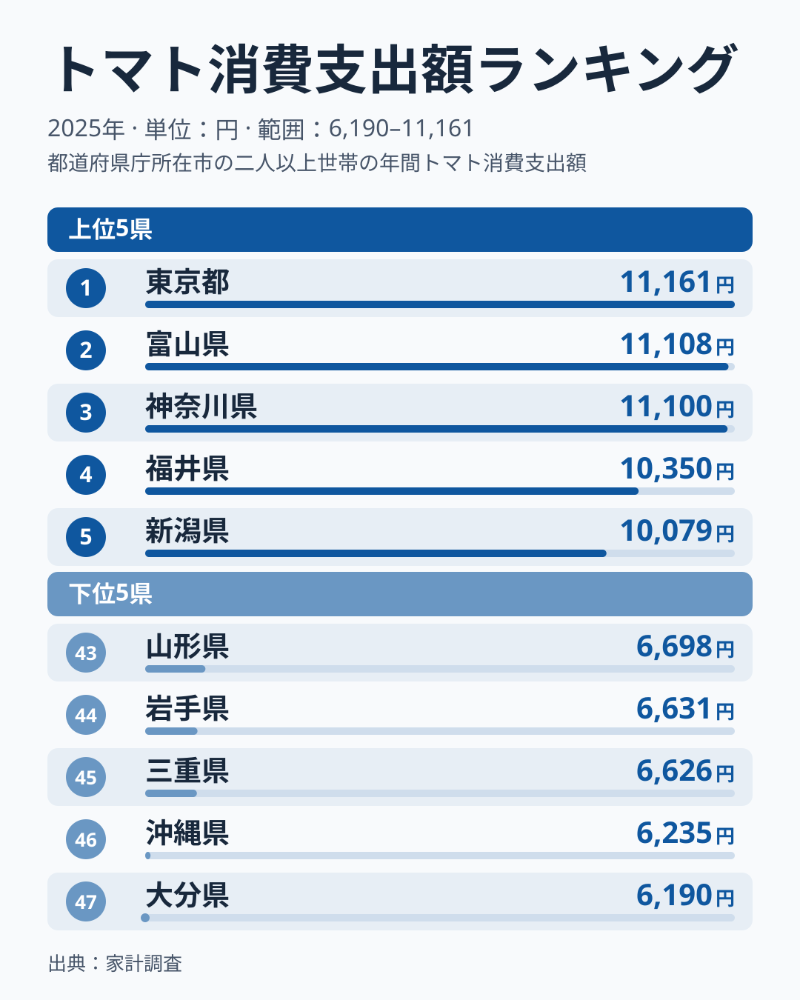
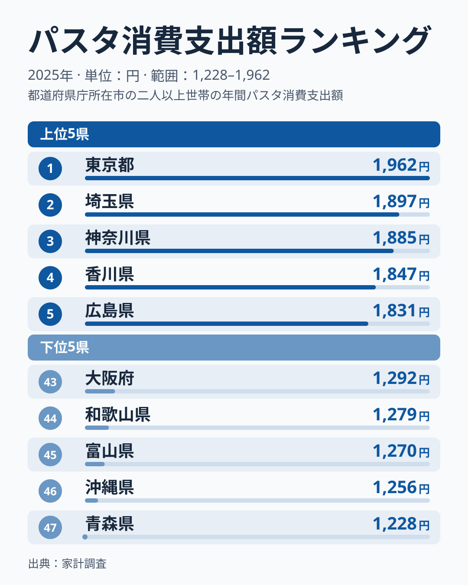
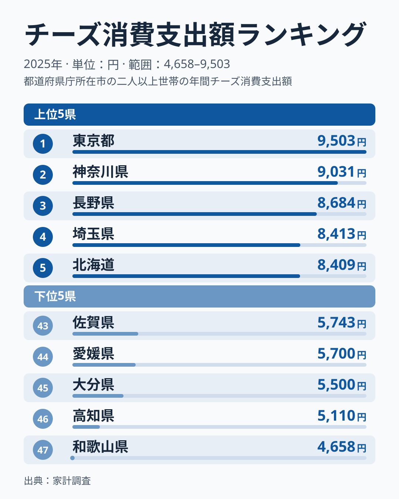
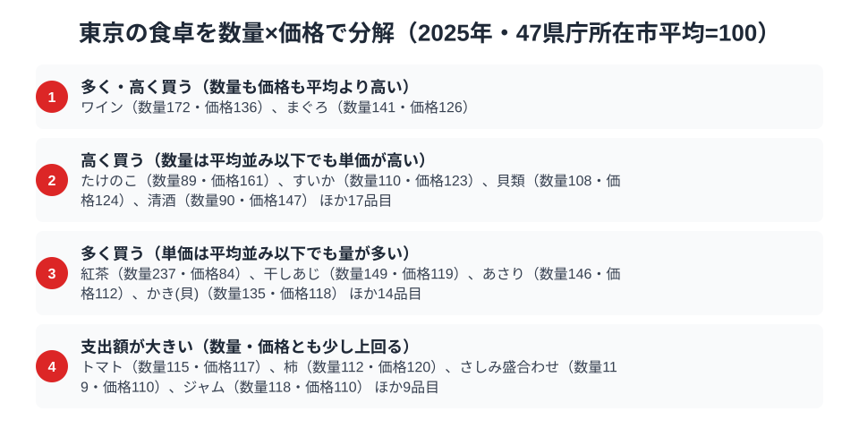

47都道府県の家計調査を見渡すと、1つの県が複数の品目で同時に全国1位になることは珍しくありません。ですが、その品目が野菜・麺類・乳製品という**性質のまったく異なる3ジャンル**にまたがるケースは多くありません。東京都はその珍しいパターンに当てはまります。

トマト消費支出額、パスタ消費支出額、チーズ消費支出額。いずれも2025年の家計調査で東京が全国1位でした。和食の定番でも郷土料理でもない、この3品目がそろって東京に集中している背景には、共働き世帯の多さと「手早く洋風」を選びやすい暮らしの構造がある、というのが本記事の[仮説]です。ただし共働き世帯のデータは本記事にはなく、単年の市別の値はぶれが大きいため、順位から構造を断定せず、数量と価格の分解で確かめていきます。

> [!NOTE]
> 本記事の数値は総務省統計局「家計調査（品目別）」2025年、二人以上世帯における年間消費支出額です。東京都の値は県全体ではなく東京都区部1市分で、他県も県庁所在市1市の単年値です。そのため、小さな差で順位が入れ替わりやすい点に注意してください。また1世帯あたりの支出額であり、購入量そのものではなく、外食や中食（総菜・弁当）の分も含みません。

## トマト消費支出額 — 上位3都県が僅差

<source-link href="/ranking/tomato-consumption-expenditure">トマト消費支出額ランキングをもっと見る</source-link>

東京は年間11,161円で全国1位でした。2位は富山県で11,108円、3位の神奈川県も11,100円と続き、上位3都県が100円以内にひしめく形です。最下位の大分県は6,190円で、東京とは1.8倍の開きがあります。

上位5県は東京・富山・神奈川・福井・新潟で、関東の2都県と中部の3県が並びました。東京と神奈川については、サラダ需要の高さと外食・中食産業の集積が背景にある、というのが[仮説]です。火を通さずそのまま食べられる野菜への需要が、単身・共働き世帯の多い都市部で根強いためです。ただし富山・福井・新潟の中部3県が上位に入る理由は、この仮説だけでは説明できません。単年の順位だけでは都市型消費か地域の食習慣かを切り分けられないため、検証には複数年の推移や世帯類型別の購入量の比較が必要です。

## パスタ消費支出額 — 麺類でも洋風が上位

<source-link href="/ranking/pasta-consumption-expenditure">パスタ消費支出額ランキングをもっと見る</source-link>

東京は年間1,962円で全国1位でした。2位は埼玉県、3位は神奈川県で、上位3位は関東の3都県が占めています。最下位の青森県は1,228円で、東京の消費額は最下位の約1.6倍です。

パスタは日本の伝統的な麺食文化（うどん・そば・ラーメン）とは異なる系統の食品です。上位5県は東京・埼玉・神奈川・香川・広島で、関東の3都県に加えて、四国の香川県と中国の広島県も入っています。トマトと同じく、上位が関東だけに固まっているわけではありません。共働き世帯にとってパスタは、茹でるだけで主菜になり調理時間を短縮できる食材です。忙しい都市生活者が「時短で満足度の高い一皿」を求める傾向が、伝統的な麺類より洋風のパスタを選ばせている可能性がありますが、香川や広島が上位に入る理由はこの仮説では説明できません。ただし本データは支出額であり、外食のパスタ（イタリアン店・カフェ）での消費は含まれていない点には注意が必要です。

## チーズ消費支出額 — 乳製品でも首位

<source-link href="/ranking/cheese-consumption-expenditure">チーズ消費支出額ランキングをもっと見る</source-link>

東京は年間9,503円で全国1位でした。2位は神奈川県、3位は長野県で、東京と神奈川の2都県が上位2位を占めています。最下位の和歌山県は4,658円で、東京との差は2.0倍あり、3品目の中では最も格差の大きいランキングです。

チーズは輸入品や高付加価値の国産品を含め、価格帯・種類ともに幅広い食品です。都市部ほど輸入食品を扱う店が多いことが支出額に影響しているかもしれませんが、本データからは確かめられません。東京ではワインも、数量・価格とも平均を上回っており（詳しくは後述）、チーズとワインが東京で併存して多く買われていることまでは確認できます。両者の関係や理由は本データからは示せず、組み合わせ需要や嗜好品への支出余力が背景にあるかどうかは、今後の検証課題です。

## 東京の食卓を貫くもの

トマト・パスタ・チーズという3品目に共通するのは、**「調理の手間が少なく、洋風の食卓に馴染む食品」**という性質です。青森や秋田のように寒冷な気候と郷土料理が支出を押し上げる[東北の食文化](/blog/aomori-food-culture)とは対照的に、東京の首位は郷土料理や産地とは結びつきにくい、というのが[仮説]です。共働き世帯の比率が高く、時短調理への需要が強い都市生活の構造が、野菜・麺類・乳製品という異なるジャンルで同じ方向に消費を押し上げている可能性があります。ただしトマトで中部の3県が上位に入るように、都市型の消費だけでは説明できない面も残ります。

これは沖縄の[食文化](/blog/okinawa-food-culture)が豚肉や独自の食材に集中するのとは異なる、「特定の食材ではなく、特定の食べ方（洋風・時短）が支出を牽引する」パターンかもしれません。東京の[地域プロフィール](/areas/13000)も合わせて確認すると、世帯構成など他の指標との関係を考える手がかりになります。

> [!TIP]
> 神奈川県は、トマトが3位、パスタが3位、チーズが2位で、3品目すべてで上位3位以内に入っています。東京単独の特殊要因というより、隣接する大都市圏の消費構造が似ている可能性を示す[仮説]です。東京だけでなく近隣県の順位も合わせて見ると、都市型消費のパターンがより鮮明になります。関心のある方は[経済カテゴリ一覧](/category/economy)から他の家計調査品目も確認してみてください。

## 数量×価格で分解する東京の食卓

<source-link href="/ranking/tomato-consumption-quantity">トマト消費量ランキングをもっと見る</source-link>

トマト・パスタ・チーズの支出額ランキングだけを見ていると、東京が1位になった理由が「たくさん食べているから」なのか「高いものを買っているから」なのかは区別できません。そこで数量と支出額の両方が取れる品目について、47県庁所在市の平均を100とした数量指数・価格指数に分解すると、東京の食卓には性質の異なる買い方が混在していることが見えてきます。

トマトは数量指数115・価格指数117で、数量と価格がそろって平均を上回る「支出額が大きい」グループに入ります。どちらか一方で首位を稼いでいるわけではなく、量と単価の積み上げです。同じグループには柿（数量112・価格120）、さしみ盛合わせ（数量119・価格110）、ジャム（数量118・価格110）も入っており、東京の食卓では「量も単価も少しずつ上回る」買い方が、トマトに限らず見られます。

一方、同じ東京でも買い方の型は品目によって分かれます。紅茶は数量237・価格84で、量の多さが支出額を押し上げる型です。清酒は数量90・価格147で、量は平均を下回るのに単価の高さが目立ちます。トマトはこのどちらでもなく、両方を少しずつ上回る型です。

パスタとチーズについては、今回の図に個別の指数が示されていないため、量と価格のどちらが主因かは本記事では判断しません。そのため「なぜ3品目で首位なのか」に、3品目すべてで答えを出せているわけではありません。

> [!TIP]
> 支出額の順位だけでは「たくさん食べている」のか「高いものを買っている」のかを見分けられません。数量指数と価格指数に分解すると、量で稼ぐ品目と単価で稼ぐ品目を切り分けられます。トマトのように、どちらも少しずつ上回って上位に立つ品目もあり、同じ首位でも中身は違います。

ここでの基準は家計調査の全国値ではなく「47都道府県庁所在市の単純平均=100」です。価格指数は支出額÷数量から算出した相対値であり、購入する品種やブランドの違いも反映するため、純粋な店頭価格の高低とは限りません。対象は二人以上世帯の年間値で、東京都は都区部の値です。

## まとめ

- トマト・パスタ・チーズの3品目で、東京は2025年の消費支出額が全国首位。トマトは上位3都県が100円以内に並ぶ接戦
- 最大と最小の差は、トマトが1.8倍、パスタが1.6倍、チーズが2.0倍で、チーズが最も大きい
- 共働き世帯の多さと「手早く洋風」の暮らしが背景にあるというのは[仮説]で、トマトで中部の3県が上位に入るなど都市型だけでは説明しきれない
- 神奈川県は3品目とも上位3位以内に入っており、隣接する大都市圏の消費構造が似ている可能性がある
- 数量×価格に分解すると、トマトは量と単価がそろって平均を上回る。パスタとチーズの主因は本記事では判断できない
