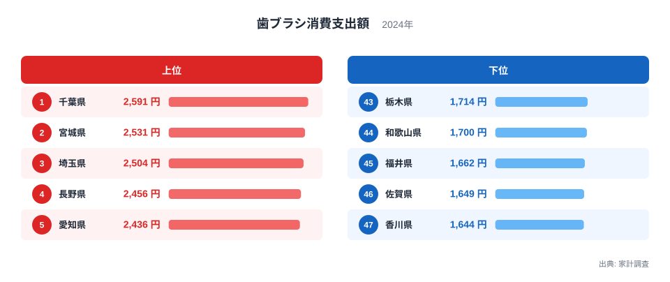
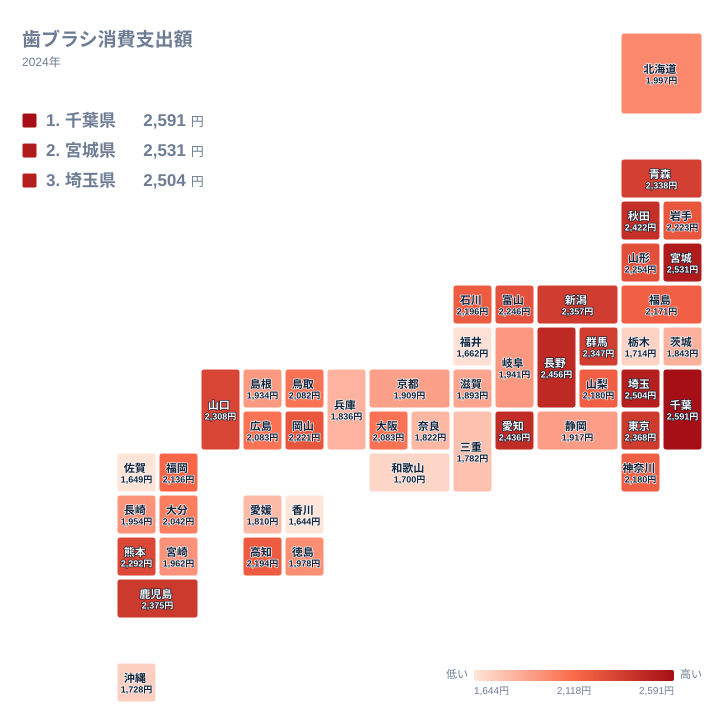

毎日使う歯ブラシにも、県ごとの支出の差があります。2024年の家計調査では、歯ブラシへの支出が最も多かったのは千葉県で2,591円でした。一方で最も少なかったのは香川県の1,644円です。安価な日用品でも、並べてみると地域の傾向が見えてきます。

この記事では、歯ブラシへの支出を都道府県別に見ていきます。上位と下位の顔ぶれ、地方ごとの広がり、関連する品目との対比を順に確かめます。

## 歯ブラシへの支出は千葉県が1位

まずは上位5県と下位5県を図で確かめましょう。

<source-link href="/ranking/toothbrush-consumption-expenditure">歯ブラシへの支出ランキングをもっと見る</source-link>

上位は、1位の千葉県が2,591円、2位の宮城県が2,531円、3位の埼玉県が2,504円です。4位は長野県で2,456円、5位は愛知県で2,436円となっています。1位から5位までの差は小さく、上位は拮抗した顔ぶれです。

下位を見ると、47位の香川県が1,644円、46位の佐賀県が1,649円です。45位の福井県は1,662円、44位の和歌山県は1,700円、43位の栃木県は1,714円でした。香川県と佐賀県はわずかな差で並んでおり、最下位争いも僅差です。

上位5県の最も低い値でも、下位5県の最も高い値を明確に上回っています。愛知県の2,436円に対して、栃木県は1,714円です。日用品の中でも、地域による開きが小さくない品目だとわかります。

詳しい地域の情報は、[千葉県のデータ](/areas/12000)と[宮城県のデータ](/areas/04000)でも確認できます。ほかの家計項目と並べたい方は、[同じカテゴリの統計一覧](/category/economy)も参考にしてください。

> [!NOTE]
> ここでの支出額は、家計調査で集計された世帯の年間の購入金額です。歯ブラシは一本あたりの値段ではありません。買う本数が多い世帯でも、高価な製品を選ぶ世帯でも、金額は大きくなります。

## 地図で見ると関東と中部、東北に上位が集まる

次に、47都道府県の位置関係を地図で見ましょう。

上位10位までを地方別に整理すると、関東が最も多くなります。千葉県、埼玉県、東京都、群馬県が入っており、順位はそれぞれ1位、3位、8位、10位です。首都圏に近い県が目立ちます。

中部では、長野県が4位、愛知県が5位、新潟県が9位です。北海道・東北では、宮城県が2位、秋田県が6位に入りました。九州・沖縄からは、鹿児島県が7位で唯一の上位です。西日本の大都市圏である大阪府は24位、福岡県は23位と、中位にとどまります。

つまり、人口が多い都市部が必ず上位に来るわけではありません。東京都は8位ですが、神奈川県は20位です。大阪府は2,083円で24位、広島県も同じ2,083円で25位でした。同額の県が並ぶ場面もあり、中位は混み合っています。

> [!TIP]
> 順位だけで県を比べると、差を大きく見すぎることがあります。中位は金額が近い県が密集しているためです。たとえば神奈川県と山梨県はどちらも2,180円で、順位だけが前後しています。順位と金額をセットで読むのがコツです。

## 食文化・気候・産地との結びつきをどう考えるか

食品や飲料なら、産地や気候との関係を語りやすいものです。ところが歯ブラシは、工業製品で全国どこでも手に入ります。特定の県でしか作れないものではないため、産地の差で説明するのは難しい品目です。

そのため、背景として考えられるのは生活習慣や購買行動です。たとえば、家族の人数が多い世帯や、買い替えの頻度が高い世帯が多い県では、支出が増えやすくなります。歯の健康への意識が高い地域や、歯科医院での購入が多い地域でも、金額は変わるでしょう。ただし、これらは推測であり、今回のデータだけで裏づけられるわけではありません。

食文化との関連も、慎重に考える必要があります。甘いものや間食の習慣が口腔ケアへの関心につながる、といった説明はよく聞かれます。しかし、この統計だけではその因果を確かめられません。東北では宮城県と秋田県が上位に入る一方、福島県は22位の2,171円です。同じ東北でも、順位はそろっていません。

気候についても同様です。寒冷地の長野県が4位、温暖な鹿児島県が7位に入っています。気温の高低では、上位の並びを説明しにくいことがわかります。結局のところ、歯ブラシへの支出は気候や産地よりも、世帯の構成や買い物の場所といった、暮らし方の違いを映していると見るほうが自然です。

> [!WARNING]
> 家計調査は、県庁所在地などを中心とした限られた世帯への調査をもとにしています。標本が小さい県では、数世帯の買い物で金額が動くことがあります。1位や47位といった順位は、県全体の実態というより、調査対象の世帯の傾向を示すものと受け止めてください。

## 関連品目との対比で見える歯ブラシの特徴

歯ブラシは、歯みがき粉や電動歯ブラシ、デンタルフロスなどの口腔ケア用品と一緒に考えると理解しやすくなります。

歯みがき粉は使い切るたびに買い足す消耗品です。電動歯ブラシは一度買えば長く使えますが、価格が高く、買う年と買わない年で支出が大きくぶれます。一方、普通の歯ブラシは安価で、買い替えの頻度が世帯ごとに異なります。本数で差がつく品目と言えます。

このように、同じ口腔ケア用品でも、支出の性格はそれぞれ違います。電動歯ブラシのような高額品は、一世帯の購入で県の平均が大きく動くことがあります。これに対して、歯ブラシは細かな買い足しの積み重ねです。比較的、日々の習慣が数字に出やすい品目だと考えられます。

下位の県を見ても、傾向は一様ではありません。香川県、佐賀県、福井県、和歌山県、栃木県は、地方も気候もばらばらです。香川県は四国、佐賀県は九州・沖縄、福井県は中部、和歌山県は近畿、栃木県は関東に属します。地域の共通点で説明できないところが、この指標の面白さです。

## 中位の県をどう読むか

上位と下位だけでなく、中位の県にも注目してみましょう。北海道は28位で1,997円、京都府は35位で1,909円、静岡県は34位で1,917円です。人口の多い県でも、順位は高くありません。

近畿では、大阪府の24位が最高で、兵庫県は38位、奈良県は39位、三重県は41位でした。近畿の中でも、順位には大きな幅があります。関東も同様で、千葉県が1位である一方、茨城県は37位、栃木県は43位です。同じ地方でも、県ごとに事情は異なります。

中国では、山口県が12位の2,308円、岡山県が17位の2,221円と比較的高めです。一方、島根県は33位で1,934円でした。四国では高知県が19位の2,194円ですが、香川県は最下位です。地方でひとくくりにして語るのは危険だと言えます。

> [!NOTE]
> 2024年のデータは、その年だけの結果です。年によって順位が入れ替わることも珍しくありません。県の特徴として決めつけず、ひとつの断面として読むことが大切です。

## データについて

この記事で使ったのは、家計調査にもとづく歯ブラシ消費支出額で、年は2024年、単位は円です。47都道府県の値を並べており、本文の金額と順位はすべてこのデータから引いています。

## まとめ

歯ブラシへの支出が最も多いのは千葉県の2,591円で、最も少ないのは香川県の1,644円でした。上位には関東、中部、東北の県が目立ちます。ただし、産地や気候で説明できるタイプの品目ではなく、世帯構成や買い物の習慣が反映されていると考えるのが妥当です。

ほかの項目でも地域差を調べたい場合は、[同じカテゴリの統計一覧](/category/economy)から探せます。身近な日用品の数字を入り口にして、暮らしの違いを見つめ直してみてください。
