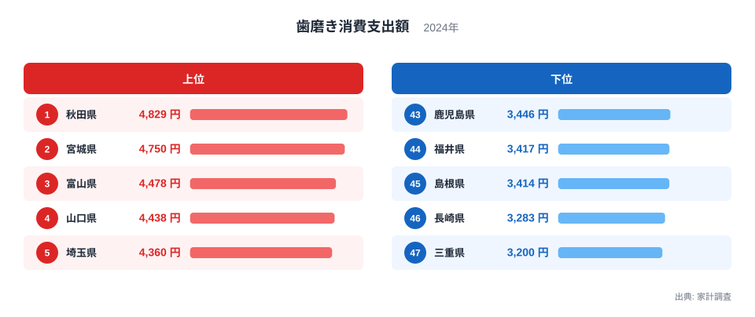
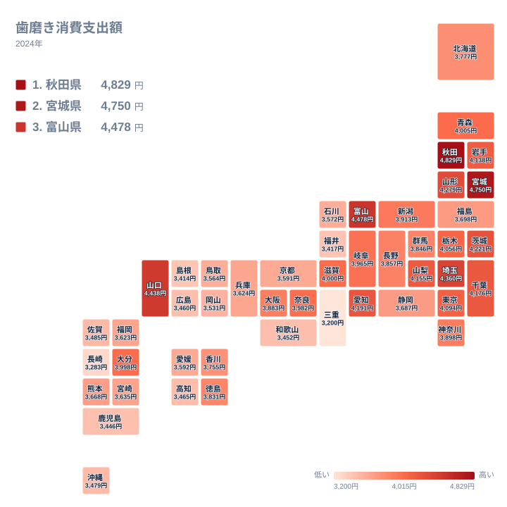

毎日のように使う歯磨き粉やその関連用品に、いちばんお金をかけている県はどこでしょうか。家計調査の2024年の結果を見ると、1位は秋田県で4,829円、2位は宮城県で4,750円でした。一方、最下位の三重県は3,200円にとどまります。生活必需品に近い品目でありながら、県によってここまで支出額が違うのは意外です。この記事では、地域の暮らしや気候、買い物の習慣と結びつけながら、差の背景として考えられる仮説を整理します。

## 上位と下位の顔ぶれ

まずは、支出額の上位と下位を図で確認します。

<source-link href="/ranking/toothpaste-consumption-expenditure">歯磨きへの支出ランキングをもっと見る</source-link>

上位には、秋田県の4,829円、宮城県の4,750円、富山県の4,478円、山口県の4,438円、埼玉県の4,360円が並びました。地方で見ると、北海道・東北が2県、中部が1県、中国が1県、関東が1県です。特定の地方に完全に偏っているわけではありませんが、1位と2位を東北の県が占めている点は目を引きます。

下位には、三重県の3,200円、長崎県の3,283円、島根県の3,414円、福井県の3,417円、鹿児島県の3,446円が入りました。本記事の地方区分では、三重県は近畿、長崎県と鹿児島県は九州・沖縄、島根県は中国、福井県は中部です。上位と同じく、下位にも明確な地域の偏りは見えにくい結果です。

つまり、歯磨きへの支出は「この地方だから高い」「この地方だから低い」と単純には言い切れない指標です。それでも、1位の秋田県の4,829円と最下位の三重県の3,200円の間には、最大で1,629円の開きがあります。ここから先は、なぜこうした差が生まれるのかを、仮説として順に考えていきます。

> [!NOTE]
> ここでの支出額は、家計調査で集計された「歯磨き」への年間の消費支出です。1世帯あたりの金額であり、1人あたりの金額ではありません。世帯の人数が多い県では支出が大きく出やすいと考えられますが、本データには世帯人数が含まれないため、確かめることはできません。

## 東北は上位から中位まで幅がある

1位の秋田県と2位の宮城県に続き、山形県は6位で4,279円、岩手県は11位で4,138円、青森県は14位で4,005円でした。一方、北海道は25位で3,777円、福島県は27位で3,698円と中位です。北海道・東北の7県は、上位から中位まで順位に幅があります。

東北の県が上位に入りやすい理由として、まず考えられるのは世帯構成です。三世代で同居する世帯や、家族の人数が比較的多い世帯では、歯磨き粉などの消費が積み重なりやすくなる可能性があります。ただし、この点は今回の実データだけで裏づけられるものではなく、あくまで仮説です。

もう一つは、買い方の習慣です。ドラッグストアの特売で複数本をまとめ買いする習慣が強い地域では、調査期間中の購入額が膨らむ可能性があります。家計調査は購入した金額を記録する調査ですから、「いつ買うか」「どれだけ買い置くか」が支出額に影響します。使用量が同じでも、買い置きの習慣によって見かけの支出は変わりえます。

秋田県と宮城県については、それぞれの詳しい数字を[秋田県のデータ](/areas/05000)と[宮城県のデータ](/areas/04000)で確認できます。ほかの統計と並べて見ると、暮らしの特徴が見えてくるはずです。

## 地理分布で見る全体像

次に、47都道府県全体の分布を地図で見てみます。

地図を眺めると、東北から関東にかけて、支出の多い県が比較的まとまっています。関東では埼玉県が5位で4,360円、茨城県が7位で4,221円、千葉県が9位で4,176円、東京都が12位で4,094円、栃木県が13位で4,056円です。神奈川県は20位で3,898円、群馬県は23位で3,846円でした。

これに対して、近畿から中国、九州にかけては、順位が下がる県が目立ちます。和歌山県は42位で3,452円、広島県は41位で3,460円、長崎県は46位で3,283円です。ただし、山口県は4位で4,438円、大分県は16位で3,998円と、西日本にも高い県はあります。沖縄県は39位で3,479円でした。

このように、大まかな傾向はあっても例外が多いのが、この指標の特徴です。気候や産地のように、品目と直結する要因が見つけにくいため、地域差は暮らしの細かな習慣が積み重なった結果である可能性があります。

> [!TIP]
> 順位が近い県どうしは金額の差も小さい点を意識すると読みやすくなります。たとえば12位の東京都は4,094円、13位の栃木県は4,056円で、順位が1つ違っても金額の差は小さい水準です。上位と下位の両端に注目し、中位は「ほぼ同じ水準」と読むのがコツです。

## 食文化や気候との結びつきは？

食品の支出であれば、郷土料理や産地、気候との結びつきを説明しやすいものです。しかし歯磨きは、地域の食材と直接つながる品目ではありません。そのため、食文化との関係は間接的に考える必要があります。

考えられる関係の一つは、食事や間食の習慣です。甘いものや間食の機会が多い暮らしでは、口腔ケアへの意識も高まりやすいかもしれません。また、冬が長く、屋内で過ごす時間が増える地域では、家でのケアにかける時間が増えることも想像できます。ただし、これらは今回の実データから確かめられる内容ではなく、読み解くための視点にとどまります。

もう一つは、商品の選び方です。同じ歯磨きでも、ホワイトニング、知覚過敏ケア、歯周病予防などの機能性をうたう商品は価格が高めです。こうした商品を選ぶ世帯が多い県ほど、支出額が上がる可能性があります。支出の差は「使う量の差」だけでなく、「選ぶ商品の差」も含みうる点を押さえておきましょう。

関連品目との対比も有効です。歯ブラシ、デンタルフロス、洗口液といった品目は、歯磨き粉と同じ口腔ケアの仲間ですが、買い替えの頻度や価格帯が異なります。歯磨き粉は使い切るたびに買い足す消耗品である一方、歯ブラシは定期的に交換する品目です。品目ごとに順位を比べると、同じ県でも口腔ケアのどこに重点を置いているかが見えてくるでしょう。

> [!WARNING]
> 家計調査は標本調査であり、都道府県別の結果は、調査対象となった世帯の数が限られます。特に歯磨きのように1回あたりの金額が小さい品目では、特定の月の買いだめなどが年間の結果に影響しやすく、順位が年によって入れ替わる可能性があります。1年分の順位を、その県の恒久的な特徴と決めつけないでください。

## 都市部と中位の県の見え方

上位と下位のほかに、中位の県にも目を向けます。愛知県は8位で4,191円、山梨県は10位で4,155円、滋賀県は15位で4,000円と、大都市圏やその周辺でも上位に入る県があります。一方、大阪府は21位で3,883円、兵庫県は31位で3,624円、福岡県は32位で3,623円、京都府は34位で3,591円です。人口の多い県だから支出が多い、あるいは少ない、とは単純には言えないことがわかります。

この結果は、地域の特徴を「都市か地方か」の二分法では説明しにくいことを示しています。買い物の習慣、世帯の構成、商品の選び方といった複数の要因が重なっている可能性がありますが、本データだけでは要因を特定できません。

同じ経済カテゴリの他の指標と合わせて見ると、家計全体の中で歯磨きがどのような位置を占めているかも見えてきます。[同じカテゴリの統計一覧](/category/economy)から、気になる品目を探してみてください。

## 数字を読むときの心構え

最後に、この統計を読むうえでの要点を整理します。

- 1位は秋田県の4,829円、2位は宮城県の4,750円、最下位は三重県の3,200円です。
- 1位と最下位の間には、最大で1,629円の開きがあります。
- 順位が近い県どうしは、金額の差も小さくなります。
- 支出額は使用量だけでなく、買い置きや商品の選択にも左右される可能性があります。

歯磨きは、誰もが毎日使うからこそ、地域の暮らしぶりが静かににじみ出る品目かもしれません。派手な地域差ではありませんが、数百円単位の違いの裏には、家族の形や買い物の習慣といった、その土地ならではの事情が隠れている可能性があります。ご自身の県の順位を確認して、普段の買い物の習慣を振り返ってみてはいかがでしょうか。

## データについて

この記事で使ったのは、家計調査の「歯磨き消費支出額」で、2024年の結果です。単位は円で、調査された世帯の支出を県ごとにまとめたものです。標本の規模に限りがあるため、県全体の姿を完全に表しているとは限りません。
