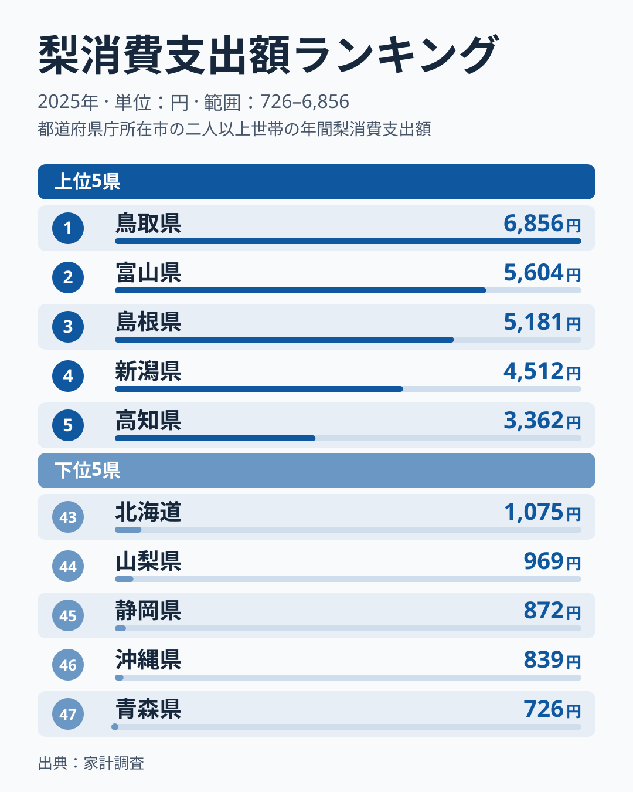
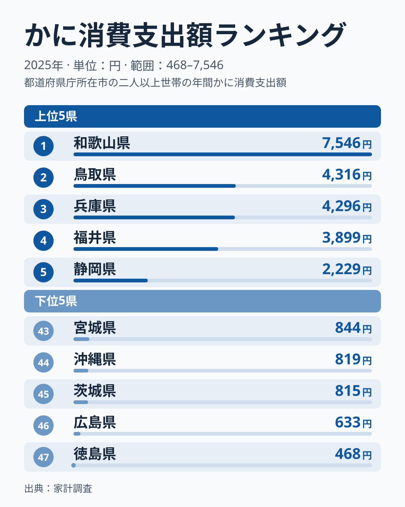
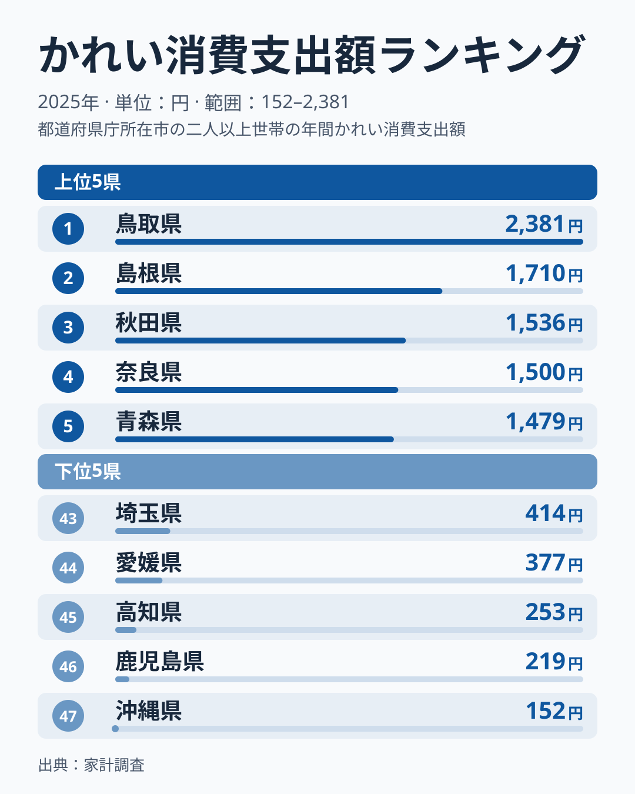
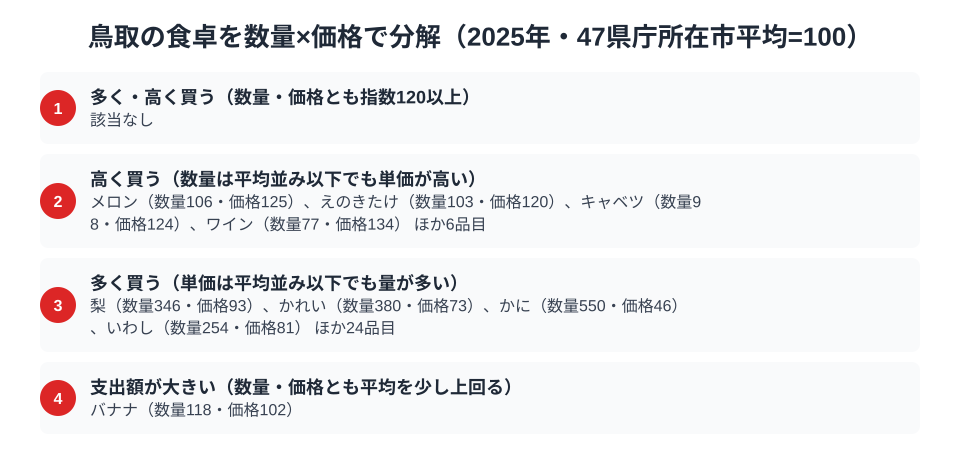

日本一人口の少ない県として知られる鳥取県ですが、食卓の豊かさは全国トップクラスです。総務省の家計調査（品目別）で鳥取市の二人以上世帯を見ると、2025年は梨とかれいの2品目で鳥取が全国1位、かには全国2位でした。

二十世紀梨、松葉ガニ、そして日本海のかれい。大地の果実と海の幸で、鳥取は食の存在感が際立つ県です。この記事では、これら3つの品目を横断しながら、鳥取県民の豊かな食卓を読み解きます。

> [!NOTE]
> 家計調査の都道府県データは、県庁所在市（鳥取県は鳥取市）の二人以上世帯を対象にした年間支出額です。県全体ではなく鳥取市在住世帯の家計簿から見た傾向であり、支出「金額」であって消費「量」そのものではない点にご注意ください。単年の順位はぶれも大きいため、背景の説明は仮説として読んでください。

## 梨 — 全国1位6,856円、二十世紀梨の郷

<source-link href="/ranking/pear-consumption-expenditure">梨消費支出額ランキングをもっと見る</source-link>

梨消費支出額は、鳥取県が6,856円で1位です。2位は富山県の5,604円、3位は島根県の5,181円で、首位が上位を引き離しています。鳥取といえば「二十世紀梨」。みずみずしく上品な甘さの青梨は、鳥取を代表する特産品であり、県のシンボルとも言える存在です。

[仮説] 鳥取では、秋になると家庭でも二十世紀梨を箱で買い求め、贈答用としてもやり取りする文化が根づいていることが、支出額の高さにつながっているのかもしれません。産地であると同時に、地元でよく食べる消費地でもあるという「産地=消費地」の一致が、梨の上位を支えている可能性があります。

## かに — 2位4,316円、首位は和歌山県

<source-link href="/ranking/crab-consumption-expenditure">かに消費支出額ランキングをもっと見る</source-link>

かにの消費支出額は、鳥取県が4,316円で2位です。1位は和歌山県の7,546円で、3位は兵庫県の4,296円、4位は福井県の3,899円でした。前年は鳥取が首位だったため、2025年は首位が入れ替わった形です。

鳥取県境港市は、松葉ガニ（ズワイガニ）の水揚げで知られる漁港です。冬になると松葉ガニ漁が解禁され、県内はかに一色になります。[かに消費支出の記事](/blog/crab-expenditure-ranking)でも扱ったように、かにの上位には複数の産地県が並びます。[仮説] 年末年始のハレの食材として、また地元で新鮮なかにが手に入る環境が、上位の支出額を支えていると考えられます。ただし単年の値は購入時期の偏りでぶれやすく、和歌山県の首位が続くかどうかは見極めが必要です。

## かれい — 全国1位2,381円、日本海の底魚

<source-link href="/ranking/flounder-consumption-expenditure">かれい消費支出額ランキングをもっと見る</source-link>

海の幸をもう一つ。かれいの消費支出額は、鳥取県が2,381円で1位です。2位は島根県の1,710円、3位は秋田県の1,536円でした。かれいは日本海の砂地に生息する底魚で、鳥取沖は好漁場として知られています。

鳥取では、かれいの煮付けや干物が家庭料理として親しまれ、地元で獲れる新鮮なかれいが食卓に日常的に上ると考えられます。松葉ガニのような華やかさはないものの、かれいのような大衆的な底魚でも1位という点に、鳥取の「日本海の海の幸への支出が全般に厚い」という食卓の性格が表れています。

> [!WARNING]
> 家計調査は支出金額の調査であり、消費量そのものではありません。物価や単価の違いも金額に影響します。特に松葉ガニのように単価の高い食材は、購入頻度が少なくても支出額が大きく出やすい点にご注意ください。

## 鳥取の食卓を貫くもの

鳥取県民の食卓を貫くのは、「大地の果実と日本海の海の幸への厚い支出」です。二十世紀梨という大地の恵み、松葉ガニという冬のハレの味覚、かれいという日常の底魚。華やかな高級食材から大衆的な魚まで、鳥取は地元でとれるものに惜しみなくお金をかけているように見えます。

人口は日本一少なくとも、食の豊かさでは全国上位というのが、数字から見える鳥取の姿です。かには首位を逃しましたが、2位と上位を保っており、3品目の中で最も差が大きいのは梨の6,856円とかれいの2,381円という金額の開きです。

高級食材（松葉ガニ）だけでなく日常の食材（かれい）の順位もあわせて見ると、その県が本当に「海の幸を日常的に食べる県」かどうかが分かります。

## 数量×価格で分解する鳥取市の食卓

<source-link href="/ranking/freshwater-clam-consumption-quantity">しじみ消費量ランキングをもっと見る</source-link>

ここまで見てきた3品目は、実は中身が一様ではありません。家計調査には支出額（円）だけでなく購入数量（g）のデータもあり、品目ごとに47都道府県庁所在市の平均を100とした指数へ直すと、「たくさん買っているのか」「単価が高いのか」を分けて読むことができます。2025年のかには数量550・価格46、かれいは数量380・価格73で、どちらも購入数量の指数が大きく、価格指数は平均を下回ります。つまりこの2品目の支出額の高さは、単価の高さではなく購入量の多さによって押し上げられています。松葉ガニというと高級食材のイメージが先行しますが、鳥取市の家計簿からは「高いものを少し買う」ではなく「地元で獲れるものをたくさん食べる」という日常の姿が浮かび上がります。いわしも数量254・価格81で同じ型に入ります。

一方、梨は数量346・価格93です。2025年は価格が平均を下回り、数量の多さが支出額を押し上げる「多く買う」型に入りました。2024年は数量318・価格131で、数量も価格も平均より高い型でした。2025年は「多く・高く買う」に該当する品目がなくなっています。反対に、メロン（数量106・価格125）、えのきたけ（数量103・価格120）、キャベツ（数量98・価格124）、ワイン（数量77・価格134）は、購入量は平均並み以下でも単価が平均を上回る品目です。[仮説] 地元で大量に生産される食材ではないぶん、流通量の少なさや輸送コストが小売価格に反映されやすいのかもしれません。同じ「支出額が多い」でも、量で稼ぐ品目と単価で稼ぐ品目があることが、数量と価格を分けて見て初めて分かります。

支出額の順位だけを見ると「かにや梨にお金をかける県」という印象で終わってしまいます。数量指数と価格指数に分解すると、かに・かれい・梨・いわしは「単価は平均並み以下でもたくさん食べている」品目だと分かり、同じ上位でも中身が違うことが見えてきます。

> [!NOTE]
> 基準となる「指数100」は、家計調査（品目別）の全国値ではなく、47都道府県庁所在市の二人以上世帯における単純平均です。価格指数は支出額を購入数量で割った金額を平均と比べた相対値であり、購入する品種やブランドの違いも反映するため、純粋な物価水準そのものではありません。数量・支出額とも、鳥取市の二人以上世帯における2025年の年間値です。

## まとめ

- 梨消費支出額は鳥取県が1位（6,856円）、2位は富山県で二十世紀梨の郷
- かには鳥取県が2位（4,316円）、1位は和歌山県（7,546円）で、前年の首位から入れ替わり
- かれいは鳥取県が1位（2,381円）、日本海の底魚を日常的に食べる食文化
- 数量×価格で見ると、かに・かれい・梨は量で支出額を押し上げる型

鳥取県の他の統計は[鳥取県の地域プロフィール](/areas/31000)、食品・家計消費の地域差は[経済カテゴリ一覧](/category/economy)からご覧いただけます。
