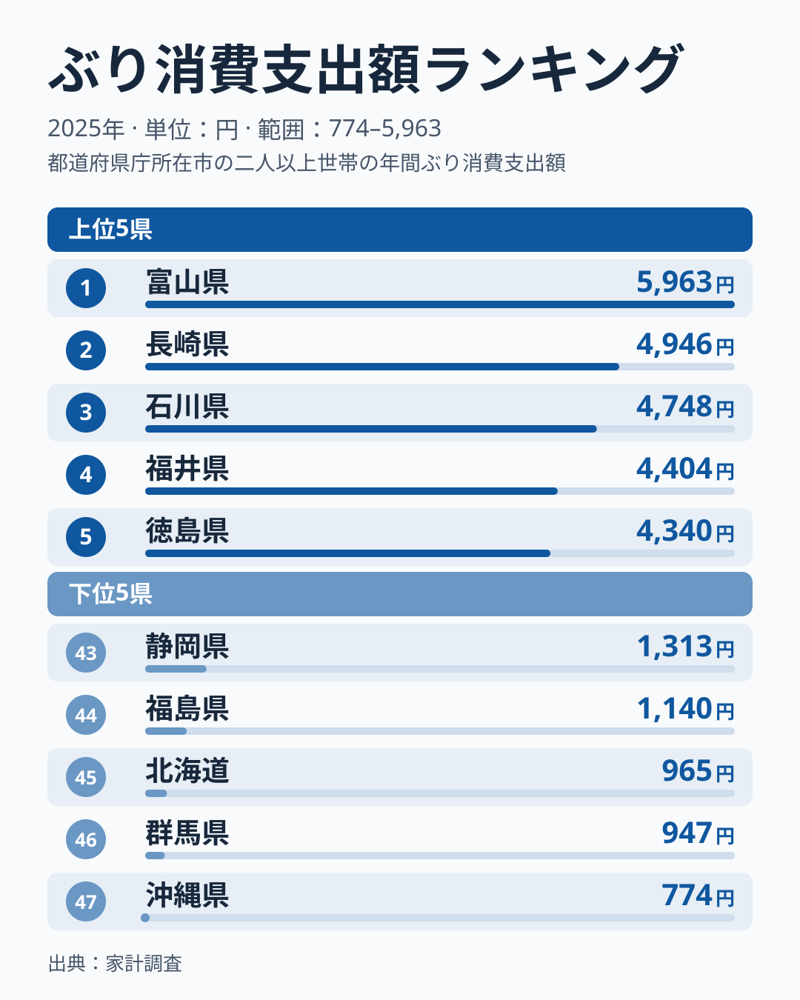
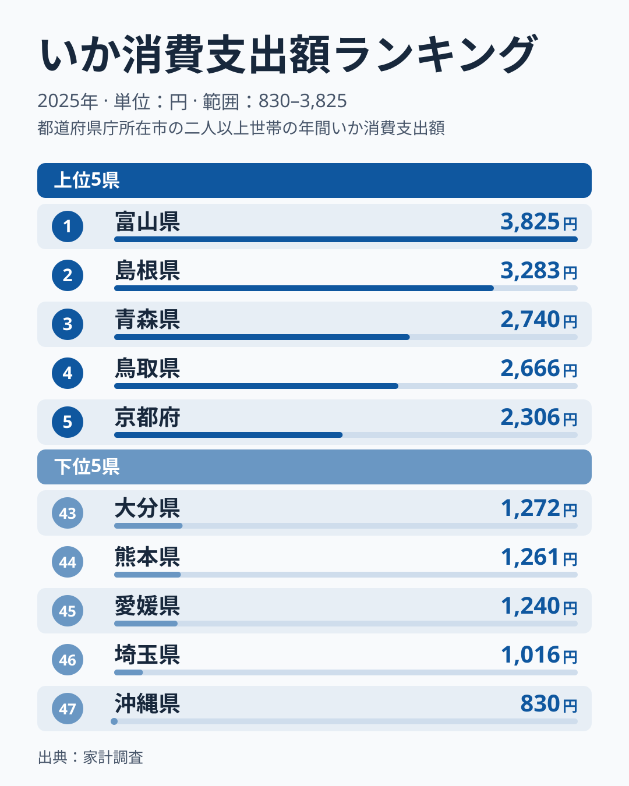
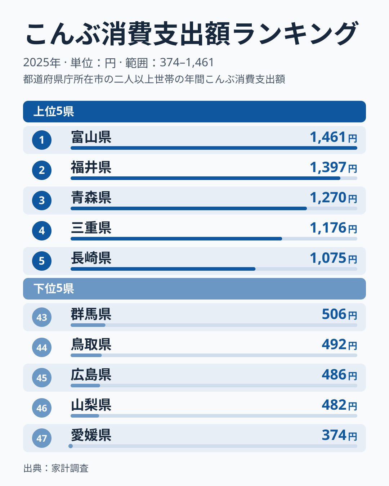
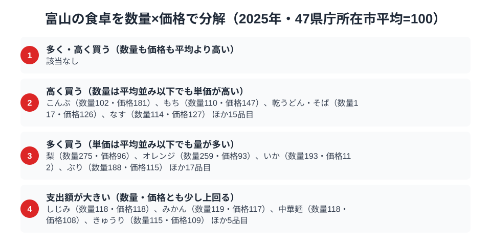

富山県は、家計調査の食品ランキングで驚くほど多くの品目が全国1位に並ぶ「食の王国」です。総務省の家計調査（品目別・2025年）で富山市の二人以上世帯を見ると、ぶり・いか・昆布という性格の異なる3つの品目で富山が全国1位に立ち、餅も福井県に次ぐ2位に入っています。

「富山湾は天然のいけす」と呼ばれるほど豊かな海の幸に恵まれ、加えて昆布や餅といった独自の食文化も色濃く残る富山。この記事では、3つの全国1位品目と惜しくも2位の餅を横断しながら、なぜ富山がこれほど「日本一だらけ」なのかを読み解きます。

> [!NOTE]
> 家計調査の都道府県データは、県庁所在市（富山県は富山市）の二人以上世帯を対象にした年間支出額です。県全体ではなく富山市在住世帯の家計簿から見た傾向であり、支出「金額」であって消費「量」そのものではない点にご注意ください。また市別の値は単年のぶれが大きく、僅差の順位は年によって入れ替わります。

## ぶり — 全国1位5,963円、富山湾の寒ぶり

<source-link href="/ranking/yellowtail-consumption-expenditure">ぶり消費支出額ランキングをもっと見る</source-link>

富山県のぶり消費支出額は5,963円で全国1位です。2位の長崎県4,946円を1,000円以上引き離す首位で、3位の石川県4,748円、4位の福井県4,404円と北陸の県が続きます。富山湾で獲れる「ひみ寒ぶり」は全国的なブランドで、脂の乗った冬の寒ぶりは富山の食文化を象徴する存在です。

富山では、年末年始に嫁ぎ先へぶりを贈る「嫁ぶり」の習慣が今も残るなど、ぶりは単なる食材を超えた特別な魚として扱われてきました。刺身・照り焼き・ぶり大根と食べ方も多彩で、冬になると一本まるごと買い求める家庭も珍しくありません。富山湾という恵まれた漁場と、ぶりを尊ぶ食文化が、全国一の支出額を支えています。

## いか — 全国1位3,825円、ホタルイカと白えびの海

<source-link href="/ranking/squid-consumption-expenditure">いか消費支出額ランキングをもっと見る</source-link>

いかの消費支出額も富山県が3,825円で全国1位です。2位の島根県3,283円を500円以上上回ります。富山湾は春になるとホタルイカが押し寄せる名所として知られ、生きたまま光るホタルイカは富山の春の風物詩です。

ホタルイカの沖漬けや酢味噌和え、素干しといった加工品まで、いかは富山の食卓に季節を通じて登場します。富山湾の深い海が育む豊かないか資源が、地元の日常的な消費を支えていると考えられます。ぶりといい、いかといい、「富山湾は天然のいけす」という表現がそのまま家計の数字に表れているのです。

## 昆布 — 全国1位1,461円、北前船が運んだ昆布文化

<source-link href="/ranking/konbu-consumption-expenditure">昆布消費支出額ランキングをもっと見る</source-link>

昆布の消費支出額も富山県が1,461円で全国1位です。ただし2位の福井県は1,397円と64円差の僅差で、3位は青森県1,270円です。富山は昆布の産地ではありませんが、江戸時代の北前船交易で北海道の昆布が富山に運ばれ、独自の昆布食文化が花開きました。

昆布〆（刺身を昆布で挟んで締める料理）、とろろ昆布のおにぎり、昆布巻きなど、富山には昆布を使った郷土料理が数多くあります。産地から遠いにもかかわらず消費が全国一という点は、北前船の寄港地だった福井県が僅差の2位に並ぶことからも、交易の歴史が食文化を定着させた好例といえます（[沖縄県の食卓](/blog/okinawa-food-culture)の昆布は9位）。

## 餅 — 3,109円で全国2位、首位の福井に迫る米どころの餅文化

<source-link href="/ranking/mochi-consumption-expenditure">餅消費支出額ランキングをもっと見る</source-link>

海の幸だけでなく、餅の消費支出額でも富山県は3,109円と上位に入りますが、順位は全国2位です。1位は福井県の3,714円で、その差は605円あります。一方で3位の岐阜県3,079円とは30円差しかなく、2位は僅差の混戦です。富山は良質な米の産地であり、餅を日常的に食べる習慣が根づいています。行事や来客のたびに餅をつく文化が残り、正月以外にも餅が食卓に上る機会が多いことが、上位の支出額につながっていると考えられます。福井県が首位に立つ理由は、このデータだけでは説明できません。[仮説]として、同じ北陸の米どころで餅を食べる習慣が近いことが考えられますが、検証には世帯の年間購入回数など別のデータが必要です。

> [!WARNING]
> 家計調査は支出金額の調査であり、消費量そのものではありません。物価や単価の違いも金額に影響します。富山のように複数の品目で全国1位が並ぶ場合でも、「支出額の順位＝食べている量の順位」と単純には読めない点にご注意ください。

## 富山の食卓を貫くもの

富山県民の食卓を貫くのは、「富山湾の海の幸」と「交易・米どころが育んだ食文化」の二本柱です。ぶり・いかは富山湾という天然の漁場が生み、昆布は北前船交易が運び、餅は米どころの伝統が支える。海の恵みと歴史・産業が重なって、3品目で全国1位、餅も全国2位という稀有な食卓が生まれています。なお福井県や石川県が、ぶり・昆布・餅の上位に並ぶことから、富山だけでなく北陸全体に共通する食文化の面もうかがえます。

高知の「黒潮のかつお特化」、宮崎の「南九州の飲みもの文化」と並べると、富山は「富山湾の海の幸＋交易・米文化の多冠型」。ひとつの県でこれほど多くの品目が全国トップ級に立つ例は珍しく、富山が日本有数の「食の豊かな県」であることが数字からも見えてきます。

> [!TIP]
> 富山の昆布のように「産地ではないのに消費が全国一」という品目は、その背後に交易や歴史が隠れています。家計調査で意外な全国1位を見つけたら、「なぜこの県で?」と産地以外の理由（北前船・行事食・地元の習慣）を探ると、その土地の食文化の奥行きが見えてきます。

## 数量×価格で分解する富山市の食卓

<source-link href="/ranking/konbu-consumption-quantity">昆布消費量ランキングをもっと見る</source-link>

支出額のランキングだけを見ると、ぶり・いか・昆布は「全国1位」、餅は「全国2位」という似た結果に並びます。しかし支出額は数量と価格のかけ算なので、47都道府県庁所在市の平均を100とした数量指数と価格指数に分解すると、品目ごとの性格の違いが見えてきます。まず、いかとぶりは数量指数がそれぞれ193.2と187.7ときわだって高く、どちらも数量でも全国2位です。価格指数は111.7と114.5で、平均を1割強上回る程度にとどまります。つまり、いかとぶりが全国1位になっているのは単価が突出して高いからではなく、平均の2倍近い量をふだんから買っているからだとわかります。富山湾で水揚げされる寒ぶりやホタルイカが手頃な値段のまま食卓に上りやすいという地の利が、そのまま数字に表れている形です。

一方、昆布と餅は量よりも単価が支出額を押し上げています。昆布の数量指数は101.7で平均並み（数量は全国16位）ですが、価格指数は181.2に達し、今回調べた家計調査の食料品目138品目のうち、紅茶に次いで2番目に高い値です。餅も数量指数110.1に対して価格指数は147.0と、量より単価の伸びが大きい形です。昆布は富山湾で獲れる魚介と違い、北海道から北前船で運ばれてきた食材なので、量が多いだけでは全国一の座は説明できません。[仮説]として、ふだん使いの安価な昆布ではなく、昆布〆に向く上質な昆布を選んで買っている可能性がありますが、購入する品種までは家計調査から分からないため、検証には別の資料が必要です。餅についても、量だけでなく単価の面での「こだわり」が支出額を押し上げている可能性があります。

> [!TIP]
> 支出額の順位だけでは、「たくさん食べているのか」「高いものを買っているのか」を区別できません。数量指数と価格指数に分解すると、いか・ぶりのように量で稼ぐ品目と、昆布・餅のように単価で稼ぐ品目に分かれることが見えてきます。気になる品目があれば、家計調査で数量と支出額の両方が公表されている品目を同じ方法で比較してみると、その土地の食文化の性格がより具体的に見えてきます。

ここでの数量指数・価格指数は、家計調査で数量と支出額の両方が公表されている食料品目について、47都道府県庁所在市の単純平均を100とした相対値です。総務省が公表する全国平均そのものではありません。また価格指数は支出額を数量で割った単価の相対値なので、購入する品種やブランドの違いも反映されており、純粋な物価水準を表すものではない点にご注意ください。数値はいずれも富山市の二人以上世帯・2025年の年間値です。

## まとめ

- ぶり消費支出額は富山県が全国1位（5,963円）、富山湾の寒ぶり文化
- いかも全国1位（3,825円）、ホタルイカに代表される富山湾の恵み
- 昆布も全国1位（1,461円）、福井県と64円差の僅差で、北前船交易が運んだ昆布〆などの食文化
- 餅は全国2位（3,109円）、首位は福井県で3,714円、米どころの餅文化
- 富山湾の海の幸と交易・米文化が重なり、3品目で全国トップ、餅も2位に入る食の王国

富山県の他の統計は[富山県の地域プロフィール](/areas/16000)、食品・家計消費の地域差は[経済カテゴリ一覧](/category/economy)からご覧いただけます。
