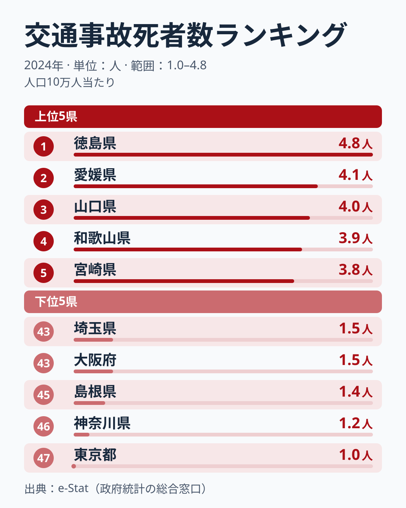
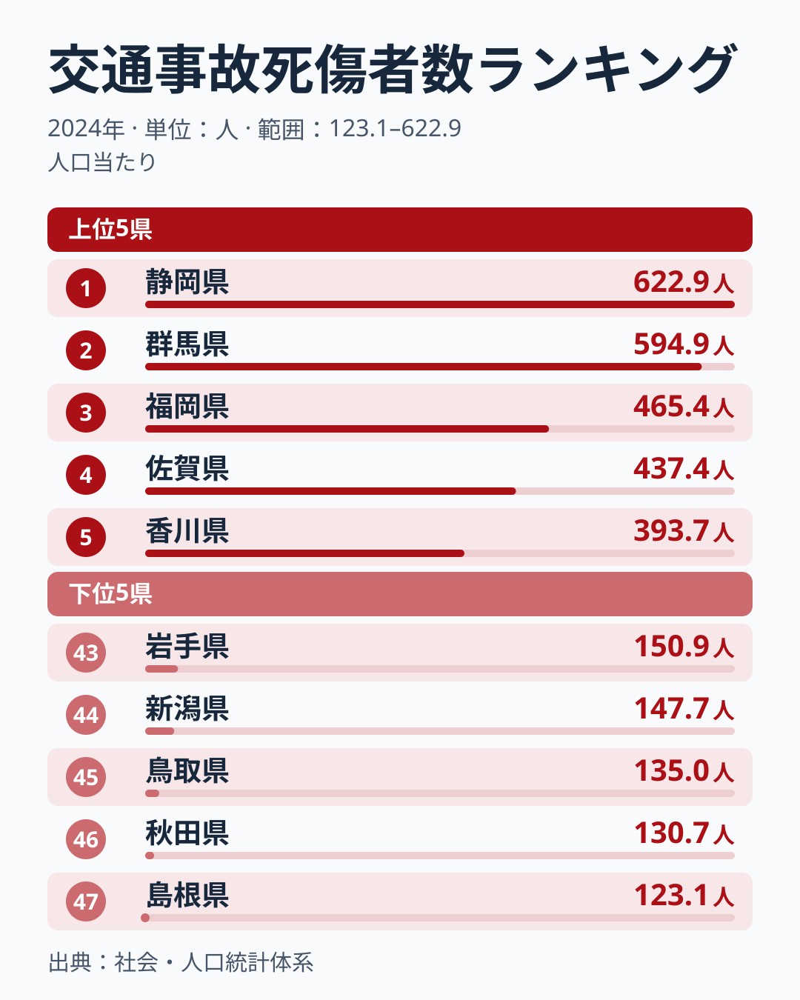
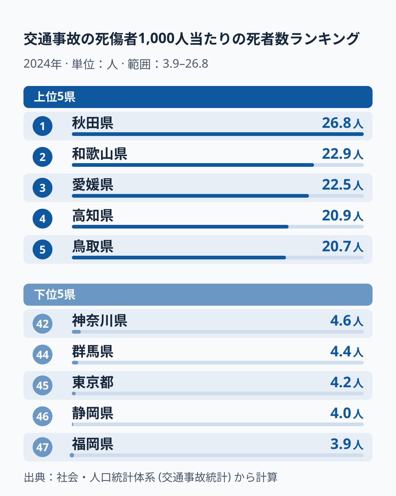
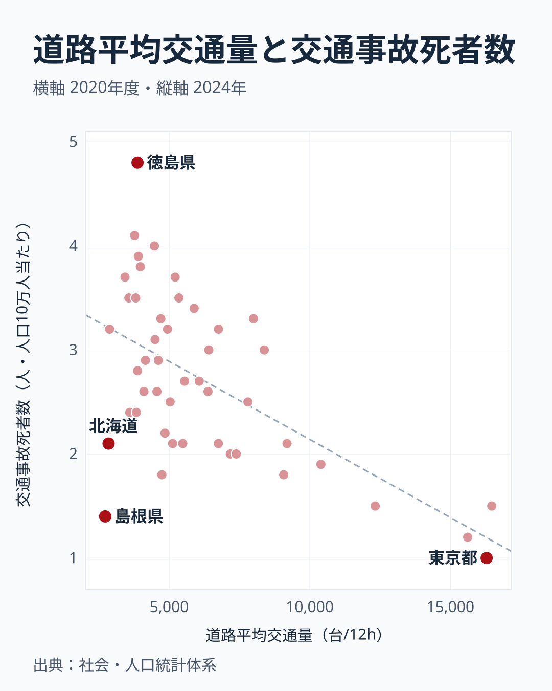
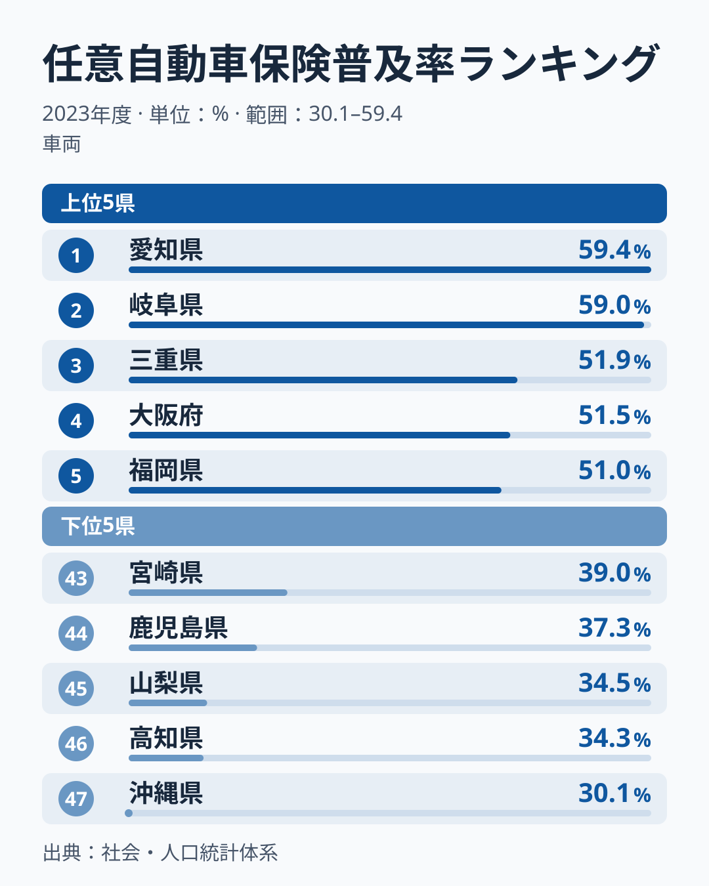

「事故が多い県は危ない県」「車社会の県ほど交通事故で亡くなる人が多い」と考える人は多いのではないでしょうか。2024年の人口10万人当たりの交通事故死者数は、最多の[徳島](/areas/36000)が4.8人、最少の[東京](/areas/13000)が1.0人で、約4.8倍の差でした。ところが、けが人を含む死傷者数では静岡が最も多く、その静岡の死者数は47都道府県の中で28位です。

この記事では、まず死者数と死傷者数の2つの地図を並べ、事故が多い県と事故で亡くなる人が多い県が別であることを確かめます。そのうえで、車社会の度合いの目安として道路の平均交通量・道路の密度・任意自動車保険の普及率の3つを取り上げ、「車社会の県ほど死者は多いか」という問いに、データで言える範囲で答えます。

## 人口当たりの死者数は徳島が最多、東京が最少

比較のものさしは、[人口10万人当たりの交通事故死者数](/ranking/traffic-accident-deaths-per-100k)です。死者の実数をそのまま並べると人口の多い都府県が上位に来てしまうので、同じ10万人の中で何人が亡くなったかにそろえます。

> [!NOTE]
> 死者数と死傷者数は、どちらも2024年の人口10万人当たりの値です (死傷者数は社会・人口統計体系の「交通事故死傷者数（人口10万人当たり）」)。分母がそろっているので、死者数を死傷者数で割ると人口が約分され、死傷者に占める死者の割合の目安になります。

<source-link href="/ranking/traffic-accident-deaths-per-100k">交通事故死者数ランキングをもっと見る</source-link>

死者数が多いのは、徳島県が4.8人、愛媛県が4.1人、山口県が4.0人、和歌山県が3.9人、宮崎県が3.8人で、四国・中国・近畿・九州の県が並びます。少ないのは、東京都が1.0人、神奈川県が1.2人、島根県が1.4人、大阪府が1.5人、埼玉県が1.5人です。47都道府県の中央値は2.7人で、徳島県は中央値の約1.8倍、東京都は約4割にあたります。

下位には東京・神奈川・大阪・埼玉と大都市圏の都府県が並びます。[仮説] 電車やバスで移動する人が多く、車で走る距離が短いことや、市街地では速度が出にくいことが、死者数を押し下げている可能性があります。ただし、この記事のデータには走行距離や速度は含まれていないので、確かめてはいません。

一方で、下から3番目に島根県が入っている点は見落とせません。島根県は大都市を持たない県ですが、死者数は1.4人と全国でも少ない側です。「大都市圏でなければ死者が多い」とは言い切れないことを、この1県が示しています。

## 死傷者数で見ると、静岡・群馬が上位に入れ替わる

次に、けが人を含めた人口10万人当たりの交通事故死傷者数を見ます。事故でけがをしたり亡くなったりした人の数なので、事故がどれだけ起きているかに近い指標です。

<source-link href="/ranking/traffic-accident-casualties-per-population">交通事故死傷者数ランキングをもっと見る</source-link>

死傷者数が多いのは、静岡県が622.9人、群馬県が594.9人、福岡県が465.4人、佐賀県が437.4人、香川県が393.7人です。少ないのは、島根県が123.1人、秋田県が130.7人、鳥取県が135人、新潟県が147.7人、岩手県が150.9人で、中央値は235.6人でした。最多の静岡県は最少の島根県の約5.1倍です。静岡県や群馬県で死傷者数が多い理由は、この記事のデータでは確かめられません。

ここで死者数の地図と比べると、上位の顔ぶれが入れ替わります。死傷者数が最も多い静岡県の死者数は2.5人で、中央値の2.7人を下回ります。群馬県の死者数も2.6人、福岡県は1.8人と少ない側です。反対に、死傷者数が46位の秋田県は、死者数では3.5人と多い側にあり、死傷者数が38位の愛媛県は死者数で4.1人と2番目に多い県です。47都道府県で死者数と死傷者数の相関係数を計算すると約−0.09で、2つの間にはほとんど関係が見られませんでした。

この食い違いは、「事故が多い県」と「事故で亡くなる人が多い県」が別であることを示しています。死傷者数の多さは主に事故の起きやすさを、死者数の多さは事故の起きやすさと、事故が起きたときに亡くなる人の割合の両方を映していると読めます。

## 死傷者に占める死者の割合が高い県

死者数を死傷者数で割ると、事故で死傷した人のうち亡くなった人の割合の目安になります。ここでは死傷者1,000人当たりの死者数として計算しました。

死傷者1,000人当たりの死者数は秋田県が26.8人で最も多く、和歌山県が22.9人、愛媛県が22.5人、高知県が20.9人、鳥取県が20.7人と続きます。反対に少ないのは福岡県の3.9人、静岡県の4.0人、東京都の4.2人、群馬県の4.4人です。秋田県と福岡県では、同じ1,000人の死傷者に対して亡くなった人の数が約7倍違います。

割合の高い県には、秋田県・高知県・鳥取県のように死傷者数の少ない県が多く入っています。ただし、この割合は分母が死傷者数なので、軽いけがの事故が多く数えられる県ほど小さく出ます。割合の高さが「事故が命に関わりやすいこと」を映しているのか、「軽い事故の数え方や起き方の違い」を映しているのかは、このデータでは分けられません。事故100件当たりの死者数は[致死率のランキング](/ranking/traffic-accident-deaths-per-100-accidents)で別に見られます。

> [!WARNING]
> 死傷者1,000人当たりの死者数は、小数1桁に丸めた人口当たりの死者数と死傷者数から計算した目安です。死者数の小さい県では丸めの影響が大きく、下位の福岡・静岡・東京・群馬の差は丸めの範囲に収まります。単年の値なので、順位の細部は年によって入れ替わる可能性があります。

## 車社会の県ほど死者は多いか — 道路の交通量で確かめる

車社会の度合いを1つで表す指標はないので、ここでは3つの目安を使います。1つ目は[道路平均交通量](/ranking/average-road-traffic-volume)（昼間12時間に道路を通る車の台数の平均、2020年度）です。「車が多く走る県」の目安になりますが、交通量が大きいのは大都市圏で、公共交通の多い地域とも重なります。

<source-link href="/ranking/average-road-traffic-volume">道路平均交通量ランキングをもっと見る</source-link>

47都道府県を並べると、道路の平均交通量が少ない県ほど死者数が多い、負の相関が見られました。相関係数は約−0.59です。交通量が最も多い大阪府の16,472台、東京都の16,289台、神奈川県の15,615台はいずれも死者数が1.5人以下で、交通量が少ない側の高知県の2,881台、青森県の3,428台、秋田県の3,566台は死者数が3.2〜3.7人と多い側にあります。

ただし外れる県もあります。交通量が最も少ない島根県の2,724台は、死者数が1.4人と全国でも少ない側です。北海道も2,844台と交通量は少ないものの、死者数は2.1人と中央値を下回ります。また、この相関は交通量の大きい大阪・東京・神奈川の3都府県が強めている面があり、大都市圏を除いた場合にどこまで残るかは確かめていません。

2つ目の目安の[道路の密度](/ranking/road-length-per-km2)（面積1km²当たりの道路実延長、2023年度）でも、道路の密度が低い県ほど死者数が多い傾向があり、相関係数は約−0.52でした。3つ目の任意自動車保険の普及率は次の節で見ます。

問いへの答えは、「車が多く走る県ほど死者が多い」とは言えず、むしろ逆だということです。車の走る量が多く道路網の密な大都市圏ほど人口当たりの死者数は少なく、道路が空いていて道路網のまばらな県ほど多い傾向があります。ただし、車社会かどうかを直接測ったわけではなく、交通量は2020年度、死者数は2024年と年もずれています。[仮説] 空いた道路で速度が出やすいことや、高齢の人口の多さなどが関わっている可能性がありますが、速度や年齢と突き合わせてはいないので、この相関を原因と読むことはできません。年齢との関係は[65歳以上人口比率](/ranking/ratio-65-plus)で県ごとに確かめられます。

## 任意保険の普及率は、死者の多い県で低いとは限らない

3つ目の目安とした任意自動車保険の普及率は、車両を対象にした2023年度の値です。

<source-link href="/ranking/private-auto-insurance-penetration-rate-vehicle">任意自動車保険普及率ランキングをもっと見る</source-link>

普及率が高いのは愛知県の59.4%、岐阜県の59.0%、三重県の51.9%、大阪府の51.5%、福岡県の51.0%です。低いのは沖縄県の30.1%、高知県の34.3%、山梨県の34.5%、鹿児島県の37.3%、宮崎県の39.0%で、最も高い愛知県と最も低い沖縄県では29.3ポイントの開きがあります。

死者数の上位の県と重ねると、普及率が低い県が目につきます。死者数が5番目に多い宮崎県は普及率が39.0%、4番目の和歌山県は39.8%、山梨県と鹿児島県はどちらも死者数が3.5人で、普及率は山梨県が34.5%、鹿児島県が37.3%です。ただし反対の例もあります。死者数が3.7人と多い岐阜県の普及率は59.0%で全国2番目に高く、死者数が1.4人と少ない島根県の普及率は39.1%と低い側です。相関係数は約−0.31で、死者数が多い県ほど普及率が低いと言えるほどの関係ではありません。

## まとめ

- 2024年の人口10万人当たりの交通事故死者数は、最多の徳島県が4.8人、最少の東京都が1.0人で、約4.8倍の差があります。
- 死傷者数では静岡県が622.9人で最多ですが、静岡県の死者数は2.5人で中央値を下回ります。死者数と死傷者数の相関係数は約−0.09で、2つの地図は大きくずれます。
- 死傷者1,000人当たりの死者数は、秋田県の26.8人から福岡県の3.9人まで約7倍の差がありますが、分母の死傷者数の数え方の違いも映している可能性があります。
- 「車社会の県ほど死者は多いか」への答えは、車の走る量で見る限り「多いとは言えず、むしろ逆」です。道路の平均交通量が少ない県ほど死者数が多く（相関係数約−0.59）、道路の密度が低い県ほど多い（約−0.52）傾向があり、交通量の多い県は大都市圏と重なります。任意保険の普及率との関係は弱く、どれも原因までは示しません。

自分の県が死者数と死傷者数のどちらで上位にあるか、道路の交通量でどの位置にあるかを見比べると、「事故が多い県」なのか「事故で亡くなる人が多い県」なのかが見えてきます。
