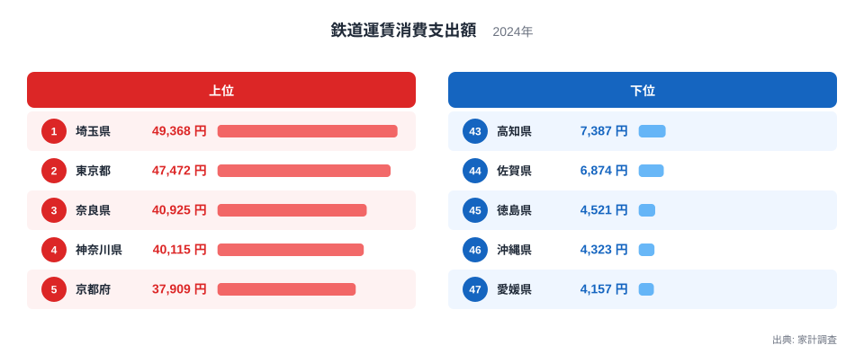
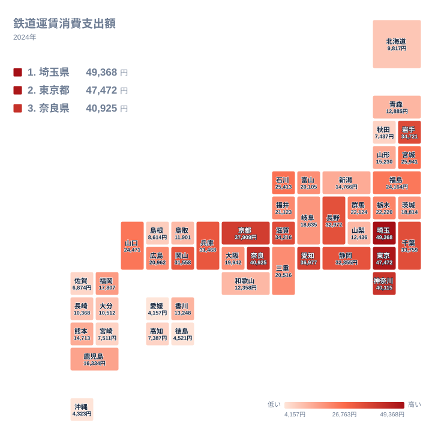

毎日の通勤や通学で、電車に乗る人と車に乗る人とでは、家計に占める交通費の姿が大きく変わります。同じ日本に暮らしていても、鉄道運賃への支出が多い県と少ない県では、暮らしの組み立て方そのものが違っていそうです。

2024年の家計調査によると、鉄道運賃への支出が最も多いのは埼玉県で、49,368円でした。いちばん少ないのは愛媛県で、4,157円です。この記事では、実データの値と順位を手がかりに、県ごとの違いを暮らしや街の成り立ちとの結びつきから読み解きます。

## 鉄道運賃への支出の上位と下位

まず、上位5県と下位5県を図で確認します。

<source-link href="/ranking/train-fare-consumption-expenditure">鉄道運賃への支出ランキングをもっと見る</source-link>

1位は埼玉県で49,368円、2位は東京都で47,472円です。3位は奈良県で40,925円、4位は神奈川県で40,115円、5位は京都府で37,909円となっています。上位5県のうち、埼玉県、東京都、神奈川県の3つは関東に属し、残る奈良県と京都府は近畿です。大都市とその周辺に、支出の多い県が集まっています。

一方、下位は47位が愛媛県で4,157円、46位が沖縄県で4,323円、45位が徳島県で4,521円です。44位は佐賀県で6,874円、43位は高知県で7,387円でした。下位5県は、四国の3県と九州・沖縄の2県という顔ぶれです。鉄道以外の移動手段が暮らしの中心になっている県が多いのではないかと推測できますが、この統計だけでは移動手段までは確認できません。

最大の埼玉県と最小の愛媛県を比べると、支出額には約11.9倍の開きがあります。この倍率は、乗車回数の差だけで決まるものではありません。運賃の水準、定期券の使い方、通勤圏の広がりなどが重なった結果と考えるのが妥当です。

> [!NOTE]
> この指標は家計調査の「鉄道運賃消費支出額」で、1世帯が1年間に鉄道運賃として支払った金額を表します。人口や乗客数の多さを示す数字ではなく、世帯あたりの支出額です。そのため、人口の大きい県が自動的に上位になるわけではありません。

## 首都圏と近畿の周辺県が上位に並ぶ

上位の顔ぶれを見ると、東京都に隣接する埼玉県、神奈川県、千葉県が目立ちます。千葉県は9位で33,759円でした。東京都心へ通う人が多い県では、定期券代が家計の中で大きな割合を占める可能性があります。

注目したいのは、1位が埼玉県で、東京都は2位という点です。東京都は鉄道網が密で、電車や地下鉄が生活の足になっています。それでも、埼玉県のほうが1世帯あたりの支出は大きくなりました。この順位から言えるのは、東京都に隣接する県の支出が東京都を上回ったという事実までです。その理由として、通勤にかかる運賃が関わっている可能性はありますが、通勤距離のデータはないため断定はできません。

近畿でも似た構図が見えます。奈良県は3位で40,925円、京都府は5位で37,909円、滋賀県は8位で34,216円、兵庫県は13位で31,468円でした。ところが、大阪府は24位で19,942円にとどまります。近畿の中心にある大阪府より、周辺の県のほうが上位に来ているのです。周辺の県から大阪府や京都府へ通う人の多さが、こうした順位に関わっているのかもしれません。

> [!TIP]
> 鉄道運賃の支出は、「鉄道網の充実度」をそのまま映す数字ではありません。大都市の中心部より、隣接する県が上位に来やすい点に注目すると、読み解きやすくなります。通勤距離の長さが関わっている可能性はありますが、この統計だけでは確かめられないため、仮説として受け止めてください。

東京都や埼玉県の詳しい統計は、[東京都のデータ](/areas/13000)や[埼玉県のデータ](/areas/11000)で確認できます。

## 地理分布で見る鉄道運賃への支出

次に、47都道府県の分布を地図で見てみます。

地図で眺めると、関東から近畿にかけての地域に、支出の多い県がまとまっています。埼玉県、東京都、神奈川県、千葉県の関東の4県は、いずれも9位以内です。近畿では、奈良県、京都府、滋賀県が8位以内に入っています。

中部では、愛知県が6位で36,977円、長野県が10位で32,972円、静岡県が11位で32,355円でした。長野県や静岡県は自動車のイメージが強い県ですが、上位に入っています。通勤や通学のほか、旅行や出張といった長距離の利用が含まれている可能性もありますが、内訳は分かりません。

東北では、岩手県が7位で34,721円と、地方の県としては際立って高い値でした。同じ東北の宮城県は14位で25,941円、秋田県は42位で7,437円です。岩手県の高さには新幹線や在来線の利用のされ方が関わっているのかもしれませんが、この統計だけでは理由を断定できません。

> [!WARNING]
> 家計調査は、限られた数の世帯を対象にした標本調査です。県単位で見ると、調査に含まれる世帯が少なく、年ごとの値が大きく動くことがあります。岩手県のように意外な順位が出たときは、1年分の数字だけで結論を急がないことが大切です。

## 下位の県と車関連の支出

下位の県では、鉄道運賃への支出が小さくなっています。愛媛県は4,157円、沖縄県は4,323円、徳島県は4,521円です。四国の4県で見ると、香川県が32位で13,248円、高知県が43位、徳島県が45位、愛媛県が47位と、すべて32位以下に並びました。

北海道は39位で9,817円です。九州では、福岡県が27位で17,807円と比較的高めで、佐賀県の44位や宮崎県の41位とは大きな差があります。福岡県のような中心都市を持つ県と、そうでない県とのあいだに、鉄道の使われ方の違いがあるのかもしれません。

関連する品目との対比として、鉄道運賃は自動車関係費やガソリン代と、家計の中で補い合う関係にある可能性があります。鉄道への支出が小さい県では、車に使う金額が大きいことも考えられます。ただし、この記事は鉄道運賃のデータしか扱っておらず、車関連の支出は確認していません。関連する指標は、[同じカテゴリの統計一覧](/category/economy)から探してみてください。

## 中位の県に見る関東内・近畿内の差

中位の県では、羅列を避けて、比較できる組み合わせに絞って見ます。

ひとつ目は、栃木県と群馬県です。栃木県は18位で22,220円、群馬県は19位で22,124円と、ほぼ並んでいます。隣り合う北関東の2県が、似た水準にあることが分かります。

ふたつ目は、関東の内部の差です。千葉県は9位で33,759円なのに対し、茨城県は25位で18,814円でした。同じ関東でも、16位もの順位差があります。東京都との位置関係や、鉄道の使われ方が県ごとに違う可能性を示しています。

三つ目は、近畿の内部の差です。同じ近畿でも、奈良県の3位と和歌山県の35位では大きな隔たりがあります。なお、三重県は22位で20,516円でした。

中部では、石川県が15位で25,413円、福井県が20位で21,123円、富山県が23位で20,105円と、北側の県が中位に並びます。一方で、新潟県は30位で14,766円、山梨県は34位で12,436円と、順位が下がります。大都市圏を持つ愛知県の6位との間には、同じ中部でも大きな幅があります。

## データについて

この記事で使ったのは、家計調査の2024年のデータです。指標の正式な名称は「鉄道運賃消費支出額」で、単位は円です。1世帯あたりの1年間の支出額を、都道府県ごとに並べたものです。

数字を読むときは、次の点に注意してください。

- 標本調査の結果なので、県によっては年ごとの変動が大きくなります
- 通勤定期のほか、出張や旅行での鉄道利用が含まれている可能性があります
- 支出額から、通勤距離や車の保有状況を直接読み取ることはできません

## まとめ

鉄道運賃への支出は、埼玉県の49,368円から愛媛県の4,157円まで、大きな開きがありました。上位には関東と近畿の県が並び、下位には四国と九州・沖縄の県が目立ちます。

特に、東京都より埼玉県が上位に来ている点は、大都市の隣接県の支出が大きいことを示しています。ただし、その理由は統計だけでは断定できません。自分の住む県の順位を手がかりに、日々の移動の姿を振り返ってみてはいかがでしょうか。
