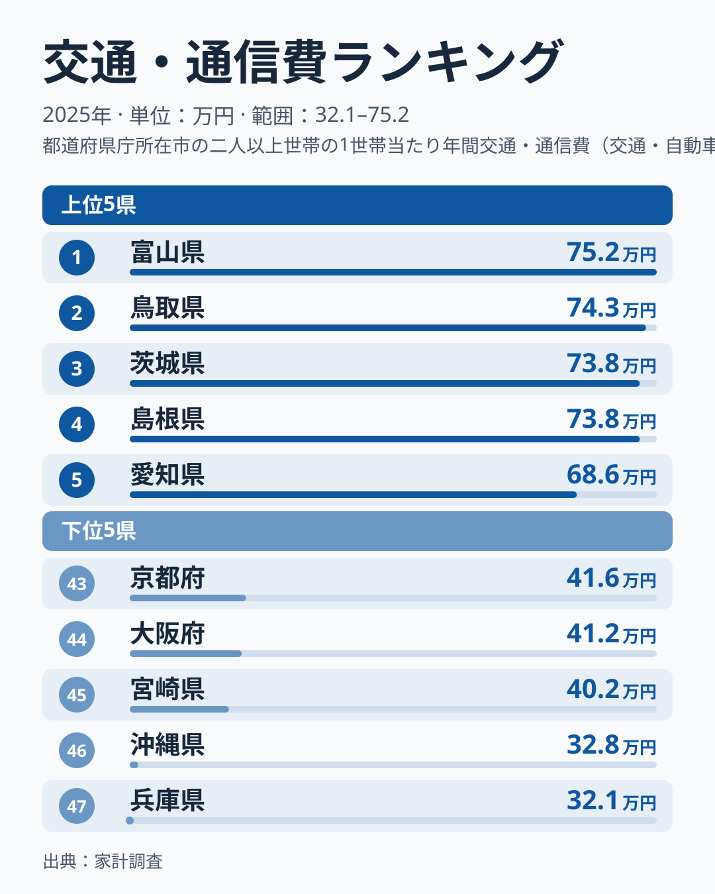
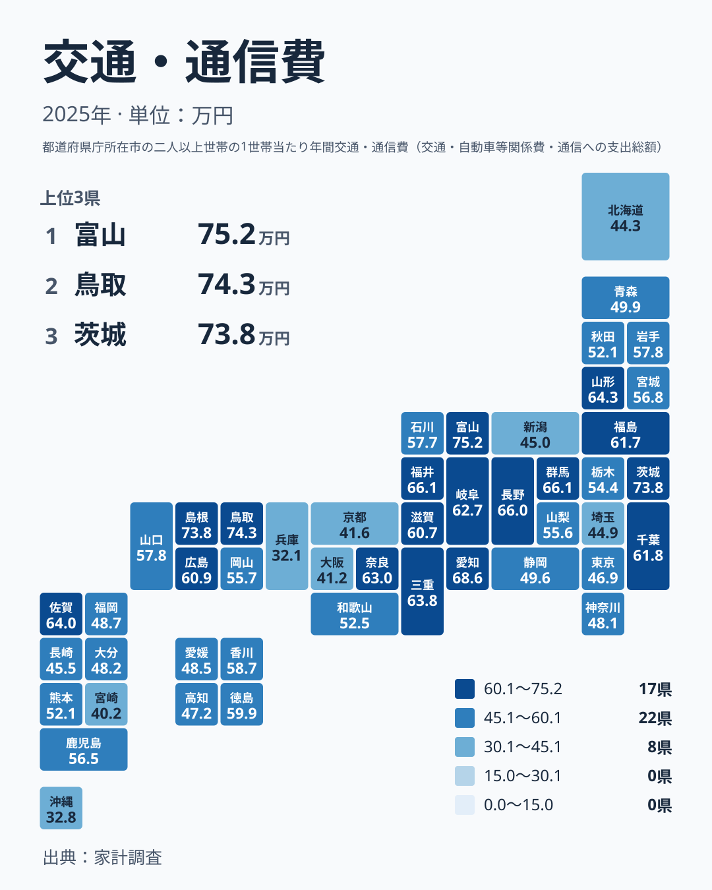

車の維持費、スマートフォンの料金、電車やバスの運賃。毎月の家計から出ていくこれらの支出は、住む場所によって大きく変わります。2025年の家計調査で、1世帯あたりの年間の交通・通信費を都道府県別に見ると、最も多い富山県は751,729円、最も少ない兵庫県は320,847円でした。富山県は兵庫県の約2.3倍です。

この記事では、金額の大きい県と小さい県を並べ、なぜこれほど差が出るのかを暮らしの視点から考えます。内訳のデータはないため、理由の部分は仮説として扱います。

## 上位と下位の顔ぶれ

まず、上位5県と下位5県を図で確認します。

<source-link href="/ranking/transport-communication-expenditure-total">交通・通信費ランキングをもっと見る</source-link>

図で目を引くのは、上位の集団のまとまりです。1位の富山県751,729円、2位の鳥取県742,986円、3位の茨城県737,857円、4位の島根県737,836円は、4県がほぼ同じ水準に並んでいます。とくに3位の茨城県と4位の島根県は21円差で、実質的に同水準と見てよい近さです。5位の愛知県は686,404円で、4位との間に段差があります。

下位は様子が違います。47位の兵庫県320,847円と46位の沖縄県327,788円は、45位の宮崎県401,807円から大きく離れています。下位は5県が緩やかに連なるのではなく、最下位の2県だけが切り離されている形です。

上位は「4県の高原」、下位は「2県の底」。この非対称が、全体の差を約2.3倍まで広げています。富山県の詳しいデータは[富山県のデータ](/areas/16000)、鳥取県は[鳥取県のデータ](/areas/31000)で確認できます。

> [!NOTE]
> ここでの交通・通信費は、家計調査で集計される1世帯あたりの年間支出です。交通費と通信費の合計で、自動車の購入費、ガソリン代、維持費も含まれます。通信費だけの比較ではありません。

## 地図で見る分布

次に、地理的な広がりを見ます。

上位10県を順位順に挙げると、富山県、鳥取県、茨城県、島根県、愛知県、福井県、群馬県、長野県、山形県、佐賀県です。地方別では中部が富山県、愛知県、福井県、長野県の4県、中国地方が鳥取県と島根県の2県、関東が茨城県と群馬県の2県です。残りは山形県(北海道・東北)と佐賀県(九州・沖縄)で、大都市圏の中心ではない県が多く並びます。

一方、人口の多い都市部は中位から下位にいます。神奈川県は36位、東京都は38位、埼玉県は41位、大阪府は44位です。同じ関東でも、茨城県は3位、東京都は38位と大きく離れます。地方という大きな枠より、県ごとの事情を見るほうが実態に合いそうです。

ここから立てられる仮説は、移動手段の違いです。日常の移動に自家用車が欠かせない地域では、車の購入や維持にかかる支出が膨らみ、鉄道網が密な地域では少なくて済むのではないか、という見方です。ただし、この記事の材料には自動車関係費や運賃の内訳がなく、仮説を直接確かめることはできません。

> [!TIP]
> 合計値の順位を読むときは、「通信費が高い県」と決めつけず、車の購入・維持費が効いている可能性を頭に置いてください。内訳が分かる別の統計と組み合わせると、仮説の当たり外れを確かめられます。

## 暮らしへの含意

仮説が当たっているなら、上位の県では交通・通信費が通勤、買い物、通院といった生活の基本動作に結びついた支出になっている可能性があります。そうした支出は、家計が厳しくなっても簡単には減らしにくいかもしれません。

下位の兵庫県、京都府、大阪府は鉄道網が発達した地域として知られており、車に頼らない暮らしが成り立ちやすいことが、低い金額の一因かもしれません。ただし、支出が少ないことをそのまま節約の成果と見るのも、暮らしの仕組みの違いとだけ見るのも、データからは言い切れません。

沖縄県は46位で327,788円と、全国でも極めて低い水準です。兵庫県と並んで他の県から離れており、独自の事情がある可能性がありますが、今回のデータだけでは理由を示せません。

引っ越しや住み替えを考える場合は、住居費と交通・通信費をセットで比べるのが現実的です。車を前提とする地域と、鉄道中心の地域とでは、家計の中で重みのかかる項目が入れ替わることがあります。ほかの統計は[同じカテゴリの統計一覧](/category/economy)から探せます。

> [!WARNING]
> 交通・通信費には自動車の購入費が含まれます。車の買い替えは数年に一度で金額が大きく、買い替えた世帯が多い年は県の平均が跳ね上がり、少ない年は下がります。そのため、1年分の順位は年ごとに上下しやすく、順位の小さな差を県の恒常的な特徴と読むのは危険です。

## 順位の近い県をどう読むか

中位は金額が密集しています。20位の岩手県は578,261円、21位の山口県は577,516円、22位の石川県は577,188円で、3県の差はごくわずかです。25位の岡山県は557,396円、26位の山梨県は556,222円で、真ん中あたりもほぼ同じ水準です。

こうした密集帯では、順位が一つ違っても意味のある差とは言えません。車の購入が年ごとの金額を左右することを考えると、なおさらです。順位よりも、上位の高原、中位の密集帯、下位の底という金額のまとまりで見るほうが、実態に近づきます。

自分の世帯の支出を見直すときも、住む県の平均は目安にとどまります。通信プランや車の台数の見直しが効くかどうかは、世帯ごとの事情によって変わります。

## データについて

この記事の数値は、家計調査の「交通・通信費」(2025年、単位は円)です。1世帯あたりの年間支出額を都道府県別に並べており、順位は金額の大きい順、全47件が対象です。倍率は1位の富山県751,729円と47位の兵庫県320,847円の比で、約2.3倍です。

自動車関係費、通信費、公共交通の運賃といった内訳は、今回の材料に含まれていません。車社会との関係は、地域の暮らしを踏まえた仮説であり、データから直接示された結論ではありません。内訳を分けて見ることで、真因にさらに近づけるでしょう。

## まとめ

交通・通信費は、1位の富山県が751,729円、47位の兵庫県が320,847円で、約2.3倍の開きがありました。上位は富山県、鳥取県、茨城県、島根県が近い水準で並び、下位は兵庫県と沖縄県が他から離れています。

この差には、移動手段や暮らし方の違いが関わっているという仮説が立てられます。ただし、内訳がないため断定はできません。数字を見るときは、順位だけでなく金額のまとまりと、車の購入による年ごとの変動を合わせて読むことが大切です。
