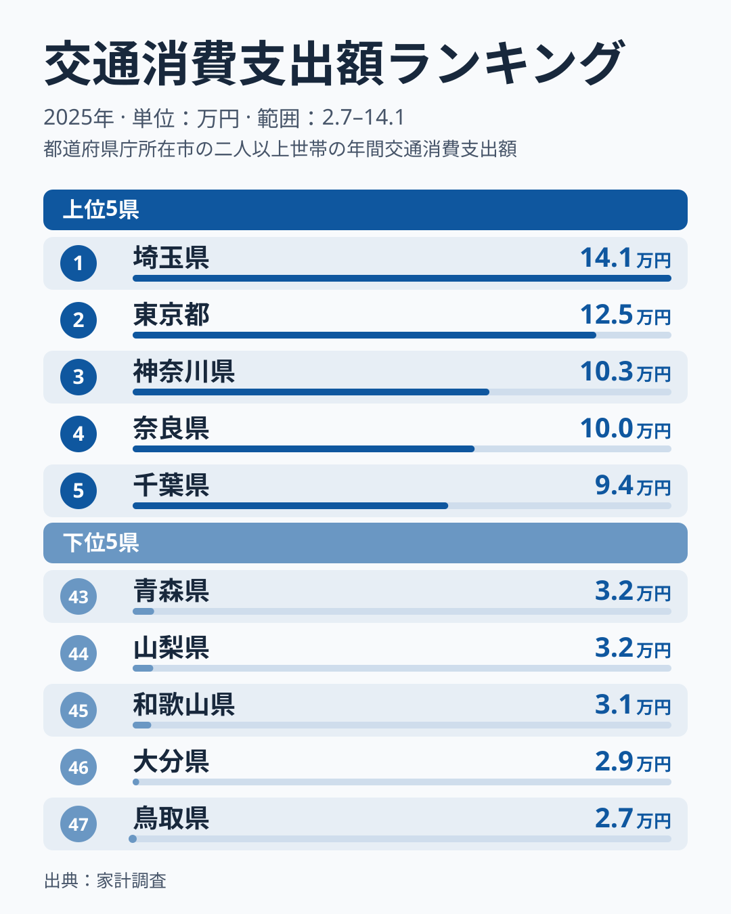
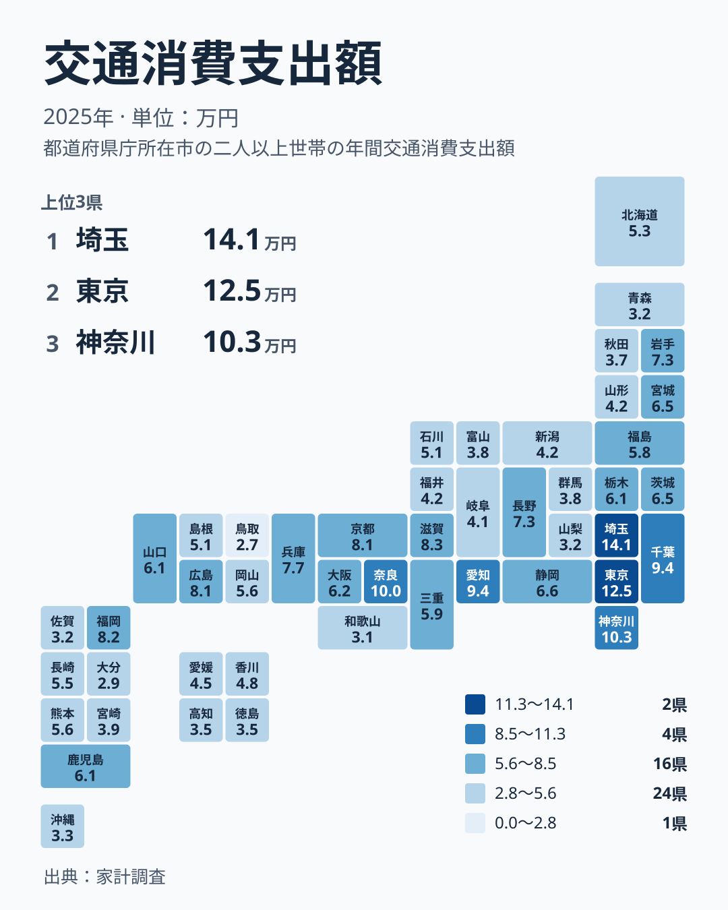

## 1位の埼玉県と47位の鳥取県を比べる

毎月の家計のなかで、移動にかかるお金は地域によって大きく姿を変えます。2025年の家計調査で交通への支出を見ると、最も多いのは埼玉県の141,063円です。最も少ないのは鳥取県の27,346円で、1位と47位の間には約5.2倍の開きがあります。

埼玉県は全国1位、鳥取県は47位で、順位の両端に位置します。埼玉県の金額は、全国で2位の東京都の125,206円よりも大きく、1位だけが突き出ている形です。一方の鳥取県は、46位の大分県の28,721円よりもさらに低い値です。この記事では、この両端を軸に、交通への支出がどのように分布しているのかを生活の側から整理します。

まず上位5県と下位5県を図で確認します。

<source-link href="/ranking/transportation-group-consumption-expenditure">交通への支出ランキングをもっと見る</source-link>

上位5県は、埼玉県、東京都、神奈川県、奈良県、千葉県の順です。このうち埼玉県、東京都、神奈川県、千葉県は関東、奈良県は近畿に属します。つまり上位5県のうち4県が関東で、その間に近畿の奈良県が4位として入っています。

上位は県ごとの差が大きく、1位から2位、2位から3位のあいだでは金額が1万円以上、2万円以上と大きく離れていきます。これに対して下位5県は、鳥取県、大分県、和歌山県、山梨県、青森県で、いずれも3万円前後に固まっています。上位は差が大きく、下位は密集している点が、図から読み取れる分布の特徴です。

> [!NOTE]
> この記事の交通への支出は、家計調査の交通消費支出額で、単位は円です。この記事で扱う範囲では、公共交通の運賃や自動車関連の費用など、中身の内訳までは確認できません。金額の大小から、何に使ったのかを特定することはできない点に注意してください。

## 上位は埼玉県と東京都が抜け、下位は密集する

上位と下位を並べると、分布の形が違うことに気づきます。上位は1位の埼玉県が突出し、東京都、神奈川県と続くあいだに大きな段差があります。下位は43位の青森県から47位の鳥取県までが狭い範囲に収まり、順位が一つ違っても金額はほとんど変わりません。

この形から言えるのは、上位ほど順位が一つ違うだけで金額が大きく変わる一方、下位では順位の違いが家計の差としては小さい、ということです。たとえば下位の順位だけを見て「差が大きい」と感じても、実際の金額差はわずかです。順位は並び順を示すだけで、差の大きさは金額で確かめる必要があります。

なお、交通への支出が高い理由は、このデータだけでは断定できません。大都市圏では鉄道やバスなど公共交通を使う機会が多く、地方部では自家用車に頼る場面が多いと、一般には説明されます。ただしこの記事の数字は内訳を含まないため、各県の高さがどちらの要因によるのかは、仮説としてしか語れません。

> [!TIP]
> 読むときは、まずこの数字が2025年の1年分であることを意識してください。自動車の購入のように数年に一度の出費が重なる年は、金額が押し上げられる可能性があります。1年だけの値で、その県が恒常的に高いか低いかは決められません。

## 地図で見る地方ごとのばらつき

地理的な広がりも見ておきましょう。次の図は、交通への支出を都道府県のタイルマップに表したものです。

関東は、埼玉県が1位、東京都が2位、神奈川県が3位、千葉県が5位と上位に集中する一方、群馬県は37位です。同じ関東の中でも、上位から下位寄りまで幅があります。近畿も同様で、奈良県が4位、滋賀県が7位と高い一方、和歌山県は45位です。近畿のなかで4位から45位までと、地方内の開きが大きい点が目立ちます。

九州・沖縄でも、福岡県が8位に入る一方、大分県は46位、佐賀県は42位、沖縄県は41位と下位に並びます。中国は広島県が10位、鳥取県が47位で、同じ地方の中に上位と最下位が同居します。つまり、地方ごとにひとくくりにして高い低いを語るのは難しく、県単位で見る必要があります。

また、関東や近畿の一部の県が上位に入る一方で、岩手県が12位、長野県が13位に入っていることも注目点です。大都市圏に属さない県でも、上位に位置する例があります。理由はこのデータだけでは判断できませんが、地域の広さや車の使い方、年ごとの支出の偏りなど、複数の要因が重なる可能性はあります。ただしこれは仮説にとどまります。

> [!WARNING]
> 家計調査は、一部の世帯を対象にした標本調査です。対象世帯の数が限られるため、車の購入のように金額が大きい支出があると、県の平均値が大きく動くことがあります。県ごとの小さな順位の差は、誤差の範囲を含む可能性があるため、慎重に読んでください。

## 数字をどう生活に活かすか

ここまでの結果から、生活の視点で言えることを整理します。

- 交通への支出は、1位の埼玉県が141,063円、47位の鳥取県が27,346円で、約5.2倍の開きがあります。
- 上位は東京都、神奈川県などで差が大きく、下位は3万円前後に密集しています。
- 同じ地方の中でも、近畿の奈良県と和歌山県、関東の埼玉県と群馬県のように、順位が大きく離れる例があります。
- 理由は内訳が与えられていないため断定できず、公共交通中心か自家用車中心かは仮説として考える段階です。

引っ越しや転職で住む場所を考えるときは、家賃や物価だけでなく、移動にかかる費用も合わせて見積もることが大切です。交通への支出が高い県でも、自分の通勤手段や生活圏によって、実際の負担は変わります。ランキングは目安として使い、自分の暮らし方に引き寄せて考えることが重要です。

家計のほかの分野の統計も比べたい方は、[同じカテゴリの統計一覧](/category/economy)をご覧ください。1位の[埼玉県のデータ](/areas/11000)や、2位の[東京都のデータ](/areas/13000)では、地域ごとの特徴を詳しく確認できます。

## データについて

この記事の数値は、2025年の家計調査にもとづく交通消費支出額で、単位は円です。順位は金額の大きい順に付けています。この記事で触れた倍率は、1位の埼玉県と47位の鳥取県の金額の比です。県ごとの内訳は与えられていないため、何に支出したかは読み取れません。単年の値である点と、標本調査である点を踏まえて、順位と金額を併せて読むことをおすすめします。
