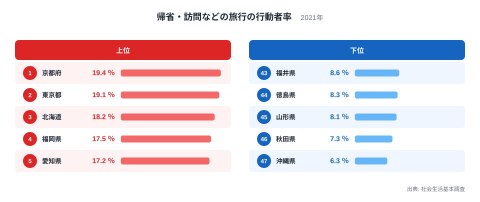
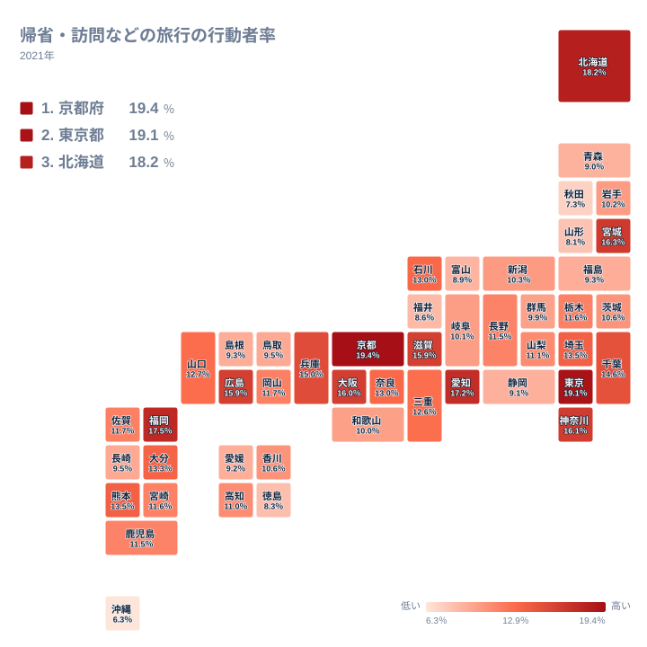

## 京都府と沖縄県で何倍違うのか

お盆や年末年始に実家へ戻る、親戚や友人の家を訪ねる。こうした「帰省・訪問などの旅行」は、観光とは性格の違う移動です。目的地に名所がなくても成り立ち、人と人のつながりが距離を越えて動く様子が表れます。

2021年の社会生活基本調査では、この旅行をした人の割合が最も高いのは京都府の19.4％で、最も低いのは沖縄県の6.3％です。倍率は19.4÷6.3で約3.1倍、差は13.1ポイントです。10人のうち2人近くが動く県と、10人のうち1人も動かない県が、同じ全国の中に並んでいます。

この記事では、上位と下位がなぜその順になるのかを、地理・産業構造・歴史の視点から考えます。ただし、このデータには転入者の数や親族の居場所といった情報は含まれていません。背景の説明はすべて仮説として読んでください。

> [!NOTE]
> ここでの割合は、過去1年間に帰省・訪問などの旅行を1回以上した人が、その県の対象者に占める比率です。集計は出発する人の居住地で行われるため、帰省先として人気の県を示す数字ではありません。

<source-link href="/ranking/travel-participation-rate-homecoming">帰省・訪問などの旅行をした人の割合ランキングをもっと見る</source-link>

図で目を引くのは、上位の並び方です。京都府の19.4％と東京都の19.1％の差は、0.3ポイントしかありません。この程度の差で二つの都府の性格を分けることはできず、実質的には同水準の首位グループと見るのが安全です。順位よりも、値がどれだけ近いかに目を向けてください。

上位5県は、いずれも広域から人が集まる大都市や、地方の中心となる都市を抱えています。進学や就職で他県から移り住んだ人が多ければ、盆暮れに故郷へ戻る人も多くなるはずです。これは地理と産業構造から立てた仮説で、転入者の数はこのデータにありません。

一方、下位には全国的な大都市圏を持たない県が並びます。最下位の沖縄県と46位の秋田県の間には1ポイントの差があり、下位でも最後尾だけは少し離れています。次の節から、上位と下位を順に見ていきます。

## 上位に並ぶのは都市圏を持つ県

首位の京都府は、大学が集まる都市として知られています。県外から進学した若者が多ければ、長期休暇のたびに実家へ戻る人が増えると考えられます。京都府の他の指標は[京都府のデータ](/areas/26000)で確かめられます。

2位の東京都は、地方から就職や進学で出てきた人が多い地域です。故郷に親を残した人が多いなら、帰省が数字を押し上げている可能性があります。詳しくは[東京都のデータ](/areas/13000)をご覧ください。

3位の北海道の18.2％は、意外に見えるかもしれません。ただし、札幌という大きな都市を抱える点は、他の上位と共通しています。歴史的な背景まで踏み込む材料はこのデータにないため、ここでは都市圏の存在という見方にとどめます。

4位は福岡県の17.5％、5位は愛知県の17.2％です。九州と中部それぞれの中心都市を持つ県が上位に入っています。拠点都市であることと数字の高さには関係があるのかもしれませんが、裏づけるデータは手元にありません。

> [!TIP]
> 割合が高い県は「帰省する人が多い県」であって、「帰省客を迎える人が多い県」とは限りません。集計は県内に住む人の行動で数えるためです。上位の県は、外へ出ていく人と戻ってくる人の両方を抱えているかもしれない、と読むと整理しやすくなります。

## 下位に沈む県は何が違うのか

最下位の沖縄県は6.3％です。本土との間に海があり、移動には航空便が欠かせません。ただ、費用や距離の負担が実際にどれほど影響しているかは、このデータからは確かめられません。島であるという地理条件は事実ですが、数字との結びつきは仮説にとどまります。

46位の秋田県は7.3％、45位の山形県は8.1％で、どちらも北海道・東北に属します。44位は徳島県の8.3％、43位は福井県の8.6％、42位は富山県の8.9％です。徳島県は四国、福井県と富山県は中部と、地方が分かれます。地方がばらばらである以上、共通の理由を一つに絞ることはできません。家族が近くに暮らしていれば長距離の帰省は少なくなる、という見方もありますが、このデータでは検証できません。

41位は青森県の9％、40位は静岡県の9.1％、39位は愛媛県の9.2％です。ここまで、47位から39位へ順位が上がる向きに並べました。この九つの県の値は6.3％から9.2％の範囲に収まり、上位の18％台とは水準が大きく離れています。

> [!WARNING]
> この数字は2021年の1年分で、新型コロナの影響が残る時期の行動です。帰省の自粛が呼びかけられた影響は、地域によって異なった可能性があります。平常時の順位とは異なるかもしれないため、順位を県の固定的な性質として読むのは避けてください。

## 地図で見る地域のまとまりと地方内の差

タイルマップを見ると、色の濃い県は関東、近畿、九州の北部、愛知県のあたりに集まっています。大都市圏とその周辺で高めに出る、という見方ができます。

ただし、同じ地方の中でも差が大きい点に注意が必要です。北海道・東北では、北海道が3位の18.2％、宮城県が6位の16.3％と高い一方、秋田県は46位の7.3％、山形県は45位の8.1％です。九州・沖縄でも、福岡県は4位の17.5％ですが、沖縄県は最下位です。地方という大きなくくりでは、県の位置を説明しきれません。

近畿では、京都府を中心に大阪府、滋賀県、兵庫県が高めです。一方、奈良県、三重県、和歌山県は中位以下で、近畿の中心から離れるほど下がるように見えます。これは地図上の並びから見える傾向で、理由までは特定できません。中心となる都市があるか、海を越える必要があるかといった条件が差を生んでいる可能性はありますが、別のデータでの検証が要ります。

## 接戦の順位を読むために

中位の県同士は接戦です。滋賀県と広島県はともに15.9％、埼玉県と熊本県はともに13.5％、石川県と奈良県はともに13％です。同じ数値で順位が分かれているため、順位の上下だけでなく数値そのものを見比べることが大切です。

同じカテゴリの他の指標と合わせて読むと、旅行や移動に関する地域の特徴がより立体的に見えます。[同じカテゴリの統計一覧](/category/tourism)から、他の旅行関連の指標もあわせてご覧ください。

## データについて

この記事で使った統計は、社会生活基本調査の「帰省・訪問などの旅行の行動者率」で、2021年の値です。単位は％で、過去1年間に該当の旅行を1回以上行った人が、対象者に占める割合を表します。

回数や滞在日数の違いは反映されません。記事中の順位と数値は、すべて上記の調査結果に基づいています。
