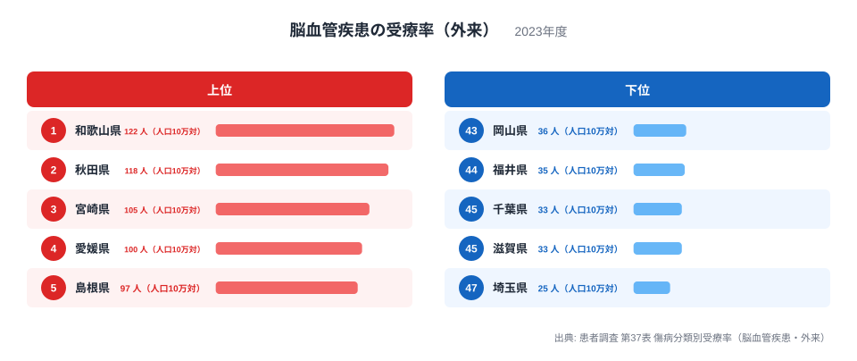
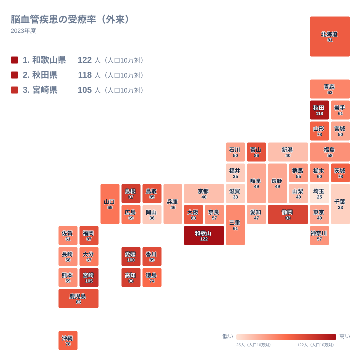

脳卒中の後遺症やその再発予防のために、外来で治療を続けている人はどれくらいいるのでしょうか。2023年の患者調査では、人口10万人あたりの脳血管疾患の外来受療率に、都道府県で大きな開きがあることが分かります。最も高い和歌山県は122人、最も低い埼玉県は25人です。この記事では、上位と下位がなぜその順になるのかを、地理・産業構造・歴史の観点から、確かめられる範囲で考えます。

> [!NOTE]
> ここで扱う数値は、患者調査の脳血管疾患・外来の受療率です。調査日に医療機関で外来受診した推計患者数を、人口10万人あたりに直したものです。病気を持つ人の割合(有病率)や、新たに発症した人の割合(罹患率)とは別の指標です。

## ランキングで見る上位と下位

まず、上位5県と下位5県を図で確認します。

<source-link href="/ranking/treatment-rate-cerebrovascular-outpatient">脳血管疾患の受療率（外来）ランキングをもっと見る</source-link>

この図で注目したいのは、値の並び方です。上位は1位の和歌山県が122人、2位の秋田県が118人と近い水準で並び、3位の宮崎県は105人です。1位と2位の間は小さく、2位と3位の間で一段下がります。つまり先頭の2県は、他の県から少し抜けた位置にあります。

下位側は様子が違います。47位の埼玉県は25人で、その上の45位は33人です。下位5県の中でも埼玉県だけが離れて低く、残りの4県は33人から36人の狭い範囲に収まっています。最大の和歌山県と最小の埼玉県を比べると、122人と25人で約5倍の開きです。

なお、この統計には同じ値の県が多くあります。たとえば45位には千葉県と滋賀県が33人で並び、次の埼玉県は47位です。同値の県は同じ順位として扱うため、順位の数字だけを見て優劣を語るのは避けたほうがよいでしょう。

> [!WARNING]
> この受療率は年齢を調整していない値です。高齢の人が多い県ほど高く出る可能性があるため、順位の差をそのまま医療の質や県民の健康度の差と読むことはできません。また調査日1日の推計にもとづくため、標本による揺れも含まれます。

## 上位の背景:仮説として考える

上位の県の背景は、この統計だけでは断定できません。そのうえで、考えられる仮説をいくつか挙げます。

秋田県は118人で2位です。冬の寒さが厳しく、塩分の多い食文化が長く続いてきた地域として、脳卒中の多さが語られてきました。血圧の管理が長期に必要になることから、退院後も外来で通院を続ける人が多い可能性があります。詳しい数値は[秋田県のデータ](/areas/05000)で確認できます。

和歌山県は122人で1位です。山がちな地形の地域が多く、高齢化が進んだ地域を抱えていることが関係している可能性はあります。ただし、それを裏づける数値はここにはありません。[和歌山県のデータ](/areas/30000)とあわせて、他の指標も見る必要があります。

3位の宮崎県は105人、4位の愛媛県は100人、5位の島根県は97人です。6位の高知県は96人、7位の静岡県は93人でした。農林水産業が根づく県が多いものの、静岡県も入っており、産業構造だけで説明できる並びではありません。通院できる医療機関の多さや、診療所と病院の役割分担など、別の要因も重なっていると考えられます。

> [!TIP]
> 外来の受療率には、入院に移った患者は含まれません。重い状態で入院が続く人が多い県では、外来の値が低く出ることもあります。また調査日1日の推計なので、平日か休日かといった受診の偏りの影響も受けます。入院の受療率とあわせて読むのが安全です。

## 地理分布で見る

次に、47都道府県の分布を地図で見ます。

地図で目立つのは、色の濃い県が近畿、中国、四国、九州・沖縄に多いことです。一方、関東と中部では、値の低い県が目立ちます。ただし、これは傾向であって例外も多くあります。

例外の一つが、北海道・東北の秋田県です。118人と全国2位の高さで、東日本にあっても高い水準です。中部でも、静岡県が93人で7位、富山県が86人で10位と高く、中部が一様に低いわけではありません。

もう一つ見ておきたいのは、大都市の位置です。大阪府は83人で13位と比較的高く、東京都は49人で35位、愛知県は47人で38位です。同じ大都市圏でも、近畿の大阪府と関東・中部の東京都、愛知県とでは位置が大きく異なります。大都市かどうかよりも、地域ごとの医療の使われ方や人口構成の違いが効いているのかもしれません。

## 下位の背景:別の受け皿の可能性

下位には埼玉県、千葉県、滋賀県、福井県、岡山県が並びます。関東の埼玉県と千葉県は、大都市圏の周辺にあります。現役世代の割合が相対的に高いことが、低い値と結びついている可能性はありますが、年齢構成の数値はここにないため、確かめることはできません。

福井県は35人、岡山県は36人です。同じ水準に、京都府、山梨県、新潟県の3府県が40人で並んでいます。こうした近い値の県どうしでは、順位の違いにあまり意味はありません。

低い値の背景として、介護施設や在宅サービスなど、外来以外の受け皿が整っている可能性も考えられます。外来に通わなくても療養を続けられる体制があれば、外来の受療率は下がるはずです。ただし、これも仮説であり、別の統計で確かめる必要があります。

## 歴史と暮らしから考える

脳卒中は、かつて日本人の死因の上位を占めていました。東北では、冬の寒さと塩分の多い食事が重なり、早くから対策の必要性が指摘されてきました。秋田県の高い値にも、こうした歴史が関係している可能性があります。

その後、食生活の改善や降圧治療の普及によって、脳卒中による死亡は大きく減ったとされます。一方で、命を取りとめた人が後遺症や再発予防のために通院を続けるため、外来の受療率が高く残る地域もあると考えられます。治療が進歩した結果として、通院する人が増える面もあるのです。

地域の医療機関の数や配置も影響します。同じ状態の患者でも、近くに診療所があれば外来に通いやすく、遠ければ受診の間隔が空くかもしれません。受療率は、人々の健康状態だけでなく、地域の医療の姿を映す数字でもあります。

## この数字をどう受け止めるか

この記事で見てきた順位は、2023年の1回の調査にもとづく結果です。上位の和歌山県や秋田県でも、別の年に同じ順位になるとは限りません。県の優劣を決めるのではなく、地域ごとの人口構成や暮らしの違いを考えるきっかけとして使うのが適切です。

読み解きの手順としては、まずランキングで位置と値の開きを確認し、次に地図で近隣との関係を見て、最後に高齢化率や入院の受療率など別の指標と照らし合わせます。そうすれば、数字の裏にある事情が少しずつ見えてきます。ほかの医療・福祉に関する統計は、[同じカテゴリの統計一覧](/category/socialsecurity)から探せます。

## データについて

使用したのは、2023年の患者調査 第37表 傷病分類別受療率(脳血管疾患・外来)です。単位は人口10万対の人数で、全47都道府県の値を比較しています。値は調査日に外来で受診した推計患者数にもとづいており、年齢調整は行われていません。そのため、高齢化の程度が異なる県どうしを比べるときは、年齢構成の違いを念頭に置いてください。
