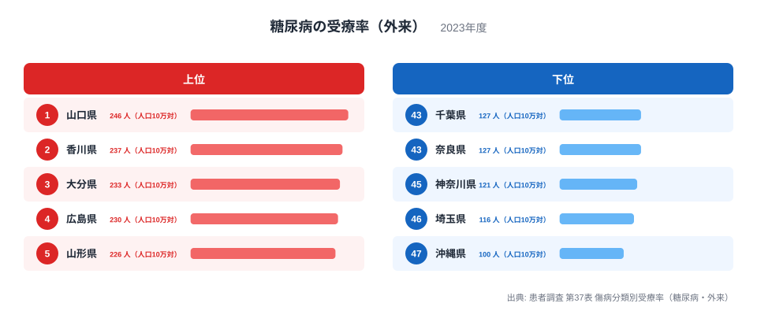
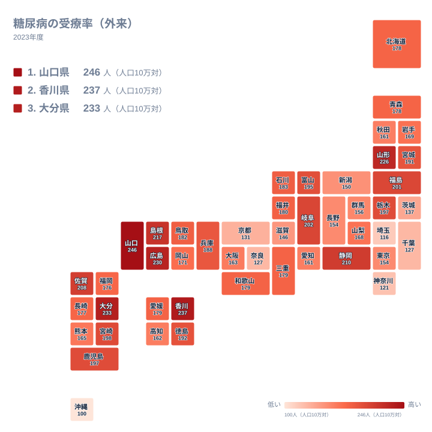

## 糖尿病の外来受療率は県でここまで違う

糖尿病は、食事や運動、加齢と結びつきの強い生活習慣病です。治療の中心は通院で、血糖値や合併症の検査を定期的に受けながら長く付き合っていきます。そのため、入院よりも外来のほうが、地域の「糖尿病との付き合い方」をよく映す指標になります。

2023年の患者調査では、人口10万人あたりの外来受療率が最も高かったのは山口県の246人でした。最も低かったのは沖縄県の100人です。最大と最小の比は2.46倍で、同じ国の中でも通院している人の割合に大きな差があります。

この記事では、上位と下位がなぜその順になるのかを、地理と産業構造の面から考えます。ただし、年齢構成や通院頻度といった背景のデータはこの記事の手元にありません。原因に踏み込む部分は、すべて仮説として書きます。

> [!NOTE]
> ここでの受療率は、調査日の1日に糖尿病で医療機関の外来にかかった推計患者数を、人口10万人あたりに直した値です。糖尿病にかかっている人の割合ではなく、その日に通院していた人の割合です。

## 上位5県と下位5県の差を読む

まず、上位と下位の県を図で確かめます。

<source-link href="/ranking/treatment-rate-diabetes-outpatient">糖尿病の受療率（外来）ランキングをもっと見る</source-link>

図で目を引くのは、順位の並びよりも間隔の広がり方です。上位は1位の山口県が246人、2位の香川県が237人、3位の大分県が233人、4位の広島県が230人、5位の山形県が226人と、5県で20人しか動きません。一方、下位は43位の千葉県と44位の奈良県がともに127人、45位の神奈川県が121人、46位の埼玉県が116人、47位の沖縄県が100人です。とくに最下位の沖縄県は、46位の埼玉県からさらに離れています。底が抜けたような形です。

千葉県と奈良県は同じ127人ですが、実データでは43位と44位に分かれています。公表されている値は整数なので、整数にする前の小さな差で順位が付いた可能性があります。この記事では実データの順位表記に合わせ、この2県は事実上の同水準として扱います。

上位5県には中国・四国・九州の県が4つ入り、東北の山形県が加わります。下位5県には関東の千葉県、神奈川県、埼玉県と、近畿の奈良県、九州・沖縄の沖縄県が並びます。上位は西日本に寄り、下位は大都市に近い県が多いという傾向は読み取れますが、理由まではこの図だけでは分かりません。

> [!WARNING]
> この値は外来の受療率だけで、入院は含みません。また、通院の間隔が月に1回の県と数か月に1回の県では、同じ患者数でも調査日に外来にいる人の数が変わります。受療率が高いことは、糖尿病の人が多いことを意味するとは限りません。通院の頻度が高いことの表れである可能性もあります。

## 地図で見る地理分布

次に、47都道府県の位置関係を地図で見ます。

地図では、中国・四国・九州に濃い県が多く見えます。中国地方では山口県が1位、広島県が4位、島根県が217人で6位です。四国では香川県が2位、徳島県が192人で15位です。九州では大分県が3位、佐賀県が208人で8位、宮崎県が198人で11位、鹿児島県が197人で13位と、上位から中位の前半に入ります。

ただし、西日本が一様に高いわけではありません。同じ中国地方でも、鳥取県は182人で19位、岡山県は171人で28位です。四国の高知県は162人で33位、九州の熊本県は165人で31位、福岡県は176人で27位、長崎県は177人で26位にとどまります。地方単位のくくりでは説明しきれず、県ごとの事情が混ざっていることが分かります。

中位層の広がりも見ておきます。200人を超えるのは10位の福島県の201人までです。20位の福井県は180人、30位の山梨県は168人で、この10位分の間に入る値の幅は小さく、順位が1つ違っても実質的な差はわずかです。150人を下回るのは40位の滋賀県の146人以降になります。順位の差よりも、値のかたまりで見るほうが実態に近いと言えます。

> [!TIP]
> 地図を読むときは、色の濃淡の差が小さい県どうしを別の順位として扱いすぎないようにしてください。たとえば21位の三重県、22位の和歌山県、23位の愛媛県はいずれも179人で、34位の秋田県と35位の愛知県はいずれも161人です。同じ値の県がいくつも並ぶ区間では、順位より値そのものを見るのが安全です。

## 東日本と大都市圏の状況

東日本では、山形県が5位、静岡県が210人で7位、岐阜県が202人で9位、福島県が10位、栃木県が197人で12位と、上位から中位の上に県が点在します。東北の中でも、秋田県は34位、岩手県は169人で29位、青森県は178人で25位、宮城県は191人で16位と、位置の幅が広くなっています。

大都市圏の中心部は中位から下位です。東京都は154人で37位、大阪府は163人で32位、愛知県は35位です。関東では埼玉県の46位、神奈川県の45位、千葉県の43位が下位に並び、都市圏の周辺で低い傾向があるように見えます。

ただし、この見方には例外があります。茨城県は137人で41位と低いのですが、大都市に隣接する県かと言われると、そう単純ではありません。反対に、同じ関東の栃木県は12位、群馬県は156人で36位です。関東は下位側の県が多いものの、都市圏かどうかだけで分けることはできません。この記事では、大都市の周辺で低めに出る傾向は見られるものの、一つの理由では説明しきれないと整理します。

## 産業構造と暮らしからの仮説

上位の県は、中小の都市と農山漁村を広く抱える県が目立ちます。こうした地域では、通勤や買い物に自家用車を使う場面が多く、日常の歩く量が少なくなる可能性があります。運動量の違いが受療率に関わっているかもしれませんが、この記事のデータでは確かめられません。

大都市圏については、鉄道やバスで移動する機会が多く、歩く量が相対的に多い可能性があります。これも仮説の域を出ません。働く世代が多い県であれば、受療率が低めに出ることも考えられますが、年齢別のデータがないため、どこまで効いているかは分かりません。

もうひとつの仮説は、医療へのつながりやすさです。健診で血糖値の異常が見つかり、通院に結びつく人が多い地域では、受療率は高く出ます。逆に、受診の機会が少なければ、病気があっても統計には表れません。高い数字は、病気が多いことだけでなく、治療につながっていることの表れでもあり得ます。どちらの影響が大きいかを、この指標だけで分けることはできません。

## 県ごとの特徴（仮説）

1位の山口県は、高齢化や車中心の暮らし、中小都市が散らばる県土など、いくつもの要因が重なっている可能性があります。ただし、どれが効いているかはこの統計からは断定できません。山口県のくわしいデータは[山口県のデータ](/areas/35000)で、2位の香川県については[香川県のデータ](/areas/37000)で確認できます。香川県は粉食の文化が語られることもありますが、食文化と受療率の関係は、この統計では確かめられません。

最下位の沖縄県は100人です。年齢構成が若いことや、離島が多く通院の機会が限られることなどが理由として考えられますが、どれもこの記事のデータでは確認できません。通院機会が限られれば受療率が低くなるという筋道も、推測にとどまります。確かなのは、沖縄県が2位の香川県の237人と比べても大きく離れた最下位にあることまでです。

東北の山形県が226人で5位という点も特徴的です。同じ東北の秋田県は34位、岩手県は29位であり、地方のくくりだけで傾向を語ることはできません。県ごとの医療体制や健診の受けやすさ、暮らし方の違いなど、仮説を立てられる材料は多くありますが、確かめるには別の統計との突き合わせが必要です。

## データについて

使用したのは、患者調査の第37表「傷病分類別受療率」のうち、糖尿病の外来にあたる値です。年は2023年、単位は人口10万人あたりの人数です。この記事の数値と順位は、すべてこの値に基づいています。

受療率は、調査日の1日の受診状況から推計した値です。そのため、年ごとの小さな変動や、調査で捉えられた医療機関の偏りの影響を受けることがあります。順位が近い県どうしは、実質的に同水準と見るのが安全です。千葉県と奈良県がともに127人で並ぶのも、その一例です。

同じ分野の他の指標と合わせて読むと、地域の健康課題がより立体的に見えてきます。[同じカテゴリの統計一覧](/category/socialsecurity)から、医療や社会保障に関する他の統計も確認できます。

## まとめ

2023年の糖尿病の外来受療率は、山口県の246人から沖縄県の100人まで、2.46倍の開きがありました。上位には山口県、香川県、大分県、広島県、山形県が並び、下位には千葉県、奈良県、神奈川県、埼玉県、沖縄県が並びます。

西日本に高い県が多く、大都市の周辺に低めの県が多いという傾向は見られます。しかし、茨城県や栃木県のように、その見方に収まらない県もあります。年齢構成、暮らし方、医療へのつながりやすさなどは仮説にとどまり、この指標だけで原因を決めつけることはできません。

自分の県の位置を確かめたうえで、通院頻度や調査日の影響といったこの指標の性質まで合わせて読むことが、この統計を正しく活用するコツです。
