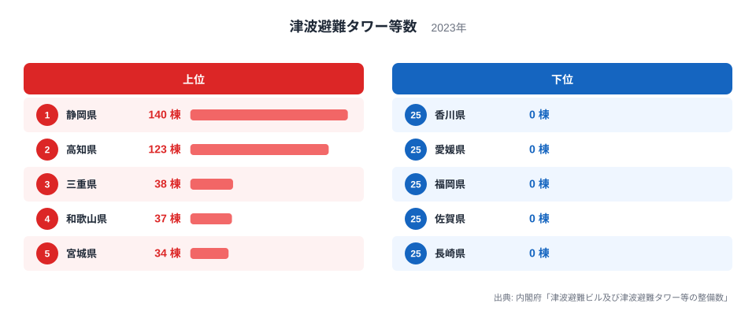
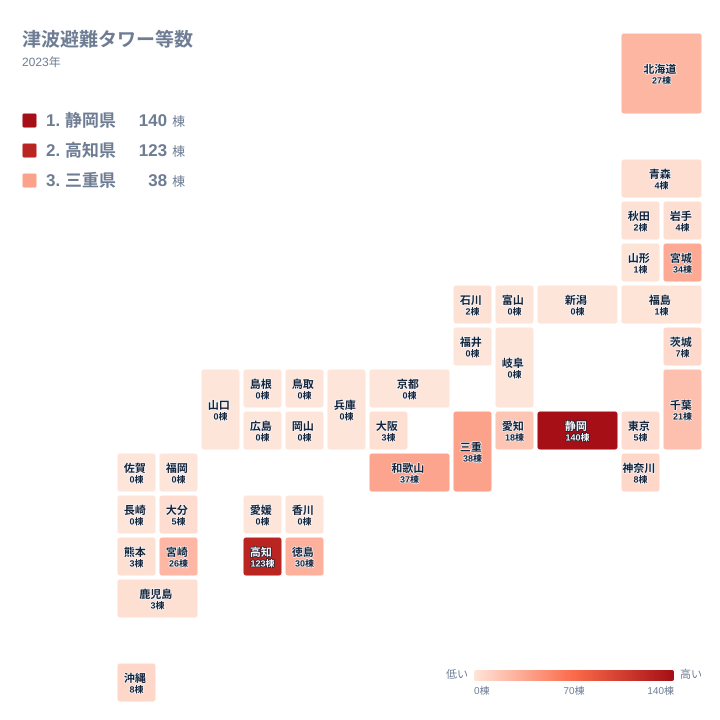

## 津波避難タワー等が最も多いのは静岡県

津波避難タワー等が最も多い県は、静岡県です。2023年の整備数は140棟で、1位です。2位は高知県の123棟で、この2県が突出しています。3位は三重県の38棟、4位は和歌山県の37棟、5位は宮城県の34棟です。

一方で、下位には0棟の府県が並びます。今回の実データは40件で、25位の新潟県から40位の長崎県までの16府県が0棟です。実データに載っている40件のうち、0棟は16件にあたります。最大の140棟と最小の0棟の開きは、倍率では表せません。

この記事では、上位と下位がなぜこの順になるのかを、地理・産業構造・歴史の視点から考えます。ただし、実データから確認できるのは整備数の分布までです。背景の説明は、すべて仮説として読んでください。同じカテゴリの[統計一覧](/category/safetyenvironment)から、防災に関わる他の指標も確認できます。

<source-link href="/ranking/tsunami-evacuation-tower-count">津波避難タワー等数ランキングをもっと見る</source-link>

図でまず目に入るのは、1位と2位だけが別の水準にあることです。静岡県と高知県の2県を足すと263棟になります。3位の三重県と4位の和歌山県を足しても75棟で、上位2県の合計はその3倍を超える規模です。上位2県の存在感が、分布全体の形を決めています。

3位から5位の38棟、37棟、34棟は、ほぼ横並びです。三重県と和歌山県は1棟しか違わず、この順位の差に大きな意味はありません。3位以下は団子状に並び、上位2県だけが抜け出す形です。

下位側は、棒が見えないほど短い0棟の県が続きます。図の下位5県は、いずれも0棟です。また、上位10位以内にも入らず0棟でもない「中間の値」を持つ県は、10棟未満の小さな数字に集まっています。整備が進んだ県と、ほとんど進んでいない県という、二極に近い構造が読み取れます。

> [!NOTE]
> 「津波避難タワー等」は、津波から逃れるために新たに建てた独立型の避難タワーに加え、避難に使える人工の高台や、避難用に整えられた施設を含む呼び方です。既存の建物を指定する津波避難ビルとは別に数えられる点に注意してください。出典は内閣府の整備数調査で、2023年の値、単位は棟です。

## 上位2県と3位以下の落差はなぜ生まれるか

静岡県と高知県が突出する理由は、実データだけでは断定できません。そのうえで考えられる仮説の一つは、津波の到達が早いと見込まれてきた地域であることです。両県はいずれも太平洋に面しています。この見込みが整備を後押しした可能性があります。

高台まで遠い低地が海沿いに広がる場所では、短時間で逃げ込める場所を人工的につくる選択肢が現実的になります。こうした条件が当てはまる地域が両県に多い可能性はありますが、地形や自治体の事情をこの記事の数値で確かめたわけではありません。各県の他の数字は、[静岡県のデータ](/areas/22000)と[高知県のデータ](/areas/39000)のページで確認できます。

もう一つの仮説は、整備の進め方です。津波避難タワーは、自治体が沿岸の集落ごとに計画して建てるものです。県全体で方針をそろえて進めた県と、市町村の判断にゆだねた県とでは、棟数に差が出る可能性があります。これも実データにない背景であり、確かめられていない推測です。

> [!WARNING]
> この数字は施設の「数」であり、収容人数、高さ、設置場所の標高は反映していません。小型のものも大型のものも、同じ1棟として数えられます。棟数が多い県ほど安全だと即断したり、少ない県の備えが足りないと決めつけたりすることはできません。

## 地図で見る分布の偏り

地図では、色の濃い県が太平洋側に目立ちます。静岡県、三重県、和歌山県、徳島県、高知県、宮崎県は、いずれも上位10位以内です。太平洋側の海との関係が一つの手がかりになる可能性はありますが、想定される津波の大きさなどは今回の実データにないため、因果は判断できません。

上位10県は、1位の静岡県、2位の高知県、3位の三重県、4位の和歌山県、5位の宮城県、6位の徳島県、7位の北海道、8位の宮崎県、9位の千葉県、10位の愛知県です。地方で分けると、次のとおりです。

- 中部は、静岡県と愛知県の2県です。
- 近畿は、三重県と和歌山県の2県です。
- 北海道・東北は、宮城県と北海道の2道県です。
- 四国は、高知県と徳島県の2県です。
- 関東は、千葉県の1県です。
- 九州・沖縄は、宮崎県の1県です。

合計は10県で、上位10県は全国の広い範囲に散らばっています。特定の地方に固まっているわけではないため、棟数の多さを一つの理由で説明するのは難しそうです。海に面した条件など、県ごとの事情が重なっている可能性があります。

> [!TIP]
> ランキングを読むときは、1位から順に追うよりも、まず「0棟が16件ある」という分布の形に注目してください。同じ棟数の県は同じ水準と読むのがコツです。たとえば青森県と岩手県は、どちらも4棟です。小さな数字では1棟の違いで順位が入れ替わるため、順位の上下に意味を持たせすぎないようにしてください。

## 0棟の府県が並ぶ背景

0棟は、実データの40件のうち16府県です。新潟県、富山県、福井県、岐阜県、京都府、兵庫県、鳥取県、島根県、岡山県、広島県、山口県、香川県、愛媛県、福岡県、佐賀県、長崎県が該当します。

地方別に数えると、次のとおりです。

- 中部は、新潟県、富山県、福井県、岐阜県の4県です。
- 近畿は、京都府と兵庫県の2府県です。
- 中国は、鳥取県、島根県、岡山県、広島県、山口県の5県すべてです。
- 四国は、香川県と愛媛県の2県です。
- 九州・沖縄は、福岡県、佐賀県、長崎県の3県です。

合計は16府県です。北海道・東北と関東には、0棟の都道県がありません。なお、実データは40件で、都道府県の全数ではありません。掲載のない県の値は、この記事では分かりません。

0棟は、津波の危険がないという意味ではありません。他の手段で備えている可能性もあります。たとえば、既存の高台や頑丈な建物への避難を想定している県では、専用のタワーを建てる必要が小さいことも考えられます。この点は、実データだけでは確かめられません。

また、同じ0棟でも、海岸線がほとんどない県と、海に面していても他の方法を選んでいる県では意味が違う可能性があります。0棟という数字だけで、備えの有無を読み取ることはできません。

産業構造や歴史の面でも仮説は立てられます。大都市や工業地帯をかかえる地域では、高層の建物が多く、そこに逃げ込む方式が取りやすいかもしれません。東京都は5棟、大阪府は3棟で、大都市圏でも数は少数にとどまります。ただし、産業や歴史を裏づける数値は実データにないため、あくまで読み方の一つです。

## 中位の県が示す整備の分かれ目

6位から10位は、徳島県の30棟、北海道の27棟、宮崎県の26棟、千葉県の21棟、愛知県の18棟です。上位2県の水準から見ると小さいものの、10棟を超える県はここまでです。

11位以下は一桁になります。神奈川県と沖縄県は8棟、茨城県は7棟です。東京都と大分県は5棟、青森県と岩手県は4棟、大阪府、熊本県、鹿児島県は3棟です。秋田県と石川県は2棟で、山形県と福島県は1棟です。

これらの県は、沿岸をもちながら、上位のような広い整備にはなっていません。ただし、数字が小さいほど、1棟の違いが順位を大きく動かします。順位の細かな上下を、県の防災意識の差と読むのは適切ではありません。

宮城県は34棟で5位です。過去の津波の経験が整備に影響した可能性はありますが、今回の実データでは確かめられません。同じ東北の岩手県は4棟で、宮城県とは対照的です。この差の理由も、地形や自治体の方針など、データにない要素が絡む推測にとどまります。

## データについて

使用した統計は、内閣府「津波避難ビル及び津波避難タワー等の整備数」による津波避難タワー等数で、2023年の値です。単位は棟で、都道府県別に整理されています。この記事で扱ったのは実データの40件で、47都道府県すべてではありません。そのため、0棟の16府県は、この40件の中での数です。

同じ棟数の県は、同じ水準として読んでください。順位は実データの並びに従っていますが、同じ値の県の間で順位に意味を持たせることはできません。

棟数は、防災の充実度を一つで測る物差しではありません。上位は整備を進めてきた可能性のある地域、下位には他の手段で備える地域や海岸線の乏しい地域が含まれる可能性があります。地域の備えを確かめるには、自治体のハザードマップとあわせて見るのが確実です。
