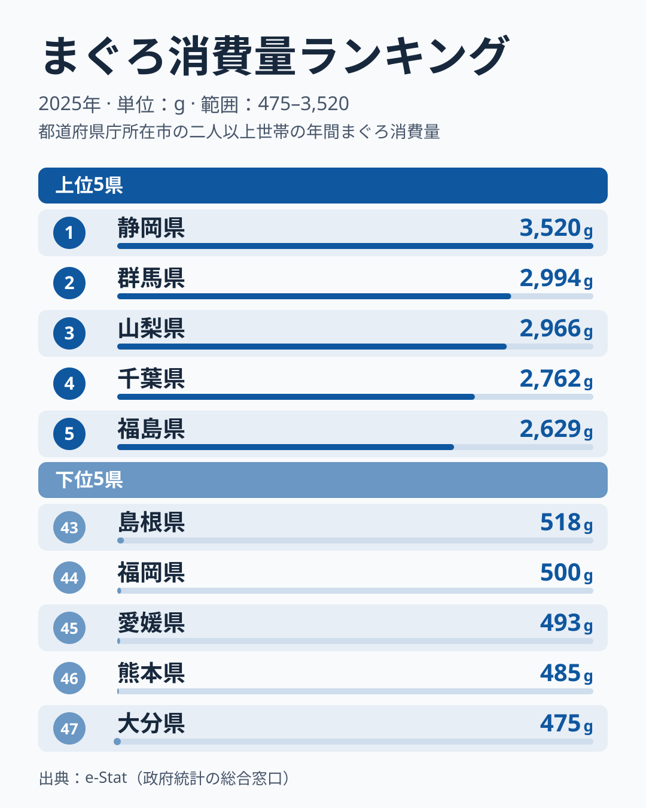
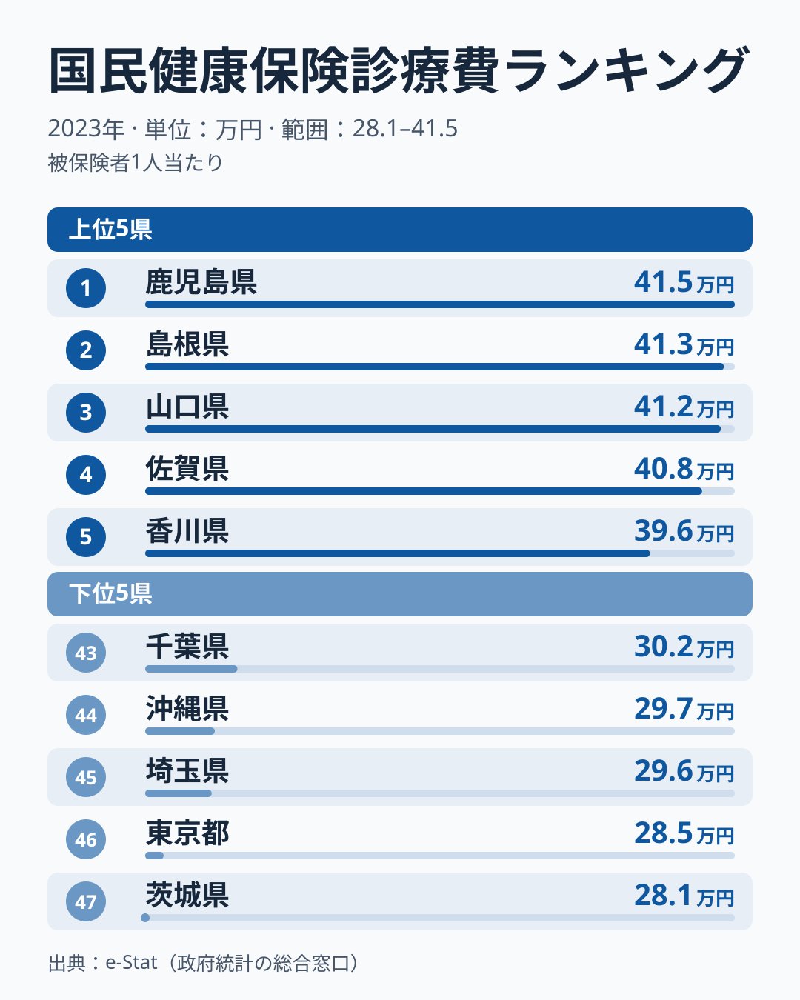
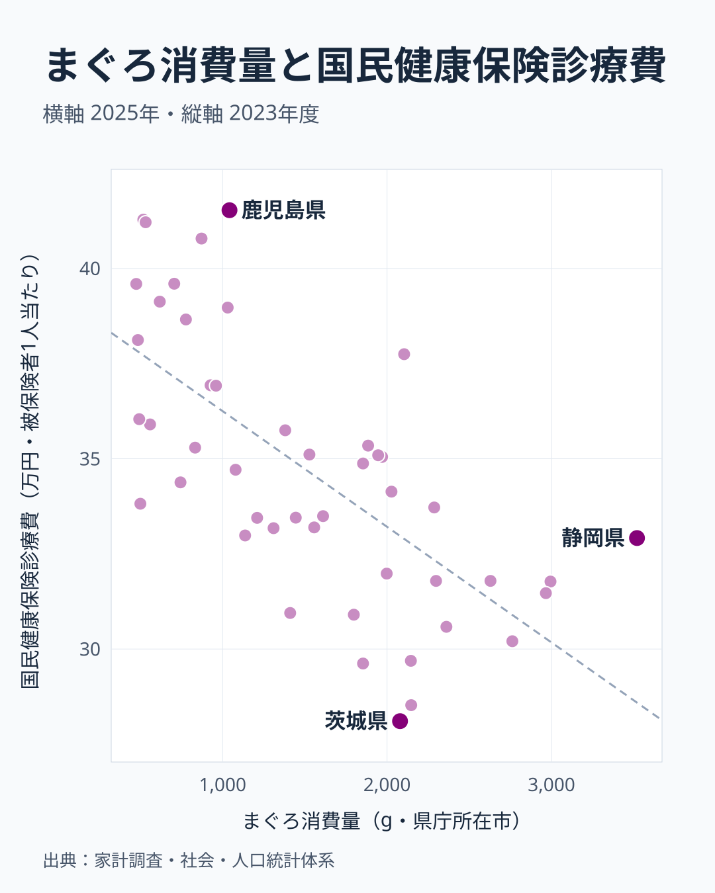

「魚をよく食べる地域は健康的」——そんなイメージを持つ人は多いのではないでしょうか。2025年の家計調査（まぐろ消費量）と2023年度の国民健康保険診療費（社会・人口統計体系）を47都道府県で突き合わせると、まぐろ消費量が多い県ほど1人あたり診療費が低いという、逆の関係が見えてきます。相関係数は-0.68で、中程度から強めの負の相関です。

ただし、この記事の目的は「まぐろを食べれば医療費が下がる」と主張することではありません。相関係数を2乗した決定係数は約0.46で、県ごとの医療費の違いの半分強はまぐろ消費量では説明できません。さらに人口規模を統制しても相関はほとんど変わらず、「都市と地方の違い」という単純な説明も当てはまりにくいことが分かります。それでも、まぐろの摂取そのものが医療費を左右していると断定するには材料が足りません。何が確かめられて、何が残っているのかを順に見ていきましょう。

## まぐろ消費量ランキング

<source-link href="/ranking/tuna-consumption-quantity">まぐろ消費量ランキングをもっと見る</source-link>

まぐろ消費量の1位は静岡県で3,520g。2位群馬県は2,994g、3位山梨県は2,966g、4位千葉県は2,762g、5位福島県は2,629gと続きます。上位5県のうち群馬と山梨は海に面していない内陸県で、静岡は駿河湾の水揚げに加えて焼津という国内屈指のまぐろ加工・卸の集積地を抱えています。内陸県が上位に食い込む理由は、[仮説] まぐろが「産地で獲れて産地で食べる」魚ではなく、加工・流通網に乗って全国のスーパーに並ぶ食材だからではないか、と考えています。家計調査の市別の値は単年のぶれが大きいため、この順位から構造を断定することはできません。

最下位は大分県で475g、46位熊本県は485g、45位愛媛県は493g、44位福岡県は500g、43位島根県は518gと続きます。下位5県の内訳は九州の大分・熊本・福岡、四国の愛媛、中国の島根で、特定の地方に限られていません。島根県は医療費では2位にも入っており、同じ県がまぐろ消費の下位と医療費の上位の両方に現れています。静岡と大分を比べると7.4倍の開きがあります。[仮説] 海に近い西日本の県では、まぐろよりもアジ・サバ・ブリなど他の魚種の消費が中心という食文化の違いが背景にあると考えていますが、この記事のデータだけでは検証できません。

> [!NOTE]
> このデータは「家計調査」の二人以上世帯・県庁所在市ベースの購入量です。外食や給食で食べたまぐろ、回転寿司での消費は含まれません。あくまで家庭内での消費傾向を示す指標だと理解してください。

## 国民健康保険診療費ランキング

<source-link href="/ranking/national-health-insurance-medical-expense-per-person">国民健康保険診療費ランキングをもっと見る</source-link>

国民健康保険の1人あたり診療費（2023年度）が最も高いのは鹿児島県で415,298円です。2位は島根県の412,814円、3位は山口県の412,132円、4位は佐賀県の407,855円、5位は香川県の395,984円で、九州の鹿児島・佐賀、中国の島根・山口、四国の香川が上位を占めています。最下位は茨城県で281,052円、46位は東京都で285,253円、45位は埼玉県で296,196円と、関東の都県が低い側に並びます。1位と最下位の差は1.5倍です。医療費は県による差が相対的に小さい指標ですが、それでも九州・中国・四国が高く、関東が低いという地域差は明確です。

ここで注目したいのは、医療費上位5県（鹿児島・島根・山口・佐賀・香川）のまぐろ消費量順位です。鹿児島県は31位、島根県は43位、山口県は42位、佐賀県は35位、香川県は39位で、5県とも47県中30位以下です。逆に、まぐろ消費量上位5県（静岡・群馬・山梨・千葉・福島）の医療費順位は、静岡県が34位、群馬県が38位、山梨県が39位、千葉県が43位、福島県が36位で、5県とも医療費が低い側の30位台以下に入っています。ただしこれは両端の5県ずつを見た例で、全体の傾向は次の散布図で確認します。

> [!WARNING]
> 国民健康保険の診療費は「国保加入者」の医療費であり、被用者保険（会社の健康保険組合など）に加入する現役世代の医療費は含まれません。そのため、この数値は県民全体の医療費ではなく、国保加入者の年齢構成や加入者の属性の影響を受けます。県どうしの比較では、この制度上の偏りを踏まえる必要があります。

## 散布図で見る相関

散布図には47都道府県が並んでいます。相関係数は-0.68で、まぐろ消費量が多い県ほど医療費が低い関係が47点の全体に表れています。数値の個別再掲より、消費量で県を二つに分けた平均を見るほうが構造をつかめます。消費量が1,000g未満の15県の医療費は平均で約37.8万円、2,000g以上の13県は平均で約31.7万円で、約6万円の差があります。

1,000g未満の15県は、石川・福井の北陸、兵庫の近畿、鳥取・島根・岡山・広島・山口の中国、香川・愛媛の四国、福岡・佐賀・長崎・熊本・大分の九州で、すべて西日本です。一方、2,000g以上の13県は、茨城・栃木・群馬・千葉・東京・神奈川の関東6都県のほか、宮城・福島の東北、山梨・岐阜・静岡の中部、高知、沖縄です。つまり「まぐろ消費」と「医療費」の関係は、東日本の関東圏と西日本という地域のまとまりの違いと重なっています。

例外も目立ちます。高知県はまぐろ消費量が11位で医療費も11位と、消費量が多いのに医療費も高い位置にあります。逆に、茨城県はまぐろ消費量12位・医療費最下位、東京都は消費量9位・医療費46位、埼玉県は消費量18位・医療費45位で、消費量が中位以上でも医療費は最下位圏にあります。まぐろの多寡だけでは医療費の高低を説明しきれないことが、これらの県からも分かります。

## 見かけの相関か、真因か

「都市部だから、まぐろ消費も多く、医療費も低い」という共通の第三要因が両方を動かしているのであれば、見かけの相関になります。この点は人口規模で確かめられています。人口規模の影響を取り除いた偏相関は-0.66で、素の相関-0.68（n=47）とほとんど変わりません。したがって、人口の多い県が両方の値を動かしているだけ、という説明は成り立ちにくいといえます。

ただし、検証できたのは人口規模だけです。では、まぐろ消費量が医療費を直接下げているのでしょうか。ここは慎重に考える必要があります。まぐろそのものに含まれるDHA・EPAなどの不飽和脂肪酸が生活習慣病予防に働くという栄養学的な知見は存在しますが、この記事のデータだけでは「まぐろを食べれば医療費が下がる」という**因果関係を証明することはできません**。考えられる交絡要因（第三の変数）はいくつもあります。

- **高齢化率**: [仮説] 国保加入者は高齢者の割合が高いため、高齢化が進んだ県ほど診療費が高くなる可能性があります。この記事には高齢化率のデータがなく、確かめられていません。
- **所得水準**: [仮説] 家計調査ベースの消費量は世帯の可処分所得にも左右されるかもしれません。単価の高いまぐろを買う余裕がある県ほど、他の生活習慣（運動・受診行動など）も異なる可能性があります。この記事には所得のデータがなく、確かめられていません。
- **受療行動の地域差**: 同じ症状でも医療機関へのかかりやすさ（病院の多さ、通院のしやすさ）が県によって異なり、これが診療費の総額に影響している可能性があります。
- **魚食全体の文化差**: まぐろだけでなく魚介類全体の消費パターンが健康指標と関係している可能性もあり、まぐろ単独を切り出すこと自体に限界があります。

[仮説] まぐろ消費量そのものよりも、まぐろを含む魚食文化・所得水準・高齢化率が複合的に医療費の地域差を生んでいる可能性があります。人口規模では説明が付かないことまでは確かめられましたが、高齢化率や1人あたり所得を統制変数に加えた多変量解析は行っておらず、そこが残された検証です。

> [!WARNING]
> 国保診療費は2023年度、まぐろ消費量は2025年と、対象年が異なります。また、まぐろ消費量は県庁所在市の二人以上世帯の購入量、診療費は県全体の国保加入者の値で、集計の範囲も違います。2つの指標を県ごとに並べるときは、この年とエリアのずれを前提に読んでください。

## まとめ

- まぐろ消費量1位は静岡県で3,520g、最下位は大分県で475gと、7.4倍の格差
- 国民健康保険診療費1位は鹿児島県で415,298円、最下位は茨城県で281,052円と、1.5倍の格差
- 散布図の相関係数は-0.68（47都道府県）で、人口規模を統制した偏相関も-0.66。ただし高知県のような例外もあり、決定係数は約0.46
- まぐろ消費量上位県（静岡・群馬・山梨・千葉・福島）は医療費が低い側に、医療費上位県（鹿児島・島根・山口・佐賀・香川）はまぐろ消費量が低い側に集まる
- 高齢化率・所得水準・受療行動など複数の交絡要因が考えられ、まぐろ消費と医療費の間に直接の因果関係があるとは断定できない

相関の読み方をさらに知りたい方は、食品消費と子どもの体重の相関を扱った[納豆消費と子供の体重](/blog/natto-child-weight-correlation)が参考になります。医療費の地域差については、[後期高齢者医療費の県差](/blog/late-elderly-medical-expense-prefecture-gap)も合わせてご覧ください。まぐろ消費量1位の[静岡県](/areas/22000)、医療費1位の[鹿児島県](/areas/46000)の地域プロフィールもあわせてご覧ください。
