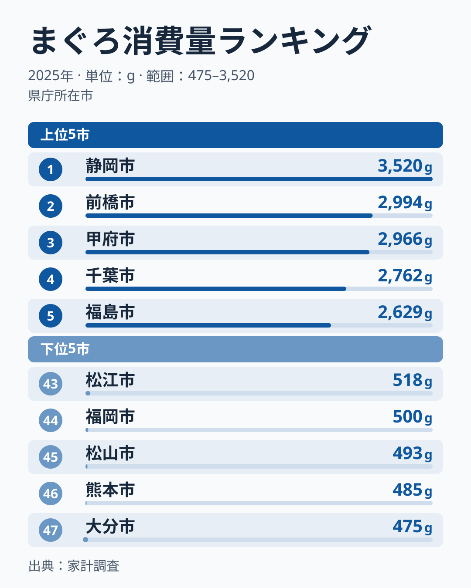
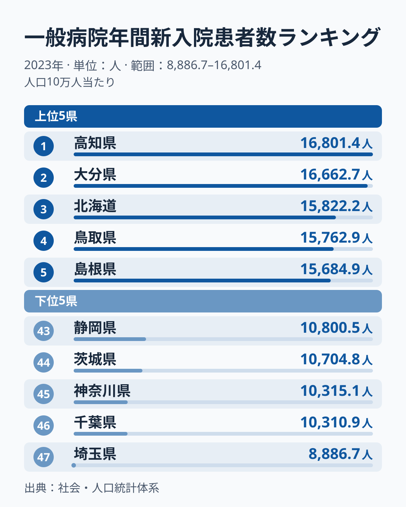
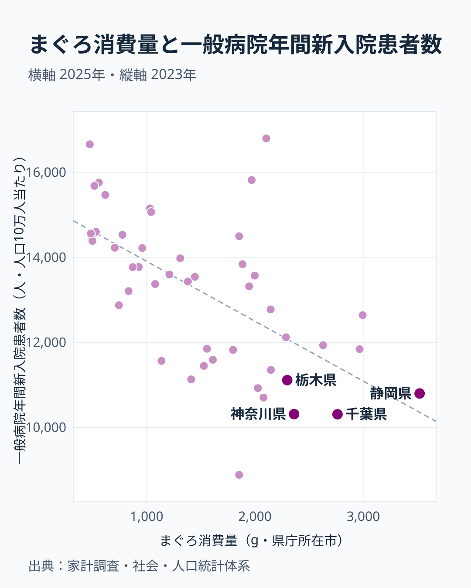

静岡市の世帯は、まぐろを全国で最も多く買っています。一方で静岡県は、一般病院の新入院患者数が人口当たりで少ない側から5番目の県です。2つの統計を47都道府県で並べると、まぐろの購入量が多い県ほど新入院患者数が少ないという関係が見えます。

題の問いに先に答えると、県の並びとしては「はい」で、2つの指標の相関係数は-0.60です。ただし、これはまぐろを食べると入院しにくくなることを示すものではありません。この記事では、どの県がこの関係を作っているのかを2つのランキングと散布図で確かめ、この相関から言えることと言えないことを分けて説明します。

使う値は2つです。まぐろ消費量は家計調査の2025年の値で、都道府県庁所在市に住む二人以上の世帯が1年間に買ったまぐろの量（1世帯当たり）です。県全体の値ではないため、本文では「静岡市の世帯」のように都市名で書きます。一般病院年間新入院患者数は医療施設調査の2023年の値で、県ごとの人口10万人当たりの人数です。2023年は、この指標で公表されている最新の年です。

## まぐろ消費量ランキング

<source-link href="/ranking/tuna-consumption-quantity">まぐろ消費量ランキングをもっと見る</source-link>

2025年のまぐろ消費量は、静岡市の世帯が3,520gで1位です。2位は前橋市（群馬県）の2,994g、3位は甲府市（山梨県）の2,966g、4位は千葉市の2,762g、5位は福島市の2,629gと続きます。静岡市は2020年から2025年までの6年間、毎年1位で、この順位は年によって入れ替わっていません。上位には前橋市、甲府市、宇都宮市（栃木県）のように海に面していない県の県庁所在市も入っています。

上位10県の続きを見ると、横浜市（神奈川県）が6位、東京都区部が9位で、千葉市の4位と合わせて東京圏の3都県が上位10県に入っています。埼玉県のさいたま市は2024年には10位でしたが、2025年は18位でした。

最も少ないのは大分市の475gで、46位は熊本市の485g、45位は松山市（愛媛県）の493g、44位は福岡市の500g、43位は松江市（島根県）の518gです。1位の静岡市と最下位の大分市では約7.4倍の差があります。下位10県は、38位の兵庫県から47位の大分県まで、すべて兵庫県から西の県で、九州の4県、中国地方の3県、四国の2県が入っています。この統計はまぐろだけを数えているので、下位の都市の世帯が魚全体を食べていないという意味ではありません。

[仮説] 静岡市の世帯が6年続けて1位であることには、まぐろの水揚げや加工の拠点が近く、手に入りやすいことが関わっている可能性があります。確かめるには、港ごとの水揚げ量や都市ごとの小売価格を年ごとに並べ、購入量と比べる必要があります。今回の2つの指標の範囲では確かめられません。

## 一般病院年間新入院患者数ランキング

<source-link href="/ranking/annual-new-inpatients-general-hospital-per-100k">一般病院年間新入院患者数ランキングをもっと見る</source-link>

2023年の一般病院年間新入院患者数は、人口10万人当たりで高知県が16,801.4人と最も多く、2位は大分県の16,662.7人、3位は北海道の15,822.2人です。4位は鳥取県の15,762.9人、5位は島根県の15,684.9人です。上位10県には、北海道を除くと中国・四国・九州の県が並びます。

最も少ないのは埼玉県で8,886.7人、次いで千葉県が10,310.9人、神奈川県が10,315.1人、茨城県が10,704.8人です。この4県は東京とその周辺の県です。43位の静岡県は10,800.5人で、東京圏ではなく東海地方の県ですが、新入院患者数が少ない側に入っています。静岡県はまぐろ消費量が1位の県でもあり、2つの指標がそろって逆の端にある県です。

下位に近い県を見ると、東京都は39位で11,355人、愛知県は40位で11,133.1人、栃木県は41位で11,114.3人です。東京都と愛知県という人口の多い2都県も、新入院患者数では少ない側に入っています。

[仮説] この地域差は、人口当たりの病床数の違いを映している可能性があります。病床が多い県ほど入院を受け入れやすく、新入院患者数も多くなりやすいと考えられるためです。確かめるには、同じ2023年の人口10万人当たりの病床数を並べ、新入院患者数と比べる必要があります。今回の記事ではその値を扱っていないため、ここでは仮説にとどめます。

## 散布図で見る関係と、そこから言えないこと

横軸に2025年のまぐろ消費量、縦軸に2023年の新入院患者数をとると、点は右下がりに並びます。相関係数は-0.60で、まぐろ消費量が多い県ほど新入院患者数は少ない、という負の相関です。

この関係を作っているのは、両端の県です。まぐろ消費量の上位10県は、新入院患者数ではどれも29位以下にあります。とくに静岡県は43位、千葉県は46位、神奈川県は45位で、まぐろが多く入院が少ない右下に位置します。一方、上位10県のうち沖縄県は29位、群馬県は30位で、新入院患者数では中ほどです。反対にまぐろ消費量の下位10県は、兵庫県の28位を除く9県が新入院患者数で15位以内に入り、大分県は2位、鳥取県は4位、島根県は5位です。

> [!WARNING]
> この相関は、まぐろを食べると入院しにくくなるという健康効果を示すものではありません。新入院患者数は住民の病気のなりやすさだけでなく、病床の数や医療機関の受け入れ体制でも変わります。また、まぐろの値は県庁所在市の世帯の購入量、新入院患者数は県全体の人口当たりの人数で、対象も年も違います。

2つの指標がそろって動いて見えるのは、まぐろ消費量の上位10県のうち沖縄県を除く9県が関東・東北・中部の県で「まぐろが多く入院が少ない」側にあり、中国・四国・九州の県が「まぐろが少なく入院が多い」側にまとまっているためです。地域ごとに別々の事情がそれぞれの指標を動かしている可能性があり、上の2つの仮説はその候補です。どちらの仮説も、今回の2つの指標だけでは確かめられません。

## この2つの指標からわかること

- 2025年のまぐろ消費量は静岡市の世帯が3,520gで1位、大分市の世帯が475gで最下位で、約7.4倍の差があります
- 静岡市は2020年から2025年まで6年続けて1位で、上位には前橋市や甲府市のような内陸の都市も入ります
- 2023年の一般病院年間新入院患者数は、人口10万人当たりで高知県が16,801.4人で最も多く、埼玉県が8,886.7人で最も少ない県です
- 新入院患者数が少ない側には埼玉・千葉・神奈川・茨城の4県と静岡県が入り、多い側には中国・四国・九州の県と北海道が入ります
- 2つの指標の相関係数は-0.60の負の相関ですが、まぐろが入院を減らすという因果関係を示すものではありません

家計の支出の統計をまとめて見たい方は、[経済の統計一覧](/category/economy)もあわせてご覧ください。まぐろ消費量の上位に入る[静岡県のデータ](/areas/22000)や[群馬県のデータ](/areas/10000)では、それぞれの県の詳しい統計を確認できます。まぐろ消費量は流通や食文化の統計と、新入院患者数は病床数や医療提供体制の統計とあわせて読むと、それぞれの差の背景を確かめる手がかりになります。
