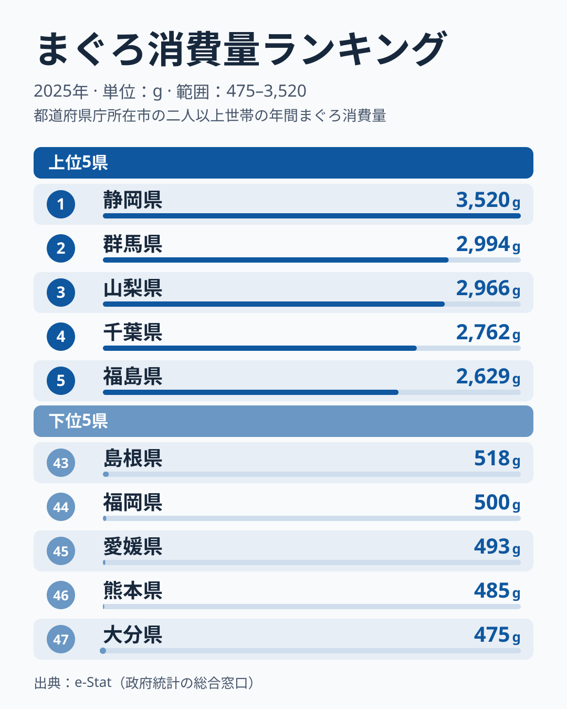

「日本人はみんなまぐろが好き」——そう思っていませんか。実は、47都道府県のまぐろ消費量には**7.4倍もの格差**があります。総務省「家計調査」(2025年)によると、1位の静岡県は3,520g、最下位の大分県は475gで、同じ「魚好き」の日本でも年間消費量が大きく異なります。

さらに驚くのは上位の顔ぶれです。2位の群馬県、3位の山梨県、7位の栃木県は、いずれも**海を持たない内陸県**。一方、漁業が盛んな九州では、大分県・熊本県・福岡県が下位5県に入ります。この「逆説的な分布」の背景には、まぐろ流通のしくみと各地域の食文化が深く関わっています。

## まぐろ消費量の上位5県と下位5県

2025年の47都道府県ランキングで、上位と下位の顔ぶれを見てみましょう。

**上位5県**は以下のとおりです。

- 1位 静岡県：3,520g
- 2位 群馬県：2,994g
- 3位 山梨県：2,966g
- 4位 千葉県：2,762g
- 5位 福島県：2,629g

**下位5県**は以下のとおりです。

- 47位 大分県：475g
- 46位 熊本県：485g
- 45位 愛媛県：493g
- 44位 福岡県：500g
- 43位 島根県：518g

上位の静岡県は3,520g、最下位の大分県は475gで、その差は**7.4倍**に達します。下位5県は475gから518gまでの43g差に収まっており、最下位争いは僅差です。47都道府県で「全国平均的な食材」であるまぐろの消費量が、ここまで割れるのは非常に興味深い現象です。

<source-link href="/ranking/tuna-consumption-quantity">まぐろ消費量ランキングの全データを見る</source-link>

> [!NOTE]
> このデータは総務省「家計調査」に基づく、**都道府県庁所在市の二人以上世帯**の年間まぐろ消費量(g)です。農村部や小都市を含む県全体の平均ではなく、県庁所在地の代表値であることに注意が必要です。また、スーパーや市場での購入量がベースで、外食でのまぐろ消費は含まれていません。

## なぜ静岡が1位なのか——焼津と清水の港

静岡県が1位を占める大きな理由は、**全国有数のまぐろ水揚げ拠点「焼津港」と「清水港」**の存在です。

焼津港は全国有数の遠洋漁業の拠点で、カツオとともにビンナガまぐろ・メバチまぐろが大量に水揚げされます。清水港も冷凍まぐろの取扱量が全国トップクラスです。港に近い産地では、まぐろが新鮮なうちに流通するだけでなく、価格も他地域より安く手に入ります。「まぐろが身近な食材」という文化が地域に根づいており、それが家庭での消費量の高さに直結しています。

また、静岡県は「まぐろのへそ(血合い)」など内臓系の部位まで無駄なく食べる食文化があり、消費量を押し上げる一因となっています。

## 海なし県がなぜ上位に? 関東・中部の高消費の謎

上位を見て多くの人が違和感を覚えるのが、**2位の群馬、3位の山梨、7位の栃木という内陸県**の存在です。海に面していない県がなぜまぐろをたくさん食べるのでしょうか。

ここには**首都圏の豊かな流通網**が深く関わっています。群馬・山梨・栃木は東京圏の物流網に組み込まれており、豊洲市場をはじめとする大規模流通から高品質なまぐろが効率よく届きます。鉄道・高速道路が整備され、翌日には新鮮な魚が手に入る環境が整っています。

さらに、内陸県は新鮮な魚を入手しにくかった歴史的背景から、**保存が利く「まぐろの漬け」や「まぐろの刺身」への志向**が強く育まれてきたとも言われます。海の魚を手に入れたときには「上等なもの」として大切に食べる文化が、消費量の高さにつながっているという見方もあります。

千葉県は4位で2,762gです。三方を海に囲まれており、銚子港などが水産拠点であることも追い風です。また、大都市・東京に隣接した消費地でもあり、まぐろへのアクセスが容易です。5位の福島県は2,629gで、太平洋に面した東北の県が関東の県に並んでいます。

> [!TIP]
> 関東・中部の高消費は「東京の流通圏の恩恵」という見方ができます。豊洲市場のまぐろ取扱量は全国でも屈指の規模で、周辺の県に新鮮なまぐろを安定供給しています。県庁所在市が豊洲へのアクセスが良い地域ほど、消費量が高い傾向があります。

## なぜ九州の多くは下位圏なのか——「別の魚」がある

もっとも興味深い逆説は、**漁業が盛んな九州の県が下位に集まる**ことです。九州7県のうち、大分県は47位、熊本県は46位、福岡県は44位で下位5県に入り、長崎県も40位で下位10県に入ります。

- 47位 大分県：475g
- 46位 熊本県：485g
- 44位 福岡県：500g
- 40位 長崎県：618g

一方で、佐賀県は35位の872g、鹿児島県は31位の1,042g、宮崎県は26位の1,381gと中位に位置し、九州の中でも差があります。九州は海に囲まれ、長崎県や鹿児島県は全国有数の漁業生産量を誇ります。にもかかわらず、まぐろ消費量が少ない理由は何でしょうか。

[仮説]として考えられるのは、**まぐろの代わりになる別の魚・食文化がある**ことです。家計調査の市別の値は単年のぶれが大きいため、この説明は検証が必要です。

大分県では「関サバ・関アジ」が超高級ブランドとして名を馳せており、家庭の食卓ではサバやアジへの愛着が強い傾向があります。長崎県では「五島手延うどん」とともに近海魚文化が根強く、まぐろより新鮮なイカやアジが好まれます。福岡では「あら(クエ)」や「ゴマサバ」が郷土の魚として定着しており、まぐろの出番は相対的に少なくなります。

つまり九州は「魚嫌い」ではなく、**まぐろ以外の地元の魚が充実している**ことが、まぐろ消費量の低さにつながっているのではないかと考えられます。

> [!WARNING]
> 「海に近い=まぐろをよく食べる」という思い込みは誤りです。このランキングが示すのは、「まぐろの消費は漁港の近さよりも、流通網・価格・地域の食文化によって決まる」という事実です。単純に「魚の消費量」と混同しないようご注意ください。九州は魚の消費量自体は全国でも高い地域です。

## 関東と九州の消費量格差——約3倍の開き

地域ごとに集計すると、格差の大きさがより鮮明になります。

2025年データで関東7県(群馬・千葉・栃木・東京・神奈川・埼玉・茨城)の県庁所在市の値を単純平均すると約2,356gになります。一方、九州7県(宮崎・鹿児島・熊本・福岡・佐賀・長崎・大分)の単純平均は約768gです。この差は**約3.1倍**に達します。

東北・北海道は上位寄りです。福島県は5位で2,629g、宮城県は8位で2,287g、北海道は15位で1,970g、山形県は16位で1,946g、秋田県は17位で1,885g、青森県は20位で1,798g、岩手県は22位で1,557gと、東北6県はすべて上位半分の23位以内に入っています。

一方、中国地方は広島県が36位で833g、岡山県が37位で777g、鳥取県が41位で559g、山口県が42位で532g、島根県が43位で518gと、5県すべてが36位以下に並びます。四国では愛媛県が45位で493g、香川県が39位で706g、徳島県が32位で1,031gと低めですが、高知県は11位で2,104gと突出しています。これらの低位の地域は、瀬戸内海の豊かな漁業資源(タイ・サワラなど)があり、まぐろ以外への選好が強いのではないかとも考えられますが、これは[仮説]で、検証にはほかの魚種の消費量との比較が必要です。

消費量の地域分布は関東・東北で高く、中国・九州で低い「東高西低」の傾向を示します。ただし高知県や、10位で2,145gの沖縄県のような例外もあり、単年の順位だけで構造を断定することはできません。

## まとめ

2025年のまぐろ消費量ランキングから見えてきたことをまとめます。

- **1位は静岡県の3,520g**: 焼津港・清水港という全国トップ級の水揚げ拠点が地元にあり、まぐろが安く・新鮮に手に入る食文化が定着
- **最下位は大分県の475g**: 7.4倍という大きな格差。「海に近いから消費量が多い」とは限らない
- **上位に内陸県が並ぶ**: 2位の群馬、3位の山梨、7位の栃木は首都圏の流通網で良質なまぐろが安定供給される
- **九州の多くが下位圏**: 大分・熊本・福岡は下位5県に入る。漁業が盛んでも地元の「別の魚」が強く、まぐろ消費の出番が少ないと考えられます
- **東高西低の傾向**: 関東7県の単純平均(約2,356g)は九州7県の単純平均(約768g)の約3.1倍

まぐろのような「国民食」に見える食材でも、地域によって消費量がこれほど異なることは、日本の食文化の多様性を示しています。他の水産物のランキングと合わせて比較すると、各地域の食生活の個性がより鮮明に見えてきます。

- [イカ消費量ランキング](/ranking/squid-consumption-quantity)
- [昆布消費量ランキング](/ranking/konbu-consumption-quantity)
- [静岡県の統計データ](/areas/22000)
- [食生活・家計のランキング一覧](/category/economy)
