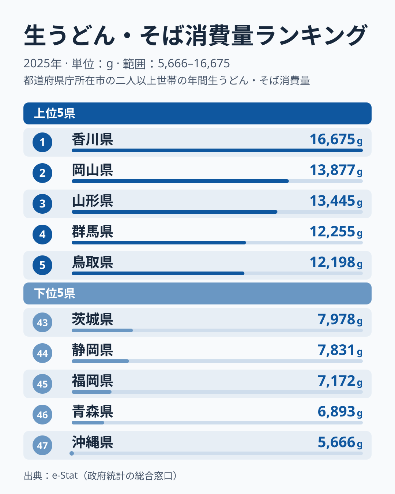
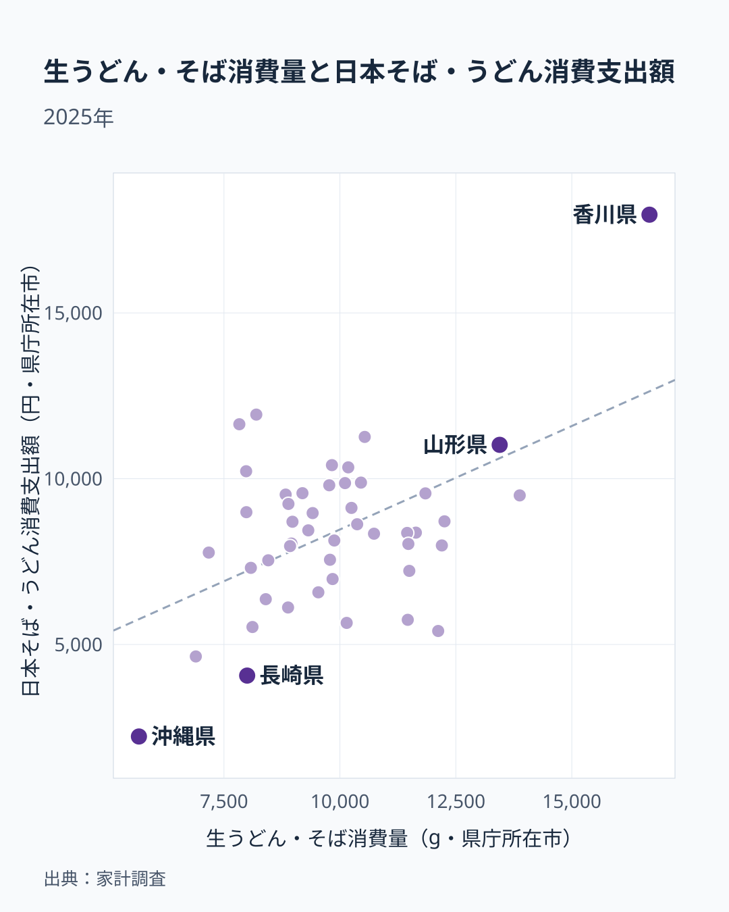

「うどん県」を名乗る香川がトップなのは、誰もが予想できます。では、博多うどんで全国に知られる福岡は何番目でしょうか——。総務省「家計調査」2025年の生うどん・そば消費量（1世帯あたり年間購入量）を47都道府県で並べると、ここに大きな意外が潜んでいます。

香川県は16,675gで断然のトップです。一方で福岡県は45番目の7,172gと、47都道府県の中でほぼ最下層に位置しています。うどんの名所として全国にイメージが定着している土地が、実際の家庭での購入量では下位に沈んでいるのです。「外食で食べているから家庭では買わないのでは」という素朴な説明は、本当に当てはまるのでしょうか。そして上位に並ぶのは、香川以外にどんな顔ぶれなのでしょうか。

本記事では、生うどん・そば消費量の都道府県地図を読み解きながら、福岡の逆説、うどん以外の麺との関係、そして家計調査という指標そのものが抱える死角まで掘り下げていきます。出発点は[生うどん・そば消費量ランキング](/ranking/fresh-udon-soba-consumption-quantity)の最新データです。

> [!NOTE]
> 本記事の数値はすべて総務省「家計調査」における都道府県庁所在市の二人以上世帯の年間購入量（g）。家庭で買う生うどん・そば（冷凍・半生を含む。乾めんは別品目）の「購入量」であり、外食や業務用での消費は含まれない。この点が後半の「逆説」を読み解く鍵になる。

## 香川がトップ、沖縄が最も少ない——全体像

最初に全体の輪郭を押さえます。トップの香川県は16,675g、最も少ない沖縄県は5,666gで、その差は約2.9倍です。

この指標は、家計調査の品目「生うどん・そば」（冷凍・半生の麺を含む）の購入量です。乾うどん・そばは別の品目で、外食の日本そば・うどんも別に集計されます。

地域別に見ると、上位10位は香川、岡山、山形、群馬、鳥取、和歌山、京都、秋田、奈良、島根の10県です。内訳は近畿が和歌山・京都・奈良の3県、中国が岡山・鳥取・島根の3県、四国が香川の1県、東北が山形・秋田の2県、関東が群馬の1県で、西日本に多いものの東日本の県も混じっています。下位5県は沖縄・青森・福岡・静岡・茨城で、九州・沖縄が2県、東北・中部・関東が1県ずつと、地方がばらけています。九州全体が少ないわけでもなく、宮崎県は31位と中位です。

この図式は、東西の単純な二分では説明しきれません。本記事は、その中でもっとも説明がつきにくい福岡県の位置に絞って、家庭の購入量と外食の支出という2つの指標を並べて読みます。

## 上位グループ——香川を追う中国地方と東北・関東

トップ5は香川を頭に、中国地方の岡山・鳥取、東北の山形、関東の群馬が顔をそろえます。図の左側（消費量が多い県）がこの上位グループです。

<source-link href="/ranking/fresh-udon-soba-consumption-quantity">生うどん・そば消費量の全47都道府県ランキングを見る</source-link>

香川の16,675gは、2位の岡山の13,877gを大きく上回っており、突出ぶりが際立ちます。背景には、讃岐うどんが日常食として根づき、家庭での生麺購入も多い可能性がありますが、このデータだけでは確かめられません。

注目したいのは、13,445gで3位の山形県です。山形県は外食の日本そば・うどんでも11,021円と高く、家庭でも外食でも麺をよく食べる県と読めます。4位の群馬は12,255gで、5位の鳥取は12,198gです。6位の和歌山、7位の京都、9位の奈良と、近畿の県が続きます。この指標はうどんとそばを合算しているため、どちらの麺が順位を押し上げているかは、この指標だけでは分けられません。

## 「うどん本場」福岡が下位に沈む逆説——家庭は45位

ここで本記事の核心、下位グループを見てみましょう。図の右側（消費量が少ない県）が示すとおり、最も少ないのは5,666gの沖縄県です。次いで青森県が6,893g、福岡県が7,172g、静岡県が7,831g、茨城県が7,978gと続きます。

とくに多くの人が引っかかるのは、45位で7,172gの福岡県でしょう。博多うどんは全国区の知名度を持つ土地です。それなのに、家庭での生うどん・そばの購入量では、下から3番目です。なお、この値は福岡市の二人以上世帯のもので、福岡県全体の平均ではありません。

家計調査が測る生うどん・そばは家庭内の購入量だけで、店で食べる分は入りません。そこで、同じ家計調査の外食の項目である日本そば・うどん消費支出額を横に並べます。福岡県の外食支出は1世帯当たり年間7,772円です。

<source-link href="/ranking/soba-udon-dining-consumption-expenditure">日本そば・うどん外食消費支出の全47都道府県ランキングを見る</source-link>

散布図は、横軸が家庭での生うどん・そばの購入量、縦軸が外食の日本そば・うどんへの支出で、点が1つの都道府県です。右上に離れて1点あるのが香川県で、生麺は16,675g、外食は17,962円と、どちらも突出しています。山形県も生麺は13,445g、外食は11,021円で、右上寄りの群にあります。全体としては右上がりで、生麺を多く買う県は外食の支出も多い傾向があります。家庭で買う県ほど外食を控える、という代替の関係は全体では読み取れません。

では、福岡県は「外食で補っている県」なのでしょうか。生麺の購入量が近い県を並べると、そうは読めません。静岡県は生麺7,831gに対して外食は11,642円、茨城県は生麺7,978gに対して外食は10,225円、東京都は生麺7,983gに対して外食は8,990円と、家庭が少ない分だけ外食が多く出ています。これに対して福岡県は、生麺7,172gで外食が7,772円と、購入量が近い県の中では外食も低めです。「外食でうどんを食べる文化が強い県は、家庭の購入量が小さく見える」という説明が当てはまるのは、福岡県よりも静岡県や茨城県です。つまり、福岡の少なさは外食で補っているからとは言えず、このデータからは理由を特定できません。

一般則として言い切れない理由は、ほかの県の位置を見るとわかります。山形県は生麺13,445gに対して外食は11,021円、岡山県は生麺13,877gに対して外食は9,496円と、どちらも高い県もあります。一方で、兵庫県は生麺11,463gに対して外食は5,744円、和歌山県は生麺12,119gに対して外食は5,407円で、家庭でよく買う県が外食でも上位とは限りません。

> [!WARNING]
> 家計調査が測るのは都道府県庁所在市の二人以上世帯の支出で、観光客の飲食は入りません。「福岡県」の値も福岡市の世帯のものです。また、家庭と外食の関係から「福岡の人は家で麺を食べず外で食べる」と断定するのも早計です。2つの指標の関係は、原因を示すものではなく、県ごとの位置を並べて見ただけです。

## 沖縄や青森の少なさは「別の麺」で説明できるか

下位の県には、うどん・そば以外の麺文化が根づいているという見方もあります。ただし、中華麺など別品目の値はこの記事の図の data にないため、ここでは数値を示しません。[仮説]沖縄そばなどが生うどん・そばとは別の品目に計上されていることが、沖縄の少なさに関わっているのかもしれません。青森県でも、家庭の麺として別の種類が選ばれている可能性はありますが、確かめるには別の品目や年を重ねた推移が必要です。

一方で、福岡県の生麺の少なさは、この記事の data だけでは理由を説明できません。外食の支出も7,772円と高くはなく、外食で補っているとは言えません。

## 「西高東低」だけでは読めない——上位の顔ぶれ

上位10県のうち、近畿・中国・四国は7県（香川、岡山、鳥取、和歌山、京都、奈良、島根）で、西に厚い傾向は確かです。ただし東日本にも山形県、秋田県、群馬県が入り、とくに山形県は3位です。長野県は10,180gで18位と中位で、「内陸だから」という地理条件では、上位の顔ぶれは説明しきれません。

家計調査の市別の値は、1つの年だけでは入れ替わりが大きい点にも注意が必要です。前年の2024年は、岡山県・山形県・群馬県の順位が今回と異なっていました。一方、香川県が上位、福岡県が下位という両端は大きく変わっていません。[仮説]2位から10位あたりの並びは年ごとに入れ替わりうるので、特定の県を「うどん圏」「そば圏」と決めつけず、変わりにくい両端を読み取るのが安全です。

上位の各県がうどん圏かそば圏かを、この指標だけで割り当てることはできません。上位から下位までを通した一般的な読み方は、[生うどん・そば消費量ランキングの解説記事](/blog/fresh-udon-soba-consumption-prefecture-gap)にまとめています。

粉もの文化をより広く捉えたい場合は、原料である[小麦粉消費量ランキング](/ranking/wheat-flour-consumption-quantity)も合わせて見ると、麺・粉もの文化圏の重なりが見えてきます。背景の食文化の差については[小麦粉消費量と食文化の地域差](/blog/wheat-flour-consumption-food-culture-gap)でも掘り下げています。

## まとめ

- トップは香川県で16,675g、2位の岡山は13,877gで、突出しています。最少は沖縄県で5,666gで、その差は約2.9倍です。
- 「うどん本場」福岡は家庭の生麺が7,172gで45位、外食の日本そば・うどんも7,772円と高くなく、外食で補っていると言える位置ではありません。
- 散布図では、生麺の購入量と外食支出は代替ではなく、同じ県で高くなる傾向があります。「外食に流れるから家庭で買わない」という説明は、福岡県よりも静岡県や茨城県のほうが当てはまります。
- 沖縄と青森の少なさは別の麺との関係が[仮説]として考えられますが、福岡の少なさはこの data だけでは理由を説明できません。
- 家計調査の市別の値は年ごとの入れ替わりが大きく、前年も変わらなかったのは香川が上位、福岡が下位という両端です。
- 食文化の全体像は[小麦粉消費量ランキング](/ranking/wheat-flour-consumption-quantity)や[経済・暮らしのデータ一覧](/category/economy)、突出ぶりが気になる[香川県のプロフィール](/areas/37000)、最少の[沖縄県のプロフィール](/areas/47000)と合わせて読むと立体的に見えてきます。
