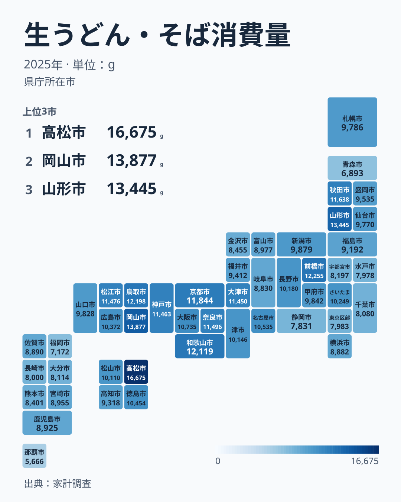
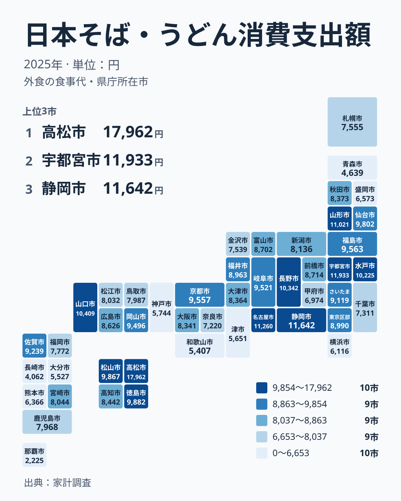

「うどん県」の香川がトップなのは、多くの人が予想できます。では、日本地図の上で生うどん・そばを多く買う県を濃く塗ると、色はどこに集まるでしょうか。そして同じ地図を、家で買う量ではなく、店で日本そば・うどんを食べる支出で塗り直すと、色の集まる場所は変わるのでしょうか──。

総務省「家計調査」の2025年の値で2枚の地図を描くと、答えは「半分は同じ場所、半分は違う場所」でした。家庭と外食がそろって中央値を上回る県と、そろって下回る県を合わせると25道府県あり、残る22都府県は片方だけが上回ります。このずれが地方ごとにまとまって出るのが近畿と関東です。近畿は家庭の購入量で7府県すべてが中央値を上回るのに、外食の支出で上回るのは京都府だけです。関東は逆で、家庭では2県、外食では5都県が中央値を上回ります。本記事は順位表ではなく地図で、この東西のずれを読みます。県ごとの順位と上位・下位の顔ぶれは[生うどん・そば消費量ランキングの解説記事](/blog/fresh-udon-soba-consumption-prefecture-gap)にまとめているので、ここでは地方ごとの分布と、家庭と外食の対比に絞ります。

> [!NOTE]
> 2つの指標はどちらも、都道府県庁所在市の二人以上世帯の1世帯当たり年間の値です。家庭の指標は生うどん・そば（冷凍・半生を含み、乾めんは別品目）の購入量（g）、外食の指標は日本そば・うどんの支出額（円）です。単位が違うので値の大きさどうしは比べず、それぞれの指標の中での位置（47都道府県の中央値を上回るかどうか）で比べます。

## 家庭の地図──近畿・中国は全府県が中央値を上回る

まず、家で生うどん・そばを買う量の地図です。色が濃いほど購入量が多い県です。

<source-link href="/ranking/fresh-udon-soba-consumption-quantity">生うどん・そば消費量の全47都道府県ランキングを見る</source-link>

47都道府県の中央値は9,786gで、ちょうど中央にあたる24位が北海道です。中央値を上回る23府県を地方別に数えると、近畿は7府県すべて、中国は5県すべてが入ります。四国は4県のうち3県です。これに対して九州・沖縄は8県すべてが中央値を下回り、関東は7都県のうち群馬県と埼玉県の2県、北海道・東北は7道県のうち山形県と秋田県の2県にとどまります。中部は9県のうち4県で、長野県や愛知県が中央値を上回ります。

地図で濃い色が帯のように連なるのは、近畿から中国・四国にかけてです。トップは香川県の16,675gで、2位の岡山県は13,877g、5位の鳥取県は12,198g、6位の和歌山県は12,119g、7位の京都府は11,844gと、この帯の県が上位に並びます。生うどん・そばを「西高東低」と呼ぶなら、その「西」は近畿・中国・四国のことで、九州は入りません。九州・沖縄の8県で最も上位の宮崎県でも31位で、最も少ないのは47位の沖縄県の5,666gです。

東日本は全体に色が淡いものの、濃い県が飛び地のように入ります。3位の山形県は13,445g、4位の群馬県は12,255g、8位の秋田県は11,638gです。この指標は生うどんと生そばを合わせた量なので、こうした県で、うどんとそばのどちらが量を押し上げているかは、この地図だけでは分けられません。

## 外食の地図──近畿が淡くなり、関東で濃くなる

次に、同じ県庁所在市の世帯が店で日本そば・うどんに使ったお金、つまり外食の日本そば・うどん消費支出額の地図です。こちらも色が濃いほど支出が多い県です。

<source-link href="/ranking/soba-udon-dining-consumption-expenditure">日本そば・うどん外食消費支出の全47都道府県ランキングを見る</source-link>

外食の中央値は8,373円で、24位の秋田県にあたります。中央値を上回る23都府県を地方別に数えると、四国は4県すべて、中部は9県のうち6県、関東は7都県のうち5都県です。一方、家庭の地図ですべての府県が中央値を上回った近畿は、外食では7府県のうち京都府の1府だけになります。九州・沖縄も8県のうち佐賀県の1県だけです。

トップは家庭と同じく香川県で、17,962円です。2位以下は栃木県の11,933円、静岡県の11,642円、愛知県の11,260円、山形県の11,021円と続き、2位から10位までの9県のうち5県が関東と中部の県です。反対に近畿では、和歌山県が5,407円で44位、兵庫県が5,744円で41位、三重県が5,651円で42位と、家庭の地図で濃かった府県が淡い側に回ります。最も少ないのは沖縄県の2,225円で、香川県とはおよそ8.1倍の開きがあります。家庭の購入量の香川県と沖縄県の開きはおよそ2.9倍なので、外食のほうが県による差が大きい指標です。

外食の指標は支出額なので、食べた回数や量だけでなく、1杯の値段の違いも入ります。値段の高い店が多い地域では、同じ回数でも支出が大きくなります。このデータでは回数と値段を分けられないため、「関東・中部の人はそばやうどんを店でよく食べる」とまでは言えず、「店で使うお金が多い」と読むのが正確です。

## 2枚を重ねる──近畿は「家で買う」側にまとまる

2つの指標を1枚に重ねたのが次の散布図です。横軸が家庭の生うどん・そばの購入量、縦軸が外食の日本そば・うどんの支出で、点が1つの都道府県です。

47都道府県全体の相関係数は+0.50で、家庭で多く買う県ほど外食の支出も多い、正の相関です。ただし右上に離れた香川県の影響が大きく、香川県を除くと+0.29まで弱まります。この全体の傾きからは、2枚の地図で見た地方ごとのずれは見えません。

そこで、両方の指標について中央値を上回るかどうかで、47都道府県を4つに分けます。

- 家庭も外食も上回る12県: 香川県・岡山県・山形県・群馬県・京都府・愛知県・長野県など
- 家庭だけが上回る11府県: 近畿の三重県・滋賀県・大阪府・兵庫県・奈良県・和歌山県の6府県と、鳥取県・島根県・秋田県・新潟県・山梨県
- 外食だけが上回る11都県: 関東の東京都・栃木県・茨城県、中部の静岡県・岐阜県・富山県・福井県と、宮城県・福島県・高知県・佐賀県
- 家庭も外食も上回らない13道県: 九州・沖縄の8県のうち佐賀県を除く7県と、北海道・青森県・岩手県・千葉県・神奈川県・石川県

同じ側にそろう県 (1つ目と4つ目) は25道府県で、半数を超えます。地図の上のずれは、残る22都府県が地方ごとにまとまって出ることで生まれています。

つまり、近畿は「家で買う側」に、関東と中部の一部は「外食にお金を使う側」に、九州・沖縄は「どちらも少ない側」にまとまります。静岡県は家庭の購入量が44位なのに外食は3位、兵庫県は家庭が11位なのに外食は41位と、両端の例ははっきりしています。

なぜ地方によって家庭と外食の向きが入れ替わるのかは、このデータでは確かめられません。家庭の指標はうどんとそばの合算で、外食の指標は値段の違いを含むため、「近畿は家でうどんを茹でる文化、関東・中部はそば店の文化」といった説明は、うどんとそばを分けた統計や、外食の回数の統計で確かめるまでは仮説にとどまります。

> [!WARNING]
> どちらの値も都道府県庁所在市の二人以上世帯のもので、県全体の平均ではありません。観光客が店で食べた分も入りません。市ごとの標本は小さく、年によって順位が入れ替わることがあるので、この記事の区分は2025年1年分の見え方です。2つの指標の相関は、一方が他方の原因であることを示すものではありません。

## 地図で見るときのコツ

順位表では「香川が1位、沖縄が47位」という両端に目が行きますが、地図にすると、近畿・中国・四国の帯や、九州・沖縄でそろって淡い色といった、地方のまとまりが見えます。同じ品目でも、家庭の購入量と外食の支出では色の集まる場所が違うので、1枚の地図だけで「この地方は麺どころ」と決めないのが安全です。

家庭の側をもう少し広げたいときは、[乾うどん・そば消費量ランキング](/ranking/dried-udon-soba-consumption-quantity)を同じように地図で並べると、乾めんを含めた家庭の麺の分布がわかります。突出している[香川県のプロフィール](/areas/37000)や、両方の指標で最も少ない[沖縄県のプロフィール](/areas/47000)も合わせて見ると、県ごとの暮らしの違いが立体的に見えてきます。

## まとめ

- 家庭の生うどん・そばの購入量の地図は、近畿7府県と中国5県がすべて中央値を上回り、九州・沖縄8県はすべて下回ります。「西高東低」の「西」は近畿・中国・四国のことです。
- 外食の日本そば・うどんの支出の地図では、中部9県のうち6県、関東7都県のうち5都県が中央値を上回り、近畿で上回るのは京都府だけです。
- 47都道府県の相関は+0.50の正の相関ですが、香川県を除くと+0.29に弱まり、地方ごとに見ると、近畿は家庭だけが上回る側、関東・中部の一部は外食だけが上回る側に分かれます。
- 外食の支出は値段の違いを含み、家庭の購入量はうどんとそばの合算なので、東西で向きが入れ替わる理由はこのデータでは確かめられません。
- 経済・暮らしのほかの指標は[経済・暮らしのデータ一覧](/category/economy)からたどれます。
