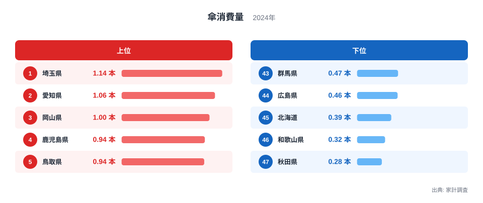
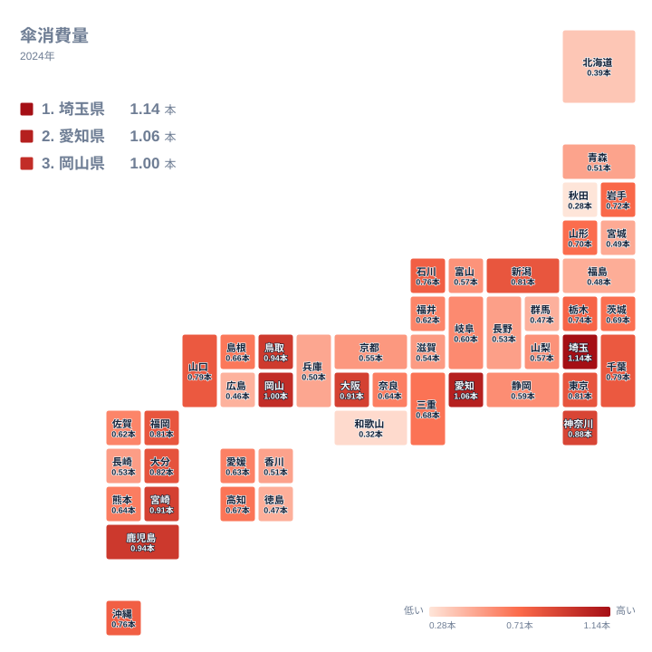

傘は雨の日の必需品です。そう考えると、雨や雪の多い地域ほど買う本数も多くなりそうです。ところが2024年の家計調査で都道府県別の傘の購入数量を並べてみると、1位は埼玉県で、最下位は秋田県でした。順位の並びは、直感とはずいぶん違って見えます。

この記事では、傘の消費量が多い県と少ない県を確認します。そのうえで、都市部の暮らし方、地域ごとの分布、雪国の事情といった視点から、差が生まれる理由を考えます。本記事にはこの指標だけで検証できる材料が少ないため、理由の説明は仮説として書きます。

## 傘消費量の上位と下位

まず全体像を図で確認します。上位5県と下位5県を並べたものです。

<source-link href="/ranking/umbrella-consumption-quantity">傘消費量ランキングをもっと見る</source-link>

1位は埼玉県で1.141本でした。2位は愛知県で1.059本、3位は岡山県で0.997本です。4位は鹿児島県で0.944本、5位は鳥取県で0.937本でした。上位5県には、関東の埼玉県、東海の愛知県、中国地方の岡山県と鳥取県、九州の鹿児島県が入っています。地方も顔ぶれもばらばらで、特定の一地方に偏っているわけではありません。

下位に目を移すと、最下位は秋田県の0.281本です。46位は和歌山県で0.318本、45位は北海道で0.388本でした。44位は広島県で0.46本、43位は群馬県で0.465本です。1位の埼玉県と最下位の秋田県の間には、大きな開きがあります。傘はどの家庭にもある日用品ですが、買われる本数には県ごとにはっきりした違いがあります。

> [!NOTE]
> ここでの傘消費量は、家計調査で把握された傘の購入数量を、本数で表したものです。持っている傘の総数ではなく、調査年に新しく買われた本数を示します。長く使い続ける家庭が多い県では、同じ天気でも数字は小さくなります。

## 大都市圏の県が上位に並ぶ

上位の顔ぶれで目を引くのは、大都市圏の強さです。埼玉県が1位、愛知県が2位でした。8位の神奈川県は0.884本、10位の東京都は0.812本です。6位の大阪府は0.907本でした。13位の千葉県は0.791本で、全国の中では上位に入っています。

大都市圏では、鉄道やバスでの通勤や通学が多くなります。駅までの徒歩や乗り換えの途中で雨に降られ、駅前の店で急いで傘を買う場面も増えるでしょう。買った傘を電車の中に置き忘れることも、人の多い地域ほど起きやすいかもしれません。こうした買い足しや紛失が、購入本数を押し上げている可能性があります。ただし、この指標からはその仕組みを直接確かめられません。

埼玉県は、東京都心へ通う人が多い県として知られています。家計調査は世帯の支出を居住地ごとに集計するため、勤務先の近くで買った傘も、買った人の住む県の数字に入ります。この仕組みが埼玉県の1位に関係しているかもしれません。埼玉県の他の指標は[埼玉県のデータ](/areas/11000)で確認できます。愛知県は自動車での移動が多いイメージがありますが、傘の購入は2位でした。詳しくは[愛知県のデータ](/areas/23000)をご覧ください。

> [!TIP]
> 順位表を読むときは、順位そのものより値の近さに注目してください。この統計では、大阪府と宮崎県がどちらも0.907本ですが、データ上は6位と7位に分かれています。千葉県と山口県も同じ0.791本で、13位と14位です。値が同じでも順位は別々に付いているため、順位だけを見て差があると決めつけないことが大切です。

## 中国地方と九州に上位の県が多い

大都市圏以外で上位に入った県にも注目します。中国地方では岡山県が3位、鳥取県が5位でした。山口県は0.791本で14位です。九州では鹿児島県が4位、宮崎県が0.907本で7位、大分県が0.82本で9位、福岡県が0.807本で11位でした。中国地方と九州には、中位より上に入る県がまとまって見られます。

次の地理分布の図で、全国のばらつきを確認します。

図では、濃い色の県が関東から東海、中国地方、九州にかけて広がっています。反対に、下位の北海道、秋田県、和歌山県、群馬県、広島県は、それぞれ離れた場所に点在しています。東北でも岩手県は18位、山形県は19位と、順位は中位の上寄りです。薄い色の県が一つの地方にそろっているわけではなく、地域ごとの偏りは単純ではありません。

中国地方の中でも、岡山県と鳥取県は上位ですが、広島県は44位と下位です。同じ地方でも順位が大きく分かれているので、地方の気候だけで傘の購入数量を説明することは難しそうです。九州南部や山陰の気候が影響している可能性はありますが、降水量のデータをこの記事では使っていないため、確かめることはできません。

> [!WARNING]
> 家計調査は標本調査で、傘は購入頻度の低い品目です。年によっては数世帯の購入の有無で、県の平均が動くかもしれません。小さな順位の差を、県民性や気候の違いと断定するのは避けてください。この記事は2024年1年分の値だけを使っているため、毎年同じ傾向とは言い切れません。

## 北海道や秋田県で少ないのはなぜか

下位に並ぶ北海道と秋田県は、冬に雪が降る地域です。雪の日は傘をささず、フード付きの上着や帽子で過ごす人が多いと言われます。そうした習慣があれば、傘を買う機会は少なくなるかもしれません。北海道の0.388本と秋田県の0.281本という低さは、こうした暮らし方の違いを反映している可能性があります。ただし、これも仮説にとどまります。

一方で、雪の多い地域がすべて低いわけではありません。新潟県は0.806本で12位、石川県は0.762本で15位でした。岩手県の0.719本は18位、山形県の0.699本は19位です。同じ雪国でも、順位は下位から上位寄りまで分かれています。雪が降ることだけでは、低さを説明できません。

和歌山県も0.318本で46位と、下位に入っています。近畿の中でも際立って低い値で、雪の多さでは説明がつきません。標本の偏りや、日常の移動手段の違いなど、別の要因が働いているかもしれません。ここでも、確かな理由は今回のデータからは分かりません。

## ほかの家計支出と見比べるには

傘の購入数量は、雨具全体の一部を表しているにすぎません。レインコートや長靴などで雨をしのぐ家庭では、傘の購入は少なくなるかもしれません。ただし、この記事のデータには他の雨具の値が含まれていないため、その比較はここでは行えません。

家計調査には、衣料や食料など多くの品目があります。傘の順位が高い県が、他の品目でも同じように高いのかどうかは、別の統計を並べて初めて分かります。他の家計に関する指標は、[同じカテゴリの統計一覧](/category/economy)から探せます。

## データについて

この記事で使った数値は、家計調査の傘消費量について、2024年の都道府県別の値です。単位は本で、全47都道府県が対象になっています。順位は購入数量の多い順に付けられています。小数第三位までの値をそのまま使っており、表示上は同じ値の県にも別の順位が付いている場合があります。

## まとめ

2024年の傘消費量は、埼玉県が1.141本で最も多く、秋田県が0.281本で最も少ない結果でした。上位には埼玉県や愛知県などの大都市圏の県のほか、中国地方の岡山県と鳥取県、九州の鹿児島県が入りました。下位には北海道、秋田県、和歌山県、広島県、群馬県が並びました。

雨や雪の多さだけで、順位を説明することはできません。通勤や通学での移動、雪の日の過ごし方、調査の標本の小ささなどが重なって、数字が決まっている可能性があります。自分の住む県の順位を確かめて、日々の雨の日の行動と照らし合わせてみてください。
