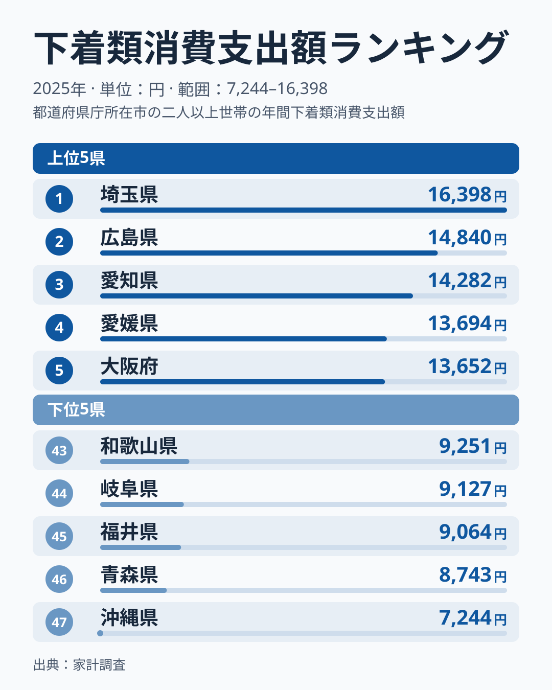
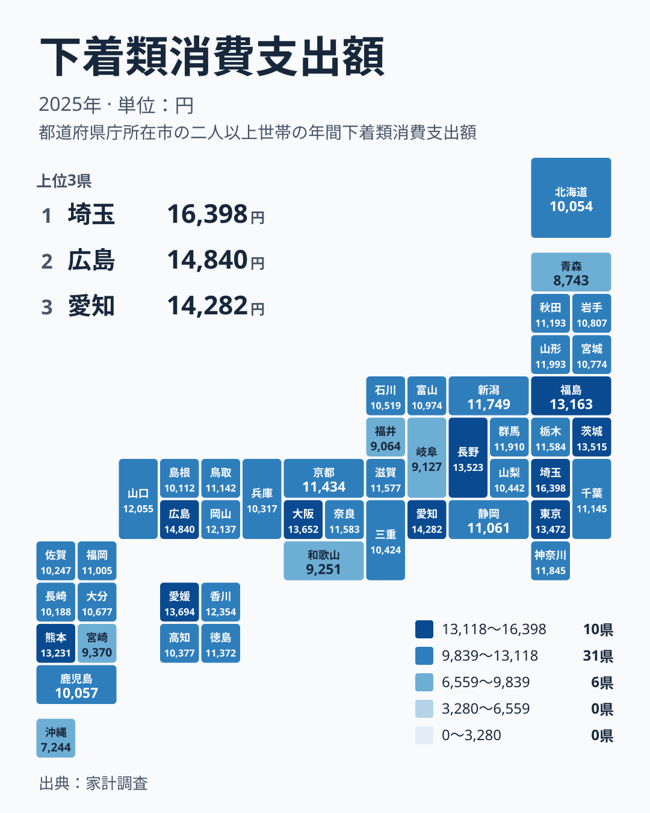

## 下着類への支出は県でどう違うのか

下着は毎日身につけるものなので、どの地域でも必ず買う品目です。それでも、1年間にいくら使うかは県によってかなり違います。家計調査の2025年の結果では、最も多い埼玉県が16,398円で1位でした。最も少ない沖縄県は7,244円で47位です。

同じ日本で暮らしていて、必需品の支出がここまで離れるのは意外に感じられます。この記事では、まず順位の顔ぶれを確かめます。そのうえで、気候、都市の規模、年齢構成といった切り口に分けて、差が生まれる理由を考えます。最後に、数字を暮らしの感覚へ置き換えるときの注意点をまとめます。

> [!NOTE]
> この記事の数値は、家計調査の「下着類」への年間支出額です。単位は円で、2025年の結果です。家計調査は世帯を対象にした調査なので、個人1人が使った額ではなく、世帯としての支出額として読んでください。

## 上位と下位の顔ぶれ

まずは上位と下位の県を図で確認します。

<source-link href="/ranking/underwear-group-consumption-expenditure">下着類への支出ランキングをもっと見る</source-link>

1位は埼玉県の16,398円です。2位は広島県の14,840円、3位は愛知県の14,282円で、4位は愛媛県の13,694円、5位は大阪府の13,652円と続きます。上位の県は関東、中国、中部、四国、近畿にまたがっています。特定の地方だけが突出しているわけではありません。

一方、下位には沖縄県の7,244円が47位で入り、46位は青森県の8,743円です。45位は福井県の9,064円、44位は岐阜県の9,127円、43位は和歌山県の9,251円となっています。こちらも北海道・東北、中部、近畿、九州・沖縄と地方がばらばらです。

注目したいのは、1位の埼玉県と2位の広島県の間にも大きな開きがあることです。広島県の14,840円に対し、埼玉県は16,398円で、上位の中でも埼玉県は頭ひとつ抜けています。反対に、47位の沖縄県は46位の青森県からもかなり離れています。両端の県は、中間の県より特殊な事情を抱えていると見たほうがよさそうです。

[同じカテゴリの統計一覧](/category/economy)では、家計の支出に関わる他の指標も確認できます。あわせて見ると、下着だけの話なのか、衣類全体の傾向なのかを切り分けやすくなります。

> [!TIP]
> 順位表を見るときは、順位そのものより金額の間隔に注目してください。中位の県どうしは数百円の差で順位が入れ替わります。たとえば20位の滋賀県は11,577円、19位の奈良県は11,583円で、わずかな差です。順位が1つ違っても、暮らしの実態が違うとは言えません。

## 地図で見ると、地方のまとまりは意外と弱い

次に、地理的な広がりを確認します。

地図を見ても、はっきりした東西や南北の分かれ目は見えにくいのが特徴です。関東では、埼玉県が1位、茨城県が7位の13,515円、東京都が8位の13,472円と上位に並びます。ところが、同じ関東でも千葉県は24位の11,145円、神奈川県は16位の11,845円で、中位にとどまります。

中部も一様ではありません。愛知県は3位で、長野県も6位の13,523円と高い水準です。しかし、福井県は45位、岐阜県は44位で、下位に沈んでいます。同じ地方の中に、上位の県と下位の県が同居していることになります。

九州・沖縄でも同じです。熊本県は9位の13,231円ですが、宮崎県は42位の9,370円で、沖縄県は最下位です。地方という大きな単位では、差の原因を説明しきれません。県ごとの事情を見る必要があります。

> [!WARNING]
> 家計調査は標本調査で、県によって調べられる世帯の数に限りがあります。1年間の家計簿をつけた世帯の顔ぶれが少し違うだけで、金額が動くことがあります。特に下着類のように、まとめ買いの有無で額が左右されやすい品目は、1年分の数字だけで県の特徴を断定しないでください。

## 差を生む3つの切り口

では、なぜこうした差が生まれるのでしょうか。被服及び履物の地域差については、気候、都市規模、年齢構成の3つの観点から説明されることが多いです。ここでは、それぞれが下着にどう当てはまるかを考えます。

ひとつ目は気候です。寒い地域では防寒具の需要が高く、手袋などでは北海道が全国平均を大きく上回るという話が知られています。下着も、保温性のある肌着を重ね着する地域では、買う点数や単価が上がる可能性があります。ただし、北海道は41位の10,054円にとどまっています。寒さだけでは順位を説明できません。

ふたつ目は都市規模です。大都市圏には百貨店や専門店が集まっていて、外出の機会も多いため、衣類に使うお金が増えやすいと言われます。東京都が8位、大阪府が5位、愛知県が3位という並びは、この見方と矛盾しません。ただ、神奈川県が16位、兵庫県が36位の10,317円であることを考えると、都市規模だけでは説明が足りません。

3つ目は年齢構成です。世代によって購入する品目や品質へのこだわりが違い、世帯の人数や構成によって必要な枚数も変わります。これは県の順位に最も効きそうな要因ですが、本記事の実データには年齢別の数値がありません。そのため、どの程度効いているかを数字で示すことはできません。

要するに、どれかひとつの要因で順位が決まるのではなく、複数の事情が県ごとに重なって金額に現れていると考えるのが妥当です。

## 暮らしの目線で数字を読む

ここまでの内容を、生活への含意として整理します。

- 1位の埼玉県は16,398円で、47位の沖縄県は7,244円です。同じ下着でも、支出の水準は県によって大きく違います
- 上位には埼玉県、広島県、愛知県、愛媛県、大阪府が入り、地方の枠を越えて分散しています
- 下位には沖縄県、青森県、福井県、岐阜県、和歌山県が並び、こちらも地方はまとまっていません
- 中位の県は金額が近く、順位の差は暮らしの差を意味しません

[埼玉県のデータ](/areas/11000)を見ると、他の指標でも家計の特徴を確認できます。[広島県のデータ](/areas/34000)も同様で、2位という結果が衣類全般の傾向なのか、下着に限った話なのかを調べる手がかりになります。

注意したいのは、支出が多いことと豊かであることは同じではない点です。買い替えの頻度が高いのか、単価の高い商品を選んでいるのか、家族の人数が多いのか。金額だけでは区別できません。支出が少ない県も、節約している、長く使う、あるいは別の場所で購入しているなど、理由はさまざまです。

自分の暮らす県が上位でも下位でも、数字は他県と比べた目安にすぎません。家計の見直しに使うなら、全国の順位よりも、自分の世帯の年間の使い方を振り返るほうが役に立ちます。

## データについて

この記事で使った指標は、家計調査の下着類消費支出額で、2025年の年間支出額を円で示したものです。県ごとの値と順位は、サイトに掲載されている全47件の実データに基づいています。

> [!NOTE]
> 家計調査の「下着類」は、被服及び履物という大きな分類の中の一項目です。衣類全体や靴の支出とは別に集計されているため、被服全体の順位とは一致しないことがあります。たとえば下着類で上位の県でも、他の衣類では中位ということが起こりえます。

気候、都市規模、年齢構成の説明は、被服及び履物の地域差に関する一般的な整理に基づく背景です。これらが各県の順位をどの程度説明するかは、この記事の実データだけでは確かめられません。実データで確認できるのは、県ごとの金額と順位の並びまでです。

下着は目立たない支出ですが、県ごとの違いを見ると、地域の暮らし方の一端がうかがえます。順位は入口にして、背景を丁寧に読み解いていくことが大切です。
