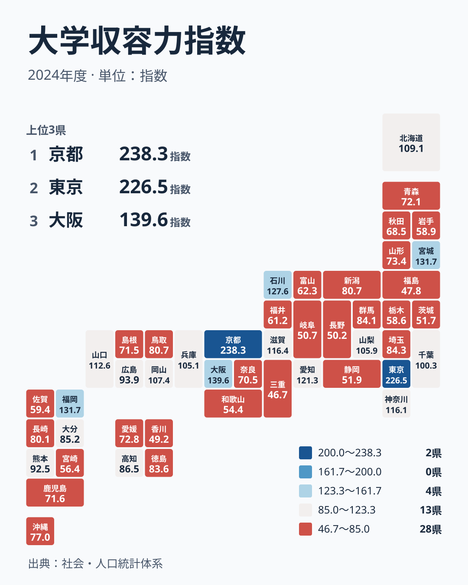
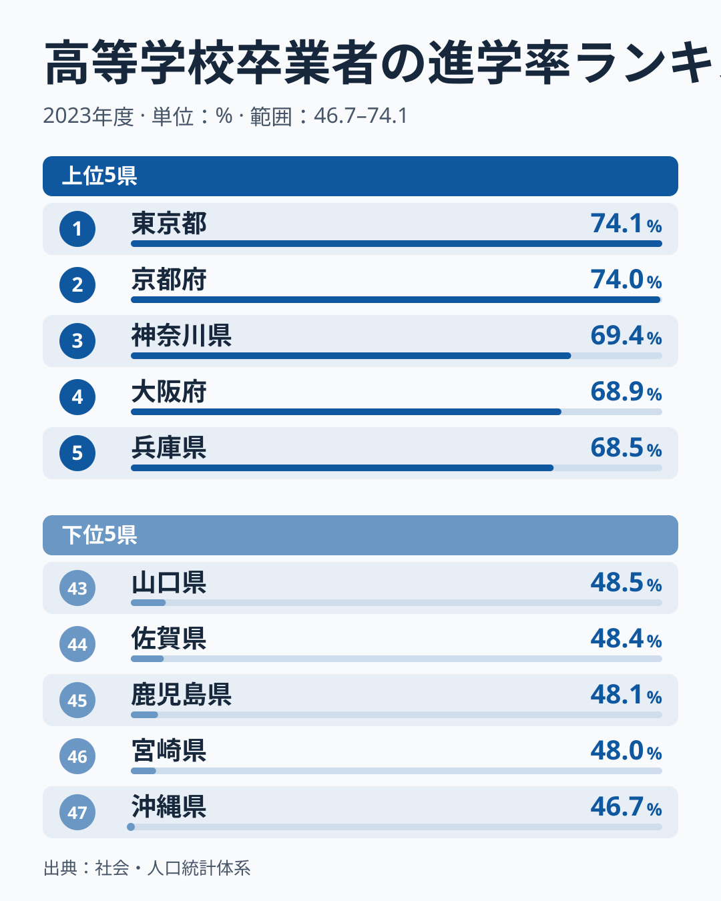
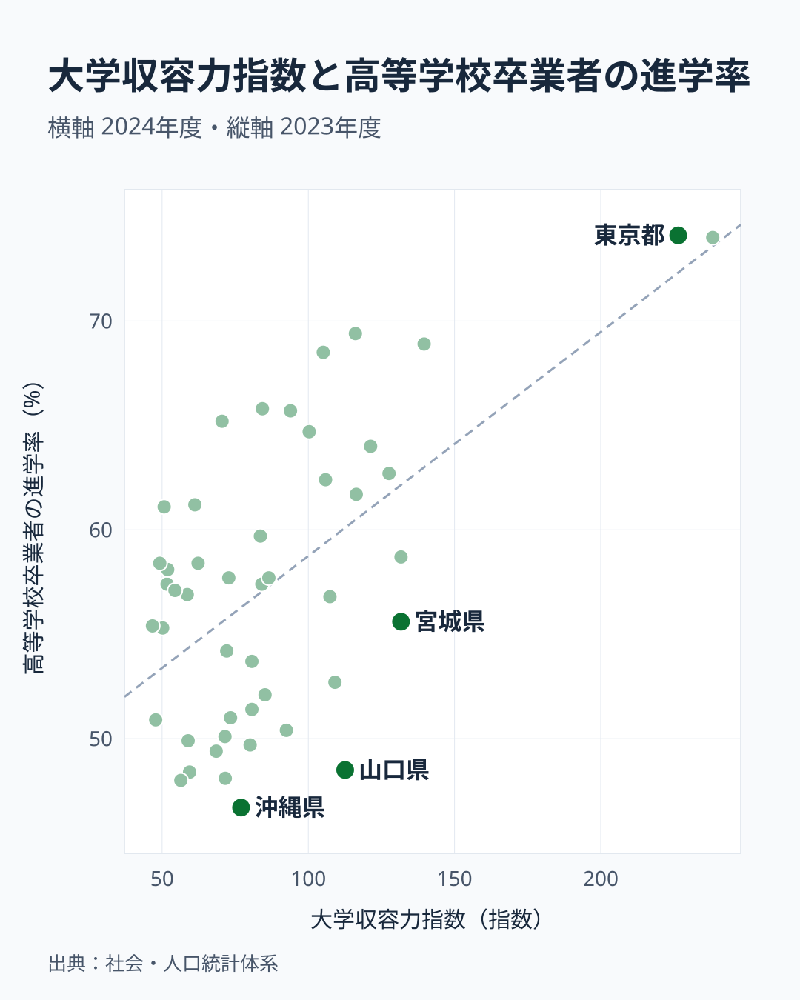
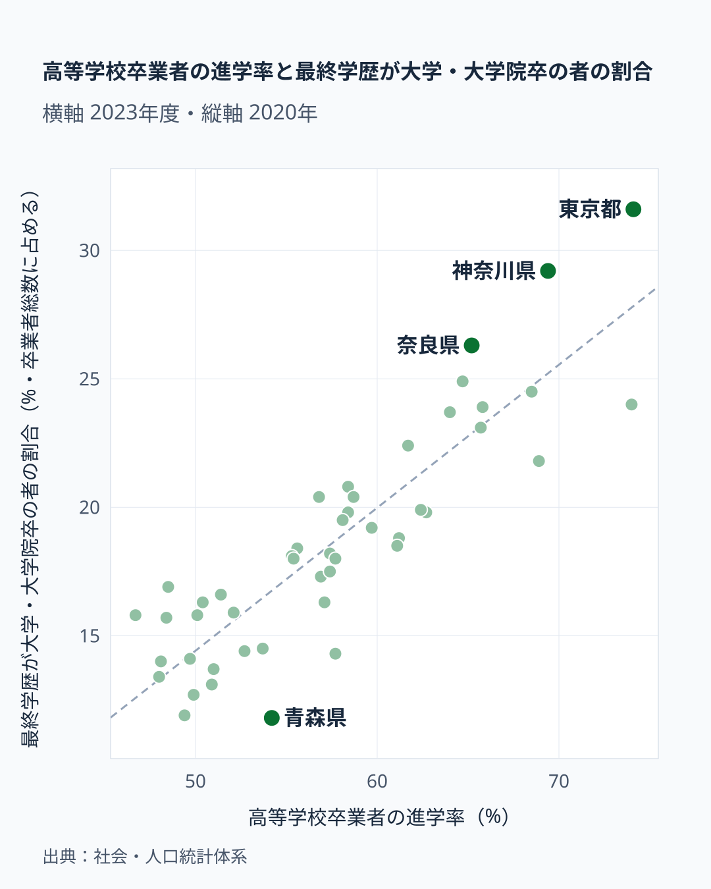

「近くに大学がある県ほど、大学へ進む人が多い」。もっともらしい見方ですが、数字で確かめるとどこまで言えるのでしょうか。

**大学収容力指数**は、京都府が238.3、[東京都](/areas/13000)が226.5と突出し、三重県は46.7、福島県は47.8です。約5倍の差があります。この差と[高校卒業者の進学率](/ranking/high-school-advancement-rate)の相関係数は0.61でした。傾向はありますが、京都府と東京都を除くと0.40に下がります。山口県のように指数が高いのに進学率が低い県や、奈良県のようにその逆の県もあります。

この記事では、大学収容力指数・進学率・県内大学への入学者割合・大卒割合の4指標を使い、大学の多さで説明できることとできないことを分けて読みます。

> [!NOTE]
> 大学収容力指数は e-Stat「社会・人口統計体系」の指標で、数字は2024年度です。計算式を公式の定義で確認できなかったため、本記事では「県内の大学の受け入れ規模を比べる指数」として値の大小だけを読みます。進学率は2023年、県内大学入学者割合は2024年、大卒割合は2020年の数字です。進学率に短大などがどこまで含まれるかも、本記事では確認していません。

## 大学収容力指数マップ──京都と東京が突出する

マップで最も濃いのは京都府の238.3と東京都の226.5です。3位の大阪府は139.6で、宮城県と福岡県が131.7で同率4位です。仙台や福岡のように地方の中核都市を持つ県が、東京と京都に次ぐ位置に来ています。周辺の県から学生が集まる県が高く出ている可能性があります。

低い側は三重県が46.7で47位、福島県が47.8で46位、香川県が49.2で45位です。指数が100を下回るのは32県で、京都府と東京都の2つが全体の平均を押し上げています。47都道府県の単純平均は88.9です。

低い側の3県は、県内の大学へ進む人の割合も三重県が23.9%、福島県が21.0%、香川県が17.7%と低く、多くの人が県外の大学へ進んでいます。三重県は愛知県、香川県は岡山県や関西に近く、県外へ進みやすい位置にあることが関わっている可能性があります。

<source-link href="/ranking/university-capacity-index">47都道府県の大学収容力指数ランキングをもっと見る</source-link>

## 進学率ランキング──東京74%、沖縄47%

進学率が最も高いのは東京都の74.1%で、京都府の74.0%がほぼ並びます。神奈川県は69.4%で3位、大阪府は68.9%で4位、兵庫県は68.5%で5位です。上位には大都市圏の都府県が並び、周辺の大学へ自宅から通いやすい環境が関わっている可能性があります。

最も低いのは沖縄県の46.7%です。宮崎県は48.0%で46位、鹿児島県は48.1%で45位、佐賀県は48.4%で44位、山口県は48.5%で43位です。1位と47位の差は約27ポイントあり、47都道府県の単純平均は57.6%です。

下位5県のうち4県は九州・沖縄の県です。沖縄県、宮崎県、鹿児島県は1人あたり県民所得でも低い側にあり、進学に伴う費用の負担が関わっている可能性があります。

<source-link href="/ranking/high-school-advancement-rate">高校卒業者の進学率ランキングをもっと見る</source-link>

## 収容力と進学率を重ねる──傾向はあるが例外が多い

2つの相関係数は0.61で、順位どうしでは0.43です。右端の京都府と東京都が全体の数字を押し上げていて、この2つを除くと0.40まで下がります。大学が多い県ほど進学率が高い傾向はあるものの、強い関係とは言えません。

線から外れる県を見ると、その理由が分かります。山口県の指数は112.6で10位ですが、進学率は48.5%で43位です。宮城県も131.7で4位なのに、進学率は55.6%で28位です。県内に大学が多くても、進学率が高いとは限りません。

反対に、奈良県の指数は70.5で32位ですが、進学率は65.2%で8位です。香川県は49.2で45位なのに、進学率は58.4%で18位です。指数が最も低い三重県も55.4%で29位で、47都道府県の中では中位です。県内の大学が少なくても、進学率が低いとは限りません。

進学率と連動する指標は他にもあります。2021年度の[1人当たり県民所得](/ranking/per-capita-prefectural-income-h27)との相関係数は0.58で、収容力指数の0.61とほぼ同じ強さです。収容力指数と県民所得の間にも0.47の相関があるので、どちらがどれだけ効いているかは、この計算からは切り分けられません。

> [!WARNING]
> 収容力指数は県境で区切った数字です。奈良県のように隣の府県の大学へ通える県では、県内の大学の少なさが進学のしにくさに直結しません。

## 県内の大学へ進む割合──愛知71%、鳥取15%

県内の高校から大学へ入学した人のうち、同じ県内の大学へ進んだ人の割合を見ます。最も高いのは愛知県の71.4%で、東京都の68.8%、福岡県の65.9%、北海道の65.3%が続きます。最も低いのは鳥取県の15.1%で、奈良県は15.2%で46位です。

この割合と収容力指数の相関係数は0.72で、進学率との0.61より強い関係です。大学が多い県では、地元の大学に進む人の割合が高くなります。つまり収容力指数は、進学するかどうかより、**進学先が県内か県外か**とのほうが強く連動しています。

奈良県は県内入学者割合が低いのに進学率は8位で、県外へ進む形で進学率を保っています。県内の大学に限らず、周辺の大学も含めた選択肢で進学を見る必要があることが分かります。

あわせて見る: [県内大学入学者割合ランキング](/ranking/in-pref-university-entrance-ratio-by-highschool-origin)

## 進学率と大卒割合──同じ県の別の時点を映す

最終学歴が分かる卒業者のうち大学・大学院を卒業した人の割合は、東京都が31.6%で1位、神奈川県が29.2%で2位、奈良県が26.3%で3位です。最も低いのは青森県の11.8%で、東京都とは約2.7倍の差があります。

進学率との相関係数は0.88で、この記事の指標の中で最も強い関係です。線に沿って右上に東京都と神奈川県、左下に秋田県や岩手県が並びます。香川県は大卒割合が20.8%で12位と、ここでも指数の低さに見合わない位置です。

ただし、この数字から「進学率が低い県は大卒が流出して不利になる」といった連鎖までは読めません。大卒割合は今住んでいる人の学歴で、進学率は最近の高校卒業者の進路です。奈良県の大卒割合が高いことには、大阪などへ通勤する人が住んでいることが関わる可能性があります。人口移動や賃金の数字を見ていない本記事では、流出が地域にもたらす影響は検証していません。

あわせて見る: [最終学歴が大学・大学院卒の者の割合ランキング](/ranking/final-education-university-graduate-school-ratio)

## まとめ

- 大学収容力指数は京都府の238.3から三重県の46.7まで約5倍の差があります
- 収容力指数と進学率の相関係数は0.61ですが、京都府と東京都を除くと0.40です
- 山口県や宮城県は指数が高くても進学率は高くなく、奈良県や香川県は指数が低くても進学率は高い位置にあります
- 収容力指数は進学率より、県内の大学へ進む割合と強く連動します。相関係数は0.72です
- 進学率は県民所得とも0.58の相関があり、大学の多さだけでは説明できません

県内の大学が多いほど県内へ進む人が増えるのは自然な関係で、0.72と0.61の差も大きくはありません。それでも、大学の多さは進学するかどうかより、どこへ進学するかと結びつきやすいと考えられます。どの数字も県単位の相関で、個人の進路の理由を示すものではありません。
