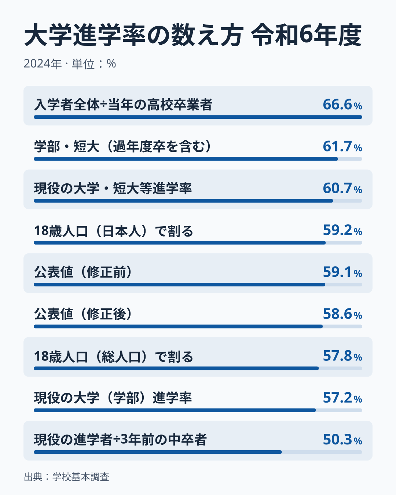
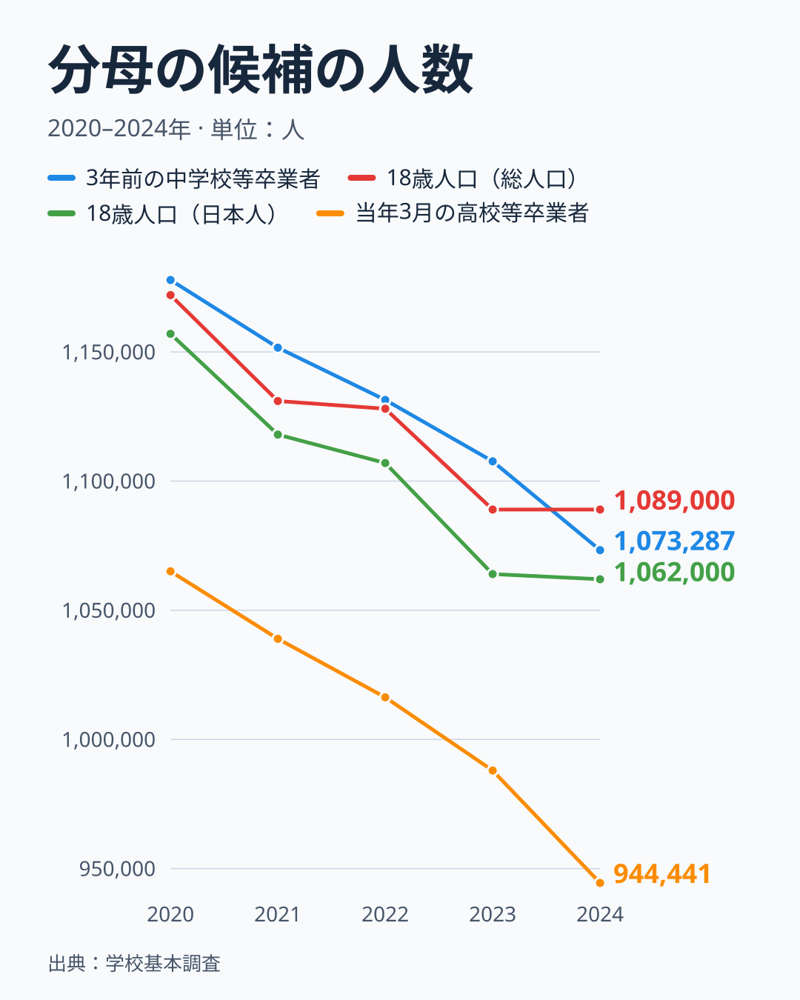
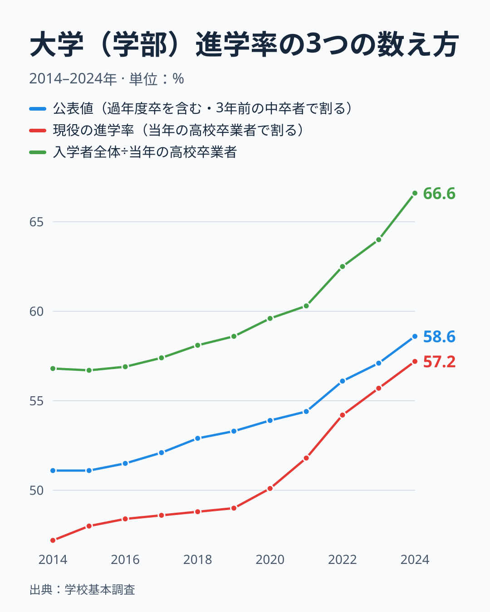
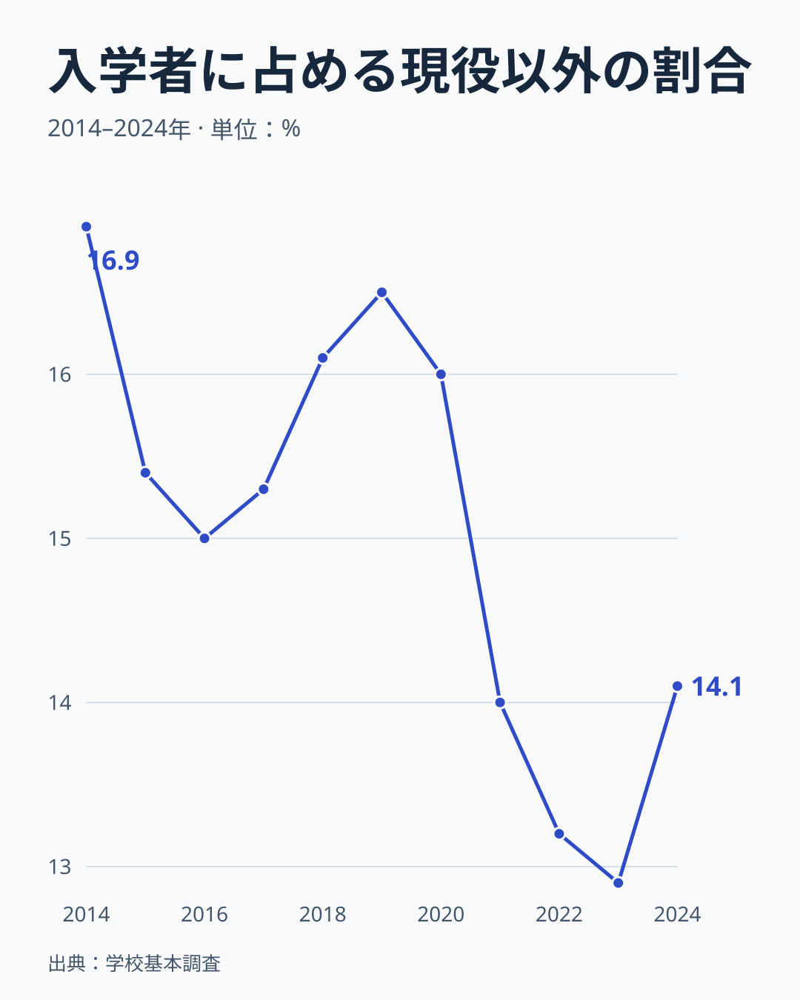
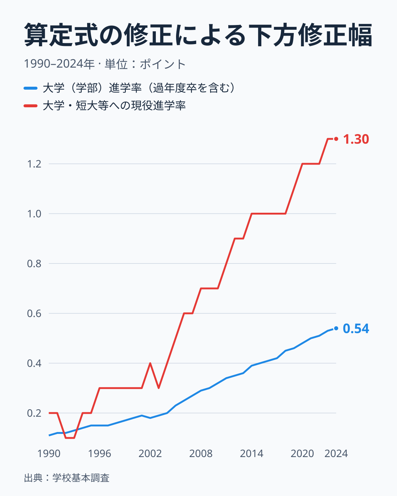
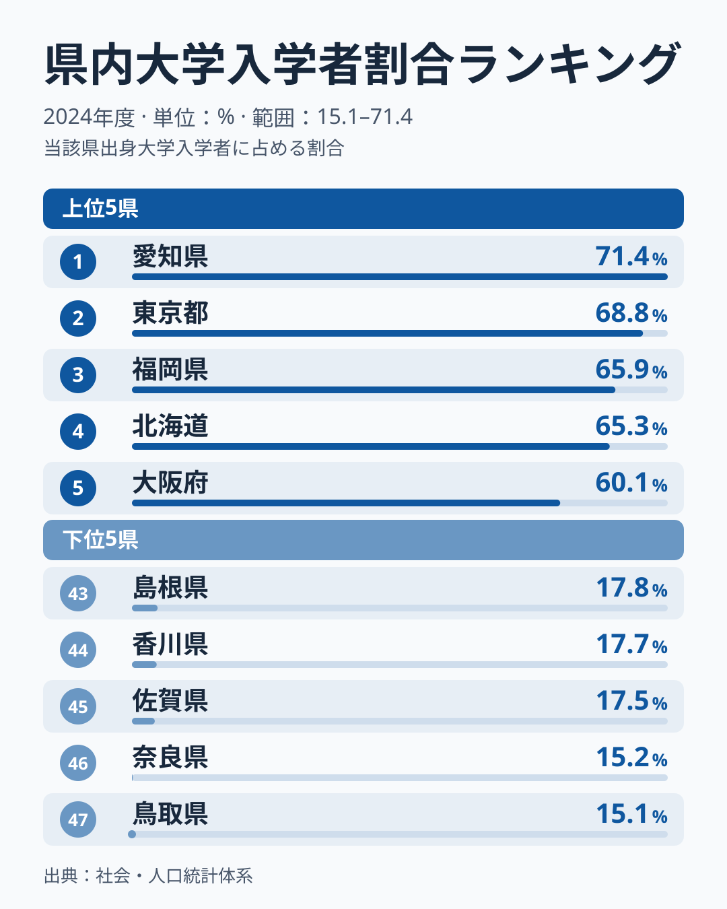

自前で計算した大学進学率が公表値と食い違うのは、分子に入れる人と分母に入れる人の組み合わせが公表値と違う場合です。令和6年度（2024年度）の大学（学部）進学率は、文部科学省の公表値（2025年12月の修正後）が58.6%でした。分子を現役の進学者だけにして当年3月の高校等卒業者で割ると57.2%、入学者全体を同じ当年の卒業者で割ると66.6%になります。分子を現役の進学者のまま分母を3年前の中学校等卒業者に替えると50.3%です。同じ年の同じ統計から、組み合わせだけで50.3%から66.6%までの数字が作れます。

食い違いを生む仕組みは2つあります。一つは分子で、現役の進学者だけを数えるか、浪人や留学生を含む入学者全体を数えるかです。分母を当年の卒業者に固定したまま分子に浪人などを加えると、率は9.4ポイント高く出ます。もう一つは分母で、当年の高校等卒業者にするか、3年前の中学校等卒業者にするかです。入学者全体を分子にしたまま分母を替えると、率は8.0ポイント低くなります。公表値は、入学者全体を分子に、3年前の中学校等卒業者を分母にしています。さらに公表値そのものも一度変わりました。文部科学省は2025年12月に、分母に特別支援学校（中学部）の卒業者が含まれていなかったことを不適切として、過去にさかのぼって修正しています。令和6年度の値は59.1%から58.6%に下がっています。

> [!NOTE]
> 公表値の分母は、3年前の中学校・義務教育学校・特別支援学校（中学部）卒業者及び中等教育学校前期課程修了者の合計です（文部科学省、令和7年12月の算定式）。分子の大学（学部）の入学者には、過年度高卒者等が含まれます。

## 同じ令和6年度に9つの数字がある

図は、令和6年度の大学進学率を、分母と分子の組み合わせを変えて並べたものです。文部科学省が公表している値は5つです。公表値（修正後）の58.6%と修正前の59.1%は、同じ指標の新旧の値で、修正前の値は2025年12月に取り下げられています。学部と短期大学（本科）を合わせた61.7%と、現役の大学・短大等進学率の60.7%は、短期大学を含む別の指標です。現役の大学（学部）進学率の57.2%は、大学（学部）に進学した現役の人数を、当年3月の高校等卒業者で割った値です。

残る4つは、公表の数字や公式の人数から計算した、この記事の参照値です。入学者全体÷当年の高校卒業者の66.6%、18歳人口（日本人）で割った59.2%、18歳人口（総人口）で割った57.8%、現役の進学者÷3年前の中卒者の50.3%です。66.6%は9つの中で最大の、分子と分母の対象が違う組み合わせです。50.3%は9つの中で最小で、分子を現役に限って分母を3年前の中卒者にした値です。報道などの自前計算がどれを使うかは、個々の計算方法を確かめる必要があり、この記事では断定しません。

最大の66.6%と最小の50.3%の差は、16.3ポイントあります。この差は統計の誤りではなく、数え方だけで生まれます。分子と分母の組み合わせを4つに整理すると、違いがはっきりします。現役の進学者を当年の卒業者で割ると57.2%、入学者全体を当年の卒業者で割ると66.6%、現役の進学者を3年前の中卒者で割ると50.3%、入学者全体を3年前の中卒者で割ると58.6%です。分子を入学者全体に替える効果は、分母が当年の卒業者のとき9.4ポイント、3年前の中卒者のとき8.3ポイントです。分母を3年前の中卒者に替える効果は、分子が現役のときマイナス6.9ポイント、入学者全体のときマイナス8.0ポイントです。

派生値のうち、入学者数は公表されている進学率に3年前の中卒者数をかけて求めた概算です。令和6年度は約62.9万人になります。進学率が小数第1位までの数字なので、概算には約540人の幅があり、率にすると0.1ポイント未満です。現役の大学（学部）進学者数は539,988人（当年3月の高校等卒業者944,441人）で、公式の確定値です。

## 公表値の分母は「18歳人口」の代用

公表値の分母は、3年前の中学校等卒業者です。文部科学省は平成24年度の学校基本調査報告書から、この分母を「18歳人口」と表記し始めました。実際には、18歳の人口を数えた数字ではありません。昭和46年の文部統計要覧にある「高等教育就学率」の考え方、つまり大学・短大の入学者を3年前の中学卒業者数で割る方法を引き継いだものです。

この方法は、近似として成り立っています。ある年の入学者には、前の年までに高校を卒業した浪人などが入ります。一方で、その年の卒業者の一部は、翌年以降に入学します。世代の大きさが毎年ほとんど変わらないなら、入学者を同じ世代の人数で割った値は、その世代が大学に進む割合の近似になります。世代が年々小さくなる局面では、入学者に含まれる浪人は前の年の大きい世代から来るため、近似はずれます。公表値は、この近似を承知して使われている概算です。

令和2年から6年にかけての、分母になりうる4つの人数を並べました。令和6年は、3年前の中学校等卒業者が1,073,287人、総務省の人口推計（2024年10月1日現在）の18歳人口が総人口で1,089,000人、日本人で1,062,000人です。この3つは、数万人の範囲に収まります。当年3月の高校等卒業者は944,441人で、3年前の中卒者より12%少ない水準です。

当年の高校卒業者が少ない理由は、定義にあります。この人数は全日制・定時制の高校等の卒業者で、中等教育学校後期課程と特別支援学校（高等部）を含みます。令和6年度の入学者に対応する世代は、令和3年3月の中学校等卒業者です。この世代の高校等への進学率は98.9%でしたが、通信制課程（本科）への進学者を除くと95.0%です（文部科学省の別紙2）。高校等に進学しなかった人の1.1ポイントと、通信制課程に進んだ人の3.9ポイントで、合わせて約5.0ポイントが、当年の高校卒業者の統計に入りません。3年前の中卒者と当年の高校卒業者の12ポイントの差のうち、残りの約7ポイントは、この資料からは分かりません。[仮説] 残る約7ポイントの大半は、高等専門学校への進学者（卒業が高校より2年遅い）、中途退学、留年や休学です。検証は、高等専門学校の進学者数、高校の中途退学者数、留年や休学で卒業が遅れた人数を同じ世代で足して、約7.5万人の何割を説明できるかを見ることでできます。8割以上なら支持し、5割未満なら棄却します。5割から8割の間は、判定を保留します。確認は、令和7年度の年次統計が整理される2027年2月までに行います。

18歳人口に分母を替えると、数字は少し動きます。入学者全体を18歳人口（総人口）で割ると57.8%、日本人で割ると59.2%です。公表値の58.6%とは、0.8ポイント低いか0.6ポイント高い範囲にあります。分母の選び方だけでは、浪人の扱いほど大きくは動きません。

> [!WARNING]
> 入学者全体には、過年度高卒者や留学生などの現役以外の人が含まれます。人口推計の18歳人口は10月1日現在で、4月に入学する世代とは半年ずれます。

## 浪人を分子だけに入れると、率が高く出る

3つの数え方を、平成26年度から令和6年度まで並べました。青い線が公表値、赤い線が現役の進学率、緑の線が入学者全体を当年の高校卒業者で割った値です。令和6年度は、青が58.6%、赤が57.2%、緑が66.6%です。緑の線は、すべての年で青より5ポイント以上高く、平成26年度の56.8%から令和6年度の66.6%まで上がりました。同じ期間に、青は51.1%から58.6%へ7.5ポイント、赤は47.2%から57.2%へ10.0ポイント上がっています。

緑の線が赤の線より高いのは、分子に浪人や留学生などの現役以外の入学者を含めたまま、分母を当年の高校卒業者に限っているためです。分子には前の年までに高校を卒業した人が入りますが、分母の当年の卒業者には入っていません。誰を数えるかが分子と分母でずれているので、現役の進学率とは別の意味の数字になります。緑の線と青の線の差は、分子が同じで分母が違うだけです。緑の線と青の線の比は、3年前の中卒者を当年の高校卒業者で割った比と一致します。この比は、平成26年度の1.11倍から、令和6年度の1.14倍に上がりました。

さらに、緑の線と青の線の差は広がっています。平成26年度は5.7ポイント、平成30年度の5.2ポイントを底に、令和6年度は8.0ポイントです。差は公表値に比から1を引いた値をかけたものなので、比の上昇と公表値の水準の上昇の両方で広がります。比が平成26年度の1.11倍のままなら令和6年度の差は6.5ポイントなので、比の上昇による分は約1.5ポイント、公表値の水準の上昇による分は約0.8ポイントです。比が上がったのは、当年の高校卒業者が3年前の中卒者に対して少なくなったためです。令和2年は3年前の中学校等卒業者が1,177,848人、当年の高校卒業者が1,065,064人で、後者は前者の90%でした。令和6年は1,073,287人と944,441人で、88%です。両者は同じ世代の人数なので、出生数の減少では説明できません。通信制課程に進む人の割合が、令和2年度の入学者に対応する世代（平成29年3月の中学校卒業者）の2.4%から、令和6年度の入学者に対応する世代の3.9%へ上がっていて、この1.5ポイントの上昇が、0.904から0.880への2.4ポイントの低下の約6割に当たります。令和3年度に60.3%だった緑の線が令和6年度に66.6%へ6.3ポイント上がった間、公表値は54.4%から58.6%へ4.2ポイントの上昇でした。

入学者に占める現役以外の割合も、年によって動いています。

入学者の概算から現役の進学者を引いた現役以外の人は、令和6年度で約8.9万人、入学者の14.1%です。平成26年度は16.9%、令和5年度は12.9%でした。この数字には、過年度の高校卒業者、留学生などのほか、当年に通信制課程を卒業して入学した人のように、現役の進学者（全日制・定時制の当年卒業者）に入らない人が含まれます。過年度高卒者や留学生等の数値は、学校基本調査では把握が難しいと、文部科学省自身が説明しています。

公表値と現役の進学率の差は、平成26年度の3.9ポイントから令和6年度の1.4ポイントまで縮まりました。公表値を現役の進学率で割った比は、入学者を現役の進学者で割った比と、当年の高校卒業者を3年前の中卒者で割った比の積に等しくなります。前者は平成26年度の1.20倍から令和6年度の1.16倍へ、後者は0.90倍から0.88倍へ下がり、積は1.08倍から1.02倍に縮まりました。前者の低下は、入学者に占める現役以外の人の割合が下がったことを表します。後者の低下は、3年前の中卒者に対して当年に高校を卒業する人の割合が下がったことを表します。

## 公表値そのものが、2025年12月に修正された

公表値は一度も変わらないものではありません。文部科学省は2025年12月に、「年次統計」の大学（学部）進学率の分母に、特別支援学校（中学部）の卒業者数が含まれていなかったことを不適切として、算定式を改めました。この指標を初めて掲載した平成11年度から、分母に特別支援学校の卒業者を入れていなかったと説明しています。

図は、修正前の値から修正後の値を引いた差です。大学（学部）進学率（過年度卒を含む）の差は、分子を変えず分母だけを替えたことによるので、修正前の進学率に修正前後の分母の比をかけて求めています。平成2年（1990年）の0.11ポイントから、令和5年度の0.53ポイント、令和6年度の0.54ポイントまで、少しずつ大きくなりました。最大は令和6年度で、公式資料の「約0.5ポイント」と一致します。令和6年度の値は、59.1%から58.6%に下がっています。大学・短大等への現役進学率は、修正幅がもっと大きく、令和6年度に1.3ポイントです。修正前は62.0%で、修正後は60.7%でした。こちらは小数第1位の値の差なので、約0.1ポイントの誤差があります。

修正の理由は、分母の範囲です。大学（学部）進学率では、3年前の中学校等卒業者に特別支援学校（中学部）の卒業者を加えました。令和6年度の分母は1,063,451人から1,073,287人へ、9,836人増えています。現役進学率でも、分母に特別支援学校（高等部）の卒業者を加えました。人数が増えた分だけ、率が下がります。

一方、分子の扱いは変えていません。文部科学省は、「大学（学部）の入学者」に過年度高卒者や留学生等が含まれることを認めたうえで、これらの数値は学校基本調査では把握が難しいこと、概算値としての大学進学率を捉える目的に照らして、現行の数値を引き続き使うと説明しています。公表値は、浪人や留学生を分子に含む概算です。この性質を知らずに「現役の進学率」と比べると、数字が合わない原因が見えなくなります。

令和7年度の確定値では、大学（学部）進学率（過年度卒を含む）は58.6%、大学（学部）・短大（本科）進学率は61.4%、現役の大学・短大等への進学率は61.4%でした。現役の大学（学部）の進学者は557,170人で、当年3月の高校等卒業者955,335人の58.3%です。公表値の58.6%と、現役の58.3%は近い値になりましたが、分子と分母の対象は違います。前者は入学者全体を3年前の中卒者で割った値、後者は現役の進学者を当年の卒業者で割った値で、同じ問いに答える数字ではありません。

## 県別に自前で計算するときの落とし穴

県別に大学進学率を計算するときは、これに加えて、どの県を基準に人数を数えるかを決める必要があります。大学のある県で数える方法と、出身高校のある県で数える方法です。

図は、進学率ではなく、出身高校のある県に残る割合です。社会・人口統計体系の「出身高校所在地県の県内大学への入学者割合」は、当該県の高校の出身者が、その県の大学に入学した割合です。令和6年度は、愛知県が71.4%、東京都が68.8%、福岡県が65.9%、北海道が65.3%、大阪府が60.1%と、大きな都市圏の県が並びます。低いのは鳥取県の15.1%、奈良県の15.2%、佐賀県の17.5%、香川県の17.7%、島根県の17.8%です。最大と最小の比は4.7倍で、鳥取県と奈良県では、出身高校のある県の大学に入る人が7人に1人ほどです。

<source-link href="/ranking/in-pref-university-entrance-ratio-by-highschool-origin">県内大学入学者割合ランキングを見る</source-link>

この割合が低い県では、進学する人の大半が県外の大学へ進みます。大学のある県で入学者を数えると、その県の高校生の進学とは別の人が多く入ります。出身高校の所在地で数えた値と大学の所在地で数えた値では、県の順位も意味も変わります。県別に自前で計算した進学率が公表値や既存のランキングと違って見えるとき、出身高校の所在地で数えたか、大学の所在地で数えたかを最初に確かめます。[仮説] 浪人は大都市圏の予備校に集まるため、現役以外の入学者の割合には県ごとの偏りがあり、県別の自前計算は全国の計算より分子の定義の影響を強く受けます。検証は、出身高校の所在地県別の入学者数を現役と過年度に分けた表で、県別の現役以外の割合の最大と最小の差が5ポイント以上あるかを見ることでできます。5ポイント以上あれば仮説を支持し、2ポイント未満なら棄却します。確認は令和7年度の県別の表が公表された後に行います。

県別の進学率の定義の違いは、[進学率トップは東京・京都｜なぜ都市部ほど高いのか](/blog/high-school-advancement-rate)と[大学が多い県ほど進学率は高い?](/blog/university-advancement-capacity)で見られます。就職を含めた進路は[進学率だけでは分からない、堅実な県はどこ](/blog/advancement-plus-employment-rate-prefecture)、塾代との関係は[塾代は最下位級でも京都の進学率はトップ級](/blog/tutoring-cost-university-advancement-gap)にあります。社会・人口統計体系の[高等学校卒業者の進学率ランキング](/ranking/high-school-advancement-rate)は、どの定義の数字かを確認してから使ってください。

## 自前計算を点検する手順

進学率を自前で計算するとき、次の順に確かめると食い違いの原因が絞れます。

- 分子に誰を入れているかを確かめます。現役の進学者だけか、過年度の高校卒業者や留学生を含む入学者全体かを区別します。
- 分母と分子の組み合わせを確かめます。入学者全体を分子にするなら、分母は3年前の中学校等卒業者のように、同じ世代の人数に近似できる集団にそろえます。当年の高校卒業者で割ると、現役とは別の意味になります。
- 分母の人数を公式の定義で確かめます。当年3月の高校等卒業者、3年前の中学校等卒業者、人口推計の18歳人口は、令和6年に94万人から109万人まで幅があります。
- 年度の対応を確かめます。令和6年度の入学者に対応する3年前の中学校等卒業者は、令和3年3月の卒業者です。
- 公表値の算定式が改められていないかを確かめます。令和7年12月の修正では、令和6年度の値が0.5ポイント下がりました。
- 県別なら、出身高校の所在地で数えたか、大学の所在地で数えたかを確かめます。

## データについて

使った資料は、文部科学省の「令和7年度学校基本統計（学校基本調査の結果）確定値について」（令和7年12月26日）と、同年12月の「学校基本調査『年次統計』における特別支援学校の取扱いに関する修正について」の別紙1・別紙2、総務省統計局の人口推計（各年10月1日現在の年齢各歳別人口）、社会・人口統計体系です。数値の転記元は、いずれも公式の資料です。公表値は、修正後の値を使いました。修正前の値は、令和6年度について別紙の表で確かめています。

令和6年度を軸にした理由は、修正文書の別紙の表が令和6年度までだからです。令和7年度は確定値の本体の値だけを使いました。この記事で使った資料には令和7年度の3年前の中卒者数が載っていないので、派生値は計算していません。人口推計の18歳人口は、2020年から2024年までの各年10月1日現在の値です。入学は4月なので、半年のずれがあり、2023年と2024年は総人口が同じ1,089,000人（千人単位の値）でした。

この記事で示した「入学者全体÷当年の高校卒業者」「18歳人口で割る」「現役の進学者÷3年前の中卒者」の3つは、公表の数字から計算した派生値で、特定の報道や調査の数字を指すものではありません。数字を比べるときは、分子と分母に何を入れているかを確かめてください。学校基本調査の定義は変更されることがあり、この記事の内容は令和7年12月の公表を基準にしています。年収別の教育費は[教育費だけ格差が桁違いなのはなぜ?](/blog/income-quintile-education)、教育・スポーツのデータは[カテゴリのページ](/category/educationsports)から見られます。

## まとめ

- 令和6年度の大学（学部）進学率は、公表値（修正後）が58.6%です。数え方を変えると50.3%から66.6%まで動きます。
- 分子を現役の進学者から入学者全体に替えると、率は8.3から9.4ポイント高くなります。分母を当年の高校卒業者から3年前の中学校等卒業者に替えると、6.9から8.0ポイント低くなります。
- 公表値の分母は、人口推計の18歳人口ではなく、3年前の中学校等卒業者です。18歳人口で割ると57.8%から59.2%です。
- 文部科学省は2025年12月に、分母に特別支援学校（中学部）の卒業者を加えて算定式を修正し、令和6年度は59.1%から58.6%になりました。
- 県別では、出身高校の所在地で数えるか大学の所在地で数えるかで、数字の意味が変わります。
