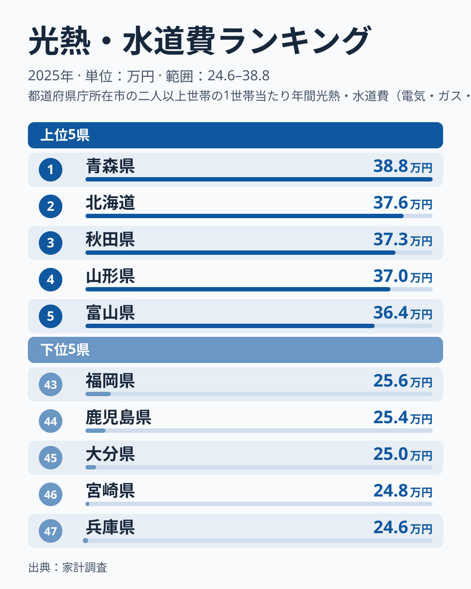
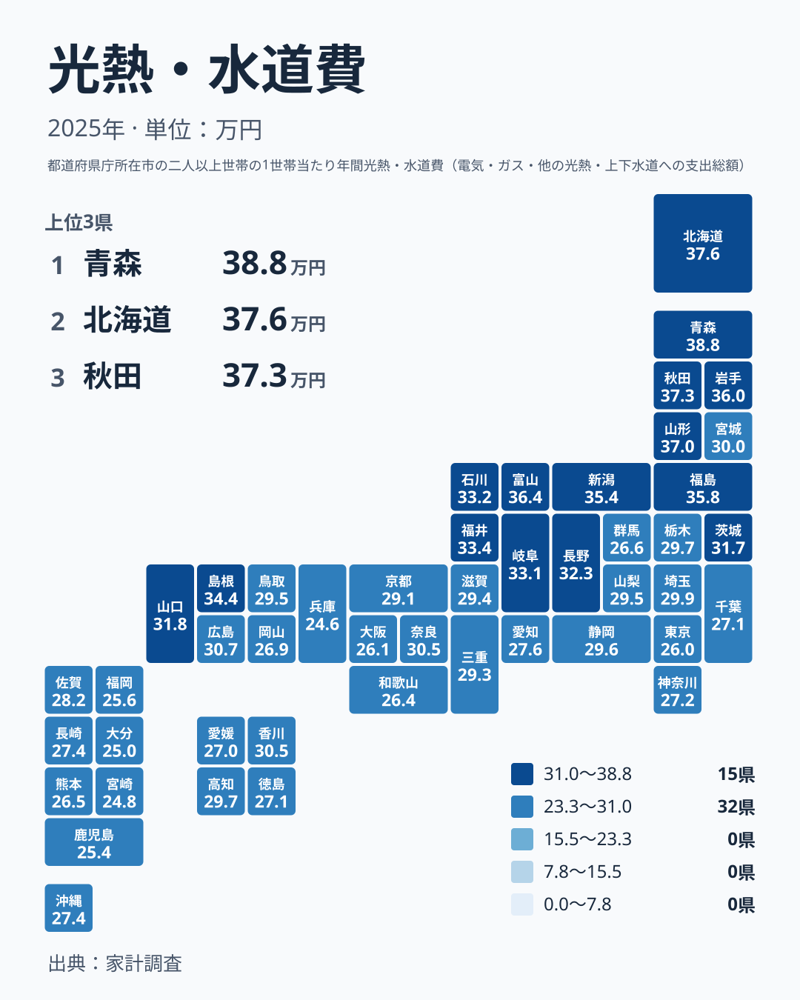

毎月の電気代やガス代、水道代の請求書を見て、「うちは高いのだろうか」と感じたことはないでしょうか。光熱・水道費は、食費や住居費と並んで、削りにくい固定的な支出です。使う量を工夫しても、住む場所の気候や住宅の条件までは変えられません。

この記事では、2025年の家計調査にもとづき、光熱・水道費が都道府県でどれだけ違うのかを確認します。そのうえで、金額の差が暮らしにどう響くのかを、いくつかの切り口に分けて考えます。

## 光熱・水道費が最も多いのは青森県

2025年の光熱・水道費で最も多いのは、青森県の387,697円です。2位は北海道の375,861円、3位は秋田県の372,548円、4位は山形県の370,452円、5位は富山県の364,020円でした。

反対に最も少ないのは、兵庫県の245,932円です。46位は宮崎県の247,518円、45位は大分県の250,308円、44位は鹿児島県の254,099円、43位は福岡県の256,271円となっています。

<source-link href="/ranking/utilities-expenditure-total">光熱・水道費ランキングをもっと見る</source-link>

上の図で目を引くのは、上位に並ぶ県の多くが北日本に集まっていることです。上位5県のうち、青森県、北海道、秋田県、山形県の4県は北海道・東北に属します。残る富山県は中部です。冬の寒さが厳しく暖房のエネルギーが多くなりやすい地域が上位に並んでおり、気候との関わりが示唆されます。

下位側は雰囲気が違います。43位から46位までの福岡県、鹿児島県、大分県、宮崎県は、いずれも九州・沖縄の県です。47位の兵庫県は近畿に属します。温暖な西日本が下位に集まる形で、気候と家計に何らかの結びつきがあると考えられます。

最も多い青森県と最も少ない兵庫県を比べると、その開きは小さくありません。同じ「光熱・水道費」という名前の支出でも、地域によって家計への重みはかなり異なります。詳しくは[青森県のデータ](/areas/02000)や[北海道のデータ](/areas/01000)でも確認できます。

> [!NOTE]
> ここでの光熱・水道費は、電気代、ガス代、上下水道料、灯油などの他の光熱費を合わせた、1世帯あたりの年間支出額です。1人あたりの金額ではないため、東京都や大阪府の順位が低いことを「都市部の人は光熱費をあまり使わない」と読むのは早計です。世帯の構成や住まいの条件も反映された数字です。

## 地図で見ると、北日本に高い県が連なる

次に、47都道府県全体の分布を地図で見てみます。

地図からは、北海道・東北から中部の一部にかけて金額の高い県が連なる様子が読み取れます。北海道・東北では、青森県が1位、北海道が2位、秋田県が3位、山形県が4位、岩手県が6位、福島県が7位です。宮城県だけは19位の300,383円で、同じ地方の中では低めです。

中部に目を向けると、富山県が5位、新潟県が8位の354,037円、福井県が10位の334,008円、石川県が11位の331,995円、岐阜県が12位の330,650円、長野県が13位の323,440円と、上位に多くの県が入っています。一方で、愛知県は30位の276,427円、静岡県は23位の295,564円で、同じ中部でも差があります。

注目したいのは、東京都や大阪府といった大都市が下位に近いことです。東京都は42位の259,871円、大阪府は41位の261,354円でした。人口の多い都市ほど支出が大きくなるわけではない点は、この指標の特徴です。

> [!TIP]
> 順位を読むときは、気候だけでなく住まいの形にも注目してください。集合住宅が多い都市部では、一戸建てより暖房や給湯の対象となる空間が小さくなりやすいと考えられます。順位の背景には、気温と住宅事情の両方が関わっている可能性があります。

## 暮らしの視点で読み替える:固定費としての重さ

ここまでの結果を、生活の感覚に置き換えてみます。青森県の世帯は、兵庫県の世帯より、年間で光熱・水道費を多く支払っています。この差は節約努力の違いというより、住んでいる場所の条件の違いが関わっていると考えられます。

寒い地域では、冬の暖房を止めるという選択肢がほとんどありません。消せない出費が多いほど、家計の自由度は下がります。同じ収入でも、光熱・水道費に回すお金が多い地域では、外食や趣味、貯蓄に回せる余地が小さくなる可能性があります。

逆に、福岡県や鹿児島県など温暖な地域は、光熱・水道費の負担が軽い分、ほかの支出に余裕を持たせやすい面があります。もちろん、夏の冷房や車の利用など、別の支出が重くなる場合もあります。光熱・水道費の少なさが、そのまま暮らしの楽さを意味するわけではありません。

転勤や移住を考えるときは、家賃や物価だけでなく、光熱・水道費の水準も確認しておくと安心です。家賃が安い地域でも、寒冷地では暖房費がかさみ、トータルの負担が思ったより軽くならないことがあります。

## どんな要因が考えられるか:仮説の整理

光熱・水道費は、いくつかの費目の合計です。電気代、ガス代、上下水道料、灯油などの他の光熱費に分けて考えると、地域差の理由を想像しやすくなります。ただし、この記事で使った実データは合計額だけなので、費目ごとの金額は示せません。以下はあくまで考え方の筋道を整理した仮説です。

まず、暖房用の燃料です。寒冷地では灯油やガスの使用量が増えやすく、他の光熱費にあたる部分が合計を押し上げる可能性があります。上位に北日本の県が集まっている点は、この見方と整合的です。

次に、電気代です。電気で暖房や給湯をまかなう家庭では、冬の電気使用量が増えると考えられます。寒さが続く地域では、電気代も重くなっている可能性がありますが、合計額だけでは確かめられません。

さらに、水道代です。水道料金は自治体ごとに水準が異なり、気候とは別の理由で差が生じることがあります。合計額の順位だけでは、こうした水道料金の影響を切り分けられません。

こうして見ると、北日本の高さの有力な要因は、暖房に必要なエネルギーの多さだと推測できます。ただし、それだけで全体を説明できるとは限りません。たとえば中部の中でも、富山県は5位、愛知県は30位と離れています。この差は日本海側と太平洋側という気候の違いでも説明できますし、住宅の形や料金水準など気候以外の要因も関わっている可能性があります。実データだけでは、どれが効いているかは判断できません。

> [!WARNING]
> 家計調査は標本調査です。県庁所在地など限られた都市の世帯を中心に集計されるため、県全体の暮らしをそのまま代表しているとは限りません。また、調査対象の世帯数が少ない県では、年ごとの金額が振れやすい点にも注意が必要です。順位が1つ違うだけで、暮らしに大きな差があるとは考えないでください。

## 順位の近さに惑わされないために

中位の県では、順位が近いと金額もほとんど変わりません。たとえば、栃木県は21位の296,790円、高知県は22位の296,643円、静岡県は23位の295,564円、山梨県は24位の295,467円です。これらは並んでいるように見えますが、実際にはごくわずかな差です。標本調査であることを考えると、順位の違いを意味のある差と受け取るのは慎重であるべきです。

順位を見るときは、上位や下位の端の顔ぶれと、その間の大きな傾きに注目するのが読み解きのコツです。細かい順位の入れ替わりより、「北日本が高く、温暖な西日本が低い」という大きな流れのほうが、生活を考えるうえで役に立ちます。

また、毎年の変動も考慮が必要です。燃料価格や電気料金は年ごとに動くため、2025年の順位が来年も同じとは限りません。今回の結果は、あくまで2025年という1年の断面として受け取ってください。

自分の暮らす県が全国のどのあたりにあるかを知ると、請求書の金額への見方が変わります。極端に高い、低いと感じたときは、まず地域の水準と比べてみてください。ほかの家計指標も見たい方は、[同じカテゴリの統計一覧](/category/economy)から探せます。

## まとめ:数字が示す、住む場所と家計の関係

2025年の光熱・水道費は、青森県が387,697円で1位、北海道が375,861円で2位、秋田県が372,548円で3位と、北日本の県が上位を占めました。下位は兵庫県の245,932円を筆頭に、宮崎県、大分県、鹿児島県、福岡県と九州の県が続きます。

この差には、暖房の必要度という気候の条件が関わっていると考えられます。ただし、住宅の形や水道料金の水準など、気候以外の要因も関わっている可能性があります。順位は目安として受け取り、自分の家計を考える材料にしてください。

光熱・水道費は、住む場所によってあらかじめ決まる部分が大きいと考えられる支出です。だからこそ、数字の違いを個人の努力不足と結びつけず、地域の条件として冷静に見ることが大切です。

## データについて

この記事で使った光熱・水道費は、総務省統計局の家計調査にもとづく2025年の値で、単位は円です。1世帯あたりの年間支出額を、47都道府県について比較しました。

家計調査は、都道府県庁所在地など限られた都市の世帯を主な対象としています。そのため、県内の農村部や離島などの暮らしは十分に反映されない場合があります。本文では、実データに載っている金額と順位だけを使い、独自の計算値は載せていません。
