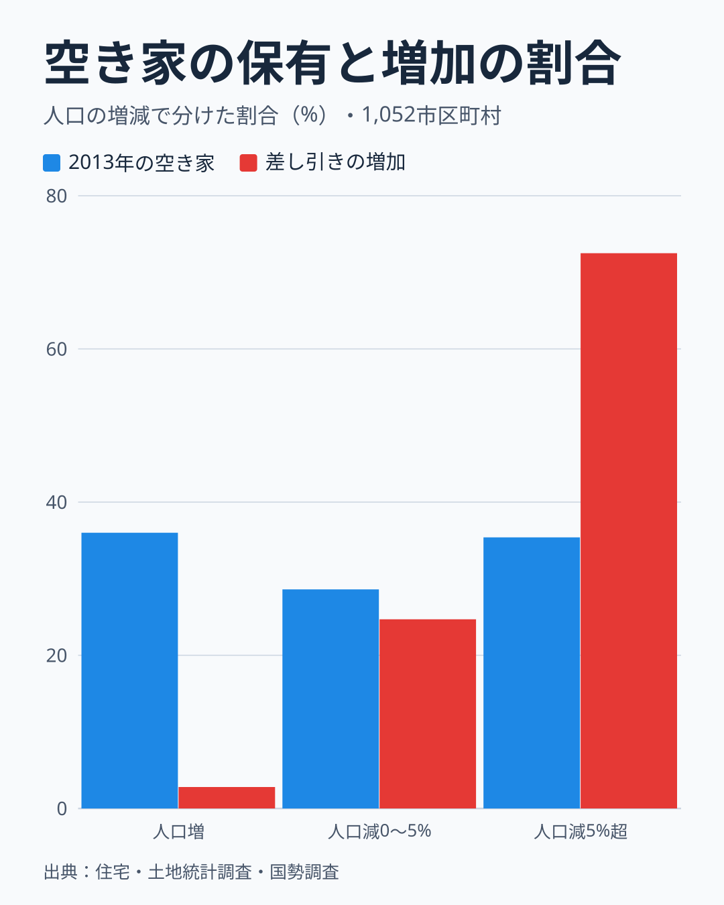
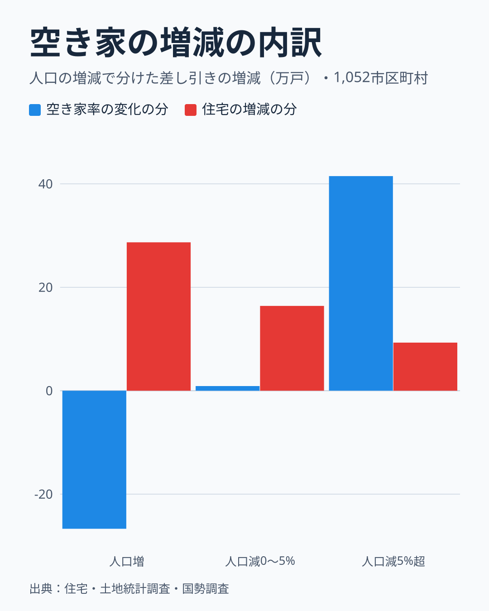
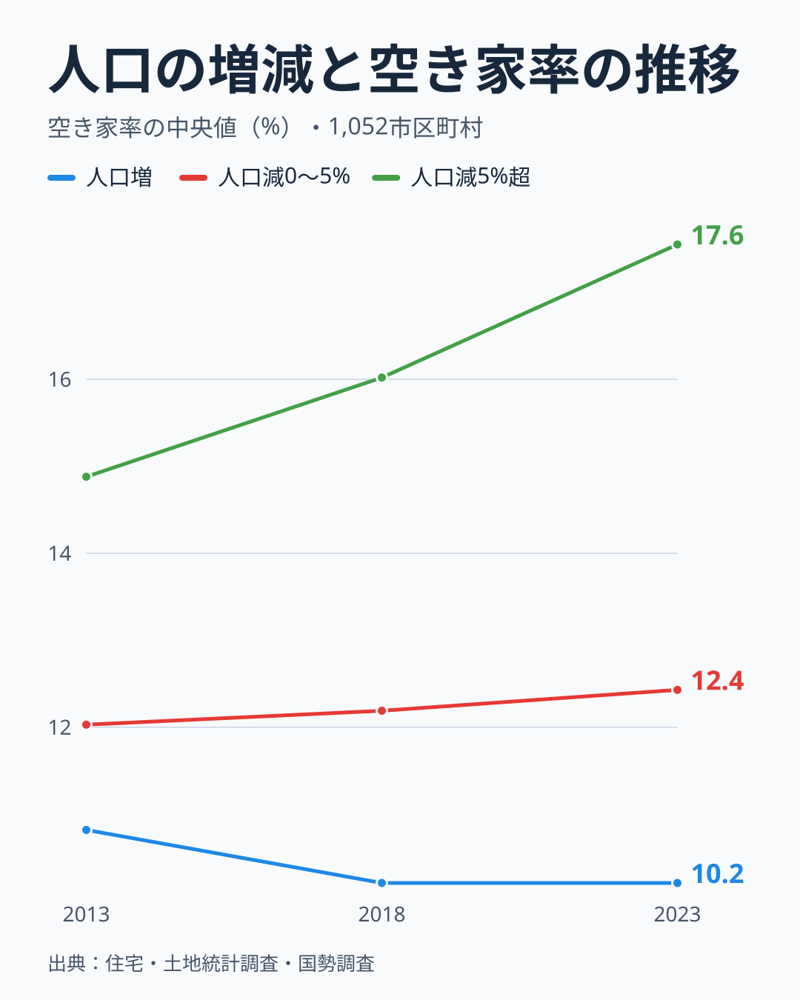
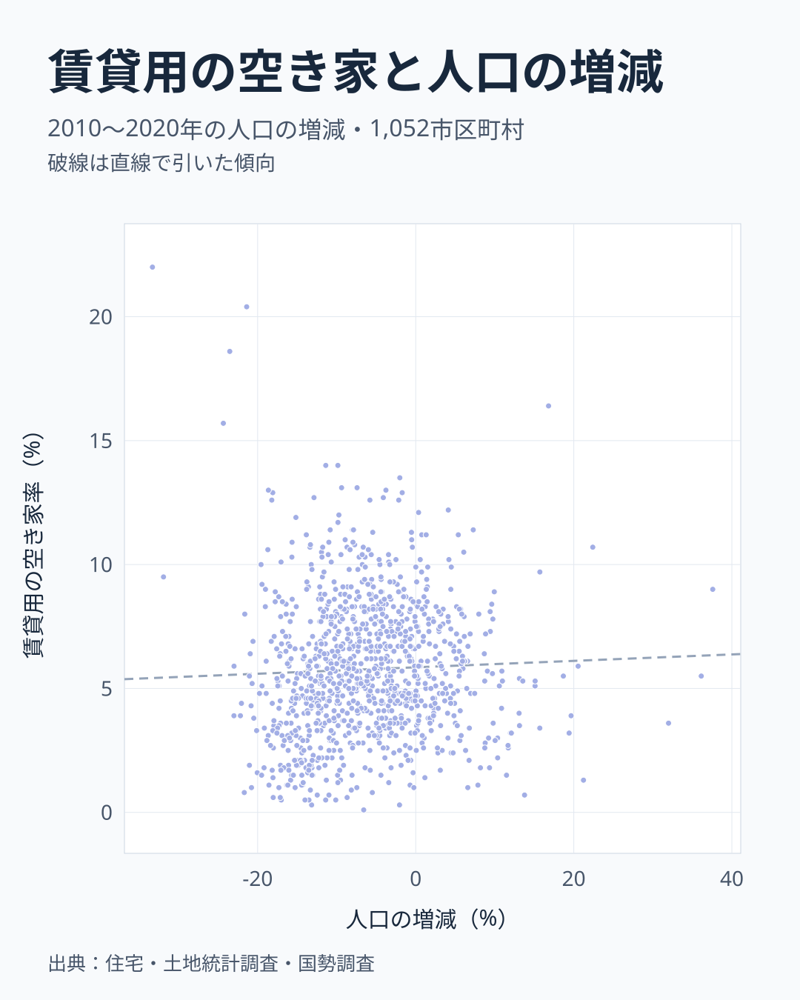
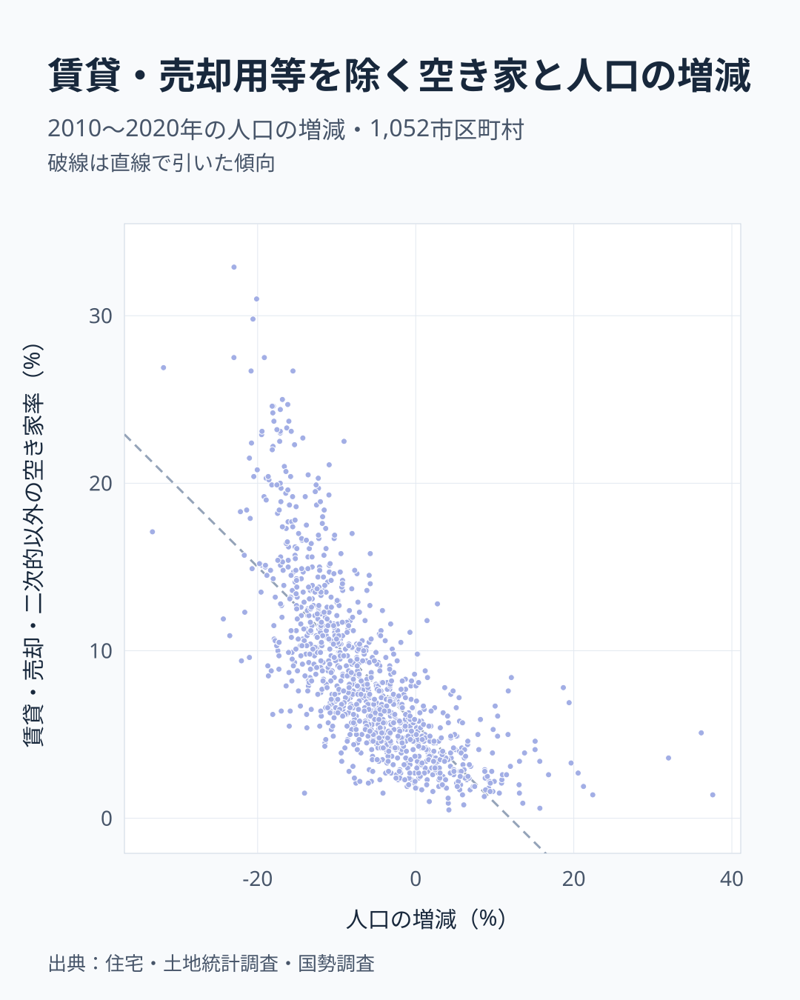

答えは、人口が減った町だけではありません。人口が減っていない212市区町村のうち、108市区町村で空き家の数が増え、76市区町村（35.8%）で空き家率が上がりました。一方、分析対象の1,052市区町村では、空き家戸数の差し引き増加の97.2%は人口が減った町にあります。

空き家の値が3時点そろう1,052市区町村を、2010年から2020年の日本人人口の増減で3つに分け、2013年から2023年の空き家の動きを比べました。この記事では、人口が少しでも減った町を「人口が減った町」と呼びます。

この記事では、増えた空き家の場所、増減の内訳、空き家の種類の順に見ていきます。

## 差し引きで見ると、増えた空き家の大半は人口が減った町にある

市区町村を、人口が増えた212、0〜5%減った236、5%を超えて減った604に分けました。青い棒は2013年の空き家がどの区分にあったか、赤い棒は10年間の差し引きの増加がどの区分にあるかを示します。

もし空き家がこの1,052の中で同じように増えたなら、青と赤の棒はほぼ同じ高さになるはずです。ところが、人口が増えた町の棒は36.0%から2.8%へ大きく縮み、5%を超えて減った町の棒は35.4%から72.5%へ伸びています。もともと3割強の空き家を持っていた区分が、増加の7割強を占めたことになります。

人口が増えた町の2013年の割合が36.0%と大きいのは、大阪市や横浜市のように町の規模が大きいためです。この区分は住宅の数でも約4割を占めます。区分内の空き家数の合計を住宅数の合計で割った空き家率で見ると、2013年は人口が増えた町が12.1%、0〜5%減った町が13.0%、5%を超えて減った町が15.3%で、人口が増えた町が最も低い値でした。

この1,052の合計で、差し引きで増えた空き家は約70万戸で、そのうち97.2%が人口が減った町にあります。

また、これは増えた町と減った町を差し引いた値です。空き家の数が増えた町だけを足すと約100万戸で、そのうち人口が増えた町は19.6%を占めます。人口が増えた212町のうち、空き家が増えた108町では約20万戸増え、空き家が減った町では約18万戸減りました。差し引きでは約2万戸の増加で、ほぼ横ばいです。町ごとの増減には後で触れる揺れが含まれるので、これらの値は幅をもって読んでください。

線の引き方でも割合は変わります。人口の増加が0%以上の町は差し引きの増加の2.8%ですが、減少が2%までの町を含めると9.6%、5%までで27.5%、10%までで60.6%になります。「人口が減った町」と言っても、大きく減った町と少し減った町で意味が違います。

<source-link href="/municipalities/ranking/vacant-houses-city">空き家数の市区町村ランキングをもっと見る</source-link>

## 人口が増えた町では、計算上、住宅の増加と空き家率の低下が釣り合う

空き家の数は「住宅の数×空き家率」なので、増減は2つに分けられます。空き家率が変わった分と、住宅の数が増えた分です。

人口が増えた町では、住宅が10.8%増えた分が約28.7万戸、空き家率が下がった分が約-26.7万戸で、ほぼ釣り合いました。これは計算の上の関係です。空き家の数がほぼ横ばいのまま住宅が増えれば、空き家率は下がります。なぜ空き家が増えなかったのかは、世帯数がこの分析のデータには無いので確かめられません。

人口が5%を超えて減った町は様子が違います。空き家率が上がった分が約41.5万戸で、この区分の増加の約8割を占めます。住宅の数も3.4%増えていて、この分が約9.3万戸です。人口が減っている町でも、2時点で比べると住宅の数は増えていました。

0〜5%減った町は、空き家率の分がほぼ0で、住宅が7.3%増えた分の約16.4万戸が増加のほとんどです。計算上、この区分の増加のほとんどは住宅数が増えた分に当たります。1,052全体で見ると、差し引きの増加の77.6%は住宅が増えた分に当たります。空き家率の動きも住宅数の増え方も区分ごとに異なり、住宅の数自体はどの区分でも増えています。

## 空き家率の動きも人口の増減で分かれる

ここでは第1節の区分全体の率とは別に、町ごとの空き家率の中央値を使います。住宅全体に占める空き家の割合を区分ごとに3時点で並べると、5%を超えて減った町は14.9%、16.0%、17.6%と上がり続けました。人口が増えた町は10.8%、10.2%、10.2%で、0〜5%減った町は12.0%、12.2%、12.4%です。線の開きは2013年の時点ですでにあり、10年でさらに広がっています。2013年から2023年の変化を町ごとに計算して中央値をとると、人口が増えた町で-1.00ポイント、0〜5%減った町で+0.23ポイント、5%を超えて減った町で+2.82ポイントでした。町ごとの変化の中央値なので、図の線の差とは一致しません。

空き家率は総住宅数を分母にした割合なので、分母の住宅数にも左右されます。率が下がっても、空き家の数が減ったとは限りません。人口が増えた212市区町村でも、76市区町村（35.8%）では空き家率が上がりました。

期間を分けても向きは変わりません。5%を超えて減った町の中央値は、2013年から2018年に+1.43ポイント、2018年から2023年に+1.42ポイントでした。人口が増えた町は-0.75ポイントと-0.15ポイントです。

市区町村ごとに見た人口増減率と空き家率の変化の相関係数は-0.54で、人口が減った町ほど空き家率が上がる傾向があります。10以上の市区町村がある45県で県ごとに計算すると、44県で同じ負の向きになりました。この傾向は、県の違いだけでは説明できません。

<source-link href="/municipalities/ranking/vacant-housing-ratio">空き家率の市区町村ランキングをもっと見る</source-link>

## 2023年の賃貸用空き家率は人口増減との関連が弱い

空き家には、入居者を募集している賃貸用の住宅もあれば、それ以外の住宅もあります。同じ「空き家」でも意味は違うため、2023年の種類別の空き家率を区分ごとに比べました。

賃貸用の空き家率は、人口の増減との相関係数が0.04で、傾向の線はほぼ水平です。中央値も人口が増えた町から順に5.5%、6.1%、5.4%で、ほとんど変わりません。

「賃貸・売却用と二次的住宅を除く空き家」は、賃貸にも売却にも出されておらず、別荘などの二次的住宅でもない空き家を指します。長期間人が住んでいない住宅などが含まれます（[総務省統計局の用語の解説](https://www.stat.go.jp/data/jyutaku/2023/pdf/yougo.pdf)）。その率は、人口が減った町ほど高くなります。中央値は3.6%、5.5%、10.3%で、人口増減率との相関係数は-0.72です。点の並びは直線ではなく、人口の減少が大きい側ほど傾きが急になる曲線です。破線は直線で引いた目安で、この曲線の形は表しません。

区分の間で差が大きいのは賃貸用ではなく、賃貸・売却用と二次的住宅を除く空き家のほうだと読めます。ただし、この比較は2023年の水準を見たもので、10年間の増加の内訳を示すものではありません。

<source-link href="/municipalities/ranking/vacant-housing-rate-excluding-rental-sale-secondary">賃貸・売却用及び二次的住宅を除く空き家率の市区町村ランキングをもっと見る</source-link>

## この分解で言えないこと

人口が減った町に差し引き増加の97.2%があるという値には、町の取り方を変えたとき85.4〜113.9%の幅があります。これは調査の標本誤差を含まない幅です。100%を超える側では、人口が増えた町の差し引き増加はマイナスになるため、その区分の合計が増えたとまでは断定できません。

分析対象からは689市区町村が除かれています。人口変化の中央値は対象側が-6.6%、除外側が-16.1%です。除外された市区町村の空き家の変化は観測できないため、結果を全市区町村には広げられません。

空き家率が上がった町と、空き家戸数が増えた町は別々に判定しています。また、この比較から人口減少が空き家増加の原因だとは言えません。世帯数や高齢化など、ほかの要因はこの分析のデータでは確かめていません。

ここまでの比較は、数百の市区町村をまとめた集団の傾向です。個々の町の変化を順位にして「空き家が急増した町」として並べることはしませんでした。

住宅・土地統計調査は全数調査ではなく標本調査で、町ごとの値には揺れが含まれます。2013年から2018年の空き家率の変化と、2018年から2023年の変化の相関係数は-0.03でした。前の5年に上がった町が次の5年も上がるという傾向は見られず、町ごとの変化はそのまま続くとは言えません。

一方で、3つの区分にまとめて見ると、人口の増減による違いが読み取れます。自分の町の空き家率の上下を見るときも、1回の調査の差だけで判断せず、長い期間の水準と合わせて見るのが安全です。都道府県単位の水準については[空き家率と高齢化の関係](/blog/vacant-housing-aging-correlation)や[徳島の空き家率の分析](/blog/vacant-house-crisis)でも取り上げています。

## データについて

空き家の値は総務省「住宅・土地統計調査」の2013年、2018年、2023年、人口の値は国勢調査の日本人人口の2010年と2020年です。空き家と人口で期間が3年ずれているので、同じ期間の増減を比べたものではありません。

住宅・土地統計調査には小さな町村の値が無いため、空き家の値がそろう1,052市区町村を比べました。政令指定都市は市全体で、東京都の特別区は区ごとに数えています。

増えた空き家の割合は、区分ごとに2023年と2013年の空き家数の差を足し上げた、差し引きの値です。区分の中には空き家が減った町も含まれます。空き家の増減の内訳は、空き家数と空き家率から逆算した総住宅数を使って計算しました。率の変化には2時点の住宅数の平均を、住宅数の変化には2時点の空き家率の平均を掛けています。この計算では、両方が変わった分を半分ずつ割り当てます。率が丸められているので、内訳の値は目安です。

## まとめ

空き家が増えたのは人口が減った町だけではありません。人口が減っていない212市区町村のうち108市区町村で空き家戸数が増えました。一方、分析対象の差し引き増加の97.2%は人口が減った町にあります。人口が減っていない町の合計は差し引きで約2万戸の増加とほぼ横ばいですが、その符号は幅をもって読む必要があります。

計算の上では全体の増加の約8割が住宅の増えた分に当たります。2023年の率では、区分の間で差が大きいのは賃貸用ではなく、賃貸・売却用と二次的住宅を除く空き家でした。空き家の数字を見るときは、率だけでなく数も、そしてどの種類の空き家なのかも確かめることが大切です。
