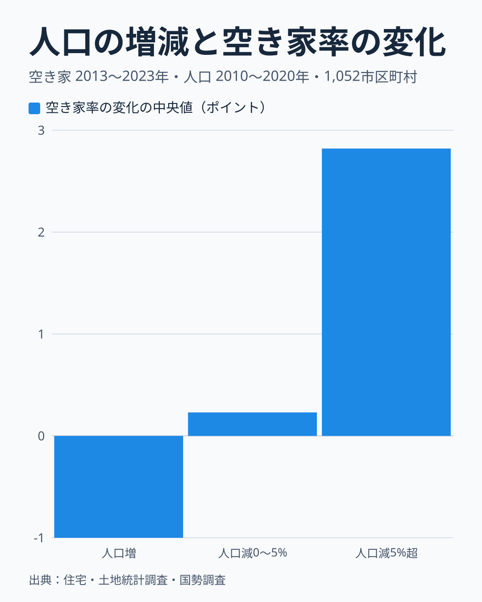
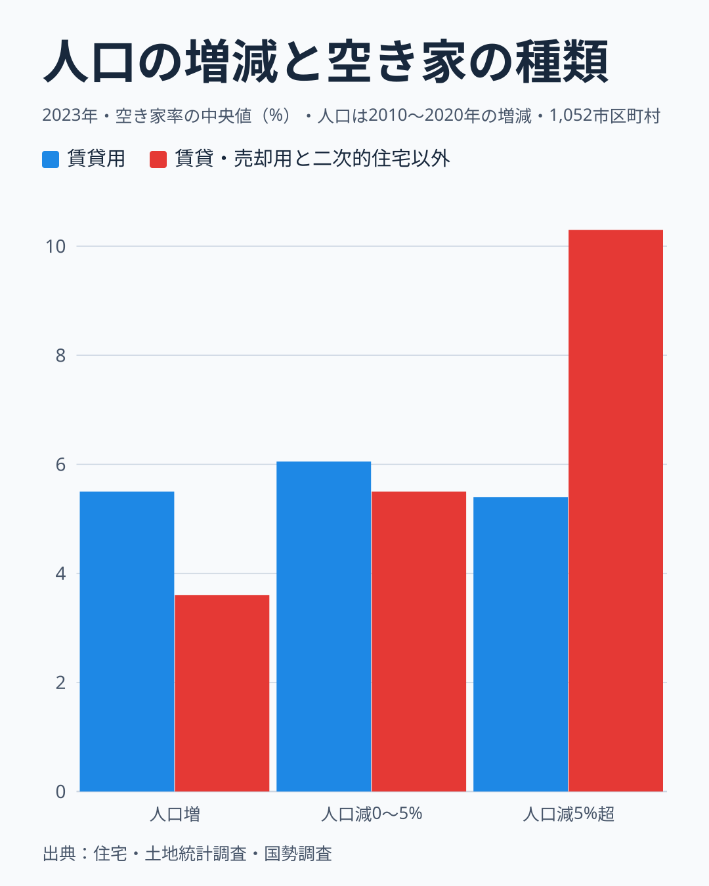

空き家が増えたというニュースを見ると、人口が減っている地方の町を思い浮かべる人が多いでしょう。では、東京の周辺のように人口が増えている町では、空き家は増えていないのでしょうか。

空き家の値が3時点そろう1,052市区町村を、2010年から2020年の日本人人口の増減で3つに分け、2013年から2023年の空き家の動きを比べました。この記事では、人口が少しでも減った町を「人口が減った町」と呼びます。

答えは、人口が減った町だけではありません。空き家の数が増えた町だけを足すと、約2割は人口が増えた町にあります。ただし、減った町の分を差し引くと、増加の大半は人口が減った町に集まります。この記事では、増えた空き家の場所、増減の内訳、空き家の種類の順に見ていきます。

## 差し引きで見ると、増えた空き家の大半は人口が減った町にある

市区町村を、人口が増えた212、0〜5%減った236、5%を超えて減った604に分けました。青い棒は2013年の空き家がどの区分にあったか、赤い棒は10年間の差し引きの増加がどの区分にあるかを示します。

もし空き家がこの1,052の中で同じように増えたなら、青と赤の棒はほぼ同じ高さになるはずです。ところが、人口が増えた町の棒は36.0%から2.8%へ大きく縮み、5%を超えて減った町の棒は35.4%から72.5%へ伸びています。もともと3割強の空き家を持っていた区分が、増加の7割強を占めたことになります。

人口が増えた町の2013年の割合が36.0%と大きいのは、大阪市や横浜市のように町の規模が大きいためです。この区分は住宅の数でも約4割を占めます。空き家率で見ると、2013年は人口が増えた町が12.1%、0〜5%減った町が13.0%、5%を超えて減った町が15.3%で、人口が増えた町が最も低い値でした。

この1,052の合計で、差し引きで増えた空き家は約70万戸で、そのうち97.2%が人口が減った町にあります。ただし、この値は小数まで言えるものではありません。対象の町を選び直して計算すると、85%から114%ほどの幅があります (町の取り方の幅で、調査の標本誤差は含みません)。100%を超える側は、人口が増えた町が差し引きで減る場合です。

また、これは増えた町と減った町を差し引いた値です。空き家の数が増えた町だけを足すと約100万戸で、そのうち人口が増えた町は19.6%を占めます。人口が増えた212町のうち、空き家が増えた108町の約20万戸を、空き家が減った町の約18万戸が打ち消しているためです。町ごとの増減には後で触れる揺れが含まれるので、この割合も幅をもって読んでください。

線の引き方でも割合は変わります。人口の増加が0%以上の町は差し引きの増加の2.8%ですが、減少が2%までの町を含めると9.6%、5%までで27.5%、10%までで60.6%になります。「人口が減った町」と言っても、大きく減った町と少し減った町で意味が違います。

<source-link href="/municipalities/ranking/vacant-houses-city">空き家数の市区町村ランキングをもっと見る</source-link>

## 人口が増えた町では、計算上、住宅の増加と空き家率の低下が釣り合う

空き家の数は「住宅の数×空き家率」なので、増減は2つに分けられます。空き家率が変わった分と、住宅の数が増えた分です。

人口が増えた町では、住宅が10.8%増えた分が約28.7万戸、空き家率が下がった分が約-26.7万戸で、ほぼ釣り合いました。これは計算の上の関係です。空き家の数がほぼ横ばいのまま住宅が増えれば、空き家率は下がります。なぜ空き家が増えなかったのかは、世帯数がこの表に無いので確かめられません。

人口が5%を超えて減った町は様子が違います。空き家率が上がった分が約41.5万戸で、この区分の増加の約8割を占めます。住宅の数も3.4%増えていて、この分が約9.3万戸です。人口が減っている町でも、2時点で比べると住宅の数は増えていました。

0〜5%減った町は、空き家率の分がほぼ0で、住宅が7.3%増えた分の約16.4万戸が増加のほとんどです。この区分の増加は、人口の減少より住宅の増加に沿っています。1,052全体で見ると、差し引きの増加の77.6%は住宅が増えた分に当たります。人口の増減で分かれるのは空き家率の動きで、住宅の数はどの区分でも増えています。

## 空き家率の動きも人口の増減で分かれる

住宅全体に占める空き家の割合でも、同じ傾向が出ます。空き家率の変化の中央値は、人口が増えた町で-1.00ポイント、0〜5%減った町で+0.23ポイント、5%を超えて減った町で+2.82ポイントでした。

空き家率は総住宅数を分母にした割合なので、分母の住宅数にも左右されます。率が下がっても、空き家の数が減ったとは限りません。

期間を分けても向きは変わりません。5%を超えて減った町の中央値は、2013年から2018年に+1.43ポイント、2018年から2023年に+1.42ポイントでした。人口が増えた町は-0.75ポイントと-0.15ポイントです。

市区町村ごとに見た人口増減率と空き家率の変化の相関係数は-0.54で、人口が減った町ほど空き家率が上がる傾向があります。10以上の市区町村がある45県で県ごとに計算すると、44県で同じ負の向きになりました。この傾向は、県の違いだけでは説明できません。

<source-link href="/municipalities/ranking/vacant-housing-ratio">空き家率の市区町村ランキングをもっと見る</source-link>

## 賃貸用の空き家率は人口の増減で変わらない

空き家には、入居者を募集している賃貸用の住宅もあれば、それ以外の住宅もあります。同じ「空き家」でも意味は違うため、2023年の種類別の空き家率を区分ごとに比べました。

賃貸用の空き家率の中央値は、人口が増えた町から順に5.5%、6.05%、5.4%で、人口の増減でほとんど変わりません。

一方で、賃貸用でも売却用でも、別荘などの二次的住宅でもない空き家の率は、3.6%、5.5%、10.3%と、人口が減った町ほど高くなります。人口増減率との相関係数も、賃貸用は0.04でほぼ無関係なのに対し、こちらは-0.72と強い関係を示しました。

区分の間で差が大きいのは賃貸用ではなく、賃貸・売却用と二次的住宅を除く空き家のほうだと読めます。ただし、この比較は2023年の水準を見たもので、10年間の増加の内訳を示すものではありません。

<source-link href="/municipalities/ranking/vacant-housing-rate-excluding-rental-sale-secondary">賃貸・売却用及び二次的住宅を除く空き家率の市区町村ランキングをもっと見る</source-link>

## 市ごとの順位にしない理由

ここまでの比較は、数百の市区町村をまとめた集団の傾向です。個々の町の変化を順位にして「空き家が急増した町」として並べることはしませんでした。

住宅・土地統計調査は全数調査ではなく標本調査で、町ごとの値には揺れが含まれます。2013年から2018年の空き家率の変化と、2018年から2023年の変化の相関係数は-0.03でした。前の5年に上がった町が次の5年も上がるという傾向は見られず、町ごとの変化はそのまま続くとは言えません。

一方で、集団にまとめると揺れは打ち消し合い、人口の増減による違いがはっきり見えます。自分の町の空き家率の上下を見るときも、1回の調査の差だけで判断せず、長い期間の水準と合わせて見るのが安全です。都道府県単位の水準については[空き家率と高齢化の関係](/blog/vacant-housing-aging-correlation)や[徳島の空き家率の分析](/blog/vacant-house-crisis)でも取り上げています。

> [!NOTE]
> この記事の相関は、人口が減ると空き家が増えるという因果関係を示すものではありません。世帯数や高齢化など、ほかの要因はこの表では確かめていません。

## データについて

空き家の値は総務省「住宅・土地統計調査」の2013年、2018年、2023年、人口の値は国勢調査の日本人人口の2010年と2020年です。空き家と人口で期間が3年ずれているので、同じ期間の増減を比べたものではありません。

住宅・土地統計調査には小さな町村の値が無いため、空き家の値がそろう1,052市区町村を比べました。政令指定都市は市全体で、東京都の特別区は区ごとに数えています。表に入らなかった689自治体の人口増減率の中央値は-16.1%で、比較に入った町の-6.6%より大きく減っています。そのため、人口が減った町の増加は、この記事の数字より大きい可能性があります。

増えた空き家の割合は、区分ごとに2023年と2013年の空き家数の差を足し上げた、差し引きの値です。区分の中には空き家が減った町も含まれます。空き家の増減の内訳は、空き家数と空き家率から逆算した総住宅数を使って計算しました。率が丸められているので、内訳の値は目安です。

## まとめ

空き家が増えたのは人口が減った町だけではありません。増えた町だけを足すと約2割は人口が増えた町にあり、人口が増えた町の合計でも差し引きで約2万戸増えています。ただし差し引きで見ると、増加の大半は人口が減った町に集まり、空き家率の変化の中央値も人口の増減ではっきり分かれます。

計算の上では全体の増加の約8割が住宅の増えた分に当たり、区分の間で差が大きいのは賃貸用ではなく、賃貸・売却用と二次的住宅を除く空き家でした。空き家の数字を見るときは、率だけでなく数も、そしてどの種類の空き家なのかも確かめることが大切です。
