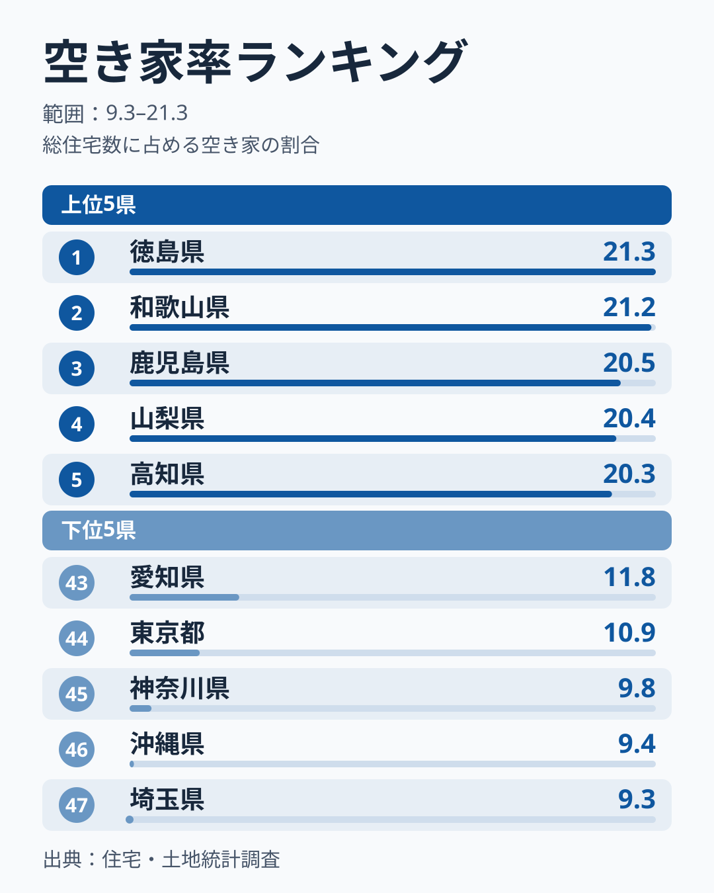
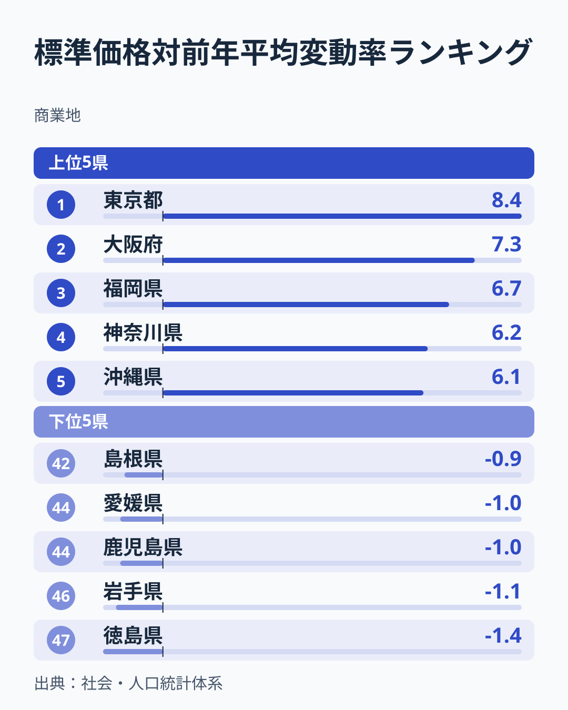
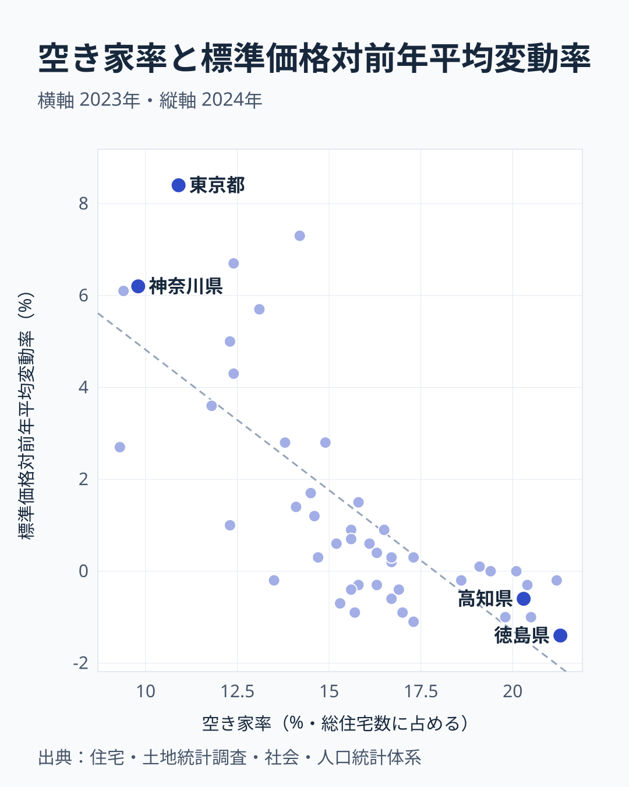

空き家率が全国で最も高い徳島県は21.3%で、住宅の5戸に1戸以上が空き家という計算です。そしてこの徳島県は、商業地の地価変動率も-1.4%と、47都道府県で最も大きく下落しています。

一方、空き家率が最も低い埼玉県は9.3%、低い側の東京都は10.9%、神奈川県は9.8%で、商業地の地価はそろって上昇しています。東京都の上昇率は+8.4%で全国1位です。

偶然でしょうか。空き家率と商業地の地価変動率を47都道府県で突き合わせると、相関係数は**-0.744**で、空き家率が高い県ほど地価変動率は低い、強い負の相関です。ただし、この相関は高齢化の度合いをそろえると大きく弱まります。この記事では、相関の強さと、どこまで読んでよいかの両方を、データで確かめます。

> [!NOTE]
> 空き家率は総務省「住宅・土地統計調査」(5年に1度、2023年が最新)、商業地の地価変動率は都道府県地価調査の標準価格の対前年平均変動率 (2024年) です。空き家率は住宅全体を対象にした指標、地価変動率は商業地を対象にした指標で、調べている対象が違います。2つの年も1年ずれています。

## 空き家率ランキング｜四国・九州と甲信が高い

[空き家率ランキング](/ranking/vacant-housing-rate)を見ると、全国の空き家率の分布がひと目で分かります。

空き家率のトップは徳島県の21.3%で、僅差で和歌山県が21.2%、鹿児島県が20.5%、山梨県が20.4%、高知県が20.3%と続きます。6位の長野県も20.1%で、上位には四国・九州・近畿南部の県と、甲信の山梨・長野が並びます。

下位は埼玉県の9.3%が最も低く、沖縄県が9.4%、神奈川県が9.8%、東京都が10.9%、愛知県が11.8%と、首都圏と中京圏の都県、そして沖縄県が並びます。[仮説] 人口の流入が続く地域では住宅の需要が強く、空き家になった住宅にも次の入居者や買い手がつきやすいことが、空き家率の低さにつながっている可能性があります。

<source-link href="/ranking/vacant-housing-rate">空き家率ランキングをもっと見る</source-link>

## 商業地の地価変動率ランキング｜上昇は大都市圏と沖縄

[商業地の地価変動率ランキング](/ranking/standard-price-change-rate-commercial)では、上昇県と下落県がはっきり分かれています。

商業地の標準価格の対前年平均変動率は、東京都の+8.4%を筆頭に、大阪府が+7.3%、福岡県が+6.7%、神奈川県が+6.2%、沖縄県が+6.1%で上位です。47都道府県のうち28都道府県が上昇、17県が下落しています。

下位は徳島県の-1.4%が最も下落幅が大きく、岩手県が-1.1%、鹿児島県・愛媛県が-1%、島根県が-0.9%と続きます。空き家率で上位の徳島県・鹿児島県が、地価変動率では下位に現れています。反対に、空き家率で下位の東京都・神奈川県・沖縄県は、地価変動率では上位です。

<source-link href="/ranking/standard-price-change-rate-commercial">商業地地価変動率ランキングをもっと見る</source-link>

## 相関を可視化する｜r=-0.744の散布図

47都道府県を「空き家率 (横軸)」「商業地の地価変動率 (縦軸)」でプロットすると、右下がりの傾向がはっきり見えます。相関係数は**r=-0.744**で、空き家率が高い県ほど地価変動率は低い、強い負の相関です。

散布図の右下 (空き家率が高く地価が下落) には徳島・鹿児島・高知などの県が集まり、左上 (空き家率が低く地価が上昇) には東京・神奈川・沖縄などがまとまっています。

外れる県もあります。長野県は空き家率が20.1%と高いのに、地価変動率は0%で下落していません。和歌山県も空き家率は21.2%と2番目に高いものの、地価は-0.2%で、下落の幅は小さめです。空き家率が高い県が一様に大きく下落しているわけではありません。

## 見かけの相関か｜高齢化をそろえると-0.36まで弱まる

空き家率も地価も、背景に同じ要因を持っていそうです。高齢化が進み人口が減る地域では、住む人のいなくなった住宅が残って空き家率が上がり、同時に土地の需要も弱まって地価が下がる、という見方です。

そこで、このサイトの相関の計算で、第三の変数をそろえた偏相関係数を見ます。

- 総人口をそろえると -0.563
- 人口密度をそろえると -0.649
- 65歳以上人口割合をそろえると -0.360

単純な相関の -0.744 から、どれをそろえても弱まりますが、とくに65歳以上人口割合をそろえたときに -0.360 まで弱まります。空き家率と地価変動率の結びつきのかなりの部分は、高齢化の度合いが両方に関わっていることと重なっている、と読めます。それでも -0.36 の負の相関は残っており、高齢化だけで説明しきれるともいえません。

> [!WARNING]
> 相関係数は因果関係を証明するものではありません。空き家の増加が地価の下落を引き起こしているのか、地価が低迷している地域で空き家が処分されずに残りやすいのか、あるいは高齢化・人口の流出・産業構造など両者に共通する別の要因が働いているのかは、この分析だけでは特定できません。また、空き家率は住宅、地価変動率は商業地を対象にしており、空き家が商業地の地価に直接影響しているとは言えません。

[仮説] 空き家の目立ち始めた地域では、将来への見通しが商業地の投資判断に影響し、地価の伸び悩みとして表れている可能性もあります。検証には、空き家の増加と地価の下落のタイミングを時系列で追う分析が必要です。

この記事で扱った空き家率・地価変動率のほかにも、[建設・住宅カテゴリ](/category/construction)には住宅ストックに関する指標が並んでいます。空き家率の上位に入った[徳島県のデータ](/areas/36000)もあわせて確認すると、地域差の理解が深まります。

## まとめ

- 空き家率 (2023年) は1位が徳島県の21.3%、最も低いのが埼玉県の9.3%で、約2.3倍の差があります。
- 商業地の地価変動率 (2024年) は1位が東京都の+8.4%、最も低いのが徳島県の-1.4%です。
- 空き家率と地価変動率の相関係数は **r=-0.744** で、空き家率が高い県ほど地価変動率は低い、強い負の相関です。
- 65歳以上人口割合をそろえた偏相関は **-0.360** まで弱まり、相関のかなりの部分は高齢化の度合いと重なっています。
- 空き家率は住宅、地価変動率は商業地の指標で、対象が違います。空き家が地価を下げているとまでは、このデータでは言えません。
