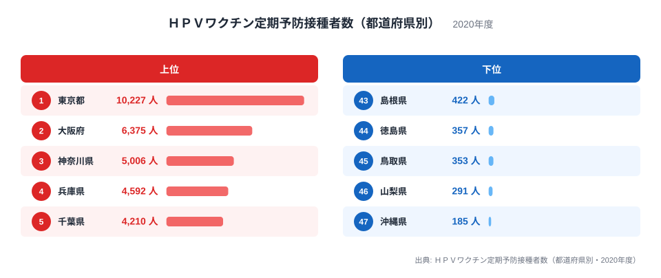
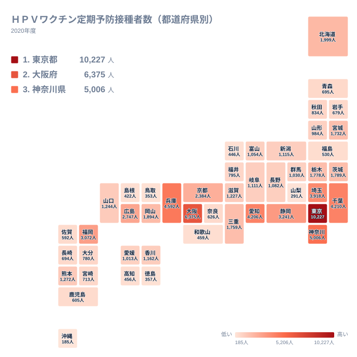

## 東京都が頭ひとつ抜ける接種者数

ＨＰＶワクチンは、子宮頸がんなどの原因となるウイルスの感染を防ぐために、公費で受けられる定期接種の対象になっています。2020年度にこの定期接種を受けた人数を都道府県別に見ると、最も多かったのは東京都で10,227人でした。2位の大阪府は6,375人で、東京都とのあいだには大きな開きがあります。

一方、最も少なかったのは沖縄県の185人です。最大の東京都と最小の沖縄県を比べると、同じ国の同じ制度であっても、接種者数には非常に大きな差があります。この記事では、その差がどのように生まれるのかを、地理・産業構造・歴史の三つの面から考えます。

<source-link href="/ranking/vaccination-recipients-disease">ＨＰＶワクチン定期予防接種者数ランキングをもっと見る</source-link>

上位5位は、東京都、大阪府、神奈川県、兵庫県、千葉県の順です。神奈川県は5,006人、兵庫県は4,592人、千葉県は4,210人でした。下位5位は、43位の島根県が422人、44位の徳島県が357人、45位の鳥取県が353人、46位の山梨県が291人、47位の沖縄県が185人です。

上位に並ぶ顔ぶれは、いずれも大きな都市圏を抱える都府県です。東京都、神奈川県、千葉県は関東、大阪府と兵庫県は近畿にあります。接種の対象になる年代の女子が多く暮らす地域ほど、接種者数が大きくなるのは自然な流れです。ここで見ているのは人数そのものであり、対象者に占める割合ではありません。

> [!NOTE]
> この指標は、2020年度に定期接種として受けた人の数です。対象年代の人口に占める割合（接種率）ではありません。人口が多い都道府県ほど数字が大きくなりやすいため、順位は「どれだけ熱心に接種したか」ではなく「どれだけの対象者が暮らしているか」を強く映します。

## なぜ大都市圏が上位を占めるのか

上位の並びを決める最大の要因は、人口規模です。東京都は全国で最も人口が集中しており、対象年代の女子の数も多くなります。大阪府が6,375人で2位、神奈川県が5,006人で3位に入っているのも、同じ理由で説明できます。いずれも昼夜を問わず人が集まる都市圏の中心です。

産業構造の面から見ると、これらの地域は商業・サービス業や事務系の仕事が集まり、若い世代の家族が多く暮らす住宅地が広がっています。自治体の規模が大きく、医療機関の数も多いため、接種できる医療機関を身近に見つけやすい環境にあります。これも接種者数を押し上げる方向に働きます。

注目したいのは、5位と6位の近さです。千葉県は4,210人、愛知県は4,206人で、その差はごくわずかでした。関東の千葉県と中部の愛知県は、産業構造も地理も異なりますが、人口規模が近い県ではこのように接種者数も近づきます。7位の埼玉県は3,918人で、東京都の周辺に位置する県が上位に集まっています。

## 中位から下位へ、順位を分ける要素

上位以外で目立つのは、地方の中核を担う県です。8位の静岡県は3,241人、9位の福岡県は3,072人、10位の広島県は2,747人でした。静岡県は中部、福岡県は九州・沖縄、広島県は中国にあり、それぞれの地方で人口の多い県に当たります。北海道は12位で1,999人です。地域の面積は広くても、人口が分散しているため、東京都や大阪府のような規模にはなりません。

下位に目を向けると、事情は少し異なります。沖縄県は全国で最も少ない185人でした。山梨県は291人、鳥取県は353人、島根県は422人で、いずれも人口規模の小さい県が並びます。徳島県の357人も加えると、四国・中国・中部・九州・沖縄にまたがって下位が散らばっています。対象者の数がそもそも少ないことが、まず大きな要因です。

ただし、人口の少なさだけで下位が決まるわけではないと考えられます。島や山間部が多い県では、住んでいる場所から医療機関までの距離が接種のしやすさに影響します。接種は複数回に分けて受けるため、通院の負担が大きい地域では、機会が減ることもあるでしょう。この点は、このデータだけでは確かめられません。

> [!WARNING]
> 実データは人数だけで、都道府県ごとの対象人口や接種率は含まれていません。下位の県が「接種に消極的」だと結論づけることはできません。順位の差を理由や原因に直結させず、人口規模の違いを踏まえて読む必要があります。

## 地理分布で見る関東・近畿への集中

次の図は、同じ数値を地図の形で並べたものです。濃い色の地域が接種者数の多い都道府県を表します。

地図で見ると、関東と近畿に数字の大きい県が固まっています。関東では東京都、神奈川県、千葉県、埼玉県が上位7位以内に入りました。茨城県は14位で1,789人、栃木県は15位で1,778人です。群馬県は26位の1,030人で、関東の中でも差があります。それでも、関東の7都県のうち多くが上位半分に入っており、関東全体の厚みを感じられます。

近畿も同様です。大阪府が2位、兵庫県が4位、京都府が11位で2,384人、三重県が16位で1,759人、滋賀県が20位で1,227人でした。一方で、奈良県は36位の626人、和歌山県は40位の459人にとどまります。近畿の中でも、大阪府を中心とする都市圏に人数が集まり、周辺の県では少なくなっています。

> [!TIP]
> 順位表を読むときは、まず地方ごとの「中心となる県」を探すと全体像がつかめます。関東なら東京都、近畿なら大阪府、中部なら静岡県と愛知県、九州・沖縄なら福岡県です。中心の県と周辺の県の差が、その地方の人口の集まり方を表しています。

## 北海道・東北と中部の姿

北海道・東北では、北海道が12位で1,999人、宮城県が17位で1,732人と、この地方の中心となる道県が上位に入りました。山形県は28位で984人、秋田県は29位で834人、青森県は33位で695人、岩手県は35位で679人、福島県は39位で530人です。広い地域に人口が分散しており、宮城県が地方内の中心として一歩抜けている形です。

中部では、静岡県の8位と愛知県の6位が突出しています。新潟県は22位で1,115人、岐阜県は23位で1,111人、長野県は24位で1,082人、富山県は25位で1,054人と、中位に近い数字がほぼ並びました。福井県は30位で795人、石川県は42位で446人、山梨県は46位で291人です。同じ中部でも、愛知県や静岡県のように製造業が集積する県と、そうでない県とで大きな差があります。

中国では広島県が10位、岡山県が13位で1,894人、山口県が19位で1,244人です。島根県は43位、鳥取県は45位と、同じ地方でも二極化しています。四国は、香川県が21位で1,162人、愛媛県が27位で1,013人、高知県が41位で456人、徳島県が44位です。九州・沖縄では、福岡県の9位に対し、熊本県は18位で1,272人、大分県は31位で780人、宮崎県は32位で713人、長崎県は34位で694人、鹿児島県は37位で605人、佐賀県は38位で592人、沖縄県は47位です。

## 歴史的背景と数字の読み方

ＨＰＶワクチンは、導入当初に接種が広がった後、副反応への懸念から国が積極的な接種の呼びかけを控えていた時期があります。その間は接種を受ける人が大きく減りました。2020年度の数字は、そうした経緯のなかで、定期接種として受けた人数を示すものです。上位と下位の差には、人口規模に加えて、各地域の周知の仕方や保護者の受け止め方も影響している可能性があります。

ただし、実データから分かるのは、あくまで都道府県ごとの人数の大小です。背景にある理由を断定するには、対象人口や接種率、自治体ごとの案内の方法といった別の情報が必要になります。順位の高さを「進んでいる」、低さを「遅れている」と評価するのは適切ではありません。

関東や近畿の都市圏で数字が大きい一方、地方では医療機関の分布や通院のしやすさが接種の機会を左右します。東京都のデータは[東京都のデータ](/areas/13000)、大阪府のデータは[大阪府のデータ](/areas/27000)から確認できます。他の保健・医療・社会保障の指標と合わせて見たいときは、[同じカテゴリの統計一覧](/category/socialsecurity)も参考になります。

## データについて

ここで使った数値は、ＨＰＶワクチン定期予防接種者数（都道府県別・2020年度）です。単位は人で、都道府県ごとに集計された定期接種の受診者数を表します。年度単位の集計であり、任意接種として受けた人は含まれません。対象年代の人口で割った割合ではないため、他の県との比較には人口規模の違いを常に意識してください。

この記事で見えたのは、数字の大きさが人口の集まる都市圏と重なっているという点です。東京都、大阪府、神奈川県、兵庫県、千葉県が上位を占め、島根県、徳島県、鳥取県、山梨県、沖縄県が下位に並びました。次に確かめたいのは、対象人口あたりの接種率で見たときに、順位がどう変わるかです。人数の順位と割合の順位を見比べることで、地域ごとの実情にもう一歩近づけます。
