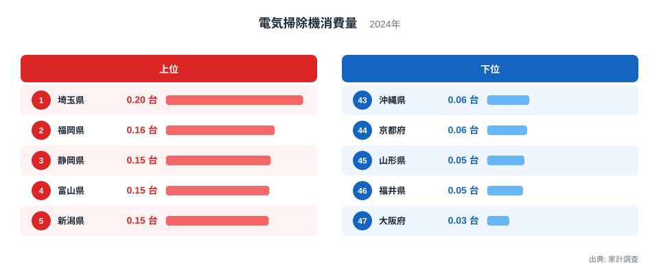
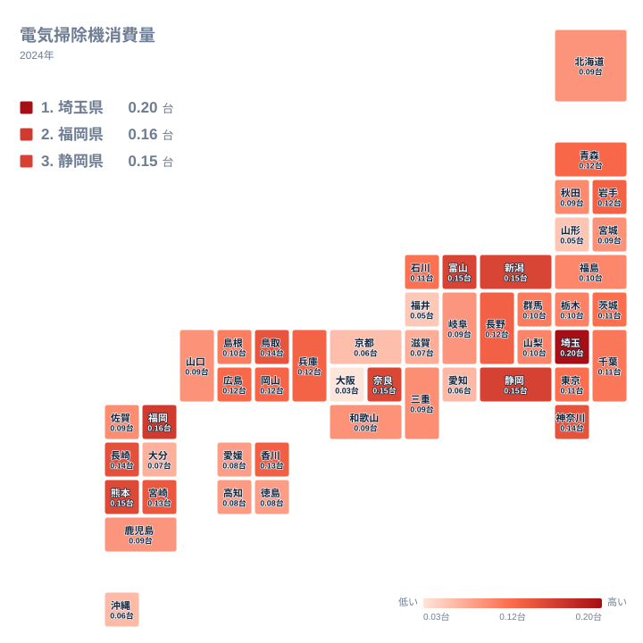

掃除機は一度買えば数年は使う家電です。それでも、1世帯が1年間に買う台数を県ごとに並べると、はっきりした差が現れます。2024年の家計調査では、1位の埼玉県が 0.199台、最下位の大阪府が 0.032台でした。最大と最小の比はおよそ6倍です。この記事では、この差が図の上でどのような形をしているのかを読み解き、あわせて、データだけでは言えないことも明確にします。

> [!NOTE]
> ここで扱う電気掃除機消費量は、家計調査で集計された、世帯あたりの年間の購入数量です。単位は台で、2024年の値を使っています。0.199台とは「1世帯が1年間に0.199台を買った」という平均の姿で、ほとんどの世帯は1台も買っていません。小数になるのは、買った世帯と買わなかった世帯をならしているためです。

## 上位と下位の構造

まず、上位5県と下位5県を図で確認します。

<source-link href="/ranking/vacuum-cleaner-consumption-quantity">電気掃除機消費量ランキングをもっと見る</source-link>

上位側で目を引くのは、1位の埼玉県の抜け方です。埼玉県は 0.199台で、2位の福岡県の 0.158台とは明確に離れています。一方、2位から5位までは福岡県の 0.158台、静岡県の 0.152台、富山県の 0.15台、新潟県の 0.149台と、ほとんど横並びです。つまり上位は「埼玉県が単独で先頭に立ち、その後ろに団子状の集団が続く」形をしています。2位から5位の間の順位は、わずかな値の違いで入れ替わりうるものです。

下位側は、上位とは違う形です。43位の沖縄県は 0.061台、44位の京都府は 0.058台、45位の山形県は 0.054台、46位の福井県は 0.052台と、ここまでは緩やかに続きます。ところが最下位の大阪府だけは 0.032台まで落ち込み、46位との間に大きな段差があります。下位は「4県が固まり、大阪府だけが飛び抜けて低い」という構造です。6倍という倍率は、先頭の埼玉県と最下位の大阪府という両端の県が、それぞれの集団から離れて存在することで生まれています。

地方の面から見ると、上位5県と下位5県に限った話ですが、顔ぶれは偏っていません。上位は埼玉県が関東、静岡県・富山県・新潟県が中部、福岡県が九州・沖縄です。下位は京都府と大阪府が近畿、山形県が東北、福井県が中部、沖縄県が九州・沖縄です。中部と九州・沖縄は、上位にも下位にも顔を出しています。特定の地方がまるごと多い、あるいは少ないという単純な構図にはなっていません。

> [!TIP]
> 購入数量の値は、1世帯あたりで 0.1台前後という小さな数字です。順位表では 0.01台の違いでも順位が動くため、順位そのものより「どの集団に属しているか」で読むのがコツです。たとえば 0.15台前後の集団と 0.05台前後の集団の違いは、1つ違いの順位より、はるかに意味のある差です。

## 地図で見る地方内のばらつき

タイルマップに並べると、色の濃淡が地方ごとにまとまっていないことが分かります。これが、この指標の最大の特徴です。

関東は、その典型です。埼玉県は1位で、神奈川県も9位の 0.137台と上位に入ります。ところが同じ関東でも、東京都は20位の 0.113台、千葉県は22位の 0.107台と中位です。関東というくくりの中に、全国1位から中位までが含まれています。

九州・沖縄も同様です。福岡県が2位、熊本県が7位、長崎県が8位と上位に並ぶ一方、大分県は41位の 0.067台、沖縄県は43位の 0.061台と下位に沈みます。同じ地方の中で、上位集団と下位集団が同居しています。ですから「九州は掃除機をよく買う」とは言えず、福岡県や熊本県など個別の県が高い、と書くのが正確です。

近畿はさらに極端です。奈良県は6位の 0.148台と上位ですが、京都府は44位、大阪府は47位です。同じ近畿でも、兵庫県は15位の 0.122台と中位で、地方の中に上から下まで全ての層がそろっています。地方単位の平均を取ると、こうした県ごとの違いが打ち消されてしまうため、地図は県単位で読む必要があります。

## 中位の県と同値の読み方

順位表の中ほどは、値が非常に近い県でひしめいています。たとえば、栃木県は25位で 0.1台、島根県は24位で 0.102台、群馬県は23位で 0.104台です。この3県は順位こそ違いますが、実質的には同じ水準と見てよいでしょう。上位や下位の両端が大きく離れているのに対し、中位は密集しているため、全体としては「真ん中に厚く、両端が薄い」分布です。

同じ値の県をどう読むかも、この指標では大切です。茨城県と東京都は、どちらも 0.113台です。それでも順位は19位と20位に分かれています。宮城県、和歌山県、山口県も、いずれも 0.088台で、順位は31位、32位、33位と並びます。同じ値でも順位が分かれて表示されているため、順位の前後に意味のある差があるわけではありません。順位を見るときは、値が同じかどうかを必ず確認してください。

> [!WARNING]
> 家計調査は、全国の限られた世帯を対象にした標本調査です。掃除機のように購入頻度が低い品目は、少数の世帯がたまたま買い替えた年に、県の数値が大きく動くことがあります。単年の数値だけで「その県は掃除機をよく買う」と断定することはできません。順位の小さな差よりも、埼玉県と大阪府のような大きな差に注目するのが安全です。

## 理由はデータだけでは特定できない

ここまで見てきたのは、購入数量の「分布の形」です。ではなぜ埼玉県が多く、大阪府が少ないのか。結論から言えば、この記事で使っているデータだけでは、理由を特定できません。

家計調査から分かるのは、各県の世帯が1年間に何台買ったかという数量だけです。住宅の種類、世帯人数、気候、買い物の手段といった情報は、今回のデータに含まれていません。そのため、これらと購入数量の関係を、数字で確かめることはできません。住まいの形や暮らし方の違いが影響しているのではないか、という見方は世間でよく語られますが、このデータで裏づけられる話ではありません。

むしろ、データから言えるのは、分かりやすい説明が成り立たないことの方です。たとえば、雪の多い地域で掃除機がよく買われるのかと考えたとき、新潟県は5位、富山県は4位と上位ですが、山形県は45位、福井県は46位と下位です。同じような地域でも結果が分かれます。大都市圏でも、神奈川県は9位、埼玉県は1位ですが、大阪府は47位、京都府は44位です。気候や都市規模のような単純な物差しでは、順位を説明しきれないことが分かります。

要因を探るには、住宅や世帯構成などの別の統計を重ねて検証する必要があります。同じカテゴリの他の指標は、[同じカテゴリの統計一覧](/category/economy)から確認できます。個別の県の詳しい数値は、[埼玉県のデータ](/areas/11000)や[福岡県のデータ](/areas/40000)で見られます。1位と2位がどのような県なのかを、他の指標とあわせて調べる出発点になります。

## データについて

この記事の数値は、家計調査の電気掃除機消費量(2024年、単位は台)に基づきます。世帯あたりの年間購入数量を、都道府県単位で比べたものです。家計調査は標本調査であり、掃除機のように購入頻度の低い品目では、年ごとの振れが大きくなることがあります。

また、本文で「約6倍」と書いたのは、1位の埼玉県の 0.199台と、47位の大阪府の 0.032台の比です。中位の県の差ではなく、両端の差を指している点に注意してください。

## まとめ

2024年の電気掃除機消費量は、1位の埼玉県が 0.199台、最下位の大阪府が 0.032台で、約6倍の開きがありました。上位は埼玉県が単独で抜け、その後ろに福岡県、静岡県、富山県、新潟県が団子状に続きます。下位は沖縄県、京都府、山形県、福井県が固まり、大阪府だけが飛び抜けて低い形です。

地方単位で見ると、関東、近畿、九州・沖縄のいずれも、県ごとの順位が大きく割れています。そのため、地方でくくって傾向を語ることはできません。理由についても、このデータだけでは確かめられません。順位の細かな差に引きずられず、全体の幅と、同じ地方の中の違いを読み取るのがおすすめです。
