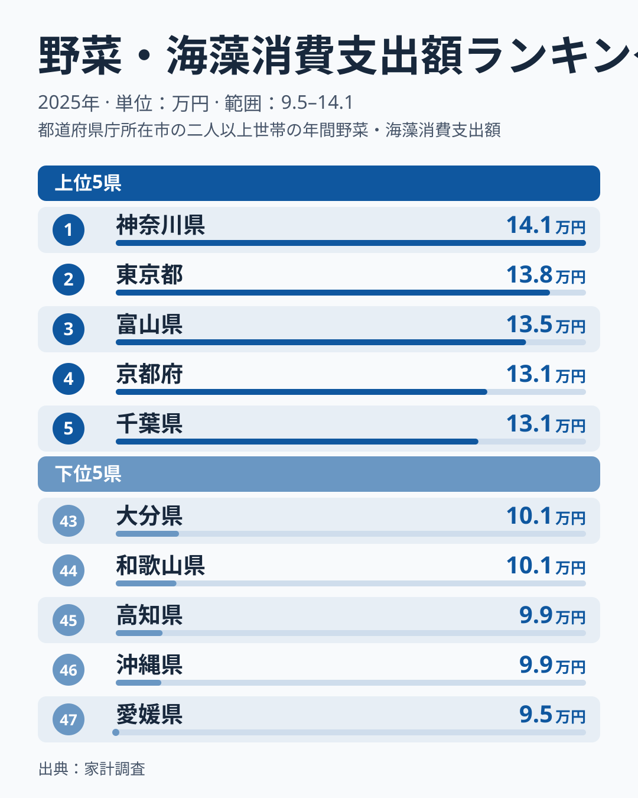
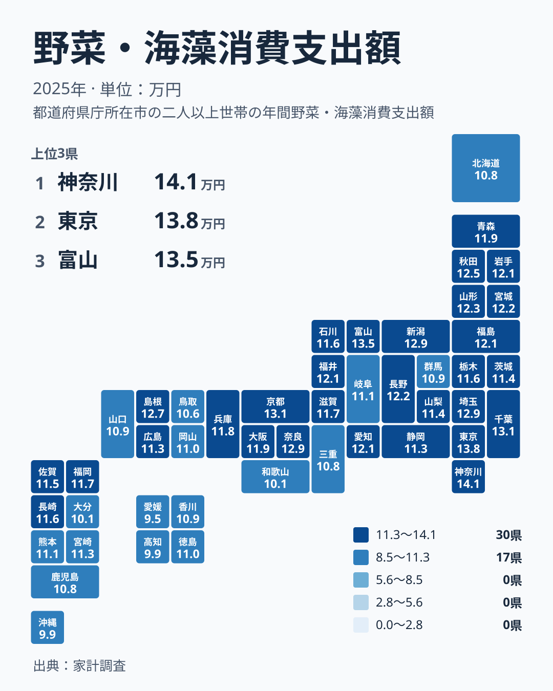

野菜と海藻にいちばんお金を使っているのは、どの県の世帯でしょうか。2025年の家計調査では、1位が神奈川県の141,159円でした。ただ、2位の東京都は137,612円で、両者はかなり近い水準です。この程度の差で「神奈川県が最も使う」と断定してよいのかは、慎重に考える必要があります。

結論を先に書くと、順位の上では神奈川県が1位です。しかし2位との開きは小さく、標本調査である以上、調査の巡り合わせで首位と2位が入れ替わっても不思議ではありません。むしろ読みどころは、1位の神奈川県と47位の愛媛県の94,854円との開きです。141,159円は94,854円の約1.5倍にあたります。

この記事では、47都道府県の並びを上位と下位に分けて確認し、食文化・気候・産地との関係を手がかりに、なぜこの差が生まれるのかを考えます。ほかの暮らしの指標もあわせて見たい方は、[同じカテゴリの統計一覧](/category/economy)も参考にしてください。

## 上位と下位の顔ぶれ

まず、全国の上位5県と下位5県を図で確認します。

<source-link href="/ranking/vegetables-seaweed-group-consumption-expenditure">野菜・海藻への支出ランキングをもっと見る</source-link>

図の上位5県は、神奈川県、東京都、富山県、京都府、千葉県です。首都圏の3都県に、富山県と京都府が加わっています。順位表から読み取れるのは、上位が大都市圏だけで固まっているわけではないことです。富山県は3位の135,254円、京都府は4位の131,439円で、いずれも関東以外の県が食い込んでいます。

注目したいのは、1位から3位までの並びです。神奈川県の141,159円、東京都の137,612円、富山県の135,254円と、上位3県は近い金額で連なっています。ここから分かるのは、トップの座が一県だけ突き抜けているのではなく、数県がほぼ横並びで競っているということです。冒頭の問いに答えるなら、神奈川県は1位だが首位と言い切れるほどの差はない、というのが誠実な読み方です。

下位の5県は、愛媛県、沖縄県、高知県、和歌山県、大分県です。所属する地方は、愛媛県と高知県が四国、和歌山県が近畿、沖縄県と大分県が九州・沖縄です。下位は三つの地方にまたがっており、特定の一地域に偏っているわけではありません。

下位の中でも、47位の愛媛県は94,854円で、46位の沖縄県の99,339円からさらに離れています。最下位だけが少し沈んでいる形で、上位の「横並び」とは対照的です。

> [!NOTE]
> この指標は野菜と海藻を合算した金額です。生鮮野菜が効いているのか、海藻が効いているのかは、この数字だけでは分かりません。たとえば昆布やわかめの消費が多い県でも、野菜の支出が少なければ合計は伸びず、その逆もあります。順位から「海藻をよく食べる県」「野菜をよく食べる県」と読み取ることはできません。

## 地図で見る地理分布

次に、都道府県ごとの金額を地図で確認します。

地図でまず目を引くのは、関東の濃さです。神奈川県が1位、東京都が2位、千葉県が5位、埼玉県が8位と、関東の四都県が上位8位以内に入っています。関東の残りの三県を見ると、栃木県は25位の115,566円、茨城県は28位の113,530円、群馬県は38位の108,733円で、同じ関東でも差があります。首都圏の上位は東京湾岸の都県に集まっていて、関東全体が高いとはいえません。

大都市圏で高い理由として、ひとつの仮説が考えられます。都市部では買い物の比重が大きく、畑や知人からの入手が少ないため、購入額が膨らみやすいのではないか、という見方です。ただし、これはデータで確かめたものではありません。あくまで仮説として受け止めてください。首都圏の詳しい数字は、[神奈川県のデータ](/areas/14000)や[東京都のデータ](/areas/13000)で確認できます。

上位10位で見ると、関東の四都県のほか、中部の新潟県と富山県、近畿の京都府と奈良県、中国の島根県、北海道・東北の秋田県が入っています。五つの地方にまたがる顔ぶれで、単一の地方に集中してはいません。

北海道・東北の区分の中身を分けて見ると、東北は秋田県が10位の125,154円、山形県が11位の122,905円、宮城県が12位の122,072円、福島県が14位、岩手県が17位、青森県が19位です。東北の六県は10位から19位に収まっています。一方、北海道は41位の107,698円で、同じ区分でも位置が大きく違います。

> [!TIP]
> 中位の県どうしは金額が近く、数位の違いは誤差の範囲に収まることがあります。順位そのものより、上位の層・中位の層・下位の層という大きなまとまりで見ると、読み違えが減ります。特に1位と2位のように金額が近い組は、順位より金額の近さに注目してください。

## 食文化・気候・産地から考える

では、なぜこのような差が生まれるのでしょうか。食文化、気候、産地との距離の三つの視点から考えます。ここから先は、地域の特徴を踏まえた推測を含みます。家計調査の数字だけで因果関係を示せるわけではない点に注意してください。

一つ目は食文化です。富山県は昆布を使った料理が家庭に根づいていることで知られます。京都府には漬物や京野菜の文化があり、奈良県にも漬物の文化があります。富山県が3位、京都府が4位、奈良県が6位の129,488円と、いずれも上位に入っているのは、こうした食習慣と重なって見えます。ただし先述のとおり、この指標は野菜と海藻の合算なので、どちらの食文化が数字を押し上げたのかまでは分かりません。

二つ目は気候です。雪の多い地域では、冬に生鮮野菜が手に入りにくい時期があり、保存のきく野菜や海藻、漬物を使う暮らしが続いてきたといわれます。新潟県は7位の129,377円、秋田県は10位です。上位10位に入るこの二県は、そうした見方と整合的です。山形県は11位で10位のすぐ外ですが、近い水準にあります。

一方で、同じく寒冷な北海道は41位です。寒さが支出を押し上げると言い切ることはできません。気候は多くの要因のひとつにすぎず、北海道のように産地が身近な場合には、別の事情が働いているのかもしれません。

三つ目は産地との距離です。野菜の産地に近い県では、直売所や知人からの入手など、購入額に表れにくい形で野菜が行き渡る場合が考えられます。中国地方では、島根県が9位の127,366円と上位なのに対し、鳥取県は42位の105,830円で、隣り合う県でも大きく異なります。産地が近いかどうかだけで説明できるわけではありません。

近畿でも差は大きく、京都府が4位、奈良県が6位、大阪府が18位の119,183円、兵庫県が20位の118,177円に対して、和歌山県は44位の100,826円です。同じ地方でも、県ごとの事情は一様ではないことが分かります。

> [!WARNING]
> 家計調査は標本調査で、都道府県別の値は限られた世帯の平均にもとづきます。1位と2位のように近い金額の県は、順位が入れ替わっても不思議ではありません。また、2025年という一年だけの結果なので、天候で野菜の価格が動いた年には、順位にも影響が出ます。この一年の並びを、その県の恒常的な食生活と受け取るのは避けてください。

## 上位と下位の対比から見えること

上位と下位の間には、どれほどの開きがあるのでしょうか。再び両端の数字を並べると、1位の神奈川県が141,159円、47位の愛媛県が94,854円で、約1.5倍の開きがあります。毎日の食卓に欠かせない食材でも、ここまでの差が出るのは、地域の暮らし方の違いを映していると考えられます。

四国と九州・沖縄を見ると、下位の顔ぶれのなかに愛媛県、高知県、沖縄県、大分県が含まれています。ただ、同じ地方に中位の県もあります。香川県は37位の109,133円、徳島県は34位の109,837円、福岡県は21位の117,400円、佐賀県は26位の115,479円です。四国と九州・沖縄をひとくくりにして「低い地方」とみなすことはできません。

下位の県については、地域の産物の使い方や、魚介など別の食材への比重が影響している可能性があります。ただし、これも数字から確認できることではありません。順位が低いからといって、野菜や海藻を食べていないとは言えませんし、食生活が貧しいことを意味するわけでもありません。

また、中位には幅広い県が並んでいます。たとえば愛知県は15位の121,082円、福井県は16位の121,051円、長野県は13位の121,944円と、ほぼ同じ水準で連なっています。大阪府は18位、兵庫県は20位で、近畿の都市部は上位ほど高くありません。このあたりは数百円から数千円の違いで順位が動く層なので、順位の細かな上下を読み込みすぎないほうがよいでしょう。

## 結びにかえて

冒頭の問いに戻ります。野菜・海藻への支出が最も多いのは、順位の上では神奈川県です。けれども2位の東京都との差は小さく、標本調査であることを考えれば、首位と言い切るのは難しいというのが答えです。

確かなこととして読み取れるのは、次の二点です。ひとつは、上位が関東の都県を中心に、中部・近畿・中国・東北の県にも広がっていること。もうひとつは、1位から47位までに約1.5倍の開きがあり、同じ地方の中でも県ごとに大きく違うことです。

食卓に並ぶ野菜や海藻は、食文化、気候、産地との距離、買い物の習慣が重なった結果です。ひとつの要因で説明しようとせず、気になる県があれば個別のデータにも目を通してみてください。

## データについて

この記事の数値は、2025年の家計調査にもとづく野菜・海藻消費支出額です。単位は円で、全47都道府県の値をそのまま使っています。順位は金額の大きい順に付けています。野菜と海藻は合算された指標のため、内訳は本記事では扱っていません。
