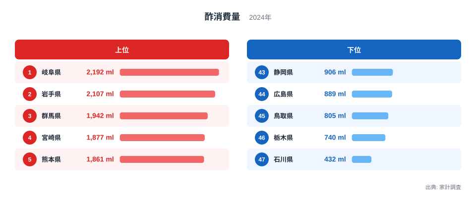
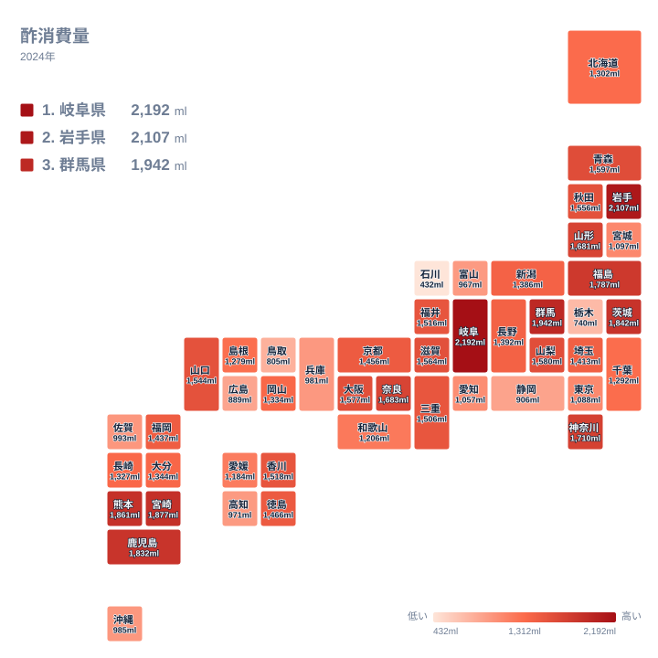

酢は、寿司や酢の物から、餃子のたれ、ドレッシング、漬物まで、日本の食卓のあちこちに登場する調味料です。ところが、家庭で使われる量は都道府県でかなり違います。2024年の家計調査で、酢の消費量が最も多かったのは岐阜県の2,192mlでした。最も少なかった石川県は432mlで、その差は1,760mlに達します。

この記事では、酢の消費量が多い県と少ない県を並べ、地域のまとまりや食文化との結びつきから、差の理由を考えます。あわせて、数字を読むときに注意したい点も整理します。

## 酢の消費量、上位と下位の顔ぶれ

まずは上位5県と下位5県を図で確認します。

<source-link href="/ranking/vinegar-consumption-quantity">酢消費量ランキングをもっと見る</source-link>

上位5県は、岐阜県が東海、岩手県が東北、群馬県が関東、宮崎県と熊本県が九州です。東海、東北、関東、九州と、地域がばらけています。特定の地方だけが酢をよく使っているわけではない、という点がまず目を引きます。

上位の層は互いに接近しています。1位の岐阜県と5位の熊本県の差は331mlで、上位5県はいずれも1,800ml台後半から2,000ml台にまとまっています。1位だけが飛び抜けているわけではなく、「酢をよく使う県」が一群をなしている姿です。

下位は事情が違います。47位の石川県は432mlで、46位の栃木県の740mlとの間に308mlの開きがあります。栃木県から43位の静岡県までは、906mlから740mlの範囲に収まっています。下位5県の中でも石川県だけが別格に少なく、約5倍という倍率の大きさは、この石川県の低さによるところが大きいといえます。

## 地図で見る酢消費量の地理分布

次に、都道府県の位置関係を保ったタイルマップで、地理的なまとまりを見ます。

東北では、岩手県の2,107mlを筆頭に、福島県が8位、山形県が11位と、上位から中位上部に並びます。青森県は12位、秋田県は16位で、東北は全体として高めの県が多い地域です。

北関東は一枚岩ではありません。群馬県は3位、茨城県は6位と上位に入る一方、栃木県は740mlで46位と下位に沈んでいます。同じ北関東でも、県によって大きく割れています。地域単位で「このあたりは酢をよく使う」と括ってしまうと、栃木県のような例を見落とします。

九州では、宮崎県が4位、熊本県が5位、鹿児島県が7位と、南部の3県が高い位置にそろいます。ただ、佐賀県は993mlで38位、沖縄県は985mlで39位であり、九州全体が高いわけではありません。

近畿も二極化しています。奈良県は10位、大阪府は14位、滋賀県は15位と高めですが、兵庫県は981mlで40位です。低い側には北陸の石川県と富山県、中国の広島県と鳥取県、東海の静岡県も並びます。

> [!NOTE]
> この指標は家計調査にもとづき、世帯が家庭で購入した酢の量をミリリットルで示したものです。外食や中食、加工食品に含まれる酢は入りません。寿司店や惣菜店で消費される酢は、この数字には現れません。

## 食文化・気候・産地から考える差の理由

酢の消費量を左右する要因は一つではありません。今回のデータは消費量そのものだけで、理由までは示していません。ここから先は、あくまで仮説として読んでください。

ひとつの見方は、漬物や酢の物を家庭で作る習慣との関係です。東北では岩手県、福島県、山形県、青森県、秋田県がいずれも1,500mlを超えています。冬が長く、保存食を手作りする文化のある地域で、酢が家庭に常備されている可能性は考えられます。

もうひとつは、野菜の産地との関係です。群馬県や茨城県は野菜の産地として知られ、収穫した野菜を酢漬けやサラダで食べる機会が多いのかもしれません。ただし、同じ北関東の栃木県は下位であり、産地であることだけでは説明がつきません。

九州南部の3県がそろって上位に入っていることも、地域に共通する食習慣を想像させます。もっとも、気候や食文化との因果は、このデータだけでは確かめられません。県ごとの違いを知りたいときは、[岐阜県のデータ](/areas/21000)や[岩手県のデータ](/areas/03000)で、上位に入る県の状況を確認してみてください。

> [!WARNING]
> 家計調査は、調査世帯の数が限られ、年ごとの変動も出やすい統計です。1年分の順位だけで、県全体の食文化を断定することは避けてください。石川県の432mlが低いことも、酢を使わない県だと読むのは早計です。

## 大都市圏と地方の違い

大都市圏の位置づけも見ておきます。神奈川県は1,710mlで9位、大阪府は1,577mlで14位と上位でした。京都府は1,456mlで22位、埼玉県は1,413mlで24位です。千葉県は1,292mlで31位、東京都は1,088mlで36位、愛知県は1,057mlで37位でした。

同じ大都市圏でも、順位はかなり散らばっています。首都圏では神奈川県が高く、東京都が低めです。東京都では外食や中食の利用が多く、家庭での購入量が少なくなっている可能性はありますが、この点も今回のデータだけでは裏づけられません。

中位には、福岡県が1,437mlで23位、新潟県が1,386mlで26位、北海道が1,302mlで30位と並びます。順位の両端に注目が集まりがちですが、実際は多くの県が1,200mlから1,600ml前後に密集しています。

> [!TIP]
> 順位だけでなく、実際の量の差を見てください。たとえば38位の佐賀県は993ml、39位の沖縄県は985ml、40位の兵庫県は981mlで、3県の差は合わせても12mlしかありません。順位が一つ二つ違っても、実質的な差はほとんどない場合があります。

## まとめ：酢の消費量が映す地域の暮らし

2024年の酢消費量は、岐阜県の2,192mlから石川県の432mlまで、大きな幅がありました。上位は岐阜県、岩手県、群馬県、宮崎県、熊本県で、東海、東北、関東、九州にまたがっています。下位は石川県、栃木県、鳥取県、広島県、静岡県でした。

地域のまとまりは見えるものの、北関東の群馬県・茨城県と栃木県のように、近い県どうしでも大きく分かれる例があります。この統計は家庭での購入量に限られ、外食や加工品は含まれません。数字を読むときは、その範囲を意識することが大切です。

暮らしや経済に関する指標は、[同じカテゴリの統計一覧](/category/economy)から比べられます。

## データについて

本記事で用いた指標は、家計調査の酢消費量(2024年、単位はml)です。順位は47都道府県の値を大きい順に並べたものです。倍率として示した約5倍は、岐阜県の2,192mlを石川県の432mlと比べた目安で、差の1,760mlは両者の値から算出しています。
