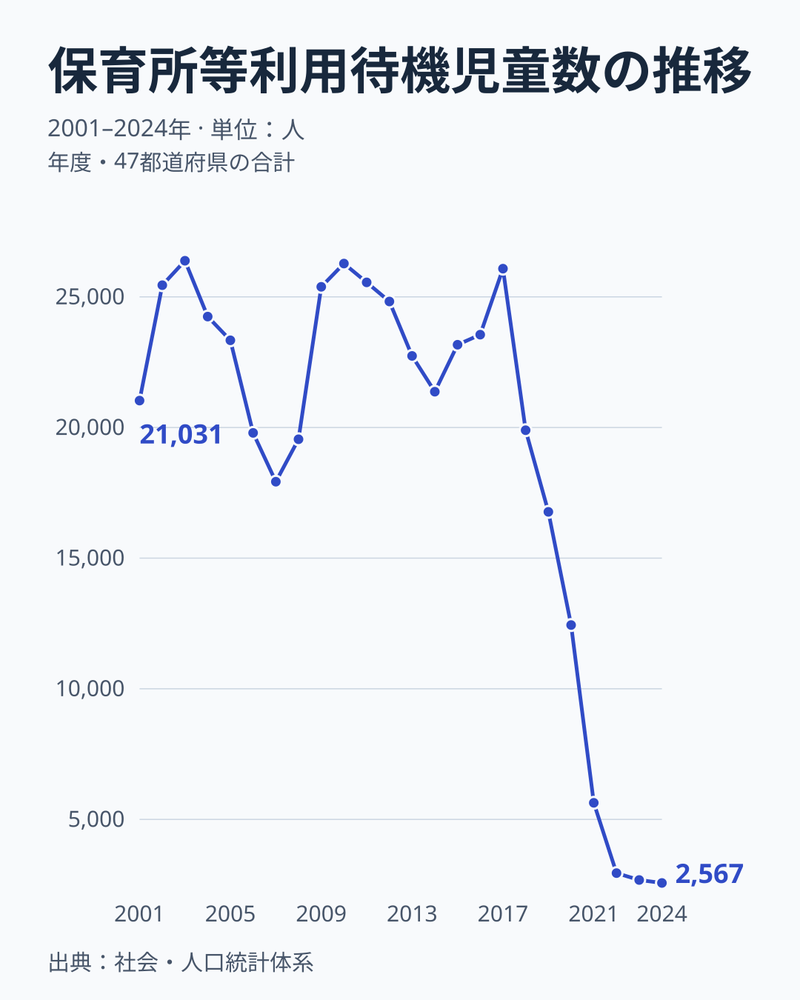
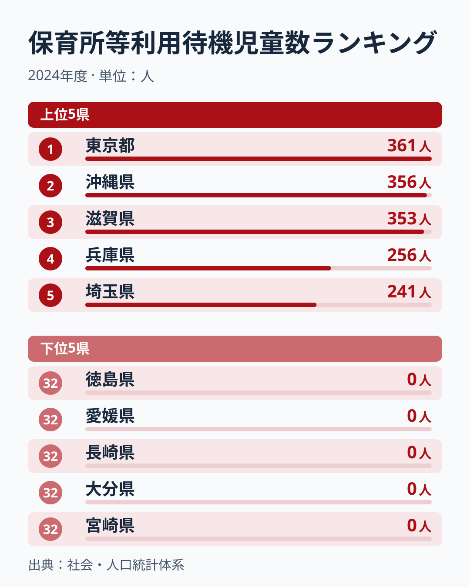
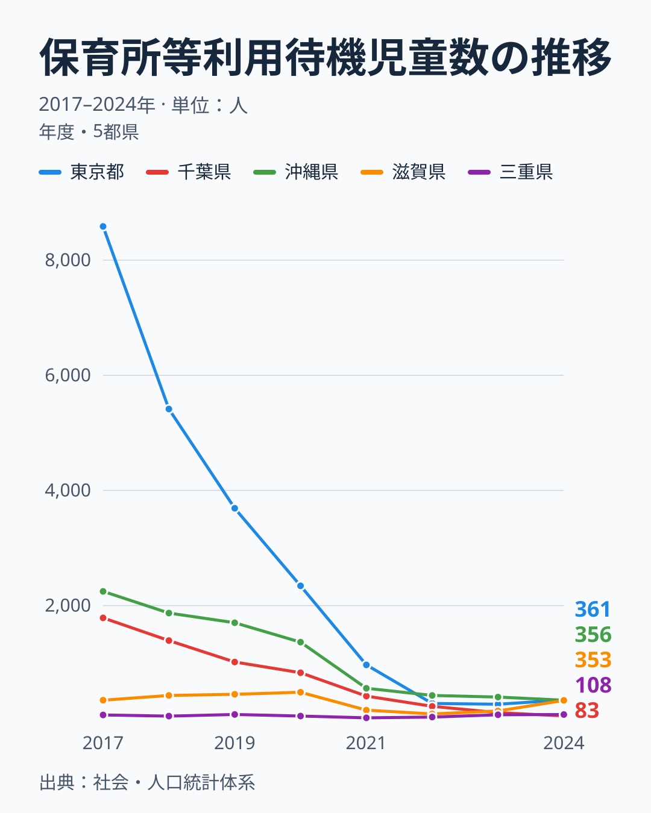
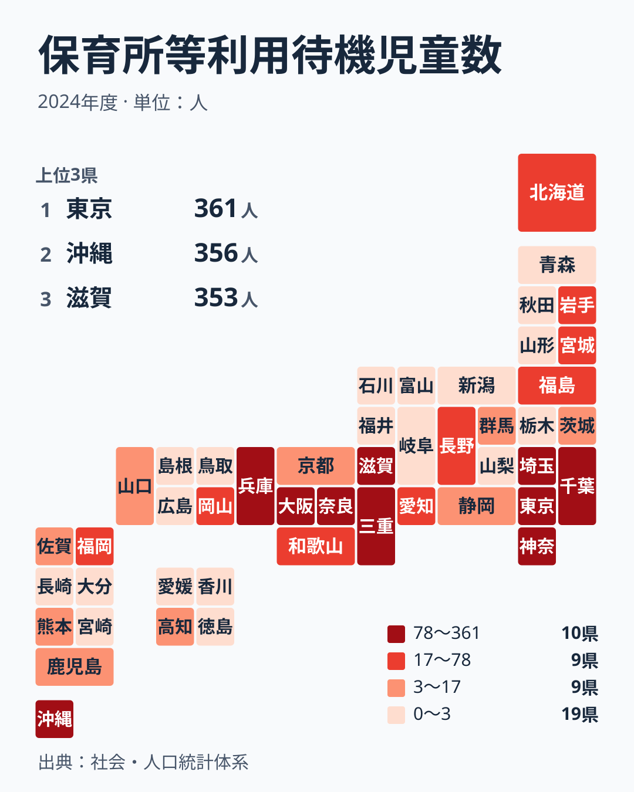
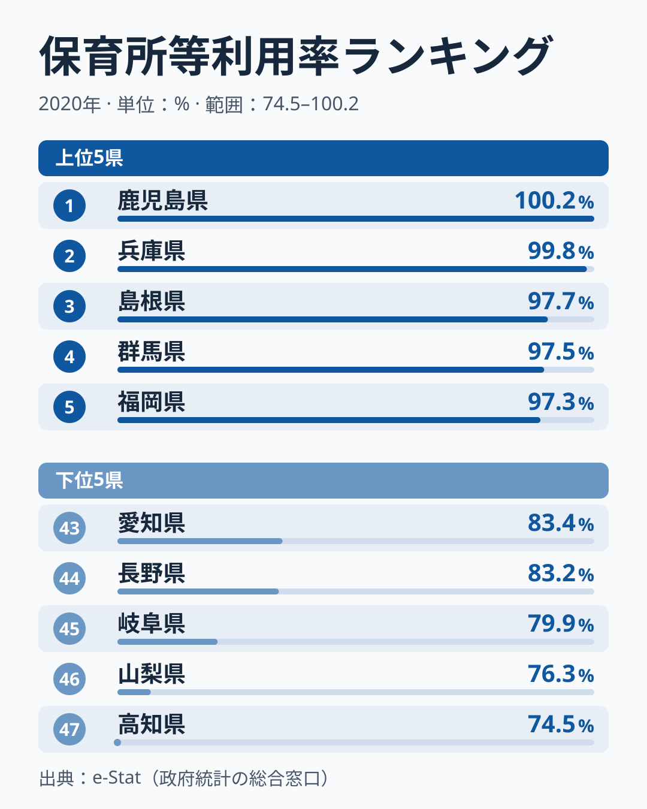

保育所等利用待機児童数は、2024年度に47都道府県の合計で2,567人でした。2001年度以降で最も多かった年は2万6千人を超えていたので、10分の1を下回るところまで減ったことになります。待機児童がゼロの県は16県にのぼります。

それでも「待機児童の問題は解決した」と言い切れるでしょうか。東京都が361人、沖縄県が356人、滋賀県が353人と、この3都県だけで2,567人の約4割を占めます。全国の合計が小さくなった分、残る待機児童がどこに偏っているかが見えやすくなりました。この記事では、推移・ランキング・地図の順に、減り方と残り方の地域差を確かめます。

> [!NOTE]
> 待機児童数は、保育所等への入所を申し込んでいるのに利用できていない児童の数です。「特定の園だけを希望している」「育児休業中」など一定の条件に当てはまる場合は数えないため、数に入らない待機の存在も指摘されています。この記事の値は「保育所等関連状況取りまとめ」の値を社会・人口統計体系から取った年度ごとの値で、全国の値は47都道府県の合計です。

## 待機児童数の推移 — 2017年度の2.6万人から10分の1以下へ

47都道府県の合計は、2003年度に26,383人、2010年度に26,275人、2017年度に26,081人と、2万6千人前後の山を3度つけました。2007年度の17,926人のようにいったん減っても、また増えることを繰り返してきたことがわかります。

流れが変わったのは2018年度以降です。2018年度に19,895人、2019年度に16,772人、2020年度に12,439人と減り、2021年度には5,634人と前の年度の半分以下になりました。その後も2022年度の2,944人、2023年度の2,680人と減り続け、2024年度の2,567人は2001年度以降で最も少ない値です。

ただし、2022年度からの3年間の減り方は小さく、2,500人前後で下げ止まりつつあるようにも見えます。全国の合計が小さくなった今、残る2,567人がどの県に集まっているかが次の問いになります。

<source-link href="/ranking/nursery-waiting-children-count">保育所等利用待機児童数ランキングをもっと見る</source-link>

## 待機児童数ランキング — 東京・沖縄・滋賀が上位

2024年度に最も多いのは[東京都](/areas/13000)の361人で、[沖縄県](/areas/47000)の356人、[滋賀県](/areas/25000)の353人が僅差で続きます。4位は兵庫県の256人、5位は埼玉県の241人でした。上位3都県の差はわずか8人で、4位の兵庫県とは100人近く離れています。

上位の顔ぶれには、人口の多さだけでは説明できない県が入っています。東京都が多いのは保育の需要の大きさと合いますが、同じ大都市圏でも大阪府は111人、愛知県は57人と少なく、人口が東京都よりずっと少ない沖縄県と滋賀県が、東京都とほぼ同じ人数で並んでいます。人口の規模をそろえて比べると、この2県の待機児童はさらに目立つ可能性があります。[仮説] 子どもの数や保育の需要が増えた地域で、受け皿の整備が追いついていない可能性がありますが、出生数や転入の数と突き合わせてはいないので、この記事では確かめていません。

一方、待機児童がゼロの県は16県あります。青森・山形・栃木・新潟・富山・石川・福井・山梨・鳥取・島根・広島・徳島・愛媛・長崎・大分・宮崎です。図の下位5県はこの16県のうちの5県で、ゼロの県どうしに順位の差はありません。

> [!WARNING]
> 「待機児童ゼロ」の県でも、育児休業中のため保留になった人や、希望する施設だけを申し込んだ人など、数え方の条件で外れた待機は別に存在しえます。公式の値がゼロであることは、保育の希望がすべて満たされたことを意味しません。

## 2017年度からの減り方 — 東京は95%減、滋賀は7年前の水準に戻った

全国の合計が2万6千人台だった2017年度と2024年度を県ごとに比べると、減り方は県によって大きく違います。図には、2024年度の上位10県から、2017年度より大きく減った東京・千葉・沖縄と、減っていない滋賀・三重の5都県を選んで並べました。

東京都は2017年度の8,586人から2024年度の361人へ、千葉県は1,787人から83人へと、どちらも約95%減りました。沖縄県も2,247人から356人へと8割以上減っています。図には入れていませんが、大阪府と兵庫県も同じ期間に8割以上減りました。

一方で、滋賀県は違う動きをしています。2017年度の356人から2020年度の495人まで増え、2022年度には118人まで減りましたが、2023年度に169人、2024年度に353人と2年で約3倍に増え、2017年度とほぼ同じ人数に戻りました。三重県も2021年度の50人から2024年度の108人へと倍増しています。東京都も2023年度の286人から2024年度の361人へ増えていて、直近の2年は5都県とも減り続けているわけではありません。

2024年度の上位3都県に東京・沖縄と並んで滋賀が入っているのは、ほかの都県が7年で大きく減ったうえに、滋賀県ではこの2年で待機児童が増えたためです。2017年度と2024年度の両端で比べると、減り方の差が残り方の差に表れています。減り方がなぜ県によって違うのかは、受け皿の整備の量や子どもの数の変化と突き合わせないと分からないので、この記事では確かめていません。

## 地図で見る — 首都圏と近畿に残り、日本海側はゼロが続く

地図で見ると、待機児童が残る県は首都圏と近畿にまとまっています。首都圏では東京都の361人、埼玉県の241人、神奈川県の188人、千葉県の83人が上位10県に入りました。近畿では滋賀県の353人、兵庫県の256人、奈良県の135人、大阪府の111人、三重県の108人が上位10県に入りました。上位10県のうち、沖縄県を除く9都府県が首都圏と近畿に集まっていることになります。

反対に、富山・石川・福井・新潟から鳥取・島根にかけての日本海側では、ゼロの県が続きます。東北でも青森・山形がゼロで、秋田県は2人です。沖縄県を除く九州では長崎・大分・宮崎がゼロで、佐賀県は6人、熊本県は4人と少なく、福岡県の57人と鹿児島県の12人を除けば一桁にとどまります。

この偏りは、待機児童が「全国の問題」から「一部の地域の問題」に変わってきたことを示しています。合計の2,567人のうち、上位10県だけで2,192人と全体の8割を超えます。

## 保育所等利用率 — 定員に対する埋まり具合の地域差

保育所等利用率は、保育所等の定員に対して、どれだけの児童が利用しているかを示す指標です。社会福祉施設等調査の値で、ここでは最新の2020年の値を使います。待機児童数の2024年度とは年がそろっていない点に注意してください。

2020年に最も高いのは鹿児島県の100.2%で、定員を上回って利用されています。兵庫県が99.8%、島根県が97.7%、群馬県が97.5%、福岡県が97.3%と続き、これらの県では定員がほぼ埋まっていました。最も低いのは高知県の74.5%で、山梨県の76.3%、岐阜県の79.9%、長野県の83.2%、愛知県の83.4%が続きます。

2020年の利用率と2024年度の待機児童数を並べると、同じ向きに並ぶ県と、そうでない県が混在しています。2020年の利用率が99.8%で2番目に高い兵庫県は、2024年度の待機児童も256人と多く、定員の埋まり具合と待機の多さがそろっている県です。一方、2020年の利用率が97.7%と高い島根県は、2024年度の待機児童がゼロで、定員がほぼ埋まっていても待機は出ていません。2020年の利用率が最も高い鹿児島県も、2024年度の待機児童は12人です。反対に、2020年の利用率が83.4%と低い側の愛知県でも、2024年度の待機児童は57人いて、定員に空きがあっても、場所や年齢によっては利用できない児童がいる可能性があります。

<source-link href="/ranking/nursery-utilization-rate">保育所等利用率ランキングをもっと見る</source-link>

> [!TIP]
> 待機児童数と保育所等利用率は、別のことを測る指標です。自分の県の状況を見るときは、待機児童の人数と、定員がどれだけ埋まっているかを両方確かめると、受け皿が足りないのか、場所や年齢の組み合わせが合っていないのかを考える手がかりになります。

## 残る課題をどう読むか

ここまでのデータから言えるのは、待機児童は2018年度以降に大きく減り、2024年度には47都道府県の合計で2,567人になったこと、そして残る待機児童の8割以上が上位10県に集まっていることです。上位10県のうち9都府県は首都圏と近畿にあり、沖縄県と滋賀県は東京都とほぼ同じ人数の待機児童を抱えています。

一方で、ゼロになった16県の多くは日本海側や東北・九州の県です。[仮説] 子どもの数が減って保育の需要が落ち着いたことが、ゼロにつながっている面もあるかもしれません。ただし、この記事では出生数や就学前の子どもの数と突き合わせていないので、ゼロの理由は確かめていません。

公式の待機児童数がゼロに近づくほど、数に入らない待機や、定員の埋まり具合の偏りが課題として残ります。自分の住む県の数字を見るときは、待機児童数のランキングと利用率の両方を見比べてください。
