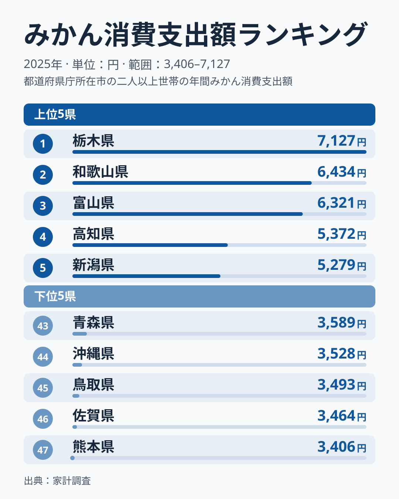
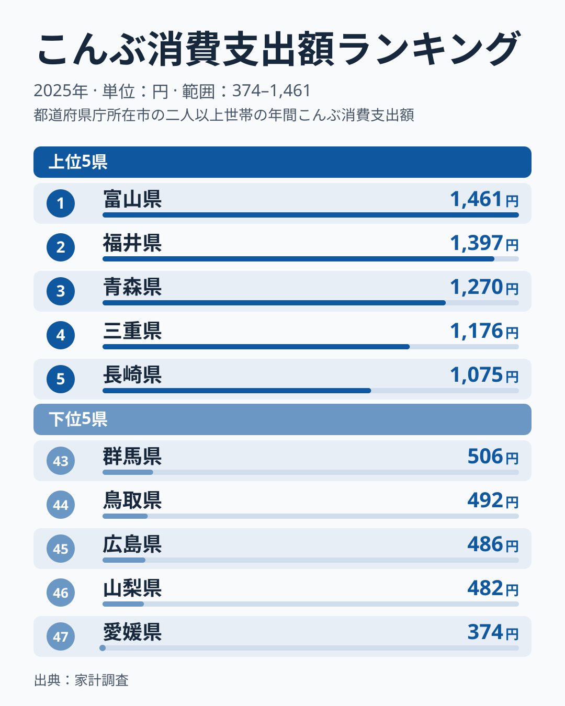
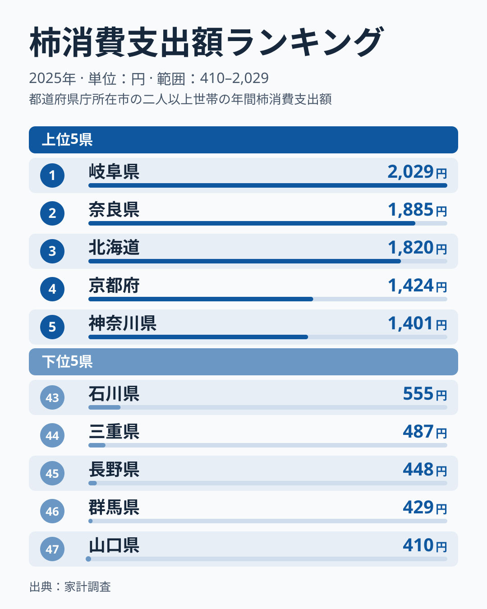
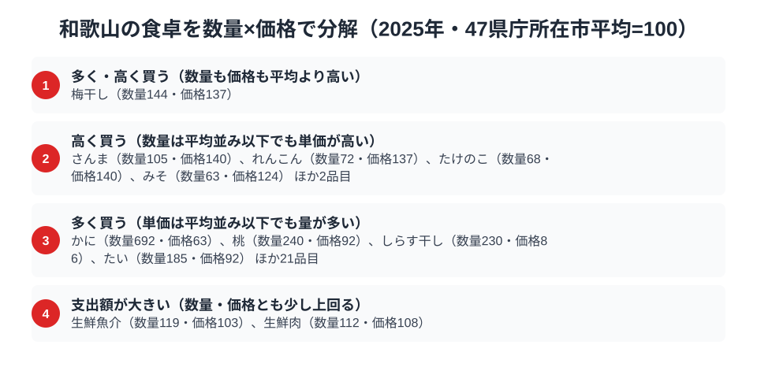

「みかんの国」和歌山。総務省の家計調査（品目別）で和歌山市の二人以上世帯を見ると、2025年のみかん消費支出額は6,434円で全国2位でした。首位は栃木県の7,127円で、和歌山県は約700円差で2位に下がり、3位の富山県6,321円とは113円差です。この記事の2024年版では和歌山がみかんの首位でしたが、2025年の値で見直すと順位は入れ替わっています。

昆布は2025年に6位（1,021円）、柿は29位（833円）で、2024年版で書いた「昆布2位・柿4位」という並びも崩れました。一方で、みかんの購入量は12,592gで全国2位、梅干しの支出額は2,756円で47市の先頭と、数量や別の品目に目を向けると和歌山らしさは残っています。この記事では、みかん・昆布・柿の3品目を横断し、後半で支出額を数量×価格に分解して、和歌山市の食卓の個性を読み解きます。

> [!NOTE]
> 家計調査の都道府県データは、県庁所在市（和歌山県は和歌山市）の二人以上世帯を対象にした年間支出額です。県全体ではなく和歌山市在住世帯の家計簿から見た傾向であり、支出「金額」であって消費「量」そのものではない点にご注意ください。

## みかん — 全国2位6,434円、栃木に抜かれた本場

<source-link href="/ranking/mandarin-consumption-expenditure">みかん消費支出額ランキングをもっと見る</source-link>

2025年の和歌山県のみかん消費支出額は6,434円で全国2位です。1位は栃木県の7,127円、3位は富山県の6,321円、4位は高知県の5,372円、5位は新潟県の5,279円で、上位3県と4位以下の間には900円以上の開きがあります。和歌山は有田みかんをはじめ、温暖な気候と水はけのよい斜面を活かしたみかん栽培が盛んな土地であり、首位こそ栃木に譲ったものの、2位という位置は産地の厚みを示しています。

首位が入れ替わった理由は、このデータだけでは断定できません。家計調査は県庁所在市1市の世帯を対象にしているため、単年の順位は標本のぶれで動きやすく、[仮説]として「栃木県の1位は2025年に限った動きで、和歌山の水準が下がったとは限らない」という見方ができます。検証するには、翌年以降のデータで栃木県と和歌山県のどちらが上位に来るかを見る必要があります。全国の並びは[みかん消費支出の記事](/blog/mandarin-expenditure-ranking)でも扱っており、産地と消費地が重なる県が上位に並びやすいかどうかは、複数年で確かめるのが確実です。

## 昆布 — 全国6位1,021円、北陸勢に次ぐ紀州の昆布食

<source-link href="/ranking/konbu-consumption-expenditure">昆布消費支出額ランキングをもっと見る</source-link>

和歌山は昆布の消費支出額でも全国6位の1,021円に入ります。家計調査の品目名は「こんぶ」で、2025年の値は1,021円です。1位は富山県の1,461円、2位は福井県の1,397円、3位は青森県の1,270円、4位は三重県の1,176円、5位は長崎県の1,075円で、和歌山は5位の長崎県と僅差で、7位の京都府1,017円とはほぼ並ぶ接戦です。昆布は北海道が主産地で、和歌山は産地から遠いにもかかわらず、上位6県に入っています。

上位に富山県・福井県が並ぶ点は、北前船の交易路が昆布の消費文化を育てたという見方と整合します。[仮説]として、紀伊半島にも北海道の昆布が運ばれた歴史が和歌山の昆布食を支えている可能性がありますが、家計調査の単年順位だけでは歴史的な背景までは裏づけられません。昆布消費支出額で全国1位の[富山県の食卓](/blog/toyama-food-culture)と比べると、和歌山は「上位ではあるが突出はしていない」という位置づけです。

## 柿 — 全国29位833円、産地でも家計では上位に出ない

<source-link href="/ranking/persimmon-consumption-expenditure">柿消費支出額ランキングをもっと見る</source-link>

和歌山は柿の産地としても知られますが、2025年の柿の消費支出額は833円で全国29位と、中位よりやや下でした。1位は岐阜県の2,029円、2位は奈良県の1,885円、3位は北海道の1,820円、4位は京都府の1,424円、5位は神奈川県の1,401円で、上位5県は1,400円以上です。2024年版で書いた「全国4位」から大きく順位を下げており、単年の家計調査がいかに動くかを示す好例です。

産地であることと、産地の県庁所在市の家計で多く消費されることは別の話で、柿については「産地だから食卓でも上位」という図式は2025年のデータでは成り立ちませんでした。

> [!WARNING]
> 家計調査は支出金額の調査であり、消費量そのものではありません。物価や単価の違いも金額に影響するため、順位だけでは和歌山の食文化の全体像は測れない点にご注意ください。県庁所在市1市の標本のため、1年の順位で県の構造を断定するのも避けてください。

## 和歌山の食卓を貫くもの

2025年の3品目は2位・6位・29位とばらつきましたが、全体としては「果樹や海産物を多く買う食卓」という輪郭は残っています。みかんは支出額で全国2位、昆布は上位6県に入り、柿だけが中位にとどまりました。単年の順位は動いても、みかんと昆布が上位に残るという点は、紀州の果樹文化と交易が運んだ海の食文化を示唆します。ただし、これは2025年の1年分から読める範囲の話です。

県民の食卓比較は、1品目の順位より複数品目の並びで読むほうが安定します。同じ果樹と海の幸の組み合わせでも、県ごとに強い品目の順位は入れ替わります。

> [!TIP]
> 家計調査の順位は年によって入れ替わります。和歌山のみかんや柿のように、2024年版と2025年で順位が大きく動く品目もあるため、複数年の推移や、数量・価格といった別の軸と合わせて読むと食文化の輪郭が見えやすくなります。

## 数量×価格で分解する和歌山市の食卓

<source-link href="/ranking/whitebait-consumption-quantity">しらす干し消費量ランキングをもっと見る</source-link>

みかんの支出額2位、昆布の支出額6位という数字だけでは、和歌山の食卓が「たくさん食べている」のか「高いものを買っている」のかまでは分かりません。家計調査の品目別データを、支出額＝数量×価格に分解し、47都道府県庁所在市の単純平均を100とした数量指数・価格指数で見ると、和歌山市の食卓には量で支出額を押し上げる品目と、単価の高さで押し上げる品目、そして両方が高い品目があります。

量で稼ぐ型の代表はしらす干しです。数量指数は230、価格指数は86と、単価は平均を下回る一方で購入量が大きく上回っています。桃も数量指数240に対して価格指数92、たいも数量指数185に対して価格指数92で、同じく量で支出額を押し上げる型です。記事前半のみかんの支出額が高い背景にも、単価ではなく購入量の多さがあると考えられますが、みかん自体の数量・価格の値はここで扱う data にないため、断定は避けます。

「多く・高く」買う型として現れたのが梅干しです。数量指数は144、価格指数は137と、量も単価も平均を上回っています。単価の高さが目立つ品目としては、さんま（数量105・価格140）、れんこん（数量72・価格137）、たけのこ（数量68・価格140）、みそ（数量63・価格124）が挙がります。

なお、かには数量指数が692と極端に大きく、価格指数は63です。1世帯の大口購入が年間平均を押し上げた可能性があり、[仮説]として単年の標本のぶれが大きい品目と考えられるため、傾向として読むのは慎重にすべきです。生鮮魚介（数量119・価格103）と生鮮肉（数量112・価格108）は、数量・価格とも平均を少し上回り、支出額の大きさにつながっています。

支出額ランキングを見るときは、数量と価格の2つの軸に分けて読むと、産地や食文化との結びつきが見えやすくなります。しらす干し・桃・たいのように数量指数が高く価格指数が平均を下回る品目は「量で稼ぐ」タイプ、梅干しのように数量指数も価格指数も高い品目は「量も単価も高い」タイプです。

> [!NOTE]
> ここでの数量指数・価格指数は、47都道府県庁所在市の単純平均を100とした相対値であり、家計調査の全国平均そのものではありません。価格指数は支出額を数量で割った金額の相対比なので、購入する品種やブランドの違いも影響します。対象は和歌山市の二人以上世帯の年間支出額・購入量です。

## まとめ

- みかん消費支出額は和歌山県が全国2位の6,434円で、首位は栃木県の7,127円
- 昆布は全国6位の1,021円、柿は全国29位の833円と、2024年版の並びから大きく動いた
- 数量×価格で見ると、しらす干し・桃・たいは量で稼ぎ、梅干しは量も単価も平均を上回る
- 単年の順位は動きやすく、構造の判断には複数年の確認が必要

和歌山県の他の統計は[和歌山県の地域プロフィール](/areas/30000)、食品・家計消費の地域差は[経済カテゴリ一覧](/category/economy)からご覧いただけます。
