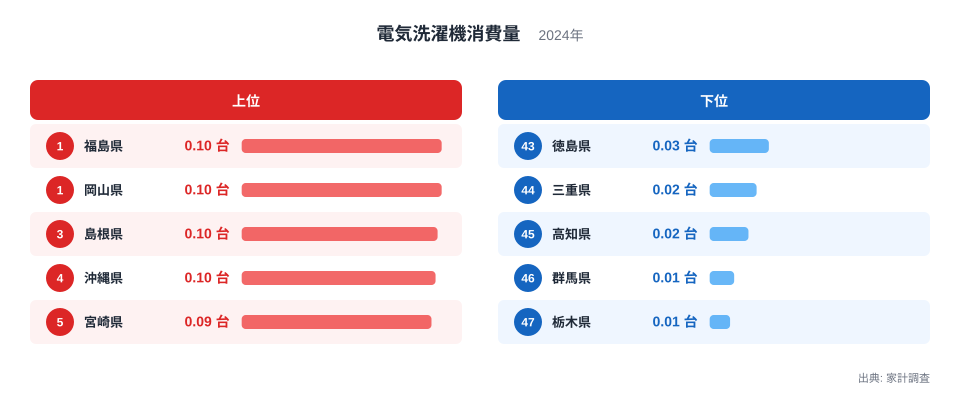
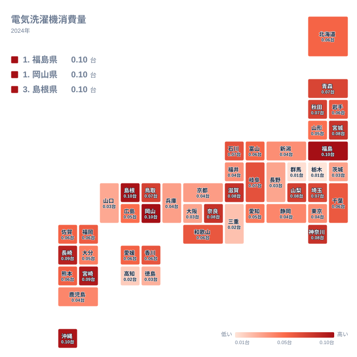

## 1位は福島県と岡山県が同値、最少の栃木県とは9.8倍の差

洗濯機の購入数量が最も多い県はどこか。2024年の家計調査では、福島県と岡山県がどちらも0.098台で並びました。順位は福島県が1位、岡山県が2位ですが、表示上は同じ値です。つまり、この指標の1位争いはほぼ同点であり、どちらが上かを決める意味はあまりありません。

一方、最も少ないのは栃木県の0.01台で47位です。最大の福島県と最小の栃木県を比べると、9.8倍の開きがあります。この大きな差の正体を、地域の散らばり方と指標の性質から考えていきます。

ここで言う「台」は、世帯が1年間に購入した台数のことです。家庭に置かれている洗濯機の総数ではありません。この点を押さえると、数字の読み方が変わってきます。

> [!NOTE]
> この指標の正式名は「電気洗濯機消費量」で、家計調査における購入数量にあたります。世帯がその年に新たに買った台数を表すもので、普及率や保有台数ではありません。長く使う耐久財なので、数値が小さいことは「持っていない」ことを意味しません。

ほかの暮らしの統計は[同じカテゴリの統計一覧](/category/economy)でも確認できます。

## 上位と下位の顔ぶれから読み取れること

まずは上位5県と下位5県を並べた図です。

<source-link href="/ranking/washing-machine-consumption-quantity">電気洗濯機消費量ランキングをもっと見る</source-link>

上位には東北の福島県、中国の岡山県と島根県、九州・沖縄の沖縄県と宮崎県が入っています。東京都や大阪府のような大都市圏の都府県は、この5県に含まれていません。人が多い地域ほど買う、という単純な構図ではなさそうです。

下位では、関東の栃木県と群馬県が最下位付近に並び、そこに四国の高知県と徳島県、近畿の三重県が加わります。上位の顔ぶれは東北・中国・九州沖縄に分かれ、下位は関東と四国が目立ちます。ただし、地方ごとに色がそろっているわけではありません。次の節で見るように、同じ地方の中でも順位が大きく割れています。

福島県の詳細は[福島県のデータ](/areas/07000)、岡山県の詳細は[岡山県のデータ](/areas/33000)でも確認できます。上位同士は差がごくわずかなので、細かな順位の違いよりも、上位と下位の間にある大きな隔たりに注目するほうが、この指標の本質に近づけます。

## 地理分布で見る、同じ地方内の食い違い

次に、47都道府県の分布を地図で確認します。

この地図から読み取れる最大のポイントは、同じ地方の中でも隣り合う県で順位が大きく割れることです。地方ごとに色がまとまる、という形にはなっていません。

関東がその典型です。神奈川県は0.081台で7位と上位に入っています。ところが同じ関東の栃木県は47位、群馬県は0.012台で46位です。同じ地方に、上位と最下位付近が同居しています。

近畿でも同じ構図が見られます。滋賀県は0.081台で8位ですが、大阪府は0.033台で41位です。大都市圏の大阪府が下位にあることを意外に感じる方もいるでしょう。

東北も一枚岩ではありません。福島県が1位、宮城県が0.08台で10位と上位に入る一方、山形県は0.052台で29位です。東北の県は上位から中位にかけて散らばっており、地方全体を一つの水準でくくることはできません。

地方単位の傾向が見えにくいことから、この指標の差は、気候や食文化のような広い地域性よりも、県ごとの事情や調査のぶれに左右されている可能性があります。ただし、単年の分布だけでは裏づけられないため、あくまで仮説の域を出ません。

> [!TIP]
> この数字は「買った台数」です。順位が高い県は、その年に買い替えの時期を迎えた世帯が多かった可能性があります。順位が低い県は、前の年に買い替えを済ませていただけかもしれません。1年分の順位は、その県の洗濯機への関心の高さではなく、更新のタイミングを映している可能性があると考えて読んでください。

## 差が生まれる背景を考える

食文化や産地と結びつく食品であれば、地域の食習慣が数字に表れます。洗濯機は毎日の食卓に上るものではなく、食文化との結びつきは考えにくい品目です。では、なぜここまで差が出るのでしょうか。

仮説として最初に挙げられるのは、買い替えの周期です。洗濯機は長く使う耐久財なので、ある年に多くの世帯が買い替える県と、ほとんど買い替えない県が生まれることが考えられます。ただし、手元に買い替え周期のデータはなく、これが主な要因だと言い切ることはできません。

気候で説明できるかも見てみます。上位には沖縄県が4位、宮崎県が5位、長崎県が0.089台で6位と、温暖な九州・沖縄の県が並びます。しかし、同じく温暖な四国の高知県は45位、徳島県は0.029台で43位と下位にあります。温暖であることだけで購入数量の多さを説明するのは難しそうです。

関連品目との対比も考えてみます。日々の食品と比べると、洗濯機は購入頻度が低く、調査に当たった世帯の事情で数値が動きやすい品目だと考えられます。食品より順位が入れ替わりやすいかもしれませんが、本記事で使えるのは2024年の単年データだけです。実際にどの程度入れ替わるかは確認できません。

> [!WARNING]
> 家計調査は全国の限られた世帯を対象にした標本調査です。洗濯機のように購入頻度の低い品目は、調査対象にたまたま買い替えた世帯がいたかどうかで数値が大きく動きます。1年分の順位だけで、その県の消費傾向を断定しないでください。

## 中位の密集をどう受け止めるか

最後に、数値の幅を確認しておきます。上位5県は0.093台から0.098台の範囲に収まり、互いの差はごくわずかです。それに対して、中位の県は0.05台前後に密集します。広島県は0.053台で28位、山形県は0.052台で29位、愛知県は0.049台で30位です。

北海道は0.057台で26位、富山県も0.057台で27位です。表示上は同じ値ですが、順位は分かれています。表示されない細かな差によるものと考えられ、順位がひとつ違っても実質的な差はほとんどないと見てよいでしょう。

下位に目を向けると、静岡県は0.044台で32位、鹿児島県も0.044台で33位、新潟県は0.041台で35位です。長野県は0.033台で40位、山口県は0.032台で42位です。東日本にも西日本にも低い県が点在しており、地域でひとくくりにはできません。

このように、洗濯機の購入数量は食文化のように地域色がはっきり出る指標ではありません。順位を見るときは、上位と下位の極端な県に注目しつつ、中位の県の順位差は小さな違いとして受け止めるのが現実的です。福島県の0.098台と栃木県の0.01台という両端の差は確かに大きいのですが、その間の大多数の県は連続的に並んでいます。

## データについて

この記事で使ったのは、家計調査の2024年の電気洗濯機消費量です。単位は台で、世帯あたりの年間購入数量を示します。数値は小数第3位までの表示で、表示上は同じ値でも順位が分かれている県があります。これは表示されていない細かな差によるものと考えられます。

順位の細かな差を比べるよりも、上位・中位・下位という大きな区分で眺めると、この指標の特徴がつかみやすくなります。福島県や岡山県のように上位に入った県も、別の年には順位が変わる可能性があります。複数年の推移とあわせて確認することをおすすめします。
