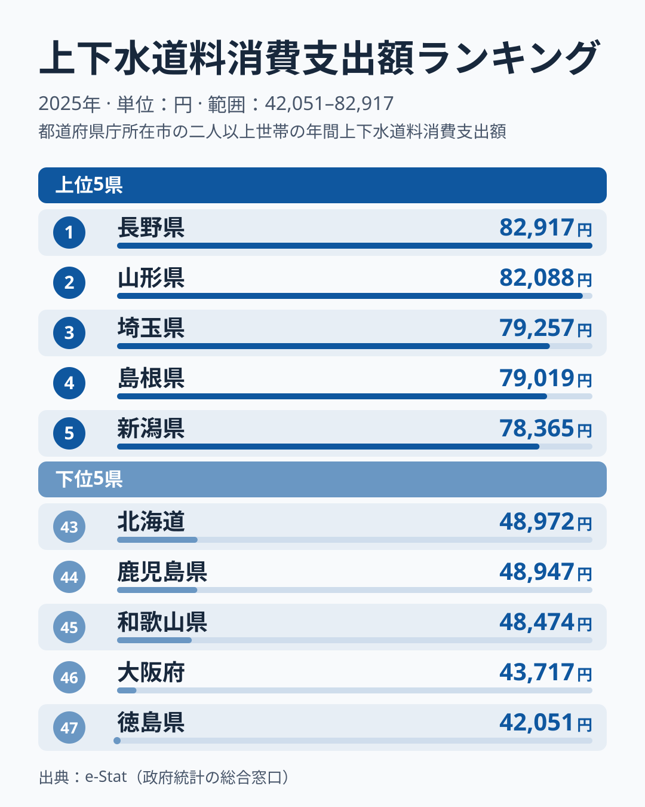
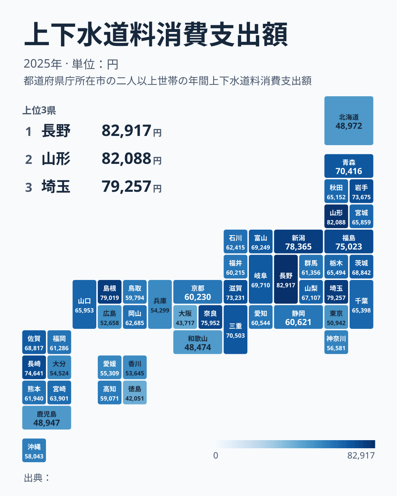

同じ日本に住んでいても、上下水道にかかる家計支出は都道府県で2倍近く違います。総務省「家計調査」による上下水道料消費支出額（2025年）を見ると、最も高い長野県は82,917円、最も低い徳島県は42,051円で、その差は1.97倍です。

ただし、この数字は県庁所在市の標本から出した単年の値なので、1年分の順位だけを見て「この県は水道代が高い」と言い切るのは危険です。そこで、2025年の顔ぶれを確かめたうえで、2021年から2025年の5年分の順位を並べ、毎年同じ位置にいる県と年ごとに大きく動く県を見分けます。結論を先に書くと、上位10位以内に毎年入る7県と下位10位以内に毎年入る7県がある一方、首都圏の千葉県、神奈川県、東京都は順位が大きく動きます。差の原因そのものは、この指標だけでは特定できません。関連する[光熱・水道費全体の県差](/blog/utilities-expenditure-total-prefecture-gap)や[家計の消費支出全般](/category/economy)とあわせて読むと、位置づけがつかみやすくなります。

> [!NOTE]
> このデータは家計調査における、都道府県庁所在市の二人以上世帯の年間上下水道料消費支出額です。水道料金の単価（円/m³）ではなく、各世帯が実際に支出した金額の平均なので、世帯人数や水使用量の地域差も含まれます。県全体の平均ではなく県庁所在市の世帯の値である点にも注意してください。

## 上位は団子状態、首都圏も割れる

<source-link href="/ranking/water-sewer-consumption-expenditure">上下水道料ランキングをもっと見る</source-link>

上下水道料消費支出額の上位は、長野県が82,917円で1位、山形県が82,088円で2位です。1位と2位の差は829円しかなく、5位の新潟県は78,365円なので、1位から5位までが約4,500円の幅に収まっています。この範囲の順位は、わずかな支出の違いで入れ替わりうると見るべきです。3位は埼玉県の79,257円、4位は島根県の79,019円で、3位と4位の差も238円しかありません。

注目したいのは、地方の県と並んで、首都圏の埼玉県が上位に入っていることです。ところが同じ首都圏でも、千葉県は21位で65,398円、神奈川県は36位で56,581円と、順位は大きくばらけます。都市部か地方かという二分法だけでは、上下水道料の高さは説明できません。

[仮説]　水道管の総延長が長くなる広い給水区域が、1世帯あたりの負担を押し上げている可能性があります。ただし、この記事で使っている家計調査には給水区域や管路の情報がないため、検証するには給水人口あたりの水道管の延長のような水道事業の統計と突き合わせる必要があります。

> [!WARNING]
> 家計調査の都道府県別の値は、県庁所在市の標本による単年の値です。標本の世帯が少し入れ替わるだけで平均は動くため、1年の順位差は小さな差ほど意味を持ちません。次の節で見るように、実際に同じ県の順位が1年で十数位動く例もあります。

## 大都市圏は低めだが、例外も多い

下位は、徳島県が最下位47位の42,051円、大阪府が46位の43,717円、和歌山県が45位の48,474円、鹿児島県が44位の48,947円、北海道が43位の48,972円です。東京都も42位の50,942円と、下位グループに入っています。下位には近畿、四国、九州・沖縄、北海道・東北、関東の県が混在しており、特定の地方に偏っているとは言えません。

大阪府と東京都が下位にある点だけを見ると、大都市圏は低いという見立てが思い浮かびます。しかし、同じ大都市圏でも埼玉県は3位、神奈川県は36位、大阪府は46位と大きく割れていて、大都市圏というくくりでは並びを説明できません。和歌山県の48,474円と大阪府の43,717円の間には4,757円の段差があり、最下位の徳島県と大阪府は1,666円差で並んでいます。下位は、この2府県が最も低い位置に固まり、その上に段差を挟んで和歌山県以下が続く形です。

徳島県が最下位になった理由は、この指標からは断定できません。次の節で見るように、徳島県は5年間ほぼ毎年最下位なので単年のぶれではなさそうですが、世帯人数や水使用量、料金体系のどれが効いているのかは、別の統計と突き合わせないと分かりません。

## 5年分の順位で見る、固定する県と動く県

2021年から2025年の5年間の順位を並べると、顔ぶれが毎年ほぼ変わらない県と、年ごとに大きく動く県にはっきり分かれます。

固定しているのは両端です。上位10位以内に5年連続で入った県は、長野県、山形県、島根県、埼玉県、奈良県、福島県、長崎県の7県でした。下位10位以内（38位から47位）に5年連続で入った県も7県で、兵庫県、香川県、北海道、鹿児島県、和歌山県、大阪府、徳島県です。ここに挙げた県は、単年のぶれを考慮しても上下水道料の支出が高め、または低めの位置にあると読めます。とくに徳島県は5年間すべて下から1番目か2番目、大阪府は下から1番目から3番目の範囲に収まっていて、下位の中でも最も安定して低い位置にいます。

首位の座は固定されていません。首位に立った年は、2021年、2022年、2024年が山形県、2023年と2025年が長野県でした。順位は、長野県が上から1番目から4番目、山形県が1番目か2番目、島根県と埼玉県がともに2番目から6番目の範囲を動いています。つまり上位の並びは毎年入れ替わるので、今年の首位が来年も首位だと考えるべきではありません。

動きが大きいのは首都圏の県です。千葉県は上から7番目から21番目、神奈川県は19番目から36番目、東京都は26番目から42番目と、10以上の幅で上下します。東京都は2021年の26番目から途中で一度戻った年を挟みつつ全体として順位を下げ、2025年の42番目はこの5年で最も低い順位です。新潟県も、2025年は上位5県に入りましたが、前の4年は10番目から15番目の範囲だったことから見ると、単年で上振れした可能性があります。

[仮説]　首都圏の県の順位が大きく動くのは、県庁所在市の標本が小さく、世帯構成の入れ替わりが平均に出やすいためかもしれません。これは標本数や世帯構成の内訳が分からないと検証できないので、この記事では断定せず、5年分で見る方法でぶれを避けることにとどめます。

## 自分の県の数字をどう読むか

ここまでを読者の判断材料として整理すると、次のようになります。

- 分かること：5年連続で上位10位以内または下位10位以内にいる県は、水道への支出が高い、または低い傾向が続いています。自分の県がその14県に入っていれば、2025年の値も傾向として受け取れます。
- 分かること：首都圏のように順位が10以上動く県は、2025年の順位だけでは判断できません。東京都や神奈川県は、5年分を並べて見るほうが実態に近くなります。
- 分からないこと：なぜその県が高い、または低いのか。この指標は支出額であり、料金単価、世帯人数、使用量を分けられません。
- 分からないこと：県庁所在市以外の暮らしがどうなのか。値は県庁所在市の世帯の平均です。

支出が高いか低いかを知りたいときは、2025年の1年だけでなく、ランキングページで過去の年の値もあわせて確かめ、自分の県の順位が毎年近い位置にあるかを見てください。

## まとめ

- 1位は長野県で82,917円、最下位は徳島県で42,051円、その差は1.97倍
- 上位は1位と2位の差が829円で、1位から5位までが約4,500円の幅に収まる団子状態
- 2021年から2025年の5年間、上位10位以内に毎年入った県は長野県、山形県、島根県、埼玉県、奈良県、福島県、長崎県の7県
- 同じ5年間、下位10位以内に毎年入った県は兵庫県、香川県、北海道、鹿児島県、和歌山県、大阪府、徳島県の7県で、徳島県は下から1番目か2番目に固定
- 首都圏は千葉県、神奈川県、東京都とも順位が10以上動き、埼玉県だけが上位に定着している
- 差の原因は、この指標（県庁所在市の二人以上世帯の支出額）だけでは特定できない
