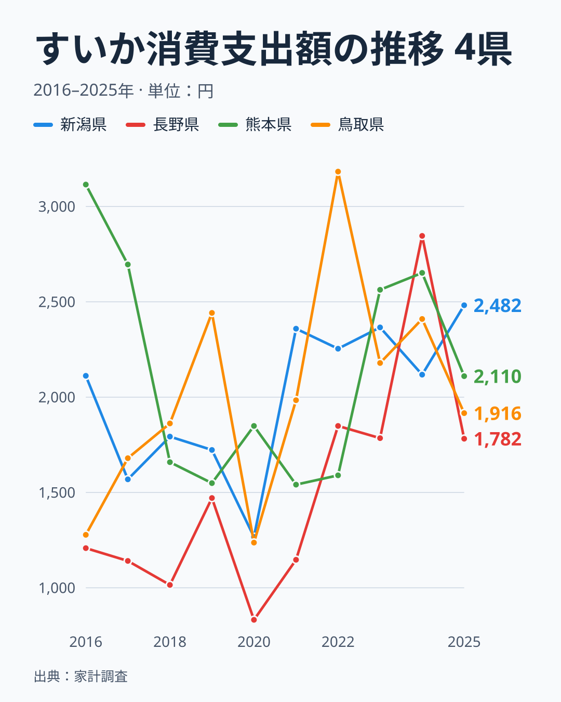

夏の風物詩「すいか」。丸ごと1玉を買って冷やし、家族で切り分けて食べる光景は、今も多くの家庭の夏の記憶に残っています。総務省の家計調査によると、都道府県庁所在市の二人以上世帯が2025年の1年間にすいかへ使った金額は、最も多い新潟県で2,482円、最も少ない和歌山県で1,037円と、その間には2.4倍の開きがあります。

さらに目を引くのは、首位の顔ぶれの変化です。前年の2024年に首位だった長野県は2,846円でしたが、2025年には1,782円で15位に下がりました。2024年に最下位だった山梨県の836円と比べると、2024年の最大差は3.4倍あり、2025年の2.4倍より開いていました。この記事では、2025年のランキングを見たうえで、首位が入れ替わる様子を過去10年の推移で確かめ、すいかだけが突出して高い県と果物全般の支出が高い県の違いも整理します。

> [!NOTE]
> 本データは総務省「家計調査」による、都道府県庁所在市（東京都のみ都区部）の二人以上世帯を対象にした年間の品目別支出額です。世帯が実際に「買った金額」であり、贈答用のすいかや自家消費用（家庭菜園など）は含まれません。したがって「消費量が多い県」ではなく「店頭ですいかを購入する金額が大きい県」を示す指標である点に注意してください。

## すいか消費支出額 上位5県・下位5県

2025年の都道府県庁所在市別すいか消費支出額を見ると、上位は次の通りです。

1位は新潟県で2,482円。2位は東京都で2,149円、3位は秋田県で2,131円、4位は熊本県で2,110円、5位は岡山県で2,084円と続きます。上位5県はいずれも2,000円を超えています。

熊本県は「植木すいか」、鳥取県は「大栄すいか」の産地として知られますが、産地の情報は家計調査の外の一般的な知識で、本データで確かめたものではありません。数字で見ると、熊本県は4位、鳥取県は1,916円で8位と、ともに上位10県に入りました。ただし、このあと見るとおり、産地の県が毎年この位置にいるわけではありません。

意外なのは2位の[東京都](/areas/13000)です。大都市はカット売りが中心で1玉買いが少ないと言われますが、2025年の東京都（都区部）は2,149円と、上位に入りました。本データは購入額だけで、1玉かカットかの内訳までは分かりません。[秋田県](/areas/05000)の3位も含め、産地かどうかだけでは説明しきれない顔ぶれです。

<source-link href="/ranking/watermelon-consumption-expenditure">すいか消費支出額ランキングをもっと見る</source-link>

## 支出額が少ない下位5県

下位5県の顔ぶれを見ると、地域的なまとまりははっきりしません。

最も支出額が少なかったのは和歌山県で1,037円。次いで群馬県1,078円、愛媛県1,190円、山口県1,199円、沖縄県1,266円と続きます。下位5県は近畿（和歌山）・関東（群馬）・四国（愛媛）・中国（山口）・九州・沖縄（沖縄）と、5つの地方にまたがっていて、「すいかが少ない地域」という単純な線は引けません。

> [!WARNING]
> 和歌山県の支出が少ない理由は、本データからは分かりません。[仮説] 地元で他の果物が手に入りやすく、すいかに回る予算が相対的に少なくなっている可能性がありますが、これを裏づける数値は本記事にはありません。

注目したいのは、和歌山県が前年の2024年には20位だったことです。2025年に一気に47位になった理由も、本データだけでは特定できません。この「年ごとの大きな動き」が例外なのかどうかを、次の節以降で確かめます。

## 地図で見る支出額の分布

地図にすると、色の濃い（支出額が高い）県が中部（新潟）、北海道・東北（秋田）、関東（東京・千葉）、九州・沖縄（熊本）、中国（岡山）とばらばらに散らばり、地理的なまとまりが見えません。西日本の産地が並ぶ、あるいは東日本が全体に高いといった一つの軸では説明しにくい分布です。地理的な偏りが小さいことは、順位が県の固定的な性格というより、年ごとの事情で動きやすい指標である可能性を示しています。

金額ではなく、すいか消費量そのものの地域差が気になる方は、<source-link href="/ranking/watermelon-consumption-quantity">すいか消費量ランキング</source-link>もあわせてご覧ください。

> [!TIP]
> すいかの消費量（購入した個数・重量）と「消費支出額」（支払った金額）は必ずしも一致しません。産地に近い県は同じ金額でより多くの量を買えている可能性があり、量の視点で見ると顔ぶれが変わることも考えられます。

## 前年から首位が入れ替わった理由は

首位の変化は、前年との順位を比べるとわかります。2024年の首位は長野県の2,846円、2位は富山県の2,798円、3位は熊本県の2,652円でした。最下位は山梨県の836円で、1位との差は3.4倍です。2025年は首位が新潟県に替わり、長野県は15位、2024年に最下位だった山梨県は1,732円で18位まで上がりました。

首位の入れ替わりは、この年だけの出来事ではありません。2016年から2025年までの10年分を並べると、首位は熊本県が3回（2016年、2017年、2023年）、鳥取県が2回（2019年、2022年）、新潟県が2回（2021年、2025年）、千葉県（2018年）、愛知県（2020年）、長野県（2024年）が1回ずつで、10年間に6つの県が首位に立ちました。最下位も福島県が4回、山梨県が2回、愛媛県・岡山県・三重県・和歌山県が1回ずつで、やはり6つの県が入れ替わっています。

図の4県の動きを見ると、変動の大きさがよく分かります。長野県は2020年の832円から2024年の2,846円まで3倍以上に振れ、10年間の順位は35位、35位、43位、14位、44位、37位、9位、14位、1位、15位と、40位台から首位までを行き来しています。新潟県は2020年の1,267円（25位）から2021年に2,359円で首位へ上がりました。熊本県は2016年の3,115円から2021年の1,541円まで下がったあと、2023年に2,563円で首位へ戻っています。

全体としてどれくらい動くのかも、10年分の順位から数えられます。前年と比べて順位が20位以上動いたのは、9回の前年比較の延べ423件のうち88件で、約5分の1にあたります。前年からの順位の変化は、平均すると約12位です。10年間の順位の幅が20位以上あった県は47県中44県で、幅が小さい福島県でも33位から47位の間を動いていました。ずっと上位に居続けた県は少なく、10年とも20位以内だったのは熊本県と秋田県の2県だけです。最も順位が低かった年は、熊本県が2022年の19位、秋田県が2018年の20位でした。

[仮説] 家計調査は県庁所在市の二人以上世帯という限られた標本に基づくため、天候によるすいかの出来や価格、特売の有無といった偶然の要素が年ごとの金額を大きく動かしている可能性があります。本データでは、順位が動く事実は確認できても、動く原因までは特定できません。確かめるには、調査の標本の大きさ（標準誤差）を別途確認する必要があります。1世帯が1年に買うすいかの玉数は少なく、1玉買うか買わないかの違いが年間の支出額を左右することも、動きの大きさと整合します。

この結果から、単年の順位を「この県はすいか好き」といった県の性格として読むのは危険だと言えます。複数年で上位に並ぶ県を見るほうが妥当で、その意味で10年とも20位以内の熊本県と秋田県は、年ごとのぶれを超えて支出が多い県だと読めます。

## すいかだけが高い県、果物全般が高い県

すいかの順位が高い県は、果物全般の支出も高いのでしょうか。2025年の生鮮果物の支出額、メロンの支出額の順位と突き合わせると、県によって姿が大きく違います。

果物全般も高いのは東京都です。すいかが2位で、生鮮果物の支出額も2位でした。一方で、熊本県はすいかが4位なのに生鮮果物は46位、秋田県はすいか3位で生鮮果物29位、岡山県はすいか5位で生鮮果物32位と、すいかだけが突出して高い県です。新潟県は首位のすいかに対して生鮮果物は13位で、果物全体の中では中位から上位にとどまります。

近い品目であるメロンと比べても、同じ傾向が見えます。メロンの首位は茨城県の3,679円で、秋田県が5位、鳥取県が6位、新潟県が7位に入ります。ただし熊本県は17位、岡山県は26位、長野県は31位で、すいかの順位とは一致しません。47県の順位のそろい方を表すスピアマンの順位相関係数は、すいかとメロンで0.53、すいかと生鮮果物全体で0.46と、どちらも中程度です。相関があるといっても、すいかの順位の約半分がメロンや果物全体で説明できる水準ではありません。

つまり、すいかの支出額は「果物が好きな県」を測る指標とは言えず、すいかというひとつの品目に固有の事情が大きいと読めます。なお、生鮮果物にはすいかとメロン自体が含まれるため、相関の一部は重なりによるものです。固有の事情の中身が産地への近さなのか、贈答の習慣なのかは、本データでは確かめられません。

あわせて見る: [メロン消費支出額ランキング](/ranking/melon-consumption-expenditure) / [生鮮果物消費支出額ランキング](/ranking/fresh-fruits-group-consumption-expenditure)

## まとめ

- 1位は新潟県2,482円、2位は東京都2,149円、3位は秋田県2,131円
- 最下位は和歌山県1,037円で、1位との差は2.4倍
- 前年首位の長野県は2,846円から1,782円で15位に、前年最下位の山梨県は836円から1,732円で18位に変わった
- 2016年から2025年の10年間で、首位は6県、最下位も6県が入れ替わった
- 10年とも20位以内だったのは熊本県と秋田県だけで、単年の順位は大きく動くため複数年で見るのが確実
- すいかだけが高い県（熊本・秋田・岡山）と果物全般が高い県（東京）があり、すいかの支出額は果物全般の指標とは言えない

すいか以外の食品・家計支出の地域差については、<source-link href="/category/economy">家計・経済カテゴリ</source-link>で他の品目のランキングも確認できます。

## データについて

総務省統計局「家計調査」（都道府県庁所在市及び政令指定都市の二人以上世帯、品目別支出額）を基に、e-Stat（政府統計の総合窓口）経由で集計しています。集計年は2025年で、推移と前年比較には2016年から2024年の同じ指標の値を使っています。順位相関と、順位の動きの集計（前年との順位差など）は、47県の順位から本記事で算出した値です。
