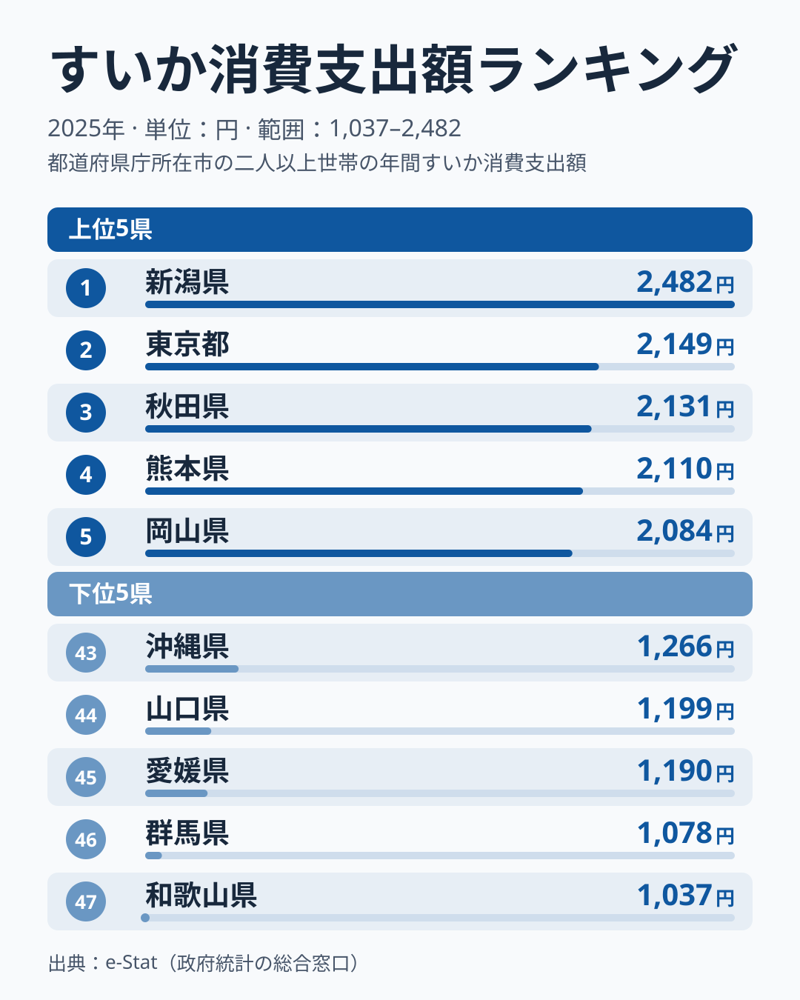
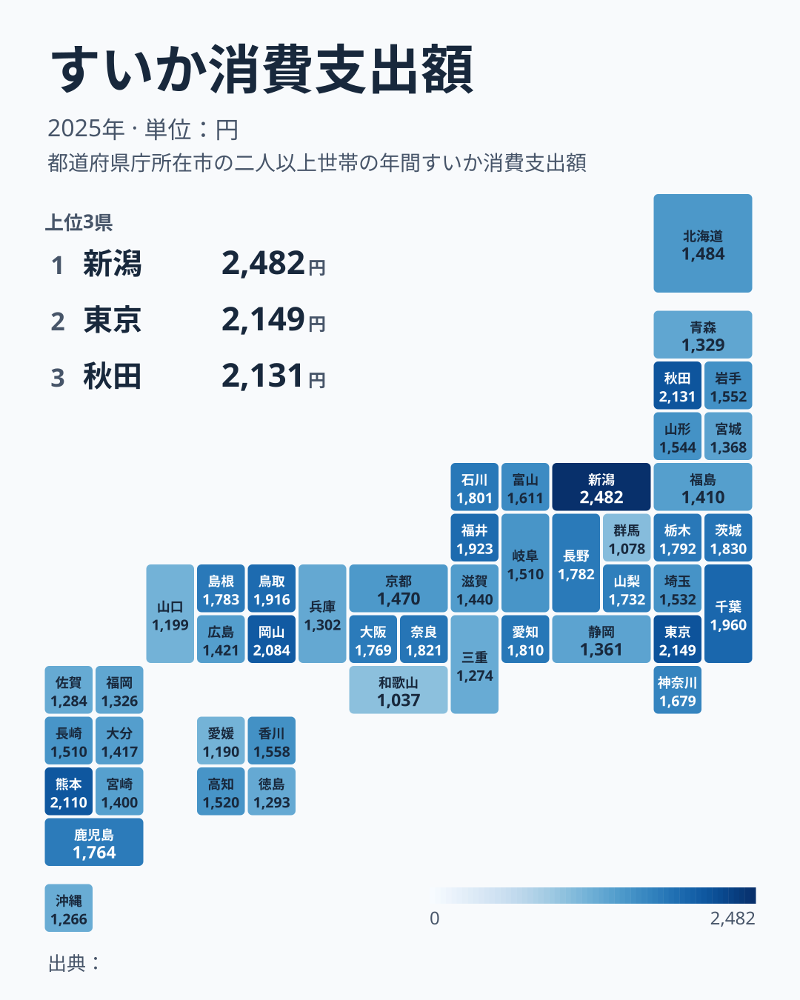

夏の風物詩「すいか」。丸ごと1玉を買って冷やし、家族で切り分けて食べる光景は、今も多くの家庭の夏の記憶に残っています。総務省の家計調査によると、都道府県庁所在市の二人以上世帯が2025年の1年間にすいかへ使った金額は、最も多い新潟県で2,482円、最も少ない和歌山県で1,037円と、その間には2.4倍の開きがあります。

さらに目を引くのは、首位の顔ぶれの変化です。前年の2024年に首位だった長野県は、2025年には1,782円で15位に下がりました。この記事では、2025年のすいか消費支出額の都道府県ランキングを見たうえで、なぜ首位がこれほど変わったのかを、仮説を交えて探ります。

> [!NOTE]
> 本データは総務省「家計調査」による、都道府県庁所在市（東京都のみ都区部）の二人以上世帯を対象にした年間の品目別支出額です。世帯が実際に「買った金額」であり、贈答用のすいかや自家消費用（家庭菜園など）は含まれません。したがって「消費量が多い県」ではなく「店頭ですいかを購入する金額が大きい県」を示す指標である点に注意してください。

## すいか消費支出額 上位5県・下位5県

2025年の都道府県庁所在市別すいか消費支出額を見ると、上位は次の通りです。

1位は新潟県で2,482円。2位は東京都で2,149円、3位は秋田県で2,131円、4位は熊本県で2,110円、5位は岡山県で2,084円と続きます。上位5県はいずれも2,000円を超えています。

熊本県は「植木すいか」（熊本市植木町）で知られる全国有数の産地で、4位に入りました。鳥取県も「大栄すいか」（鳥取県北栄町）で知られる産地ですが、2025年は1,916円で8位でした。産地として知られる県が上位から中位に並ぶ一方で、順位は年ごとに動いている可能性があります。

意外なのは2位の[東京都](/areas/13000)です。大都市はカット売りが中心で1玉買いが少ないと言われますが、2025年の東京都（都区部）は2,149円と、上位に入りました。[仮説] 高単価の贈答向け・ブランドすいかや、カットすいかの購入が金額を押し上げた可能性があります。ただし、本データは購入額だけで、1玉かカットかの内訳までは分かりません。[秋田県](/areas/05000)の3位も含め、産地かどうかだけでは説明しきれない顔ぶれです。

<source-link href="/ranking/watermelon-consumption-expenditure">すいか消費支出額ランキングをもっと見る</source-link>

## 支出額が少ない下位5県

下位5県の顔ぶれを見ると、地域的なまとまりははっきりしません。

最も支出額が少なかったのは和歌山県で1,037円。次いで群馬県1,078円、愛媛県1,190円、山口県1,199円、沖縄県1,266円と続きます。

> [!WARNING]
> 和歌山県の支出が少ない理由は、本データからは分かりません。[仮説] 地元で他の果物が手に入りやすく、すいかに回る予算が相対的に少なくなっている可能性もありますが、これを裏づける数値は本記事にはありません。本データだけでは果物全体の消費傾向までは分かりません。

下位5県は近畿（和歌山）・関東（群馬）・四国（愛媛）・中国（山口）・九州・沖縄（沖縄）と、5つの地方にまたがっています。地理的なまとまりは見られず、「すいかが少ない地域」という単純な線は引けません。[仮説] 県ごとの個別の事情が支出額に影響している可能性はありますが、本データだけでは原因を特定できません。

## 前年から首位が変わった理由は

地図にすると、すいか消費支出額には魚介類のような明確な東西の帯がないことが分かります。色の濃い（支出額が高い）県が中部（新潟）、北海道・東北（秋田）、関東（東京・千葉）、九州・沖縄（熊本）、中国（岡山）とばらばらに散らばり、地理的なまとまりが見えません。産地の近さという一つの軸だけでは説明しにくい分布で、[仮説] 複数の要因が県ごとに異なる形で関わっている可能性があります。

首位の変化は、前年との順位を比べるとわかります。2024年の首位は長野県でしたが、2025年の首位は新潟県で、長野県は15位でした。2024年に最下位だった山梨県も、2025年は1,732円で18位まで上がりました。ただし、ここで比べているのは2024年と2025年の2時点だけで、首位が毎年のように入れ替わるかどうかまでは、この記事のデータでは言えません。

家計調査の都道府県別の値は、県庁所在市という1つの市の二人以上世帯から集めた標本に基づいています。[仮説] 標本が限られるため、天候によるすいかの出来や価格、特売の有無といった偶然の要素が、年ごとの金額を大きく動かしている可能性があります。この仮説を確かめるには、同じ県の10年分の推移を見て、順位の変動幅が大きいかを調べる必要があります。

すいかは重量があり単価も比較的高い果物です。1世帯が1年に買う玉数は少ないため、1玉買うか買わないかの違いが、年間の支出額に大きく響く可能性があります。単年の順位から「この県は果物全般への支出意欲が高い」といった構造を断定するのは危険で、複数年で上位に並ぶ県を見るほうが妥当です。

> [!TIP]
> すいかの「消費量」（購入した個数・重量）と「消費支出額」（支払った金額）は必ずしも一致しません。産地に近い県は同じ金額でより多くの量を買えている可能性があり、量の視点で見ると顔ぶれが変わることも考えられます。

金額ではなく購入量そのものの地域差が気になる方は、<source-link href="/ranking/watermelon-consumption-quantity">すいか消費量ランキング</source-link>もあわせてご覧ください。

## 世帯の事情と支出額の関係

すいかは1玉が大きく、丸ごと買うと少人数の世帯では食べきれないことがあります。[仮説] 世帯人数が多く、まとめ買いしやすい地域と、少人数世帯が多く、カット売りが中心になりがちな地域とでは、同じ「すいか好き」でも支出の出方が変わる可能性があります。ただし、本記事には世帯構成や販売形態のデータがなく、確かめることはできません。

2025年は東京都が2位に入っており、都市部は支出が少ないという見立てがそのまま当てはまるわけでもありません。世帯構成だけでは説明がつかない部分が残ります。

## まとめ

- 1位は新潟県2,482円、2位は東京都2,149円、3位は秋田県2,131円
- 最下位は和歌山県1,037円で、1位との差は2.4倍
- 前年首位の長野県は15位、前年最下位の山梨県は18位に変わり、首位は新潟県になった
- 熊本県は4位、鳥取県は8位と、産地として知られる県は上位から中位に入っている
- 単年の順位は標本のぶれの影響を受ける可能性があるため、[仮説] 複数年で上位に並ぶ県を見るのが確実

すいか以外の食品・家計支出の地域差については、<source-link href="/category/economy">家計・経済カテゴリ</source-link>で他の品目のランキングも確認できます。

## データについて

総務省統計局「家計調査」（都道府県庁所在市及び政令指定都市の二人以上世帯、品目別支出額）を基に、e-Stat（政府統計の総合窓口）経由で集計しています。集計年は2025年です。
