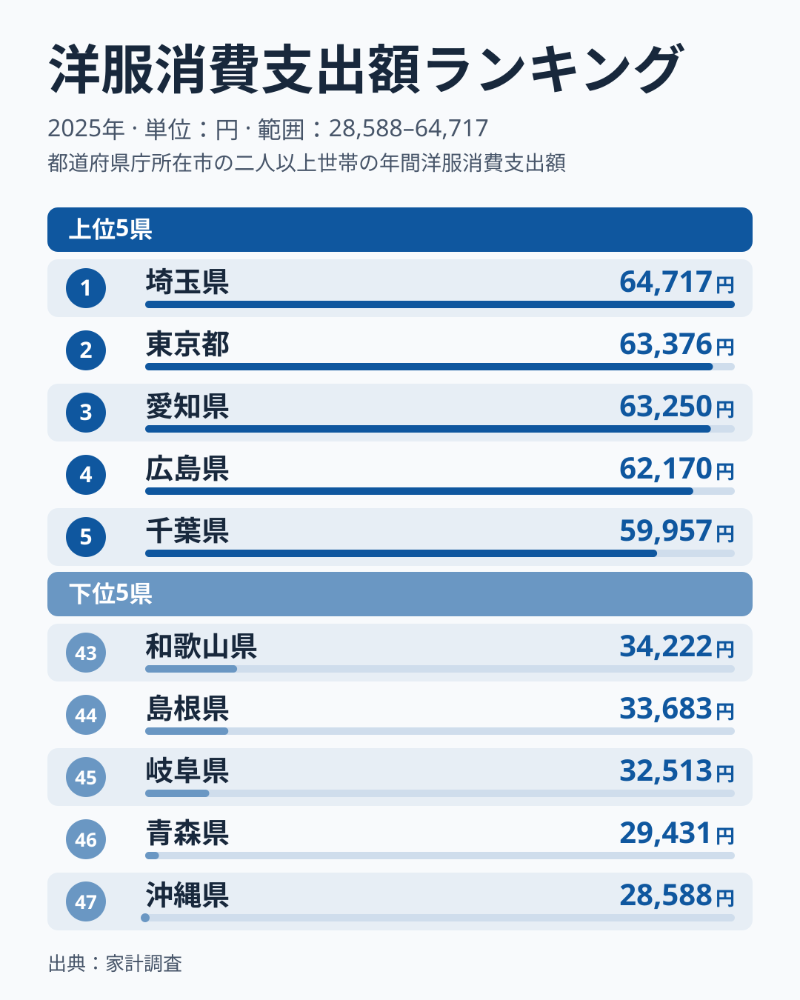
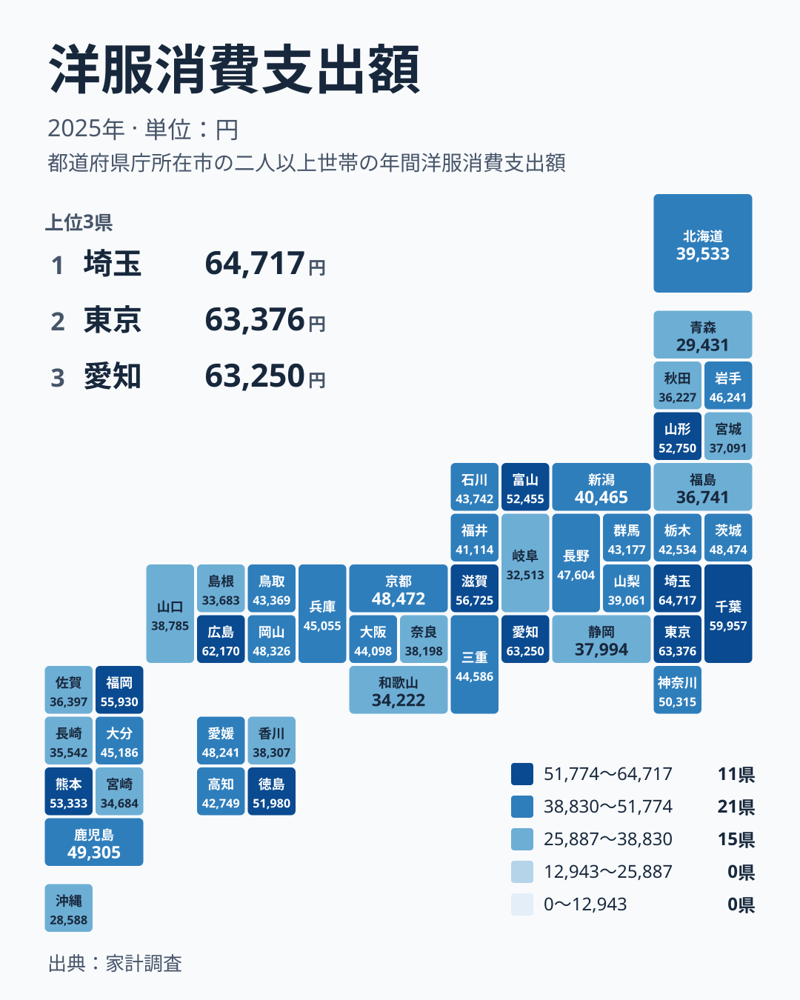

## 洋服への支出、1位は東京都ではなく埼玉県でした

洋服への支出と聞くと、流行の発信地である東京都を思い浮かべる方が多いのではないでしょうか。ところが2025年の家計調査で1位になったのは埼玉県でした。埼玉県は64,717円で1位です。東京都は63,376円で2位でした。

3位は愛知県で63,250円、4位は広島県で62,170円、5位は千葉県で59,957円です。上位5県を地方で数えると、関東が3県、中部が1県、中国が1県です。大都市の中心だけが突出しているわけではなく、首都圏の周辺県と地方の中核都市が混在しています。

一方、47位の沖縄県は28,588円です。1位の埼玉県との比は約2.3倍で、同じ「洋服」でも家計の中での位置づけがかなり違うことが分かります。この記事では、その差を地方の内側から分解し、暮らしの視点で整理します。

> [!NOTE]
> ここで使う「洋服消費支出額」は、家計調査で1世帯あたりの年間支出を円で示した値です。2025年のデータで、洋服に分類される品目の支出を集計しています。和服や靴、小物類とは別の分類で、どこまでが「洋服」に入るかは調査上の品目区分に従います。

## 上位と下位を並べて見る

まず、上位5県と下位5県を図で確認します。

<source-link href="/ranking/western-clothing-group-consumption-expenditure">洋服への支出ランキングをもっと見る</source-link>

上位4県は62,170円から64,717円の範囲に収まっています。一方、4位の広島県と5位の千葉県の間には、62,170円と59,957円という開きがあります。上位でも4位と5位の間で段差があり、「上位はどこも同じ水準」とまでは言えません。

下位は、43位の和歌山県が34,222円、44位の島根県が33,683円、45位の岐阜県が32,513円、46位の青森県が29,431円、47位の沖縄県が28,588円です。この5県は、近畿、中国、中部、北海道・東北、九州・沖縄にそれぞれ1県ずつ分かれます。下位は特定の地方に固まっていません。

つまり、上位は関東を中心にまとまり、下位は全国に散らばる構図です。ただし、これだけで「都会は洋服にお金をかける」とは言えません。大阪府は44,098円で23位、神奈川県は50,315円で12位と、大都市圏でも順位には幅があります。

## 地図で見る、地方の内側の差

次に、地理的な広がりを確かめます。

地図で注目したいのは、地方ごとの内部格差です。近畿では、6位の滋賀県が56,725円、43位の和歌山県が34,222円で、同じ地方の中に大きな開きがあります。近畿の7県は、この2県の間に京都府、兵庫県、大阪府、奈良県、三重県が並ぶ形です。

九州・沖縄も同様です。7位の福岡県は55,930円、47位の沖縄県は28,588円で、同じ地方の中に上位と最下位が同居しています。関東では、1位の埼玉県が64,717円、28位の栃木県が42,534円です。地方という単位は、洋服への支出を説明するには粗すぎることが分かります。

中国では、4位の広島県が62,170円、44位の島根県が33,683円です。隣り合う県でも、順位は40位分離れています。この指標は、地方の傾向よりも県ごとの事情が強く出ます。

> [!TIP]
> 中位の県は金額差が小さく、順位が入れ替わりやすい傾向があります。たとえば茨城県は48,474円で14位、京都府は48,472円で15位で、差は2円です。順位の上下ではなく、金額の水準で比べるのが読み解くコツです。

## 洋服への支出が多い背景を分けて考える

支出額が高い県には、どんな共通点があるのでしょうか。実データで確かめられるのは順位と金額だけです。以下は、そう考えられるという仮説にとどまります。

ひとつ目は、仕事や外出で服を着る機会の多さです。埼玉県、東京都、千葉県、愛知県は大きな都市圏を抱えるため、通勤や通学で服が必要になるのではないか、という見方があります。ただし、この記事のデータには通勤や通学の情報はなく、因果は確認できません。

ふたつ目は、世帯の構成です。家計調査は1世帯あたりの支出なので、成長期の子どもがいる世帯が多いと、買い替えで支出が増える可能性があります。ただし、世帯構成のデータはここにはなく、仮説の域を出ません。

みっつ目は、買い物の手段です。実店舗での購入と通販とでは、記録のされ方が変わるかもしれません。これも、この記事のデータだけでは検証できません。

> [!WARNING]
> 家計調査の「洋服」は、調査上の品目区分に基づく集計です。通販で買った服が洋服として計上されるか、他の費目に含まれるかは、購入方法や記録の仕方に左右される可能性があります。また、普段着とフォーマルウェア、子ども服などの内訳もこの値からは分かりません。金額の差が「おしゃれへの熱意」の差とは限りません。

## 気候と暮らしから読む

気候の影響については、仮説として考えてみます。年間を通じて暖かい沖縄県は、防寒着が少なくて済み、洋服の支出が抑えられるのかもしれません。四季がはっきりした地域は、季節ごとに服をそろえる必要があるという見方もあります。

しかし、この見方にはすぐに反例があります。青森県は29,431円で46位ですが、寒冷な地域です。一方、北海道は39,533円で31位、山形県は52,750円で9位です。同じ寒い地域でも順位は大きく異なり、気温だけでは説明できません。

結局のところ、収入、店舗の数、買い物の習慣など、複数の要因が重なっていると見るのが妥当です。このデータだけで特定の理由は断定できません。

生活の面では、順位の高低を気にしすぎる必要はありません。自分の地域の順位が低くても、それは節約上手という面もあれば、買う機会が少ないだけという面もあります。むしろ、家計の中で洋服にかける割合を見直すきっかけにするのが現実的です。

詳しい数字は、[埼玉県のデータ](/areas/11000)や[東京都のデータ](/areas/13000)のページで確認できます。ほかの家計関連の指標とあわせて見たい場合は、[同じカテゴリの統計一覧](/category/economy)も参考になります。

## 地方より県の事情が大きい指標

地方別に見ても、どの地方にも高い県と低い県が混在しています。たとえば近畿は6位の滋賀県と43位の和歌山県、九州・沖縄は7位の福岡県と47位の沖縄県を抱えます。この記事で見た範囲では、地方のくくりより県ごとの違いのほうが目立ちます。

自分の家計を考えるときは、地方の平均的な姿よりも、近隣の県と比べた位置や金額の水準を見るほうが実感に近づくでしょう。順位は目安にとどめ、暮らしに合った支出を考える材料として使ってください。

## データについて

この記事の数値は、家計調査の「洋服消費支出額」にもとづく2025年の1世帯あたりの年間支出額です。単位は円です。順位は、この金額の高い順に付けています。
