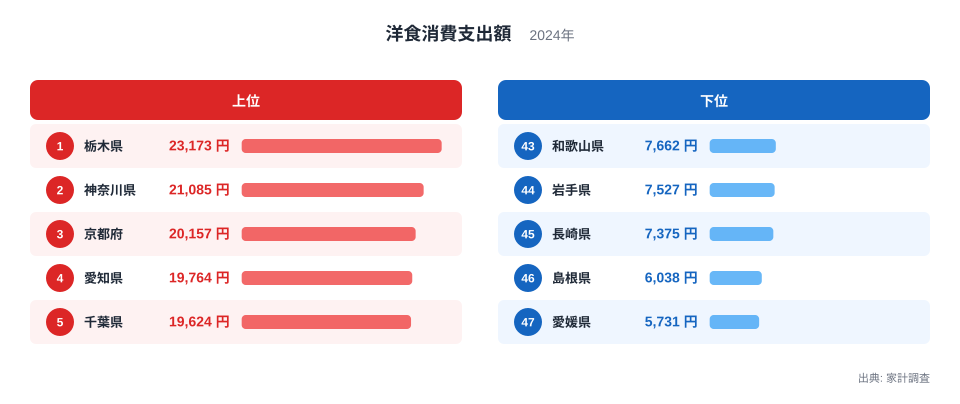
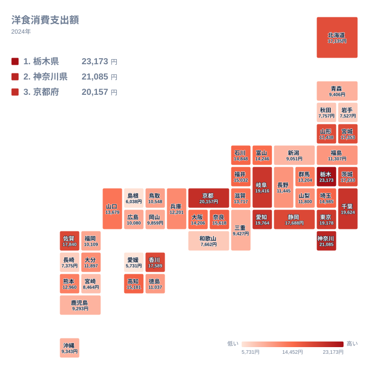

洋食と聞いて、どの県を思い浮かべるでしょうか。港町として西洋文化を早く受け入れた神奈川県でしょうか。それとも古くからパン食が根づいた京都府でしょうか。2024年の家計調査で洋食への支出を見ると、首位に立ったのはどちらでもなく栃木県でした。この記事では、47都道府県の差がどこから生まれるのかを、食文化や産地、暮らし方との結びつきから考えます。

## 洋食への支出、上位と下位の顔ぶれ

まず全体像を見ます。次の図は、洋食への支出が多い上位5県と少ない下位5県を並べたものです。

<source-link href="/ranking/western-food-dining-consumption-expenditure">洋食への支出ランキングをもっと見る</source-link>

1位は栃木県で23,173円でした。2位は神奈川県の21,085円、3位は京都府の20,157円、4位は愛知県の19,764円、5位は千葉県の19,624円と続きます。上位5県は、関東が3県、近畿が1県、中部が1県という内訳です。

一方、下位に目を向けると、47位は愛媛県の5,731円、46位は島根県の6,038円、45位は長崎県の7,375円、44位は岩手県の7,527円、43位は和歌山県の7,662円です。最大の栃木県と最小の愛媛県を比べると、約4倍の開きがあります。同じ国の中で、洋食に使う金額がここまで違うことは意外に思えます。

> [!NOTE]
> ここでの洋食消費支出額は、家計調査における二人以上の世帯が、1年間に洋食に使った金額を指します。単位は円で、2024年の値です。外食の支出が含まれるのか、家庭で調理する品目が含まれるのかは、調査の分類に依ります。そのため、ステーキを焼く頻度やパンを食べる量そのものを示す数字ではありません。

## 栃木県が首位に立つ背景

首位の栃木県は、[栃木県のデータ](/areas/09000)でも確認できるとおり、洋食支出で23,173円と突出しています。2位の神奈川県とは21,085円で、差がはっきり出ました。

栃木県は、首都圏に近い北関東に位置します。宇都宮市はギョーザのまちとして知られていますが、洋食でも家計の支出が大きいことは、単一の名物だけでは説明できません。畜産や乳製品の産地であることが、洋食になじみやすい食卓をつくっている可能性があります。ただし、これは産地と食卓の結びつきを考えるための仮説であり、この統計だけで因果を断定することはできません。

同じ関東では、千葉県が5位で19,624円、東京都が7位で19,178円でした。茨城県も13位の17,233円と、関東の多くが上位から中位上部に入っています。一方、埼玉県は18位の14,985円、群馬県は24位の13,204円で、同じ関東でも順位には幅があります。関東は洋食に支出する傾向が強めとはいえ、一様ではありません。

## 港町と古都、パン食文化の系譜

2位の[神奈川県のデータ](/areas/14000)を見ると、21,085円という高さが際立ちます。横浜は開港の歴史を持ち、西洋料理が早くから根づいた土地です。洋食への支出の高さは、その歴史と無縁ではないと考えられます。

近畿では、京都府が3位で20,157円でした。京都は古くからパンの消費が多い土地柄として語られることが多く、洋食店や喫茶の文化も厚いと言われます。ただし近畿でも、奈良県は15位の15,618円、大阪府は21位の14,206円、兵庫県は26位の12,201円と、順位は大きく割れています。近畿の中でも、京都府だけが上位に抜けている形です。

中部では、愛知県が4位の19,764円、岐阜県が6位の19,416円、静岡県が9位の17,688円と、上位に並びます。洋食の存在感が高い県が複数あることは、東海地域の食文化を考える手がかりになりそうです。

> [!TIP]
> 順位を見るときは、隣り合う県の金額差にも注意してください。たとえば6位の岐阜県は19,416円、7位の東京都は19,178円で、差はわずかです。中位では順位が一つ違うだけで金額が数百円しか違わないことがあり、順位の上下だけで暮らしの違いを論じるのは危険です。

## 地理分布を地図で見る

次は、47都道府県の分布をタイルマップで見ます。

地図からは、関東から東海、近畿の一部にかけて支出の高い県が連なる様子が読み取れます。栃木県、神奈川県、千葉県、東京都、愛知県、岐阜県、京都府と、上位7位までは本州の中央部に集まっています。

その外側では、地方ごとに様相が異なります。北海道・東北では、山形県が11位で17,438円、宮城県が12位で17,353円、北海道が14位で17,135円と中位上部に入る一方、青森県は37位の9,406円、秋田県は42位の7,757円、岩手県は44位の7,527円と低めです。同じ地方でも、県ごとの差が大きい点が特徴です。

四国と九州・沖縄にも目を向けましょう。香川県は10位で17,589円、佐賀県は8位で17,840円と上位に入ります。ところが、愛媛県は47位の5,731円、長崎県は45位の7,375円です。西日本の中でも、上位と下位が混在しています。地図は「東高西低」のように単純な図式を当てはめにくいことを教えてくれます。

> [!WARNING]
> 家計調査は、標本として選ばれた世帯の回答にもとづく調査です。都道府県別の値は、世帯数が限られる県ほど、たまたま回答した世帯の影響を受けやすくなります。1年だけの値で県の食文化を断定せず、複数年の動きと合わせて見る必要があります。

## 関連する品目との対比で考える

洋食という区分は、和食や中華といった他の区分と並べて理解すると輪郭がはっきりします。この記事のデータは洋食に限られているため、他品目の数値はここでは示しません。ただ、洋食の順位が低い県が、別の品目で上位に入っている可能性は十分にあります。

たとえば、洋食が下位の愛媛県や島根県は、魚介や郷土料理を中心とした食卓の比重が高いのかもしれません。反対に、洋食が上位の県は、パンや乳製品、肉料理を取り入れやすい環境にある場合があります。支出の多寡は好みの強さだけでなく、近隣の店の数、産地との距離、家族の構成によっても動きます。

中位の県にも注目しておきましょう。福井県は17位の15,032円、石川県は19位の14,848円、富山県は20位の14,246円で、近い水準に並びます。福岡県は33位の10,109円、広島県は34位の10,080円と、大都市を抱える県でも中位から下位寄りでした。人口の多さと洋食支出の高さは、必ずしも一致しません。

## データについて

この記事で使った洋食消費支出額は、家計調査の2024年の値で、単位は円です。順位は支出額の高い順で、全47都道府県を対象としています。栃木県の23,173円から愛媛県の5,731円まで、約4倍の差があることは、実データの最大値と最小値の比にあたります。

## まとめ

2024年に洋食への支出が最も多かったのは栃木県で、神奈川県、京都府、愛知県、千葉県が続きました。最も少なかったのは愛媛県で、島根県、長崎県、岩手県、和歌山県が下位に並びます。

上位には、港町の歴史を持つ神奈川県や、パン食文化で知られる京都府が入り、首都圏とその周辺に支出の高い県が集まっていました。ただし、同じ地方の中でも順位は大きく割れており、地方ごとの一括りでは説明できません。気になる県があれば、[同じカテゴリの統計一覧](/category/economy)から、ほかの食の指標とも見比べてみてください。県ごとの食卓の個性は、複数の数字を重ねるほど立体的に見えてきます。
