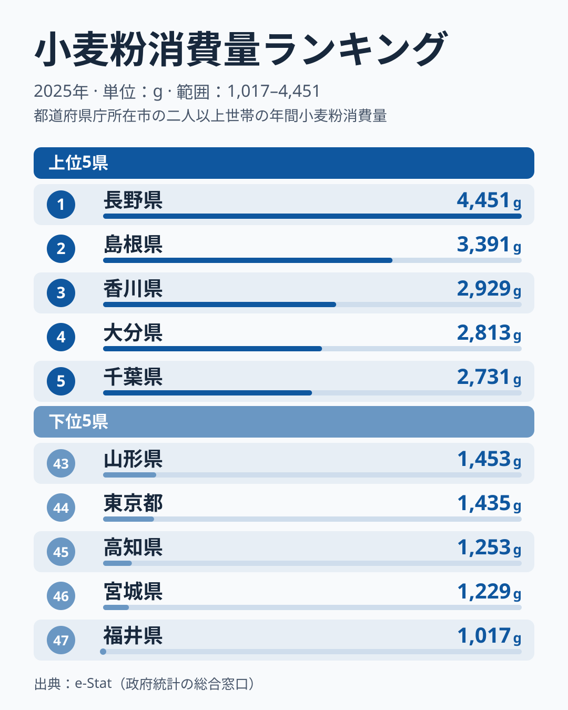

「うどん県」を名乗る香川県は、小麦粉消費量ランキングで何位だと思いますか。お好み焼きの大阪、ラーメンの福岡、すいとんの北関東――小麦粉の食文化が濃い土地を思い浮かべると、つい上位を想像してしまいます。ところが2025年の総務省「家計調査」で都道府県を並べると、トップは長野県で、香川は3位に入るものの、大阪は17位、福岡は37位と、土地のイメージと順位は必ずしも重なりません。

この記事が扱うのは「家庭が一年でどれだけ小麦粉そのものを買ったか」という一点です。パンやうどんの完成品ではなく、袋入りの粉を台所で買う量です。1位の長野県は年間**4,451g**、最下位の福井県は**1,017g**で、その開きは2025年でおよそ4.4倍です（2007〜2025年の19年では年によって2.2〜4.4倍の幅があります）。なぜ長野が毎年のように上位に入り、うどんの本場・香川が3位に入る一方で、東京は下位に沈むのでしょうか。順位の裏側には「家庭調理の文化」と「統計が拾えない外食消費」、そして「年ごとの振れの大きさ」という三つの構造が隠れています。

## 小麦粉消費量ランキングの全体像

まず全体の地図を確認しましょう。下のランキングは2025年の家計調査(二人以上世帯)で、家庭が一年間に購入した小麦粉の量(g)を都道府県別に並べたものです。上位は甲信越・山陰・四国・九州・南関東に散らばり、特定の一地域に偏っていない点が目を引きます。

チャートの上位5県は1位の長野、2位の島根、3位の香川、4位の大分、5位の千葉で、甲信越・山陰・四国・九州・南関東に散らばります。大阪は17位(2,030g)、東京は44位(1,435g)で、東京は下位5県に入ります。

<source-link href="/ranking/wheat-flour-consumption-quantity">小麦粉消費量ランキング(全47都道府県)をもっと見る</source-link>

トップの長野県は4,451g。最下位の福井県の1,017gと比べると、同じ日本の家庭でも一年に買う粉の量がおよそ4.4倍ちがいます。地域別に見ると、上位10県は近畿3(和歌山・兵庫・京都)・九州2(大分・熊本)・中国2(島根・岡山)に、甲信越・四国・南関東が各1という内訳で、2025年は上位10県のうち8県を西日本が占めます。ただしこの数は年によって動き、2024年は4県、2023年は6県、2022年は8県でした。1位は長野、5位は千葉と東日本の県も入り、「西日本=粉もん文化」という単純な図式では説明しきれません。[仮説] 順位には「外で食べるか、家で作るか」という生活様式の差が効いている可能性があります。詳しい指標の背景は[小麦粉消費量ランキング](/ranking/wheat-flour-consumption-quantity)のページでも確認できます。

> [!NOTE]
> 本データは総務省「家計調査」(二人以上世帯・都道府県庁所在市)の年間購入量(g)。家庭が小売店で買った「小麦粉そのもの」の量であり、パン・うどん・お好み焼きなどの加工品や、飲食店で出される料理に使われた小麦粉は一切含まれない。つまり「家でどれだけ粉から調理するか」を映す指標であって、「その土地で小麦粉料理がどれだけ食べられているか」とは別物だ。

## 上位は長野が突出、他は年ごとの入れ替わりが大きい

上位陣を眺めると、共通するのは「家庭での粉ものづくりが日常に根づいている」可能性がある点です。

1位の長野県は4,451gで、2位の島根県の3,391gに約1,000gの差をつけています。長野は、すいとん・おやき・手打ちうどんといった「粉を練る」郷土食の宝庫です。寒冷で米作に不利だった歴史が、家庭で小麦粉を扱う習慣を残したとされます。同じ指標の過去の順位を見ても、長野県は2007年から2025年まで毎年6位以内に入り、1位は10回を数えます。

一方、2位の島根県は3,391g、3位の香川県は2,929gですが、2024年にはそれぞれ31位・13位でした。1年で順位が大きく動いており、上位の顔ぶれには年ごとの振れが含まれていると見るのが安全です。4位の大分県は2,813g、5位の千葉県は2,731gと続きます。千葉県も2024年に2位、2023年に10位、2022年に32位と動いており、順位の理由を一つに絞ることはできません。6位の和歌山県は2,616g、7位の兵庫県は2,521g、8位の京都府は2,294gと、お好み焼きなど粉ものの外食が盛んな近畿から3県が並ぶのは意外ですが、京都府は2024年に40位、和歌山県は2024年に32位でした。[仮説] 家庭でも粉を使う度合いが高い可能性がありますが、単年の振れである可能性も残ります。大阪府は17位にとどまり、近畿全体が高いわけではありません。10位の熊本県は2,217gで、だご汁(団子汁)に代表される家庭の粉もの料理が、買い物カゴの小麦粉を押し上げているのかもしれません。

> [!TIP]
> 長野のすいとん・おやき・手打ちうどん、熊本のだご汁のように、完成品を買うのではなく粉から作る郷土食が残る地域では、家庭の小麦粉購入量が伸びやすいとみられる。逆に外食やパン・冷凍麺で済ませる生活が広がると、同じ小麦粉好きでも家庭の購入量は下がる。ただし上位の他の県にまで同じ説明が当てはまるかは、このデータだけでは分からない。

## 「うどん県」香川は3位——ただし年ごとの振れが大きい

ここで本題です。讃岐うどんで全国に知られる香川県は、2,929gで**3位**でした。「うどん県」が上位に入ったことは、イメージと合っています。ただし1位の長野とは約1,500gの差があり、トップではありません。しかも香川県は、2024年は13位(2,135g)、2023年は36位(1,649g)と、年によって順位が大きく入れ替わっています。

香川のうどん文化は、安くて旨い「うどん店」を日常的に利用する**外食型**の面が強いとされます。店が使う業務用の小麦粉は、各家庭の買い物ではなく事業者の仕入れであり、家計調査の「家庭購入量」には1グラムも計上されません。そのため、家庭の購入量は外食の多さとは別の事情で上下しやすく、3位の理由もこの統計だけでは特定できません。

考えられる説明は二つあります。[仮説] 一つめは、家庭でうどんを打つ世帯がもともと多いという説明です。二つめは、調査対象の世帯の入れ替わりで高く出た年にあたるという説明です。2007〜2025年の19年で見ると、香川県が3位以内に入ったのは2015年の2位と2025年の3位の2回だけで、最も低い年は2021年の39位でした。この推移からは二つめの可能性が小さくありません。検証には世帯ごとの購入記録が要ります。

> [!WARNING]
> 香川が3位という数字を「香川の家庭は粉から大量にうどんを打つ」と断定するのは早計だ。逆に、13位や36位の年を「香川は実はうどんをあまり食べない」と読むのも誤りになる。家計調査が捉えるのは家庭で小麦粉を「買う」量だけで、うどん店という外食消費はまったく見えない。指標の定義を外して順位を語ると、食文化を見誤る。

香川の食文化全体を知りたい方は、完成品ベースで比較した[生うどん・そば消費量の食文化地図](/blog/udon-soba-food-culture-prefecture-map)（2024年データの記事）も合わせて見ると、家庭購入量との差がよく分かります。

## 下位は東京と、東北・北陸・四国に散らばる

下位グループには、外食・中食(惣菜やパン)に頼る生活様式が透けて見える県もあります。

下位5県は、最下位の福井県の1,017gを筆頭に、宮城県の1,229g、高知県の1,253g、東京都の1,435g、山形県の1,453gで、北陸・東北・四国・南関東に散らばっています(上のチャート右側が下位)。

そして注目すべきは、日本最大の人口と外食産業を抱える東京都が44位と下位5県に入っていることです。東京都は2022年から2025年まで36位・37位・42位・44位と、4年続けて下位寄りです。パン・冷凍麺・惣菜・外食でまかなう生活が広がるほど、家庭の小麦粉購入量は減ると考えられます。これは「東京の人が小麦粉料理を食べない」のではなく、「家庭で粉を買って作る工程を外部化している」可能性があります。一方、大阪府は17位、愛知県は22位、神奈川県は23位と大都市圏でも中位が多く、都市であることだけでは説明できません。

最下位の福井県の理由は、この統計からは特定できません。福井県は2023年も930gで47位でしたが、2024年は1,970gで21位と、年による振れの大きい県です。下位10県を地域別に見ると東北3・北陸2・南関東2・四国2・東海1と散らばり、「寒冷地だから少ない」「都市だから少ない」のどちらか一方では説明できません。背景には「家庭調理 vs 外食・中食」という生活様式の比重と、年ごとの振れの両方がありそうです。

このギャップは「家庭が小麦粉に支出した金額」と並べると、より立体的に見えてきます。購入量と支出額のズレ(高い粉を少なく買う県、安い粉を多く買う県)を扱った[小麦粉の支出額と消費量のズレ](/blog/wheat-flour-expenditure-vs-quantity)も参考になります。家計や食品消費の他指標は[暮らし・経済カテゴリ](/category/economy)から横断的にたどれます。

> [!NOTE]
> 家計調査は都道府県庁所在市の二人以上世帯を対象とするサンプル調査で、単身世帯や全市町村を網羅していない。年により対象世帯が入れ替わるため、単年の順位差を過大に解釈しないことが大切だ。傾向は複数年で見るのが安全で、本指標は2007〜2025年の19年分が蓄積されている。

## データについて

- 総務省「家計調査」(都道府県庁所在市・二人以上世帯)2025年(e-Stat 経由)
- 集計対象は家庭が小売店で購入した小麦粉(g)。外食・業務用・加工品の小麦粉は含まない。
- トップは長野県の4,451g、最も少ない福井県は1,017g(順位表の数値はすべて2025年の同調査による。2022〜2024年の順位への言及は、同じ指標の過去年の値による)。

## まとめ

- 2025年の家庭購入量で見ると小麦粉消費量1位は長野県の4,451g、最下位は福井県の1,017gで、開きは約4.4倍です。
- 上位は長野・島根・香川・大分・千葉などで、2025年は上位10県のうち8県を西日本が占めますが、2024年は4県でした。長野は19年すべてで6位以内に入る一方、島根は2024年31位から2位へ上がるなど、年ごとの振れが大きく出ます。
- 「うどん県」香川は3位(2,929g)ですが、2024年は13位、2023年は36位でした。外食や業務用仕入れは家計調査の家庭購入量に現れないため、1年の順位だけで家庭の粉の使い方を断定できません。
- 東京都は44位(1,435g)で下位5県に入ります。2022年以降4年続けて下位寄りで、外食・中食・パン中心の生活が家庭の小麦粉購入を減らしている可能性があります。
- ランキングは「小麦粉料理をどれだけ食べるか」ではなく「家庭で粉からどれだけ作るか」を映します。指標の定義を外して順位を語ると食文化を見誤ります。
