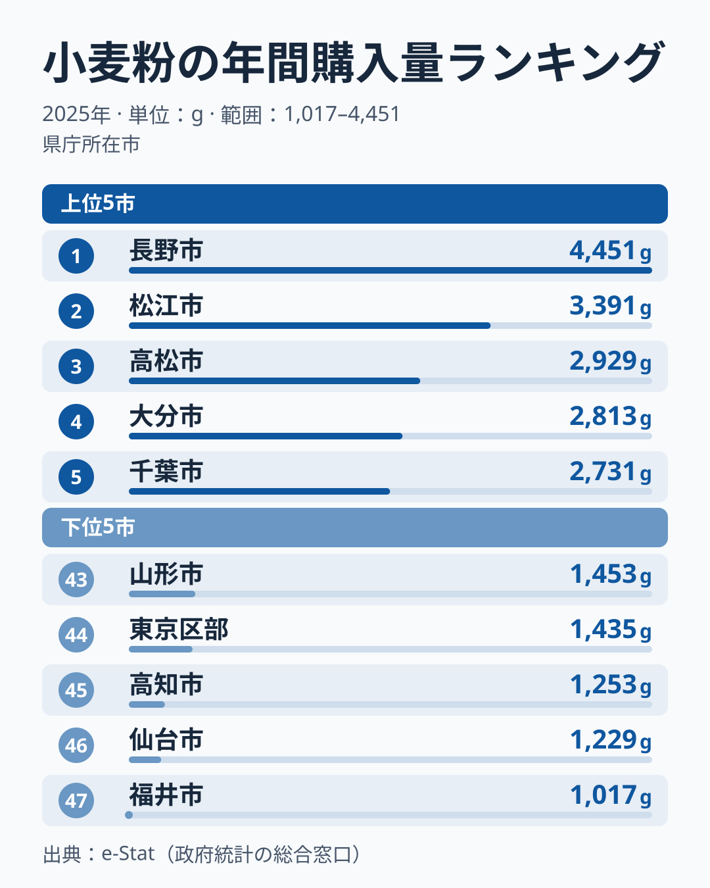
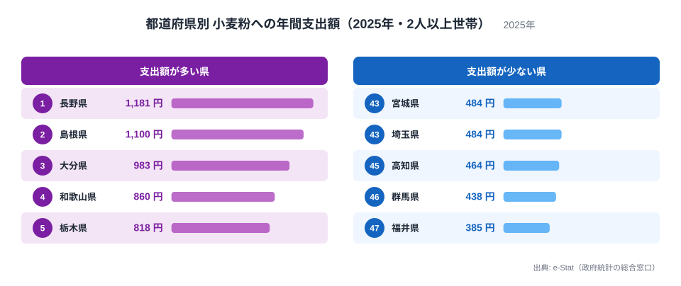

小麦粉と聞いて思い浮かべるのは、うどん・お好み焼き・天ぷら・たこ焼きといった粉物料理でしょう。2025年の家計調査（総務省）で、県庁所在市の二人以上世帯が1年間に買った小麦粉の量を比べると、**1位は長野県の4,451g、最下位は福井県の1,017gで、その差は約4.4倍**でした。

前年（2024年）に最も多く買っていたのは三重の3,072g、最も少なかったのはほうとうで知られる山梨の1,284gでした。ところが2025年は、三重が2,128gで13位、山梨が1,831gで26位に位置を変えています。家計調査は限られた世帯の平均値を使う標本調査なので、[仮説] わずか1年で顔ぶれがここまで入れ替わる一因は、この標本のぶれにある可能性があります。

では、なぜ長野は福井の4倍を超えたのでしょうか。2021年から2025年の5年分を並べると、長野は5年中4回で1位（2024年だけ3位）に入っており、毎年のように顔ぶれが入れ替わる他県とは様子が違います。一方、最下位は2021年と2022年が栃木、2023年が福井、2024年が山梨、2025年が福井と、毎年のように入れ替わっています。この記事では、2025年の順位を読みながら、「どこまでが長野の特徴で、どこからが年ごとのぶれか」を切り分けます。なお、家計調査では小麦粉の「購入数量」を、ランキング上では「小麦粉消費量」と呼んでおり、本文ではどちらも同じ指標を指します。

## 小麦粉の購入量が多い県・少ない県

家計調査の「1世帯当たり年間購入数量（二人以上世帯）」を見ると、上位には長野・島根・香川・大分・千葉の5県が並び、地方に偏りはありません。

1位は長野県の4,451g、2位は島根県の3,391g、3位は香川県の2,929gで、4位が大分県の2,813g、5位が千葉県の2,731gです。1位の長野は2位の島根を約1,060g上回っており、上位5県の中でも抜けています。下位には、47位の福井県の1,017g、46位の宮城県の1,229g、45位の高知県の1,253g、44位の東京都の1,435g、43位の山形県の1,453gが入りました。

注目したいのは、長野が突出している点です。おやきや信州そばのつなぎなど、家庭で粉を扱う食文化は長野によく知られており、これと関係している可能性はあります。ただし仮説の段階で、家庭での粉物調理が長野の購入量を押し上げているという説明は、この図だけでは確かめられません。検証には、世帯ごとの購入品目や調理頻度を調べた別の調査が必要です。

そこで、確かめられる範囲として、同じ長野市の値を過去5年で並べました（出典は、公開ランキング「小麦粉消費量」（家計調査・1世帯当たり年間購入数量、二人以上世帯、単位g）の2021〜2025年の各年の値です）。長野は2021年4,353g、2022年3,273g、2023年3,696g、2024年2,799g、2025年4,451gで、順位は1位、1位、1位、3位、1位です。年によって量は大きく動くものの、位置は毎年上位にあります。長野が福井の4倍を超えた背景には、2025年の福井が極端に少なかったことに加えて、長野が構造的に上位にいることが重なっています。福井の1,017gは、2023年の930g（47位）に次ぐ低さで、それ以外の3年は1,722g（2021年・45位）、1,906g（2022年・33位）、1,970g（2024年・21位）でした。福井が極端に少なくなるのは5年のうち2回で、毎年ではありません。

下位の顔ぶれも見ておきます。2025年の下位5位には、東北（宮城・山形）、北陸（福井）、四国（高知）、東京都区部が入りました。ただし、福井は2021年45位、2022年33位、2023年47位、2024年21位、2025年47位と、下位に入る年と中位に戻る年が交互に来ています。高知は2024年46位、2025年45位と2年続けて下位でした。最下位の県も、2021年と2022年は栃木、2023年は福井、2024年は山梨、2025年は福井と、年ごとに替わっています。下位は、長野の上位ほど安定しているとは言えず、標本のぶれの影響を受けやすいと読むのが安全です。

下位10県に広げると、福井・宮城・高知・東京・山形に、埼玉・富山・岐阜・愛媛・福島が加わります。地方で数えると北海道・東北が3県、中部が3県、関東が2都県、四国が2県で、特定の地方には固まっていません。「寒冷地だから少ない」「都市だから少ない」のどちらか一方では説明できない並びです。

その中で東京都区部は、2022年36位、2023年37位、2024年42位、2025年44位と、4年続けて中位より下にいて、順位は年ごとに下がっています。年ごとに入れ替わる下位の中では、比較的続いている例です。ただし、外食・中食に頼る割合が高い都市部であることとの関係は、この調査だけでは示せません。

> [!NOTE]
> 家計調査の数値は各県の**県庁所在市（東京は都区部）における二人以上世帯**の値です。たとえば長野県の数字は長野市の購入実績であり、県全体の平均ではありません。県を代表する1都市のデータとして読む必要があります。

<source-link href="/ranking/wheat-flour-consumption-quantity">小麦粉消費量ランキングをもっと見る</source-link>

## 順位は1年でこれだけ動く──三重13位、山梨26位

前年（2024年）の値と比べると、動きの大きさが分かります。

- 三重県：2024年は首位（3,072g）、2025年は13位（2,128g）
- 山梨県：2024年は最少の47位（1,284g）、2025年は26位（1,831g）
- 香川県：2024年は13位（2,135g）、2025年は3位（2,929g）

三重の購入量は約940g減り、山梨は約550g増えています。この変化の理由を、このデータだけから断定することはできません。標本調査では、少ない世帯数の平均値が年ごとにぶれるため、順位の差が誤差の範囲に収まることもあります。1年の順位入れ替わりを、食習慣が変わった証拠とみなすのは危険です。

そのため、この記事では2025年の順位を「この年の標本が示した姿」として読み、地域の文化と結びつける話は仮説として扱います。「ほうとうの本場だから山梨は少ない」という前年の逆説は、2025年の値では成り立たなくなりました。山梨は購入量で26位とほぼ中位に入っています。

> [!TIP]
> 都道府県別の小麦粉購入量のように、1つの市の標本平均で作られたランキングは、**2〜3年分を並べて安定して上位・下位に入る県だけ**を「傾向」として読むのが安全です。2025年の1位・最下位は、来年も同じとは限りません。

## 19年で見る──長野は毎年6番目以内、「うどん県」香川は2番目から39番目まで

同じ指標は2007年から2025年まで19年分あります。5年より長く並べると、長野の安定ぶりと、ほかの県の振れの大きさがよりはっきりします。

長野は19年すべてで6番目以内に入り、首位に立ったのは10回です。最も低かったのは2017年の6番目です。1位と最下位の比は年によって約2.2倍から約4.4倍まで動き、2025年の約4.4倍は19年の中で最も大きい部類です。長野と福井の4倍超の差は、長野の高さという続く傾向に、2025年の福井の低さが重なった結果だと、19年分からも読めます。

対照的なのが、うどんで知られる香川です。2025年は2,929gで3位でしたが、2024年は2,135gで13位、2023年は1,649gで秋田と同じ値の35番目でした。19年分で見ると、香川が3番目以内に入ったのは2015年の2番目と2025年の3番目の2回だけで、最も低かったのは2021年の39番目です。1年の順位だけで「うどん県だから小麦粉を多く買う」とも「うどん県なのに少ない」とも言えません。

香川の値がうどんのイメージと結びつきにくい理由の一つは、指標の定義にあります。家計調査が数えるのは家庭が買った小麦粉そのものの量で、うどん店が仕入れる業務用の小麦粉や、外食で食べるうどんは入りません。[仮説] うどんを店で食べる機会が多い地域ほど、家庭の小麦粉購入量にはうどん文化が表れにくい可能性があります。確かめるには、外食の回数と家庭の購入を同じ世帯で比べたデータが要ります。

## 購入量と支出額は別の物語──長野は両方で1位

同じ小麦粉でも、「どれだけの量を買ったか（購入量）」と「いくら使ったか（支出額）」では順位が変わります。小麦粉消費支出額（1世帯当たり年間の小麦粉への支出額）も見てみましょう。

支出額の1位は長野県の1,181円、2位は島根県の1,100円、3位は大分県の983円、4位は和歌山県の860円、5位は栃木県の818円です。購入量でも長野・島根・大分が上位に入っており、この3県は量も金額も多い「よく買う県」だと言えます。下位は47位の福井県の385円、46位の群馬県の438円、45位の高知県の464円で、福井と高知は購入量でも下位でした。

最上位の長野の1,181円と最下位の福井の385円の差は約3.1倍で、購入量の差（約4.4倍）より小さくなっています。これは、買った量あたりの値段が県によって違うためです。計算してみると、100gあたりの支出額は長野が約26.5円（1,181円÷44.51）、福井が約37.9円（385円÷10.17）でした。長野は大量に買う分、安い大袋を選んでいる、あるいは特売を活用している可能性があります。ただしこれは仮説で、検証には袋の大きさや購入店ごとの単価を調べる別のデータが必要です。

一方、香川は購入量で3位（2,929g）なのに、支出額では10位（745円）です。購入量と支出額が必ずしも同じ順に並ばないことは、片方のランキングだけで「小麦粉に熱心な県」と決めつけられないことを教えてくれます。

<source-link href="/ranking/wheat-flour-consumption-expenditure">小麦粉支出額ランキングをもっと見る</source-link>

## 都市部と「粉物の本場」のイメージ

2025年の値で、大都市はどうでしょうか。東京は購入量44位（1,435g）、支出額42位（512円）と、どちらも下位です。大阪は購入量17位（2,030g）、支出額15位（696円）で、粉物の街というイメージほど突出してはいません。愛知は購入量22位（1,873g）、神奈川は23位（1,872g）と、中位に収まっています。

> [!WARNING]
> 家計調査が捉えるのは**家庭で購入した小麦粉**であり、外食や、乾麺・冷凍麺・パンなど加工品の形で食べる小麦は含まれません。また、単身世帯は調査の対象外です。「購入量が少ない県＝粉物を食べない県」とは言えず、郷土料理の知名度と家庭での小麦粉購入量は必ずしも一致しません。

東京や大阪のような都市部で外食・中食の比重が高いことは、購入量が少なめに出る一因かもしれません。ただし2025年の大阪は中位であり、「都市部だから少ない」と一括りにはできません。外食・中食への依存度が小麦粉の購入量を下げているというのは仮説で、その検証には、世帯の調理頻度や外食支出を同じ世帯で比べた調査が必要です。

## まとめ──小麦粉の「本場」は1年のデータでは決められない

2025年の家計調査（県庁所在市の二人以上世帯）から読めたことを整理します。

- 購入量の1位は長野の4,451g、最下位は福井の1,017gで、その差は約4.4倍
- 支出額の1位も長野の1,181円、最下位も福井の385円で、差は約3.1倍
- 長野・島根・大分は、購入量と支出額の両方で上位5位以内に入った
- 前年に最多だった三重は13位に、最少だった山梨は26位になり、1年で順位は大きく動く
- 長野は2007〜2025年の19年すべてで6番目以内 (首位は10回) と安定している一方、香川は2番目から39番目まで動き、最下位は2021年と2022年が栃木、2023年が福井、2024年が山梨、2025年が福井と毎年のように入れ替わる
- 順位の入れ替わりは標本調査の誤差を含むため、地域の食文化の変化とは結びつけない

家計調査は「県庁所在市の家庭が、その年にどれだけ買ったか」を映す標本調査です。「なぜ長野は福井の4倍超か」への答えは、長野の高さは複数年で続く傾向、福井の低さは2023年と2025年に強く出て、2022年と2024年には中位に戻ったぶれ、と分けて読むのが現時点で言える範囲です。粉物文化の濃淡を語るには、複数年の傾向を重ねて読む必要があります。食品や家計に関する他の指標は[経済カテゴリのランキング一覧](/category/economy)からも探せます。
