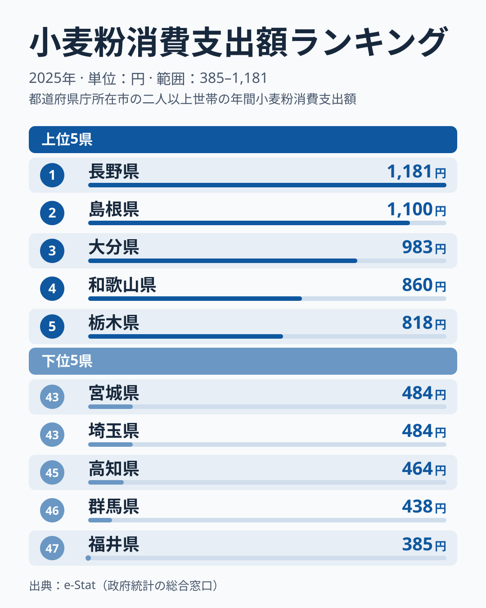
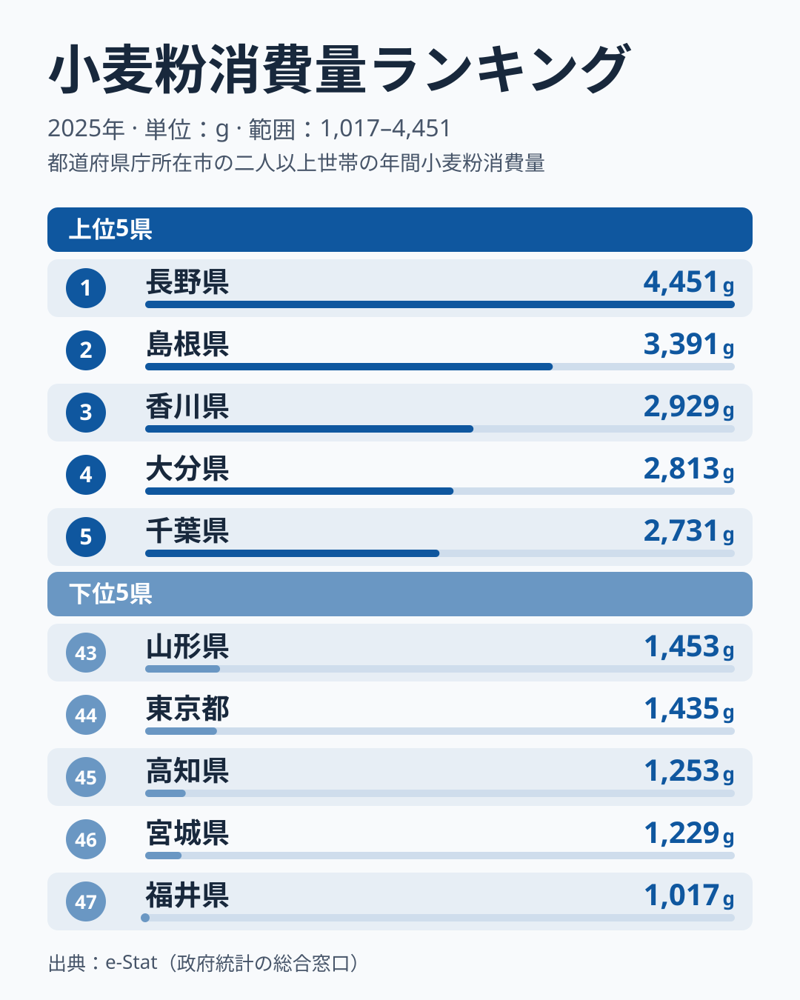
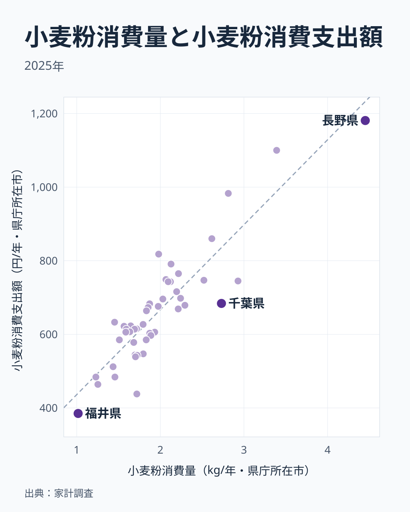

「小麦粉をいちばん多く買う県」と「小麦粉にいちばんお金を使う県」は、同じ県だと思いますか。直感的には「たくさん買えば、たくさん払う」はずです。2025年の家計調査を開くと、この直感は首位ではそのとおりでした。どちらも長野県です。

小麦粉の年間支出額が最も多いのは長野県の1,181円、年間消費量が最も多いのも長野県の4,451gです。2位も量・金額ともに島根県で、上位10県のうち7県が量でも金額でも顔をそろえます。

それでも、量と金額が完全に重なるわけではありません。栃木県は支出額が5位なのに消費量は18位、香川県は消費量が3位なのに支出額は10位です。このズレは集計の誤差ではなく、同じ「小麦粉」でも県によって「1kgあたりにいくら払っているか」、つまり単価の概算が違うことから生まれます。本記事では支出額ランキングの全体像を押さえたうえで、量と金額のズレを単価まで分解して読みます。

## 小麦粉消費支出額ランキングの全体像（2025年）

まずは支出額のランキングを見ます。最も多いのは長野県で1,181円、最も少ないのは福井県で385円で、その差は約3.1倍です。

上位5は、長野が1位で1,181円、島根が2位で1,100円、大分が3位で983円、和歌山が4位で860円、栃木が5位で818円です。下位は最下位の福井が385円で、群馬が438円、高知が464円と続きます。

上位は甲信越の長野、山陰の島根、九州の大分、近畿の和歌山、関東北部の栃木と、地域でまとまっていません。粉ものの食文化（おやき、だんご汁など）が根づいた地域と重なる県もありますが、家計調査は県庁所在市1市の値で単年のぶれが大きく、地域パターンとして断定できる材料ではありません。順位の細かな動きや過去年の推移は下記のランキング詳細で確認できます。

<source-link href="/ranking/wheat-flour-consumption-expenditure">小麦粉消費支出額ランキングをもっと見る</source-link>

> [!NOTE]
> 本データは総務省「家計調査」（都道府県庁所在市・二人以上世帯）の2025年値（e-Stat経由）。スーパーなどで購入した「小麦粉そのもの」の金額・数量であり、パン・麺・菓子といった加工品や、外食・中食での粉消費は含まれない。家庭で粉から調理する文化の濃淡を映す指標と捉えるとよい。

## 消費量でも長野が首位、それでも順位がズレる県がある

ここで「量」のランキングと突き合わせます。消費量の首位は長野で4,451g、続いて島根が3,391g、香川が2,929gです。最少の福井は1,017gで、首位との差は約4.4倍あり、金額の差（約3.1倍）より開いています。

上位5は、長野が1位で4,451g、島根が2位で3,391g、香川が3位で2,929g、大分が4位で2,813g、千葉が5位で2,731gです。下位は最下位の福井が1,017gで、宮城が1,229g、高知が1,253gと続きます。

<source-link href="/ranking/wheat-flour-consumption-quantity">小麦粉消費量ランキングをもっと見る</source-link>

量と金額の上位10県を比べると、長野・島根・大分・和歌山・兵庫・香川・熊本の7県が両方に入ります。最下位がどちらも福井であることも含め、全体としては「多く買う県ほど多く払う」関係がはっきり出ています。

ズレが目立つのは、栃木と香川、千葉です。栃木は支出額が5位で818円なのに対して消費量は18位で1,980g、香川は消費量が3位で2,929gなのに対して支出額は10位で745円、千葉は消費量が5位で2,731gなのに対して支出額は16位で684円です。鍵は「1kgあたりいくら払っているか」という単価にあります。支出額（円/年）を消費量（kg/年）で割って概算すると――

- 栃木：818円 ÷ 1.980kg ≒ **約413円/kg相当**
- 長野：1,181円 ÷ 4.451kg ≒ **約265円/kg相当**
- 香川：745円 ÷ 2.929kg ≒ **約254円/kg相当**
- 千葉：684円 ÷ 2.731kg ≒ **約250円/kg相当**

栃木は長野より約56%高い単価の小麦粉を買っている計算になります。量が少なくても単価が高ければ、合計支出は上位に入ります。逆に香川・千葉のように単価が低めだと、量が上位でも支出は中位にとどまります。

> [!TIP]
> ここでの単価（円/kg相当）は「支出額 ÷ 消費量」で割り戻した概算値にすぎない。家計調査は小麦粉の品目別（薄力・強力・国産・輸入など）のミクロ価格を県別には公表していないため、「どの銘柄を買ったか」までは特定できない。あくまで県全体の平均的な価格帯の目安として読んでほしい。

## 単価の違いが映す「選び方」の地域差

量と金額の関係は、消費量（横軸）と支出額（縦軸）を47都道府県で散布図にすると一目で見えます。

点は右上がりに並び、「量が多い県ほど支出も多い」傾向がはっきりしています。ただし一直線には乗りません。同じくらいの消費量でも支出額が上下にばらつく――この縦方向のばらつきが単価差です。たとえば消費量がほぼ同じ栃木と滋賀でも、栃木は1,980gで818円、滋賀は1,975gで676円と、支出が142円開いています。反対に、香川は2,929gで745円、大分は2,813gで983円と、香川のほうが量が多いのに支出は238円少なくなっています。

単価の概算を全県で並べると、最も高いのは山形の約436円/kg相当（消費量は43位、支出額は23位）、次いで栃木の約413円/kg相当、岐阜の約397円/kg相当です。最も低いのは千葉の約250円/kg相当で、香川、群馬の約255円/kg相当が続きます。最高と最低の差は約1.7倍に収まり、量の差（約4.4倍）よりずっと小さいことも分かります。量が支出の大半を決め、単価が順位を入れ替える、という構図です。

> [!TIP]
> 散布図の「縦方向のばらつき」を読むのがコツです。同じ消費量（横位置が同じ）で点が上下に離れていれば、それは単価の差。ランキングを1本だけ並べても見えない「量×単価」の構造が、消費量と支出額を交差させると立ち上がります。

[仮説] 栃木・山形・岐阜で単価が高めなのは、国産小麦や用途特化の専用粉（うどん粉・天ぷら粉など）を選ぶ家庭が多いためかもしれません。香川・千葉・長野で単価が低めなのは、大袋や特売品をまとめ買いしているためかもしれません。ただしどちらも単価の概算から導いた推測であり、確証には家計調査の品目別ミクロデータや銘柄別POSデータでの検証が必要です。県庁所在市1市の単年値でもあるため、翌年も同じ順位になるとは限りません。現時点では「単価が高い＝高価格帯を選んでいる可能性がある」という所までしか言えません。

## 大都市は東京・埼玉が下位、大阪は上位寄り

大都市は一様ではありません。支出額で東京都は42位の512円、消費量でも44位の1,435gと下位に沈みます。埼玉県も支出額が44位で484円、消費量が42位で1,457gです。一方で大阪府は支出額が15位で696円、消費量が17位で2,030gと上位寄りで、神奈川県も支出額が17位で683円、消費量が23位で1,872gと中位より上にいます。

> [!WARNING]
> 東京や埼玉の数値が低い背景には、家計調査が「家庭で粉から調理する量・金額」しか捉えていないという制約があります。外食・中食・調理済み加工品が発達した大都市では、粉の消費が家庭の外に移っている可能性があります。下位＝粉を食べないのではなく、「家庭で粉を買う形では消費していない」と解釈すべきです。ただし大阪の位置は同じ説明では読めず、大都市でひとくくりにはできません。

支出額が最も少ない福井、群馬、高知は、福井と高知が量・金額ともに最下位グループです。群馬は消費量こそ30位の1,719gですが単価が約255円/kg相当と低く、支出額が下位に沈みます。下位グループも一様ではない点に注意したいところです。上位の[長野県のエリアデータ](/areas/20000)や[島根県のエリアデータ](/areas/32000)と合わせて、粉もの食文化の濃淡を地域単位で確かめると面白いでしょう。経済指標の地域差をより広く見たい場合は[経済カテゴリの一覧](/category/economy)が手がかりになります。

## まとめ

- 支出額が最も多いのは長野県で1,181円、最も少ないのは福井県で385円で、その差は約3.1倍です。
- 消費量が最も多いのも長野県で4,451gで、最少は福井県で1,017gです。上位10県の7県は量でも金額でも上位に入り、全体では「多く買う県ほど多く払う」関係が強く出ています。
- ズレる県の正体は単価です。栃木は支出額が5位で消費量が18位、単価の概算は約413円/kg相当、香川は消費量が3位で支出額が10位、単価の概算は約254円/kg相当と、単価の概算が分かれます（支出÷消費量による概算）。
- 単価の最高と最低の差は約1.7倍で、量の差（約4.4倍）より小さく、量が支出の大半を決め、単価が順位を入れ替えています。
- 支出額で東京都は42位、埼玉県は44位と下位ですが、大阪府は15位と上位寄りで、大都市は一様ではありません（家計調査の定義上の制約もあります）。
