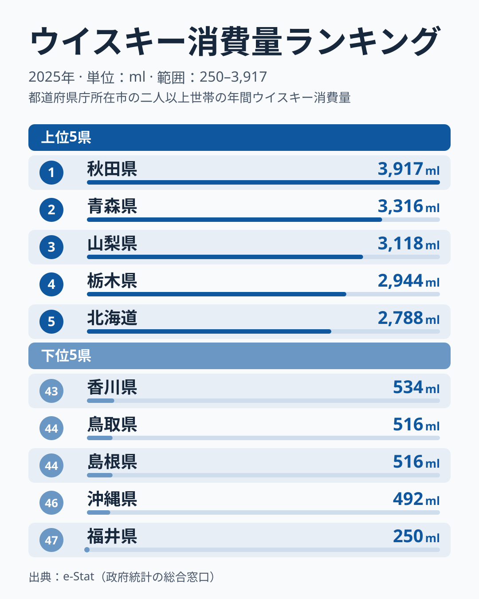

「ウイスキーが一番飲まれている県は?」と聞かれて、東京や北海道を思い浮かべる人は多いはずです。ところが総務省「家計調査」の 2025 年で 1 世帯あたりの年間ウイスキー消費量を調べると、首位は **秋田県** で 3,917ml でした。2 位の青森は 3,316ml、3 位の山梨は 3,118ml で、東京は 7 位の 2,244ml です。ウイスキーの本場というイメージのある北海道も、2,788ml で 5 位にとどまります。

最下位は **福井県** で 250ml でした。秋田とのあいだには **15.7 倍** もの開きがあります。46 位の沖縄は 492ml で、福井とのあいだも約 2 倍離れており、ウイスキーは酒類のなかでも「住む場所で飲む量が変わる」品目です。ただし、後半で触れるとおり家計調査の県別の値は年ごとの振れが大きく、順位をそのまま「県民性」と読むのは危険です。この記事では、2025 年の数字から読み取れることと、読み取れないことを分けて整理します。

> [!NOTE]
> 家計調査の数値は「都道府県庁所在市・二人以上世帯」の 1 世帯あたり年間購入量です。単身世帯や家庭外の飲酒 (居酒屋・バー) は含まないため、外食でウイスキーを飲む量が多い都市部では実消費が過小に出やすい点に注意してください。順位は「家で買って飲むウイスキー」の地図と読み替えるのが正確です。

## ウイスキー消費量、秋田が首位に立った2025年

まず上位 5 県と下位 5 県を見比べてみます。

<source-link href="/ranking/whisky-consumption-quantity">ウイスキー消費量ランキング(47都道府県・各年版)をもっと見る</source-link>

1 位の秋田は、1 世帯あたり年間で約 3.9 リットルのウイスキーを購入している計算になります。これは 2 位の青森の約 1.2 倍、3 位の山梨の約 1.3 倍で、首位が頭ひとつ抜けた形です。4 位は栃木の 2,944ml、5 位は北海道の 2,788ml で、ここまでが 1 世帯あたり 2.7 リットルを超える上位グループです。

上位 10 県まで広げると、秋田・青森・北海道・山形・新潟と、冬の寒さや雪の厳しい地域が 5 県並びます。気温が下がる地域ほど、水割りやお湯割りで体を温められる蒸留酒の需要が高まりやすいという構図は、2025 年の並びからもうかがえます。一方で、栃木・埼玉・東京・茨城と関東の 4 都県も上位 10 に入っており、寒冷地だけでは説明しきれません。埼玉は 6 位の 2,383ml、茨城は 8 位です。関東では、帰宅後に家でハイボールをつくる習慣が広がったことが、家計に計上される量を押し上げている可能性があります ([仮説]。検証には世帯類型別の酒類購入データが要ります)。

> [!TIP]
> 同じ寒冷地の酒として、東北では日本酒の消費も全国上位です。[日本酒消費量ランキング](https://stats47.jp/ranking/sake-consumption-quantity)の 2025 年版では岩手が 1 位、青森が 2 位、栃木が 4 位、秋田が 6 位で、ウイスキー上位の顔ぶれと重なります。寒い地域では「日本酒もウイスキーも飲む」傾向が読み取れ、特定の酒だけが強いわけではないことが分かります。

## 下位は福井・沖縄と中国・四国の県

下位グループを見ると、47 位の福井が 250ml と突出して低い値です。沖縄は 492ml、島根と鳥取はともに 516ml、香川は 534ml と続き、下位 5 県とも年間 600ml に届きません。1 位の秋田の 7 分の 1 に満たない水準で、福井にいたっては秋田の 15.7 分の 1 です。

注目したいのは、この下位の顔ぶれが「焼酎の強い県」とは単純に重ならない点です。[焼酎消費量ランキング](https://stats47.jp/ranking/shochu-consumption-quantity)の 2025 年版では、島根が 3 位、福井が 8 位と、ウイスキー下位の 2 県が焼酎では上位に入っています。「焼酎をよく飲む地域はウイスキーを飲まない」という代替関係が当てはまる県もある一方、沖縄と香川は焼酎では中位です。さらに、焼酎の消費が全国で最も多い宮崎はウイスキーでは 36 位、焼酎でも上位の鹿児島はウイスキーでは 19 位で、並びが完全に逆転しているわけではありません。

> [!WARNING]
> 「焼酎が強い県はウイスキーが弱い」という関係は、2025 年の順位を見る限り一部の県にしか当てはまりません。地元の蒸留酒・気候・年齢構成・所得など複数の要因が同時に効いている可能性があり、片方が片方を押し下げているという因果は [仮説] の段階で、検証できていません。

中位を見ても、九州の福岡は 26 位で 1,435ml、長崎は 27 位で 1,323ml と、全体の中央付近に収まります。九州全体を「ウイスキーが弱い地域」とひとくくりにはできません。全 47 県の並びは[ウイスキー消費量ランキング](https://stats47.jp/ranking/whisky-consumption-quantity)で確認できます。

## 単年の順位は大きく入れ替わる

この記事を 2024 年の値で書いた場合、首位は千葉の 3,427ml、最下位は沖縄の 518ml で、結論はまったく違うものになっていました。2025 年の千葉は 1,820ml で 12 位です。逆に福井は 2024 年に 1,548ml だったのが 2025 年は 250ml に、秋田は 2,726ml から 3,917ml に動いています。

家計調査は県庁所在市の二人以上世帯だけを対象にしており、1 市あたりの標本は多くありません。ウイスキーのように 1 回の購入量が大きく、買わない世帯も多い品目では、数世帯の購入が年間の平均を大きく動かします。そのため、福井の 250ml のような極端な値を「福井の人はウイスキーを飲まない」と読むのは根拠が足りません。

> [!NOTE]
> 単年の順位は偶然の影響を強く受けるため、構造として読めるのは「東北北部と北海道に寒冷地の需要がある」「関東の都市部も家飲みで上位に入りやすい」といった大きな傾向までです。県ごとの順位の差を、そのまま食文化の差だと断定しないでください。複数年を並べて、毎年上位や下位に入る県を探すと、本当に定着した傾向が見えてきます。

## まとめ

- 1 位は秋田の 3,917ml、2 位は青森の 3,316ml、3 位は山梨の 3,118ml で、東京の 7 位や北海道の 5 位より上に並ぶ
- 最下位の福井は 250ml で、秋田との差は **15.7 倍**。ただし福井は 2024 年に 1,548ml で、年ごとの振れが非常に大きい
- 上位 10 県には、秋田・青森・北海道・山形・新潟の寒冷地 5 県と、栃木・埼玉・東京・茨城の関東 4 都県が入る
- 下位は福井・沖縄・島根・鳥取・香川。焼酎との代替関係は島根や福井では当てはまるが、全体の説明にはならない [仮説]
- 家計調査の県別の値は単年のぶれが大きく、構造を読むなら複数年で見るのが安全
