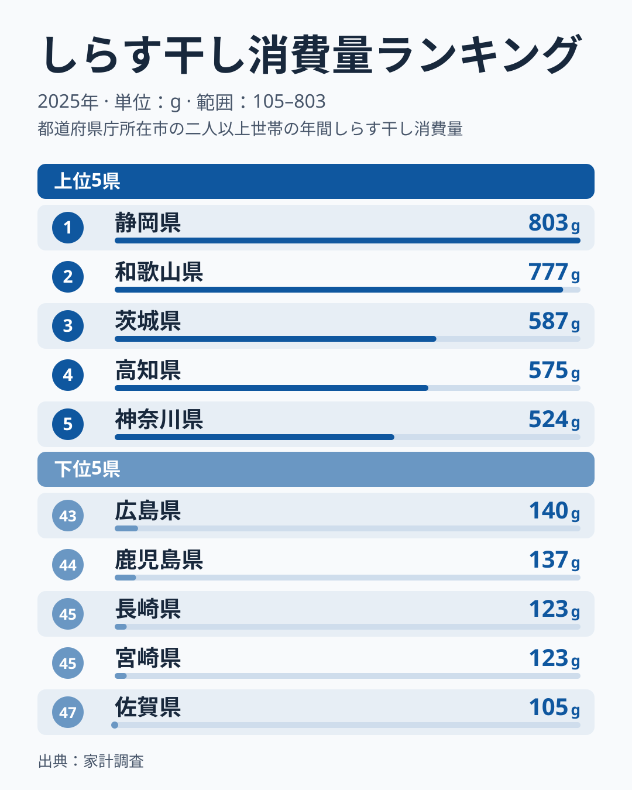
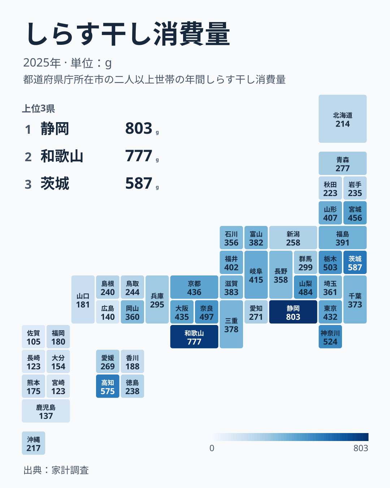

しらす干しは、カタクチイワシなどの稚魚を釜ゆでして干した加工品です。ご飯にかけたり、酢の物や卵焼きに混ぜたりと、家庭料理で幅広く使われています。ところが家計調査の数字を見ると、この身近な食材の消費量には都道府県で大きな開きがあります。

2025年の調査で全国でもっとも消費量が多いのは静岡県で、年間803グラムを消費しています。次いで和歌山県が777グラムで、前年は首位だった和歌山県が2位に下がりました。もっとも少ないのは佐賀県で105グラムにとどまり、1位との差はおよそ8倍にのぼります。同じ日本国内でありながら、なぜこれほどの差が生まれるのでしょうか。この記事では、上位と下位の分布を可視化しながら、データから読み取れることと、仮説にとどまることを分けて見ていきます。

## 上位と下位を見る

<source-link href="/ranking/whitebait-consumption-quantity">しらす干し消費量ランキングをもっと見る</source-link>

分布の形で目立つのは、上位2県の突出です。静岡県の803グラムと和歌山県の777グラムは並んでおり、3位の茨城県587グラムとの間に約200グラムの開きがあります。3位から5位は、茨城県の587グラム、高知県の575グラム、神奈川県の524グラムと、数十グラムずつの差で連なっています。ただし家計調査は県庁所在市の二人以上の世帯の値で、県全体の値ではありません。単年の順位はぶれも大きいため、順位の入れ替わりは慎重に見る必要があります。

下位側は、最下位の佐賀県105グラムから、長崎県と宮崎県の123グラム、鹿児島県の137グラム、広島県の140グラムまで、100グラム台前半に密集しています。ここでは最下位から数えて、同率の長崎県と宮崎県を含む47位から43位までの5県を「下位5県」とします。下位5県のうち佐賀県、長崎県、宮崎県、鹿児島県の4県が九州で、広島県は中国地方です。[仮説] 長崎県や鹿児島県は水産業が盛んな地域ですが、しらすよりも地元で水揚げされる別の魚介が食卓の中心になっている可能性があります。検証には各県の漁獲統計や購入品目との突き合わせが必要です。

## 地理分布で見るしらす干し消費量

タイルマップにすると、上位2県の静岡県と和歌山県のほか、茨城県が3位、神奈川県が5位、栃木県が6位と、関東の県も上位に入っていることが分かります。一方、京都府、大阪府、東京都は432〜436グラムの狭い範囲に並び、10〜12位が団子状に続いています。

下位5県より一つ上の順位帯にも、九州の県が目立ちます。福岡県は40位で180グラム、熊本県は41位で175グラム、大分県は42位で154グラムです。これらは下位5県の外ですが、下位8県の範囲では、九州の県が福岡県、熊本県、大分県、佐賀県、長崎県、宮崎県、鹿児島県と7県を占めます。北海道は37位の214グラムで、海に面した県でも順位は一様ではありません。

ここまでがデータから言えることです。以下は、その背景についての仮説です。

## 分布の背景を考える

[仮説] 静岡県や和歌山県には、しらす漁に適した漁場があり、水揚げ港の近くで加工して地元に流通させる消費が根付いているのかもしれません。ただし、漁場や鮮度、流通の経路といった事情は、この記事の家計調査のデータには含まれておらず、データでは確かめられません。また、北海道が37位にとどまるように、海に近いことだけでは順位を説明できません。

[仮説] 海に面していない奈良県が7位の497グラムに入っているのは、隣接する和歌山県や大阪府経由でしらす干しが流通しているためかもしれません。また、しらす丼などを前面に出す観光地では、日常の食卓でも使う頻度が高くなる可能性があります。いずれも今回のデータだけでは確かめられず、観光統計や流通の統計との突き合わせが必要です。

## 数字の読み方

この数値は購入数量です。釜揚げや生しらすなど、しらす干し以外の形態がどこまで含まれるかは、この記事のデータからは分かりません。贈答でもらったものや自家消費、外食での摂取分も、購入数量には反映されない可能性があります。順位の差は「しらす干しの購入量が多い・少ない」という意味にとどめ、食べている量そのものの差とは受け取らないようにしてください。

## まとめ

- しらす干し消費量の全国1位は静岡県で803グラム、2位は和歌山県で777グラム、最下位は佐賀県で105グラムです
- 1位と最下位の差はおよそ8倍です
- 上位は静岡県、和歌山県、茨城県、高知県、神奈川県の順で、関東の県も上位に入ります
- 下位5県(43位から47位)のうち4県は九州の県で、中国地方の広島県も入ります
- 産地からの近さや食文化は背景として考えられますが、今回のデータだけでは確かめられません

しらす干しの消費量は、[同じカテゴリの統計一覧](/category/economy)からほかの食品の消費傾向とあわせて確認できます。首位から2位に下がった[和歌山県のデータ](/areas/30000)では、県単位の統計を確かめられます。

**補足:** この数値は総務省の家計調査による、県庁所在市の二人以上の世帯における1年あたりの購入数量です。世帯単位の平均であるため、単身世帯の消費量は含まれていません。

> [!WARNING]
> しらす干しの数値は購入数量であり、生しらすや釜揚げなど他の形態、自家消費、贈答品を含むかどうかは、この数値からは分かりません。県庁所在市の世帯の値であり、県全体の消費量とは限りません。

**読み解きのポイント:** 単年の順位はぶれが大きいため、1位と2位の入れ替わりだけで構造が変わったと断定せず、複数年の推移とあわせて見ることが大切です。
