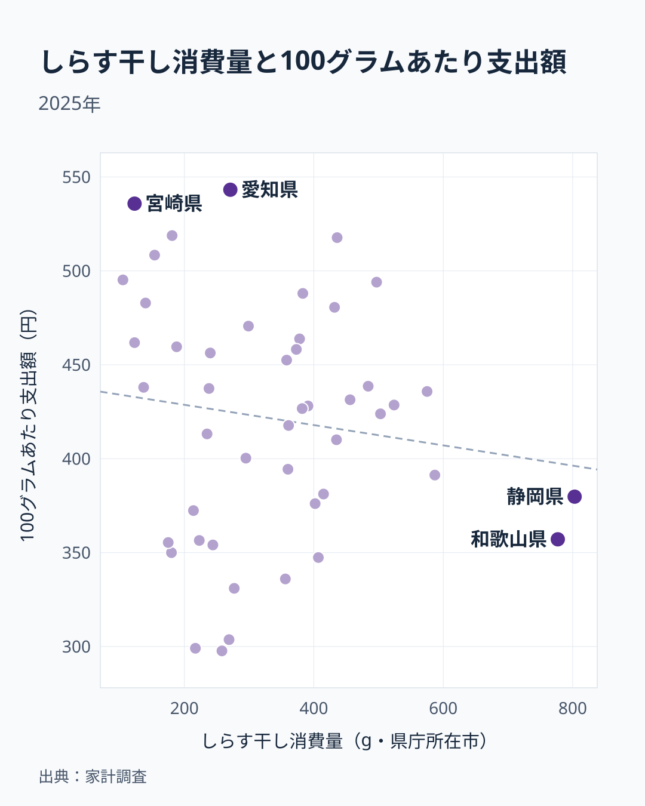

しらす干しは、カタクチイワシなどの稚魚を釜ゆでして干した加工品です。ご飯にかけたり、酢の物や卵焼きに混ぜたりと、家庭料理で幅広く使われています。ところが家計調査の数字を見ると、この身近な食材の購入量には都道府県で大きな開きがあります。

2025年の調査で全国でもっとも購入量が多いのは静岡県で、年間803グラムです。次いで和歌山県が777グラムで、最下位の佐賀県は105グラムにとどまり、1位との差はおよそ8倍にのぼります。同じ日本国内でありながら、なぜこれほどの差が生まれるのでしょうか。この記事では、上位と下位の分布に加えて、同じ家計調査の支出額から求めた100グラムあたりの支出額も見て、「安いから多く買う」という説明が成り立つのかを確かめます。データで言えることと仮説にとどまることは、分けて書いていきます。

## 上位と下位を見る

<source-link href="/ranking/whitebait-consumption-quantity">しらす干し消費量ランキングをもっと見る</source-link>

分布の形で目立つのは、上位2県の突出です。静岡県の803グラムと和歌山県の777グラムは、差が26グラムしかありません。この2県の間では順位の優劣を語れませんが、3位の茨城県587グラムとの間には190グラムの開きがあります。論点は「どちらが1位か」ではなく、「静岡県と和歌山県が他の県から抜けている」ことです。3位から5位は、茨城県の587グラム、高知県の575グラム、神奈川県の524グラムと、数十グラムずつの差で連なっています。

下位側は、最下位の佐賀県105グラムから、長崎県と宮崎県の123グラム、鹿児島県の137グラム、広島県の140グラムまで、100グラム台前半に密集しています。最下位から数えて、同率の長崎県と宮崎県を含む5県分を「下位5県」とすると、佐賀県、長崎県、宮崎県、鹿児島県の4県が九州で、広島県は中国地方です。上位が2県だけ飛び抜けているのに対し、下位は一つの塊になっている点が、この分布の特徴です。

## 数字の読み方

この数値は、総務省の家計調査による県庁所在市の二人以上の世帯の、1年あたりの購入数量です。県全体の値ではなく、単身世帯も含まれません。釜揚げや生しらすなど、しらす干し以外の形態がどこまで含まれるかは、この記事のデータからは分かりません。贈答でもらったものや自家消費、外食での摂取分も、購入数量には反映されない可能性があります。

そのため順位の差は「しらす干しの購入量が多い・少ない」という意味にとどめ、食べている量そのものの差とは受け取らないようにしてください。標本世帯の数が限られる調査なので、単年の値は年によって入れ替わる余地もあります。

## 地理分布で見るしらす干し購入量

タイルマップにすると、地方ごとのまとまりが見えます。上位8県には、関東の茨城県、神奈川県、栃木県の3県と、近畿の和歌山県、奈良県の2県が入り、関東と近畿に上位が集まっています。一方、京都府、大阪府、東京都は432〜436グラムの狭い範囲に並び、10〜12位が団子状に続いています。大都市圏の県が、上位と中位の境目にまとまっているということです。

反対側では、九州が目立ちます。最下位まで続く下位8県(40位以下)のうち、7県が福岡県、熊本県、大分県、佐賀県、長崎県、宮崎県、鹿児島県の九州で、残る1県が広島県です。海に面しているかどうかだけでは説明できない点も見逃せません。北海道は37位の214グラムで、海に面した県でも順位は一様ではありません。

## 購入量の差は価格差では説明できない

家計調査には、しらす干しの購入数量のほかに支出額もあります。支出額を購入数量で割ると、100グラムあたりの支出額が求められます。「上位の県は安く買えるから多く買う」のであれば、購入量の多い県ほど100グラムあたりの支出額は低くなるはずです。

<source-link href="/ranking/whitebait-consumption-expenditure">しらす干し消費支出額ランキングをもっと見る</source-link>

> [!WARNING]
> 100グラムあたり支出額は、支出額を購入数量で割った計算値です。店頭の価格そのものではなく、買われた商品の種類や買い方の違いも混ざっています。

47都道府県庁所在市の100グラムあたり支出額は、愛知県の543円がもっとも高く、新潟県の298円がもっとも低くなっています。差は約1.8倍で、購入数量の差である7.6倍あまりよりずっと小さい範囲に収まります。さらに、購入数量と100グラムあたり支出額の相関係数は-0.14で、ほとんど関係が見られません。

購入量が突出している2県を見ると、静岡県は支出額3050円を803グラムで割って380円、和歌山県は2775円を777グラムで割って357円です。全国の中央値428円は下回っていますが、最低の新潟県298円と比べればむしろ高めです。購入数量の上位8県の100グラムあたり支出額は357円から494円まで広がっていて、安い県だけが上位に来ているわけではありません。

下位側はさらに示唆的です。購入数量が下位8県(40位以下)の県のうち、福岡県の350円と熊本県の355円を除く6県は、鹿児島県の438円から宮崎県の536円まで、中央値428円を上回っています。購入量が少ない県が、100グラムあたりでは割高な支出をしているケースが多いということです。支出額の順位でも、静岡県の3050円と和歌山県の2775円が1位と2位で、最下位の佐賀県の520円とは約5.9倍の開きがあります。つまり、多く買う県は支払う総額も大きく、購入量の差は価格の差ではなく買う量そのものの差だと読めます。[仮説] 下位の県では、少量パックを選ぶ世帯が多いために単価が高めに出ている可能性がありますが、パックの大きさは家計調査の数値からは分かりません。

## 分布の背景を考える

同じ魚の稚魚を扱う食材でも、県ごとの食卓での位置づけは違います。同じ家計調査のいわしの購入数量は、長崎県が1,079グラムで全国2位、鹿児島県が859グラムで5位です。ところが同じ2県は、しらす干しでは45位と44位にとどまります。いわしは多く買うのにしらす干しは少ない県が九州にあるので、「魚介をよく買う県ほどしらす干しも多い」とは言えません。

[仮説] 長崎県や鹿児島県は水産業が盛んな地域で、しらすよりも地元で水揚げされる別の魚介が食卓の中心になっている可能性があります。反対に静岡県や和歌山県は、しらす漁に適した漁場があり、水揚げ港の近くで加工して地元に流通させる消費が根付いているのかもしれません。ただし漁場や鮮度、流通の経路といった事情は、この記事のデータには含まれておらず、確かめられません。

[仮説] 海に面していない奈良県が7位の497グラムに入っているのは、隣接する和歌山県や大阪府経由でしらす干しが流通しているためかもしれません。これも漁獲統計や流通統計との突き合わせが必要で、今回のデータだけでは判断できません。

しらす干しとあわせて、[いわしの消費量ランキング](/ranking/sardine-consumption-quantity)や[同じカテゴリの統計一覧](/category/economy)から、ほかの魚介の購入傾向も確かめられます。上位の[静岡県のデータ](/areas/22000)や[和歌山県のデータ](/areas/30000)では、県単位の統計を見られます。

## まとめ

- しらす干し購入量の全国1位は静岡県で803グラム、2位は和歌山県で777グラム、最下位は佐賀県で105グラムです
- 1位と最下位の差はおよそ8倍ですが、1位と2位の差は26グラムしかなく、論点は上位2県の突出です
- 100グラムあたり支出額の差は約1.8倍にとどまり、購入量との相関係数は-0.14です。購入量の差は単価の差では説明できません
- 下位5県(43位から47位)のうち4県は九州で、下位8県では7県が九州です
- 産地からの近さや食文化は背景として考えられますが、今回のデータだけでは確かめられません
