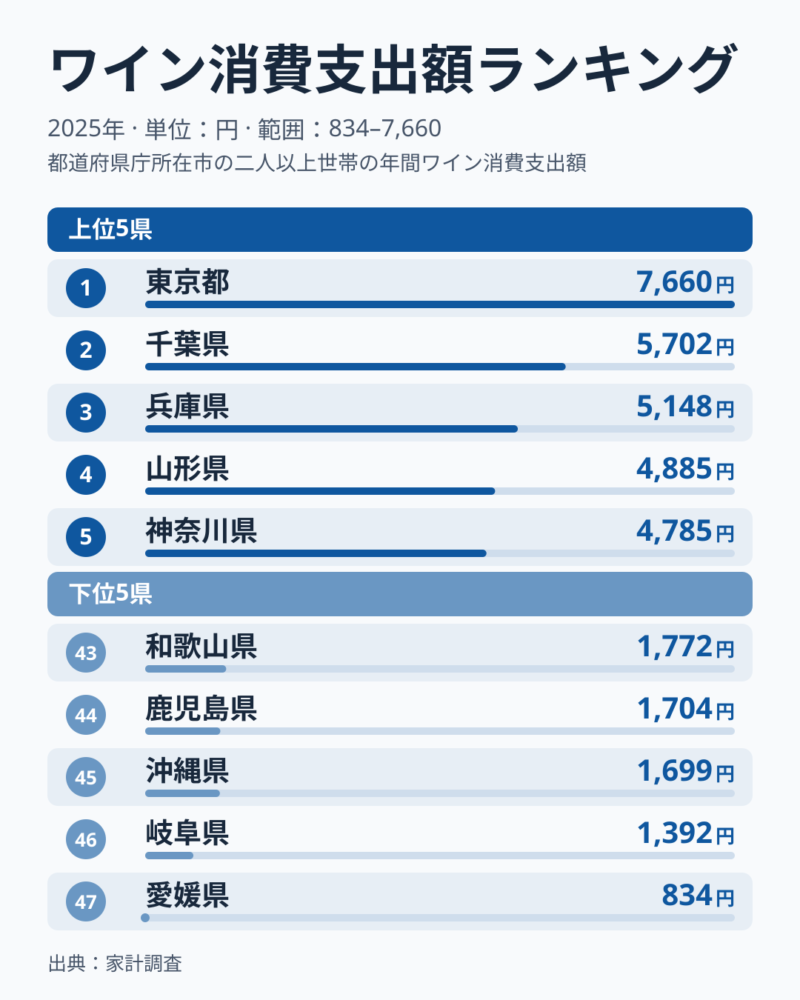
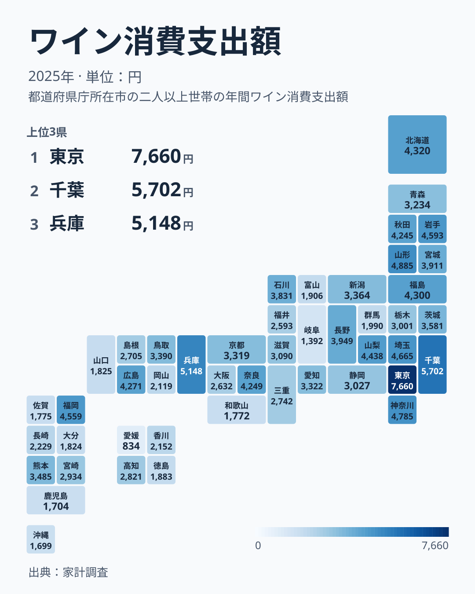

「ワインをよく飲む県」と聞いて、まず思い浮かぶのはぶどう産地でしょうか。しかし家計調査の消費支出データを見ると、答えは「産地は上位寄りだが、1位は産地ではなく東京」でした。2025年のワイン消費支出は東京都区部が1世帯あたり7,660円で1位、最下位の愛媛県は834円で、その差はおよそ9.2倍です。ただし最下位の愛媛県は46位の岐阜県1,392円からも大きく離れた値で、この倍率は最下位の極端な値に引っ張られている面があります。

上位には東京・千葉・兵庫・山形・神奈川が並び、関東の都市部のほか、近畿の兵庫県と東北の山形県も入っています。この記事では、ワイン産地として知られる山形・山梨・北海道・長野・岩手の順位と、大阪・愛知・京都といった大都市の順位を並べ、「飲む県」と「作る県」がどこまで重なるのかを実データで確かめます。あわせて、同じ家計調査の焼酎・日本酒・ウイスキー・ビールの順位と見比べ、ワインの低い県が「お酒全般が低い県」なのか「ワインだけ低い県」なのかも見ていきます。

> [!NOTE]
> このランキングは総務省「家計調査」の二人以上の世帯の年間ワイン消費支出額（2025年）を、都道府県庁所在市の値で比較したものです。東京都の値は市ではなく東京都区部（特別区）の世帯の支出で、東京都全域の値ではありません。産地でのワイナリー直販や贈答、観光客による購入は、家計調査の「支出」には反映されにくい点に注意してください。

## 上位と下位を見る

1位東京都区部の7,660円と2位千葉県の5,702円の差は1,958円あり、1位だけが大きく抜けた形です。一方、2位千葉県から8位福岡県までは5,702円から4,559円の範囲で、差は1,143円です。この7県（千葉・兵庫・山形・神奈川・埼玉・岩手・福岡）は互いに近い値で、順位が少し入れ替わってもおかしくない密集した帯をなしています。

家計調査は県庁所在市の標本が小さく、1,000円ほどの差は調査のぶれの範囲に収まりうる大きさです。そのため2位から8位の並びは「この順に飲まれている」と読むより、「この7県が東京に次ぐ集団をつくっている」と読むのが妥当です。東京と2位以下の1,958円の開きは、この集団内の差の1.7倍に当たり、こちらは順位の入れ替わりでは説明しにくい差です。

<source-link href="/ranking/wine-consumption-expenditure">ワイン消費支出額のランキングをもっと見る</source-link>

下位5県は愛媛県・岐阜県・沖縄県・鹿児島県・和歌山県で、四国・中部・九州沖縄・近畿にまたがります。47位の愛媛県834円は、46位の岐阜県1,392円と比べても大きく離れています。一方、45位沖縄県1,699円、44位鹿児島県1,704円、43位和歌山県1,772円はほぼ横並びです。

> [!WARNING]
> 家計調査は都道府県庁所在市の二人以上の世帯の支出額を調べる調査です。標本が小さく単年のぶれが大きいため、ある年の順位だけで県の食文化を断定することはできません。愛媛県の834円のような極端な値は、特に年による変動を疑って読む必要があります。

## 地図で見ると東北と首都圏が濃い

47県を地図に並べると、濃い県は首都圏（東京・千葉・神奈川・埼玉）と東北に集まり、薄い県は西日本に多く見えます。東北6県のうち5県が4位から16位に入り、山形県が4位の4,885円、岩手県が7位の4,593円、福島県が11位の4,300円、秋田県が14位の4,245円、宮城県が16位の3,911円です。ただし青森県は24位の3,234円で、東北全体が一様に高いわけではありません。

西側では、四国4県が高知県の29位2,821円から愛媛県の47位834円までに収まり、徳島県は39位の1,883円、香川県は35位の2,152円です。九州は福岡県が8位の4,559円、熊本県が19位の3,485円、宮崎県が28位の2,934円と上位から中位に分かれます。長崎県は34位、大分県は41位、佐賀県は42位、鹿児島県は44位と下位で、沖縄県も45位です。「東高西低」という大きな傾向はありますが、福岡や兵庫、広島県は12位で4,271円、奈良県は13位で4,249円のように、西日本にも上位の県があります。

あわせて見る: [焼酎消費支出ランキング](/ranking/shochu-consumption-expenditure) / [日本酒消費支出ランキング](/ranking/sake-consumption-expenditure)

## 産地は上位寄り、ただし東京には届かない

ワイン産地として知られる県の順位を並べると、山形県が4位（4,885円）、岩手県が7位（4,593円）、山梨県が9位（4,438円）、北海道が10位（4,320円）、長野県が15位（3,949円）です。5県すべてが47県の上位3分の1に当たる15位以内に入っています。一方で、5県のなかで最も高い山形県も東京の7,660円には届かず、産地であることが1位をもたらしているわけではありません。

大都市の順位も見ておきます。大阪府は32位の2,632円、愛知県は22位の3,322円、京都府は23位の3,319円で、人口の多い都市圏だから高いとは言えません。ワインの消費支出は、都市部であれば一様に高い、産地であれば必ず突出する、のどちらでもなく、「東京と首都圏が高く、産地の県も上位寄り、大阪・愛知・京都は中位から下位」という並びでした。

> [!TIP]
> 産地の生産量と、産地に住む世帯の購入額は別のものです。山梨県の9位は甲府市の二人以上の世帯が買ったワインの支出額であり、県内で造られたワインの量や出荷額を表すものではありません。この記事は醸造量の統計を使っていないため、「産地」は一般にワインの産地として知られる県を指します。

[仮説] 山形・岩手・山梨・北海道・長野が上位寄りなのは、地元のワイナリーやワインの売り場に触れる機会が多いことが背景にあるのかもしれません。ただし、この記事のデータだけでは醸造量や店舗数との関係を確かめられません。ワイン醸造量の県別統計を並べて、上位の5県と他の県で購入額に差があるかを見れば検証できます。

## 他の酒類と並べると見えるもの

同じ家計調査の他の酒類と順位を比べると、ワインが低い県の事情が県ごとに違うことが分かります。

鹿児島県は焼酎が2位の9,608円で、ワインは44位の1,704円です。宮崎県も焼酎が1位の12,263円ですが、ワインは28位の2,934円と下位ではありません。沖縄県は焼酎が13位の6,691円と高くなく、ワインは45位の1,699円、日本酒は47位の1,547円で、焼酎の強さではワインの低さを説明できません。焼酎が強い県でワインが低いのは鹿児島県などに限られ、焼酎の強さだけでは説明がつきません。

愛媛県はワインが47位、ウイスキーが46位の1,115円、日本酒が44位の2,597円と、ワイン・ウイスキー・日本酒がそろって低い県です。一方でビールは38位の10,802円、焼酎は19位の5,954円で、飲酒そのものが少ないとは言えません。ワインが44位以下の沖縄県は日本酒が47位、鹿児島県は46位で、ワインと日本酒の両方が低い県が重なっています。ただし山形県は日本酒が20位、ウイスキーが6位の4,211円と、産地の県は酒類全般で上位寄りというより、品目ごとにまちまちです。

東京都区部はワインが1位ですが、日本酒は8位の7,001円、ウイスキーは9位の3,873円、ビールは10位の14,335円、焼酎は33位の4,878円と、洋酒・醸造酒のどれも1位ではありません。ワインだけが突出して高いのが東京の特徴です。

[仮説] 東京のワインが突出する背景には、多様な国・地域の料理店が集まり、ワインに合わせる食文化に触れやすいことがあるかもしれません。大阪・愛知・京都のワインが高くない点は、人口が多いだけでは説明できないことを示しています。外食費の内訳や、輸入ワインの販売店数との関係を見れば確かめられます。

他の酒類の記事として、[ビールと発泡酒の消費割合の変化](/blog/beer-vs-happoshu-shift)と[ウイスキー消費の県別ランキング](/blog/whisky-consumption-prefecture-gap)もあわせてお読みください。

## まとめ

- 1位は東京都区部7,660円で、2位千葉県5,702円との差は1,958円。2位から8位は5,702円〜4,559円に収まる
- 最下位は愛媛県834円で、東京との差は9.2倍。ただし46位の岐阜県1,392円からも大きく離れた極端な値
- 産地として知られる山形・岩手・山梨・北海道・長野は4位から15位に入り、上位寄りだが東京には届かない
- 大阪32位、愛知22位、京都23位と、大都市でも高いとは限らない。地図では首都圏と東北が濃く、四国と九州の多くが薄い
- 鹿児島は焼酎2位でワイン44位だが、沖縄は焼酎13位でワイン45位、愛媛は日本酒・ウイスキーも低位で、焼酎の強さだけでは説明できない
