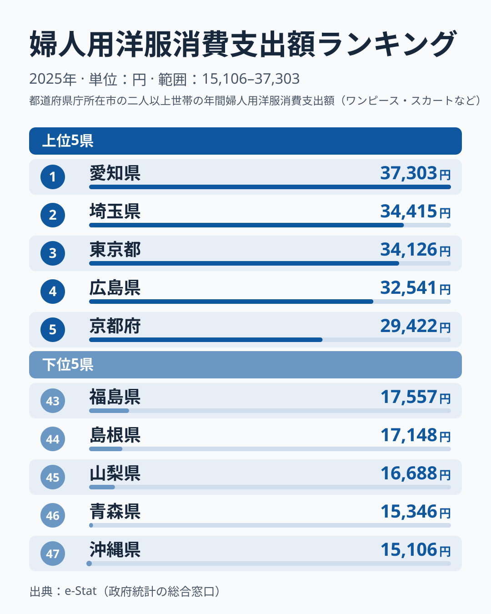
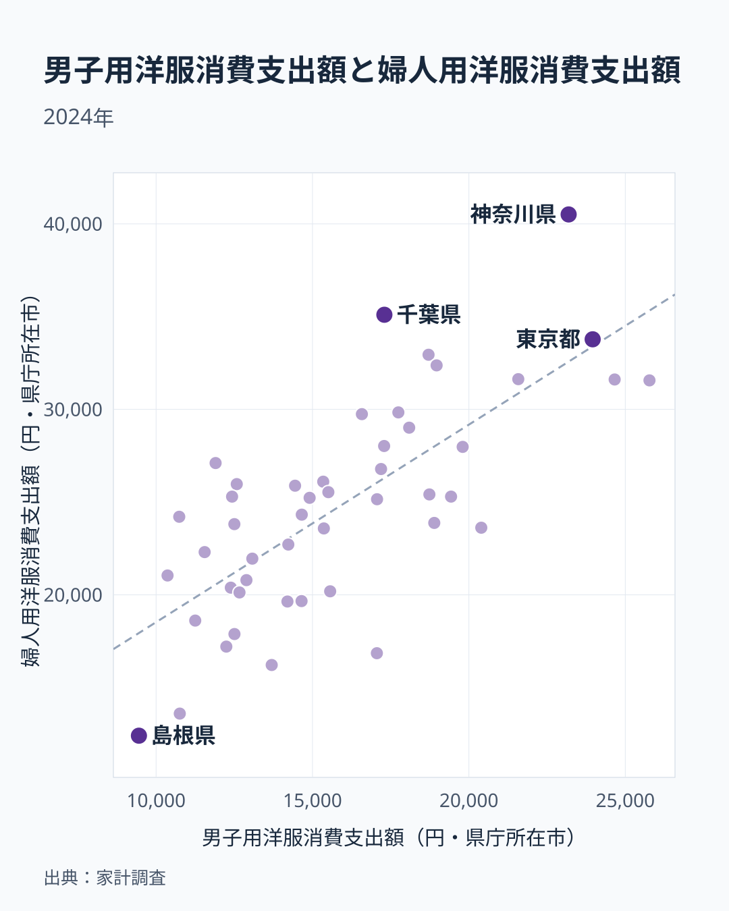

「服にお金をかける県はどこか」と聞かれたら、多くの人は東京や大阪を思い浮かべるかもしれません。ところが総務省「家計調査」（2025年）で婦人用洋服（ワンピース・スカートなど）の消費支出額を都道府県別に見ると、1位は愛知県で37,303円でした。東京都は3位で34,126円にとどまり、大阪府は24,669円で20位と、全国の真ん中より下です。2位は埼玉県で34,415円、最下位の沖縄県は15,106円で、1位の愛知県との差は約2.5倍になります。前年の首位だった神奈川県は、2025年は27,050円で13位まで下がりました。

この記事では、2025年のデータから婦人用洋服への支出がどの県で多く、どの県で少ないのかを読み、東京・愛知・大阪という三大都市圏の中でも位置が大きく分かれる点、首位の入れ替わりをどう受け止めるべきか、男性用洋服との関係までを順に見ていきます。

## 婦人用洋服消費支出額ランキング——上位5県と下位5県（2025年）

**上位5県**は[愛知](/areas/23000)が1位で37,303円、埼玉が2位で34,415円、東京が3位で34,126円、広島が4位で32,541円、京都が5位で29,422円という顔ぶれです。1位から5位までの幅は7,881円あり、1位の愛知県と、すぐ下の埼玉県との差は2,888円です。上位10県には埼玉・東京・千葉・茨城の関東4都県が入りますが、1位の愛知（中部）、4位の広島（中国）、5位の京都（近畿）、7位の熊本（九州）のように関東以外の県も並び、首都圏だけが高いという図式にはなりません。

**下位5県**は福島が43位で17,557円、島根が44位で17,148円、山梨が45位で16,688円、青森が46位で15,346円、沖縄が47位で15,106円です。43位から47位までの幅は2,451円で、上位5県の幅の3分の1に届きません。47県の中央値にあたる24位の鳥取県は22,338円で、愛知県はその約1.7倍、沖縄県は約0.7倍です。上位ほど差が開き、下位は横並びに近いという非対称が、このランキングの形です。

<source-link href="/ranking/womens-clothing-consumption-expenditure">婦人用洋服消費支出額の全47都道府県ランキングを見る</source-link>

> [!NOTE]
> 本データは総務省「家計調査」の県庁所在市の二人以上世帯を対象にした年間支出額です。単身世帯や町村部の消費は含まれないため、都道府県全体の実態とは異なる可能性があります。また指標は婦人用洋服（ワンピース・スカートなど）で、和服や下着は含みません。

## 三大都市圏でも位置が分かれる——東京・愛知・大阪

冒頭で触れたとおり、東京都・愛知県・大阪府は婦人用洋服の支出で大きく順位が分かれます。愛知県は37,303円で1位、[東京](/areas/13000)は34,126円で3位、[大阪](/areas/27000)は24,669円で20位です。東京都と愛知県の差は3,177円ですが、東京都と大阪府の差は9,457円あり、大阪府は愛知県と比べると13,000円近く低くなります。同じ大都市圏でも、婦人服への支出額は一様ではありません。

[神奈川](/areas/14000)は27,050円で13位、大阪府との差は2,381円で、首都圏の一角でありながら全国の上位10県には入りません。人口の多い大都市圏の県だからといって、婦人服への支出が自動的に大きくなるわけではないことが、この3県と神奈川県の並びから読み取れます。大阪府がなぜ低いのかは、このデータだけでは分かりません。県庁所在市という調査対象の狭さや、標本の年ごとのぶれが影響している可能性があります。

## 首位交代は構造変化か標本のぶれか

家計調査は標本調査で、都道府県別の単年の順位はぶれが大きくなります。前年に首位だった神奈川県が2025年は13位まで下がり、愛知県が1位になったという入れ替わりも、構造の変化というより年ごとの振れを含むと見るのが安全です。後述する散布図の2024年のデータでは、婦人用洋服の支出は神奈川県が40,509円で全国最高、愛知県は31,563円でした。それが2025年には神奈川県が27,050円へ、愛知県が37,303円へと、1年で大きく入れ替わっています。

この変動の大きさを見ると、1年の順位だけで「愛知県は婦人服にお金をかける県」「神奈川県はかけない県」と決めつけるのは危険です。愛知県の背景には、商業施設の集積や世帯の構成などが関わっている可能性がありますが、これらは [仮説] であり、本データには所得や店舗数の情報がないため確かめられません。確かなのは、世帯の婦人用洋服への年間支出が、県庁所在市ごとに最大で2.5倍、中位との比でも1.7倍開くという事実だけです。

> [!WARNING]
> 通信販売の普及により、店舗の有無と購買行動の関係は弱まっている可能性があります。家計調査は世帯の支出額を集計したもので、購入経路（実店舗かオンラインか）は区別していません。「店舗が少ないから支出が少ない」という因果関係は、本データだけでは確認できません。

## 下位5県は特定の地方に偏らない

下位5県の福島・島根・山梨・青森・沖縄は、東北、中国、中部、九州・沖縄にまたがっています。「地方だから低い」という単純な図式は成り立たず、同じ地方でも山形県は27,155円で12位、熊本県は28,505円で7位と、上位に入っています。最下位の沖縄県は15,106円で、2位の埼玉県の34,415円と比べると半分に届きません。沖縄県は気候が温暖で、冬物の衣料が少なくて済むことが支出を抑えている可能性がありますが、これも [仮説] で、本データでは検証できません。

## 男性用洋服との対比——婦人服と男性服の関係

婦人用洋服と男子用洋服（背広服・上着・ズボンなど）を県ごとにプロットした散布図は、下の図のとおりです。なお、この図の値は2024年のデータで、上のランキング（2025年）とは年が異なります。以下の説明は、2024年同士の比較として読んでください。

2024年の散布図から相関係数を計算すると約0.73で、婦人服への支出が多い県は男性服への支出も多い傾向があります。両方が高い県の代表は愛知県で、男性用洋服は25,773円で全国最高、婦人用洋服は31,563円でした。ただし散布図の点が全て同じ傾向に乗るわけではありません。2024年のデータで回帰直線を引くと、直線より婦人服が多い側に外れるのは千葉県、神奈川県、大阪府です。神奈川県は婦人用洋服が40,509円で全国最高でしたが、男性用洋服は23,189円で、愛知県や埼玉県、東京都より低い水準でした。大阪府は男性用洋服が11,902円と、最も低い部類の沖縄県の11,251円に近い低さで、婦人用洋服は27,106円でした。大阪府は男性服の支出が際立って低く、それに比べれば婦人服にはお金をかけている県といえます。

<source-link href="/ranking/mens-clothing-consumption-expenditure">男性用洋服消費支出額の全47都道府県ランキングを見る</source-link>

> [!TIP]
> 単年の順位は標本のぶれを含みます。特定の年の順位だけで地域の傾向を断定せず、2024年と2025年のように複数年を並べて見ると、より実態に近い見方ができます。

## まとめ

- 2025年の婦人用洋服消費支出額は、愛知県が37,303円で1位、沖縄県が15,106円で最下位で、差は約2.5倍です。
- 東京都は34,126円で3位ですが、大阪府は24,669円で20位、神奈川県は27,050円で13位と、大都市圏でも位置が分かれます。
- 上位5県の幅は7,881円、下位5県の幅は2,451円で、上位ほど差が開く形です。
- 前年首位の神奈川県は13位へ下がり、愛知県が首位に立ちました。単年の順位は標本のぶれを含みます。
- 所得や店舗数、気候との関係は [仮説] で、本データだけでは検証できません。

## データについて

総務省統計局「家計調査」（2025年、県庁所在市の二人以上世帯）をもとに、e-Stat 経由で取得したデータです。男性用洋服との散布図のみ2024年の値を用いています。
