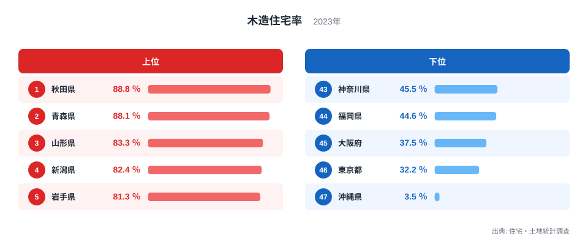
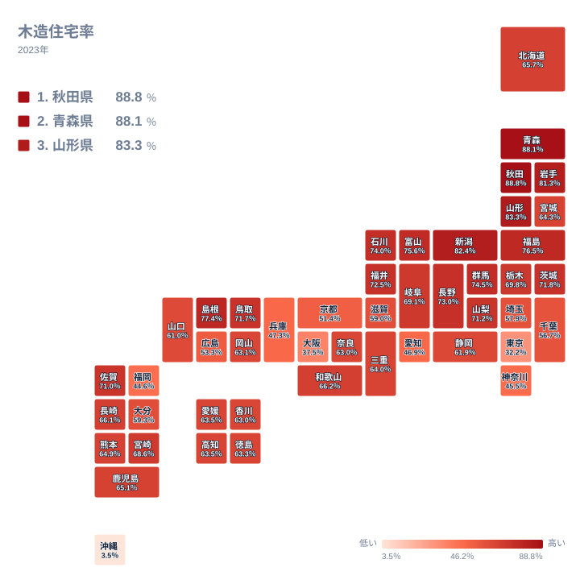

住宅の構造は、その土地の気候や産業、そして歴史の積み重ねを映す鏡のようなものです。全国で見ると、木造住宅の割合は県によって大きく開いています。2023年の調査で最も高かったのは秋田県で88.8％、最も低かったのは沖縄県で3.5％でした。同じ国の中で、住まいの素材がここまで違うのはなぜでしょうか。この記事では上位と下位の顔ぶれを確認し、その順位になる背景を、地理・産業構造・歴史の観点から仮説として考えていきます。

## 木造住宅率の上位と下位を確認する

まず、上位5県と下位5県を図で見てみましょう。

<source-link href="/ranking/wooden-housing-ratio">木造住宅率ランキングをもっと見る</source-link>

上位5県は、1位の秋田県が88.8％、2位の青森県が88.1％、3位の山形県が83.3％、4位の新潟県が82.4％、5位の岩手県が81.3％です。地方で分けると、東北の5県のうち4県までが占め、残る1県が新潟県です。新潟県は北陸に含める区分もあれば、含めない区分もありますが、いずれにしても上位は東北と、それに隣り合う日本海側の県で固まっています。

特に目を引くのは、1位と2位の近さです。秋田県の88.8％と青森県の88.1％の差はわずか0.7ポイントです。この水準では、順位の一つ違いに大きな意味を持たせない方が安全です。上位は、どの県も8割を超える高い水準で横並びになっているというのが実態に近い姿です。

下位は性格がまったく異なります。47位の沖縄県は3.5％で、他の県とは別の水準にあります。その上の46位は東京都の32.2％、45位は大阪府の37.5％です。さらに44位が福岡県の44.6％、43位が神奈川県の45.5％と続きます。下位は、大都市を抱える都府県と、沖縄県という独自の事情をもつ県に分かれて見えます。沖縄県と東京都のあいだにも、約29ポイントの開きがありますが、この差は両者の値の引き算であり、背景は別々に考える必要があります。

> [!NOTE]
> この指標は、住宅・土地統計調査で「木造」と分類された住宅が住宅全体に占める割合です。分類は建物の主な構造で決まるため、大手メーカーの鉄骨造のように、見た目が一般的な戸建てでも非木造に入る住宅があります。「戸建てが多い」ことと「木造が多い」ことは、同じ意味ではありません。

## 上位の東北で木造が多い理由を考える

東北に木造住宅が多い理由は、データだけでは検証できません。そのため、ここでは有力な仮説として整理します。

一つ目は、森林資源と木材産業です。秋田県は杉の産地として、青森県はヒバの産地として知られています。地元で木材が手に入りやすければ、住宅の材料に木を選びやすかったのではないかと考えられます。製材や大工の技術が地域に根づいてきたことも、木造が選ばれ続ける背景になっている可能性があります。

二つ目は、気候への適応です。冬の寒さや雪が厳しい地域では、断熱性に優れる木の家が好まれたり、雪の重みに耐える太い梁や柱を組む工法が発達したりしたと考えられます。山形県の83.3％、新潟県の82.4％、岩手県の81.3％という高さは、そうした事情と結びついているかもしれません。ただし、同じ雪国でも、後述するように北海道は上位に入っていません。気候だけで説明できるわけではないという点も重要です。

三つ目は、住まいの形です。戸建て住宅が中心の地域では、木造の割合が高くなりやすいという仮説が立てられます。マンションなどの共同住宅に鉄筋コンクリート造が多いとすれば、集合住宅が少ない地域ほど木造率が高く出る構図です。ただ、今回のデータには戸建て率が含まれていないため、この点は確認できていません。

詳しい数値は、[秋田県のデータ](/areas/05000)や[青森県のデータ](/areas/02000)のページで確認できます。ほかの指標と見比べることで、仮説を検討する材料が増えます。

> [!TIP]
> 木造住宅率が高い県は「古い木造の家が多い県」とは限りません。この指標は構造の種類の割合であり、住宅がいつ建てられたかは示していません。築年数や新築の多さと混同せず、別の統計と組み合わせて読むのがコツです。

## 下位は都市部と沖縄県で背景が異なる

下位に並ぶ東京都、大阪府、神奈川県、福岡県には、人口の集中する大都市を含むという共通点があります。土地に限りがある都市では、一つの敷地に多くの世帯を収める必要があるため、鉄筋コンクリート造や鉄骨造の集合住宅が増えやすいと考えられます。東京都の32.2％、大阪府の37.5％という低さは、そうした都市の住まいの姿を映している可能性があります。

歴史の面では、大都市は戦災を経験し、復興の過程で燃えにくい建物が重視されてきたことが影響したのかもしれません。防火地域の指定や建築基準の整備が進んだ結果、市街地では耐火性の高い構造が広がったという見方もあります。ただし、これらもこの記事のデータで確かめられたものではなく、仮説にとどまります。

沖縄県の3.5％は、都市化だけでは説明しにくい水準です。台風が多く、高温多湿でシロアリの被害も大きい気候に加え、戦後の歴史のなかでコンクリート造が広く普及したことが背景にあると、しばしば指摘されます。この記事では、これを可能性の一つとして紹介するにとどめます。

こうして見ると、下位は「都市化が進んだ都府県」と「独自の気候と歴史をもつ沖縄県」という、性格の異なる低さが並んでいると読めます。同じ低さでも、背景は別々に考える必要があります。

> [!WARNING]
> この指標は、住宅の「戸数」に占める木造の割合です。広さを表す延べ床面積や、そこに住む人数の割合ではありません。大きな集合住宅が1棟建つと戸数が一気に増えるため、都市部では木造の戸建てが多く残っていても、率としては低く出ることがあります。

## 地図で見る木造住宅率の地理分布

次に、地図上の分布を確認します。

地図から読み取れる最も大きなパターンは、東日本の北側で濃く、大都市圏で薄いという、全体の傾き方です。東北と北関東・甲信越にかけて、7割を超える県が連なっています。具体的には、福島県が76.5％、群馬県が74.5％、長野県が73％、茨城県が71.8％です。一方、東京都は32.2％、神奈川県は45.5％、愛知県は46.9％、大阪府は37.5％、兵庫県は47.3％と、人口の多い大都市圏では低くなっています。

このパターンは、「寒さ」だけでは説明がつかないことも示しています。北海道は65.7％で22位、寒冷な地域でありながら上位には入りません。札幌などの都市部で非木造の住宅が一定数あることが一因かもしれませんが、データからは確かめられません。気候、都市化の度合い、住宅の建て方など、複数の要素が重なって地図の濃淡が生まれていると見るのが穏当です。

## 上位と下位から見える日本の住まいの姿

ここまでの内容を整理しましょう。木造住宅率の差を生む要因として、次の三つの仮説が考えられます。

- 地理と資源: 豊富な森林があり、地元の木材を使いやすかった可能性
- 産業構造: 製材・大工の技術が根づき、戸建て中心の暮らしが続いた可能性
- 歴史と都市化: 戦災や復興、都市への人口集中で、非木造の集合住宅が増えた可能性

秋田県の88.8％や青森県の88.1％の高さは、これらが重なった結果である可能性がありますが、実際にどの要因がどれだけ効いているかは、この記事のデータだけでは分かりません。東京都の32.2％や大阪府の37.5％も、都市化と耐火性重視の流れが関わっていると考えられるにとどまります。

中位の県にも目を向けておきましょう。和歌山県は66.2％で20位、長崎県は66.1％で21位、三重県は64％で26位です。県の平均値は、山間部と平野部、市街地と農村部など、内部の多様さを一つの数字にまとめたものです。順位の近い県でも、中身が同じとは限りません。

住宅の構造は、災害対策や空き家問題といった政策課題とも結びつきます。数字の高低は、その地域がどんな課題に向き合うのかを考える手がかりになります。ほかの建設・住宅関連の指標とあわせて見たい方は、[同じカテゴリの統計一覧](/category/construction)をご覧ください。住宅の広さや築年数、持ち家の割合などと照らし合わせると、各県の住まいの全体像がいっそう立体的に見えてきます。

## データについて

この記事で使った木造住宅率は、住宅・土地統計調査の2023年の結果にもとづく、単位が％の指標です。住宅・土地統計調査は、住宅とそこに住む世帯の実態を把握するための調査です。全数を調べるのではなく、抽出した住宅などの回答から全体を推計する標本調査のため、数値には推計に伴う誤差が含まれます。

人口規模の小さい県では、標本の影響が相対的に大きくなりやすい点にも注意が必要です。順位が近い県どうしの差は、小さな違いにとどまる場合があります。大きな傾向をつかむために、上位グループと下位グループの違いに注目して読むことをおすすめします。
