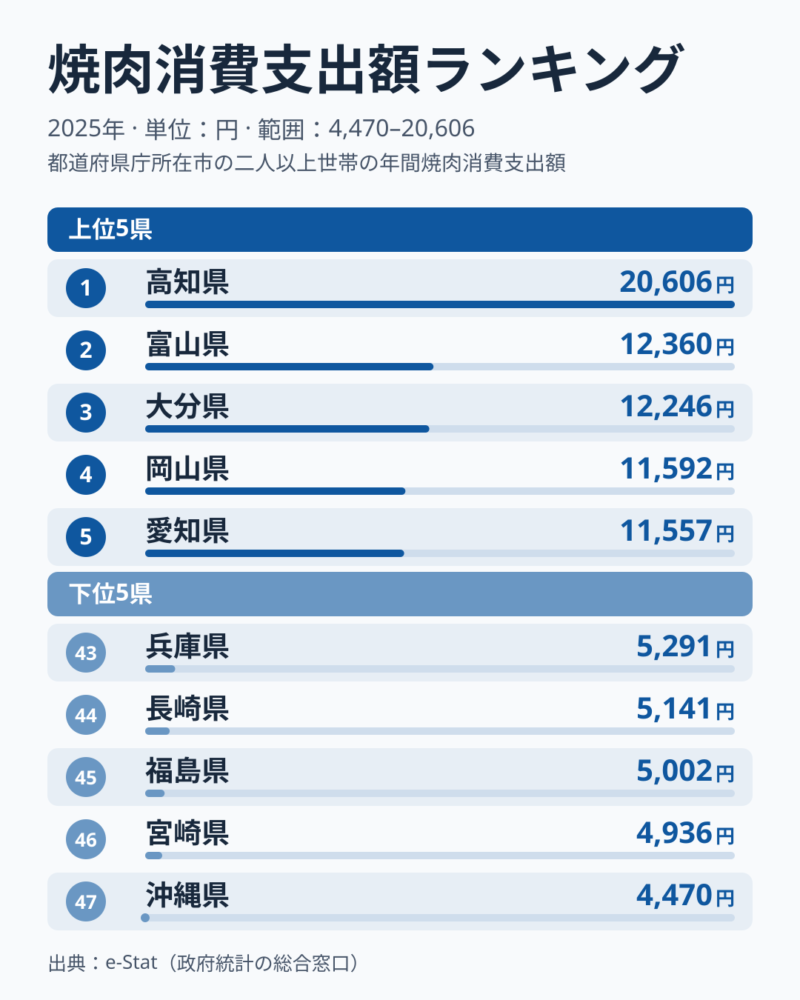

「同じ日本人でも、焼肉店に使うお金は住む県でここまで違う」──そう聞いて、どの県がトップだと思うでしょうか。焼肉の本場というイメージなら大阪か、あるいは黒毛和牛の産地の鹿児島・宮崎か。ですが2025年の家計調査が示した答えは、そのどちらでもありませんでした。

焼肉店での支出額（都道府県庁所在市の二人以上世帯の年間支出）の1位は**[高知](/areas/39000)の20,606円**でした。2位の富山は12,360円で、差は8,246円で、高知の金額は富山の約1.7倍という独走です。一方、最下位は**[沖縄](/areas/47000)の4,470円**で、1位と最下位の差は**4.61倍**にのぼります。47都道府県の中央に当たる24位は茨城の8,680円で、高知はその倍以上を焼肉店で使っている計算になります。

この記事では、焼肉店への支出が多い県・少ない県を順位ごとに並べたうえで、外食全体や牛肉の購入額と並べて「高知は外食好きなのか、焼肉だけが突出しているのか」を確かめます。なぜ高知なのかという理由までは、家計調査だけでは確定できません。その点は仮説として区別して書きます。

> [!NOTE]
> 本記事の数値は総務省「家計調査」の品目「焼肉」（2025年・暦年）の1世帯あたり年間支出額です。家計調査で「焼肉」は外食の食事代に分類され、焼肉店（自分で網で焼く店）での焼肉を伴った食事を指します。家庭で焼肉用の肉を買う支出ではありません。また都道府県全体ではなく**県庁所在市**の二人以上世帯の値です。

## 上位5と下位5

まず焼肉店への支出（ランキング上の指標名は「焼肉消費支出額」）の上位5県と下位5県を、家計調査のデータで見てみましょう。

突出しているのは高知の20,606円です。2位の富山は12,360円、3位の大分は12,246円で、高知は47都道府県のなかで唯一2万円台に乗っています。4位の岡山は11,592円、5位の愛知は11,557円で、2位から5位までは12,360円から11,557円の約800円幅に収まっています。この幅は1年分の値としてはほぼ横並びで、2位から5位の順位の違いは大きな意味を持たないと読むのが安全です。上位を広げて見ても、6位は熊本の11,397円、7位は埼玉の11,325円、8位は香川の11,064円、9位は山形の10,834円、10位は秋田の10,727円と、さまざまな地方が入り混じります。

つまり、焼肉店への支出が多い県には「西日本」「大都市圏」といった単純な共通項がありません。高知だけが別格で、そこから先は1万円台前半の団子状態というのがこのランキングの形です。

<source-link href="/ranking/yakiniku-consumption-expenditure">焼肉消費支出額ランキングをもっと見る</source-link>

> [!WARNING]
> 本記事の順位は2025年1年分の、県庁所在市の二人以上世帯の値です。県全体の傾向とは限らず、別の年でも同じ順位になるかはこのデータでは確かめられません。順位を「県民性」の確定証拠として読むのではなく、複数年で確かめる前の参考値として扱ってください。

## 焼肉店への支出が少ない県（下位グループ）

次に、焼肉店にあまりお金を使わない県を見てみましょう。最下位は沖縄の4,470円で、トップの高知の20,606円と比べると4.61倍の開きがあります。47都道府県のなかで唯一4,500円を下回りました。続く宮崎の4,936円、福島の5,002円、長崎の5,141円、兵庫の5,291円も5,000円前後に固まっています。

下位5県は九州・沖縄（沖縄・宮崎・長崎）と東北の福島、近畿の兵庫で、地域がばらばらです。同じ東北でも山形は9位、秋田は10位に入る一方、福島は45位に沈み、同じ近畿でも京都は32位、兵庫は43位と、地域の内側でも順位が大きく割れています。42位の岩手、41位の栃木、40位の新潟まで下位を広げても、共通する地域は見えてきません。

沖縄や宮崎、長崎の低さについては、[仮説]として、外食の中身が焼肉以外（沖縄そば、宮崎の郷土料理、長崎のちゃんぽんなど）に向いている可能性があります。ただし本データは焼肉の支出額だけで、他の外食品目との比較や店舗密度の裏づけは取っていないため、検証が必要な推測にとどまります。

## 発見: 大都市かどうかでは順位が決まらない

このデータから読み取れる最大の発見は、**焼肉店への支出は「大都市ほど高い」「大都市ほど低い」のどちらの図式にも収まらない**ことです。

大都市を抱える都道府県を並べると、愛知は5位で11,557円、東京は11位で10,721円、大阪は13位で10,083円と15位以内に入っています。ところが神奈川は31位で7,761円、福岡は33位で7,390円、北海道は28位で8,184円、宮城は29位で7,866円、京都は32位で7,728円、兵庫は43位で5,291円と、中位以下に並びます。大都市の県庁所在市という条件が同じでも、東京・大阪・愛知が上位、神奈川・福岡・北海道が中位以下と割れるため、大都市であることは順位の説明になりません。

ほかに2025年の特徴として、7位の埼玉は11,325円で、大都市に隣接するベッドタウン県でありながら上位に入っています。一方、黒毛和牛の産地として知られる鹿児島は27位で8,323円、宮崎は46位で4,936円と、ブランド牛の産地だから焼肉店への支出が多いとは限らないことがわかります。産地の評判と、住民が焼肉店に払う金額は別の話です。

## 高知は外食好きなのか、焼肉だけが突出しているのか

では、なぜ高知だけが群を抜くのでしょうか。まず確かめられる範囲を絞ると、「高知は外食全体の支出が多いだけ」という見方は成り立ちません。同じ家計調査の外食消費支出額（一般外食と学校給食を合わせた年間額）で見ると、高知は202,138円で全国13番目、1位の東京は307,023円で、外食全体では上位ではあるものの突出はしていません。外食に占める焼肉店の割合を計算すると、高知は20,606円÷202,138円で約10.2%、東京は10,721円÷307,023円で約3.5%です。外食をたくさんするから焼肉店も多いのではなく、高知は外食のなかで焼肉店に回る割合が際立って高いことになります。

家庭で買う牛肉との対比でも、焼肉店の突出は見えます。牛肉の購入額（牛肉消費支出額）では高知は20,764円で全国28番目、1位の京都は41,258円です。焼肉店への支出は全国1位なのに、家庭の牛肉購入は中位にとどまります。肉そのものへの支出が多いのではなく、焼肉店という外食の場面に支出が集まっていると読めます。

あわせて見る: [外食消費支出額ランキング](/ranking/dining-out-consumption-expenditure) / [牛肉消費支出額ランキング](/ranking/beef-consumption-expenditure)

> [!TIP]
> [仮説] 高知は「皿鉢（さわち）料理」に代表される、人が集まって大皿を囲む宴会文化で知られます。焼肉店での会食とこの習慣が相性よく、外食の集まりが焼肉店に向かいやすいのかもしれません。ただし家計調査だけでは裏づけにならず、会食の頻度や店舗数のデータと突き合わせる必要があります。

## まとめ

- **1位は高知の20,606円**。2位富山の12,360円を8,246円上回り、唯一の2万円台。最下位は沖縄の4,470円で、差は**4.61倍**です。
- 高知の外食全体は全国13番目、家庭の牛肉購入は28番目で、突出しているのは焼肉店への支出だけです。
- 愛知5位・東京11位・大阪13位に対し、神奈川31位・福岡33位・北海道28位と、大都市であるかどうかでは順位を説明できません。
