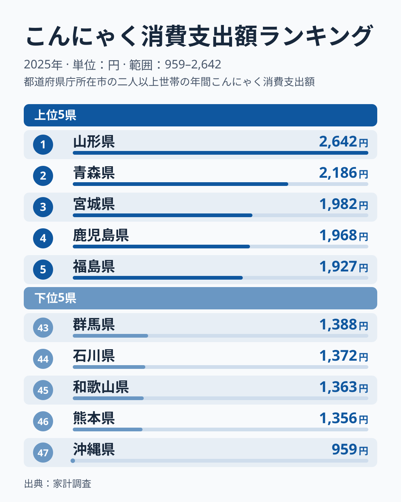
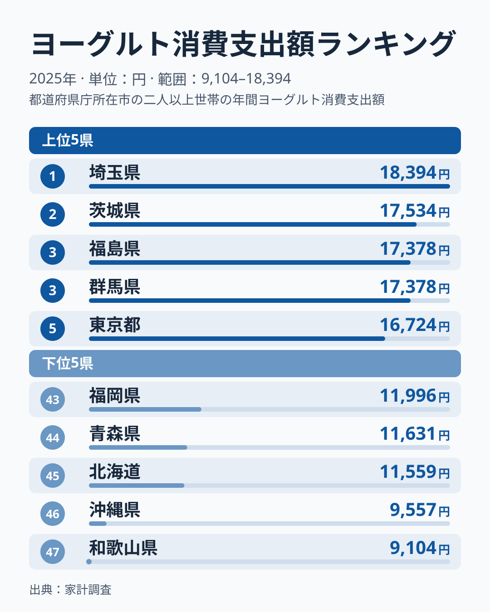
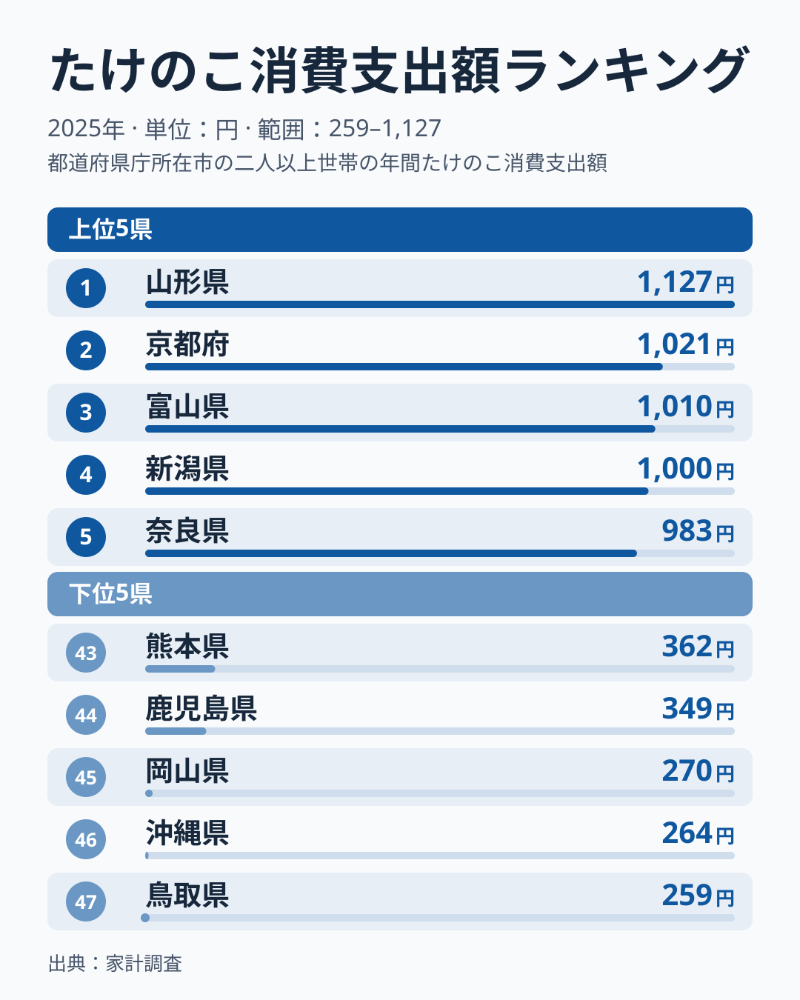
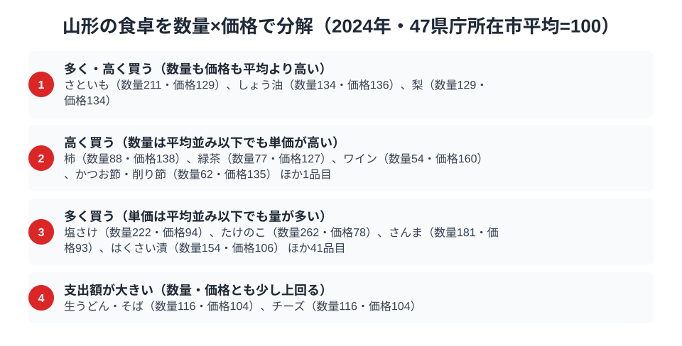

さくらんぼで知られる山形県ですが、家計調査が映し出す食卓の主役は少し意外な顔ぶれです。総務省の家計調査（品目別）で山形市の二人以上世帯を見ると、2025年はこんにゃくとたけのこの2品目で山形が全国1位に立っています。ヨーグルトは11位ですが、上位に近い水準です。

芋煮に欠かせないこんにゃく、健康志向を映すヨーグルト、そして山の恵みのたけのこ。海に面しない山形県ならではの、大地と山の食文化がここに表れています。この記事では、3つの品目を横断しながら、山形県民の食卓を読み解きます。

> [!NOTE]
> 家計調査の都道府県データは、県庁所在市（山形県は山形市）の二人以上世帯を対象にした年間支出額です。県全体ではなく山形市在住世帯の家計簿から見た傾向であり、支出「金額」であって消費「量」そのものではない点にご注意ください。単年の順位はぶれが大きいため、ここで述べる理由は仮説です。

## こんにゃく — 全国1位2,642円、芋煮の主役

<source-link href="/ranking/konnyaku-consumption-expenditure">こんにゃく消費支出額ランキングをもっと見る</source-link>

山形県のこんにゃく消費支出額は2,642円で全国1位です。2位は青森県で2,186円でした。山形といえば秋の「芋煮会」。里芋・こんにゃく・牛肉・ねぎを大鍋で煮る芋煮は、河川敷に家族や仲間が集まって楽しむ山形の一大行事です。

芋煮に欠かせないこんにゃくに加え、山形には「玉こんにゃく」を串に刺して煮込む名物もあります。[仮説] 芋煮文化と玉こんにゃくという二つの食習慣が、こんにゃくの支出額の高さを支えている可能性があります。[こんにゃく消費支出の記事](/blog/konnyaku-expenditure-ranking)でも山形の突出ぶりを扱っています。

## ヨーグルト — 15,743円で11位、上位に近い水準

<source-link href="/ranking/yogurt-consumption-expenditure">ヨーグルト消費支出額ランキングをもっと見る</source-link>

2025年のヨーグルトの消費支出額は、山形県が15,743円で11位でした。1位は埼玉県の18,394円、2位は茨城県の17,534円です。以前の首位からは離れましたが、47位の和歌山県9,104円と比べると、山形は上位グループに入っています。

山形は果物王国として知られ、ヨーグルトは果物と合わせて食べられることも多いため、[仮説] フルーツ文化とヨーグルト消費が結びついている可能性があります。朝食を重視する家庭が多いことも背景として考えられますが、データから確かめられるものではありません。

## たけのこ — 全国1位1,127円、山の恵み

<source-link href="/ranking/bamboo-shoot-consumption-expenditure">たけのこ消費支出額ランキングをもっと見る</source-link>

山の幸でも山形は全国トップです。たけのこの消費支出額は山形県が1,127円で全国1位。2位は京都府で1,021円でした。山に囲まれた山形では、春になると山菜やたけのこを採り、食卓に取り入れる文化が根づいていると言われます。

たけのこの煮物や炊き込みご飯、山菜と合わせた郷土料理など、季節の山の恵みを大切にする食習慣が、たけのこの高い支出額を支えている可能性があります。

> [!WARNING]
> 山形名産のさくらんぼや山菜の一部は、家計調査の主要品目として個別に集計されていません。そのため、ここで紹介した3品目のランキングだけでは、山形の食文化の全体像は測れない点にご注意ください。

## 山形の食卓を貫くもの

山形県民の食卓を貫くのは、「大地と山が育む食文化」という見方です。芋煮のこんにゃく、果物文化と結びついたヨーグルト、山の恵みのたけのこ。海に面しない県であることから、大地の作物・山菜・乳製品への支出が厚くなると考えられます。

海の幸が中心の県と並べると、山形は「大地・山・乳製品型」といえそうです。海の有無という地理条件が食卓の骨格に関わっているかもしれません。ただし単年の値なので、断定はできません。

山形のように海に面しない県では、山菜・こんにゃく・乳製品といった「山と大地の食材」への支出が厚くなる可能性があります。海の幸の順位だけでなく、山の幸・農産物の順位も見ると、食文化の豊かさが見えてきます。

## 数量×価格で分解する山形市の食卓

<source-link href="/ranking/taro-consumption-quantity">さといも消費量ランキングをもっと見る</source-link>

家計調査は品目ごとに支出額だけでなく数量も調べています。両方を組み合わせ、47都道府県庁所在市の平均を100とする指数に直すと、山形市がその品目を「多く買っている」のか「高く買っている」のかを切り分けられます。2025年のデータでは、さといもが数量指数139・価格指数143、ワインが数量指数122・価格指数123と、量も単価も平均を上回っています。芋煮の主役であるこんにゃくと並んで、さといもも山形の食卓で量と単価の両面から目立つ品目です。しょう油も数量指数118・価格指数118と同じ傾向にあり、味付けそのものを多く使う食文化がうかがえます。

反対に、紅茶は数量指数88・価格指数136、小麦粉は数量指数73・価格指数130と、買う量は平均以下でも単価が高い品目です。はくさい漬も数量指数100・価格指数124で、単価の高さが目立ちます。量は少なくても単価が高い背景には、質の高いものを選んで買う層の存在が考えられます。一方で、たけのこは数量指数199・価格指数92、あさりは数量指数181・価格指数92と、多く買う一方で単価は平均より低くなっています。ほたて貝は数量指数174・価格指数115、オレンジは数量指数173・価格指数107です。たけのこの全国1位も、高級品としてではなく、日常的に多く消費される山の恵みとしての1位だとわかります。

なお、こんにゃくとヨーグルトは支出額の統計はあっても数量の統計が家計調査に無いため、同じ切り分けはできません。この2品目が量によるものか単価によるものかは、今後のデータ拡充を待つ必要があります。

> [!TIP]
> 支出額の順位だけでは、「たくさん食べているから上位」なのか「高いものを買っているから上位」なのかは分かりません。数量指数と価格指数に分解すると、さといもやワインのように量も単価も高い品目と、紅茶や小麦粉のように単価が高い品目、たけのこやあさりのように量で支出額を押し上げている品目を見分けられます。この指数は47県庁所在市の単純平均を100とした値で、価格指数には買っている品種やブランドの違いも含まれます。

## まとめ

- こんにゃく消費支出額は山形県が全国1位（2,642円）、芋煮と玉こんにゃくの食文化
- ヨーグルトは15,743円で11位、1位は埼玉県の18,394円
- たけのこは山形県が全国1位（1,127円）、山の恵み
- 数量×価格で分解すると、たけのこは量で稼ぐ品目（数量指数199・価格指数92）、さといもとワインは量も単価も高い品目とわかる
- 海に面しない県ゆえの大地・山・乳製品への支出が、山形の豊かな食卓を支えている可能性がある

山形県の他の統計は[山形県の地域プロフィール](/areas/06000)、食品・家計消費の地域差は[経済カテゴリ一覧](/category/economy)からご覧いただけます。
