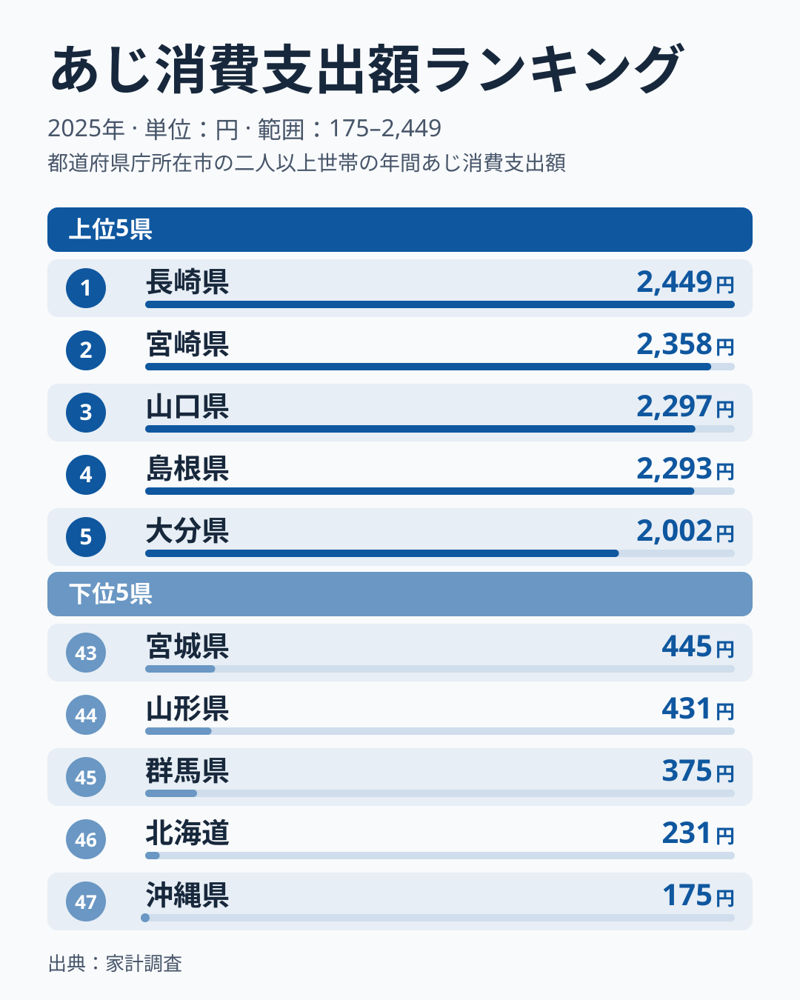
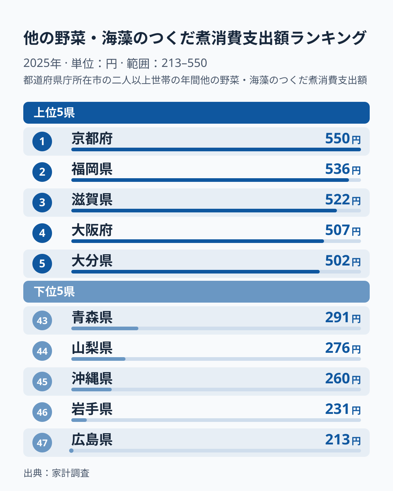
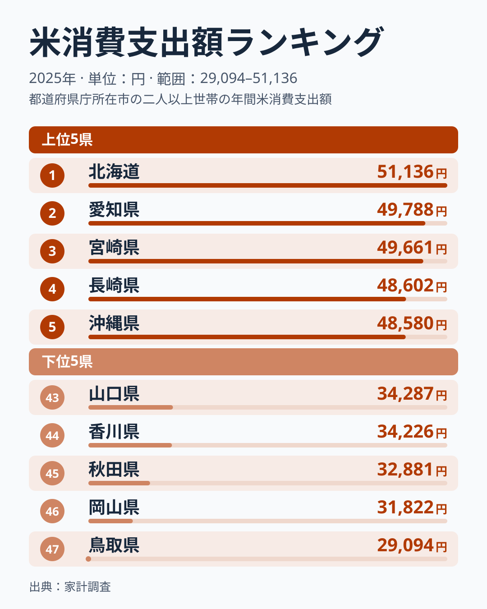
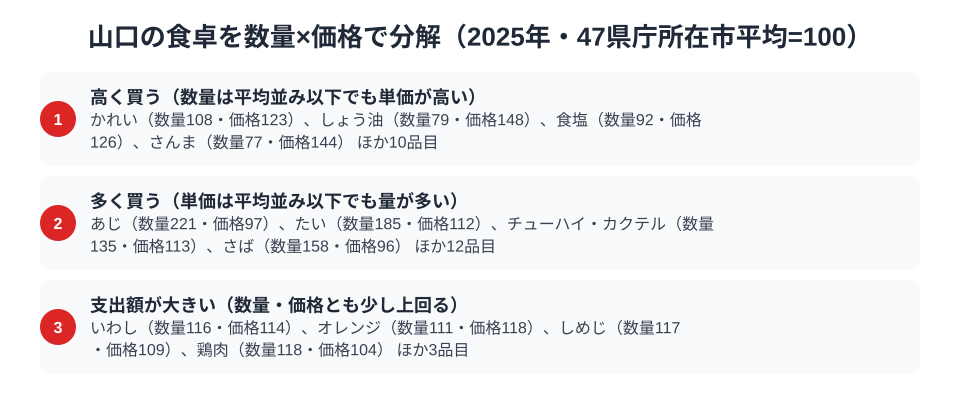

瀬戸内海と日本海の両方に面する山口県は、魚を新鮮なまま食卓に運べる立地に恵まれていると考えられます。実際に家計調査を見ると、山口市はあじの消費支出額で全国3位、佃煮でも全国6位と、魚介まわりの支出が上位に並びます。

ところが同じ家計調査で主食の米を見ると、山口市は全国43位という下位のグループに入っています。魚は上位なのに、米は下位。ただし「魚をよく買う県は米を買わない」とまとめられるわけではありません。あじで1位の長崎県と2位の宮崎県は、米でもそれぞれ4位と3位に入っているからです。「魚が多いと米は少ない」と言えるのかを、3つの品目と数量・価格の分解から見ていきます。

> [!NOTE]
> 家計調査の数値はすべて山口県の県庁所在市（山口市）の二人以上世帯における2025年の年間消費支出額です。県全体の平均ではありません。標本が小さい市別の値は単年のぶれが大きく、近い順位の県どうしは1年違えば入れ替わりうる点に注意してください。

## あじ — 全国3位2,297円、1位長崎とは152円差

<source-link href="/ranking/horse-mackerel-consumption-expenditure">あじ消費支出額ランキングをもっと見る</source-link>

山口はあじの消費支出額が2,297円で全国3位です。1位の長崎県は2,449円、2位の宮崎県は2,358円で、山口との差はそれぞれ152円と61円にとどまります。4位の島根県は2,293円と山口とわずか4円差で、5位の大分県は2,002円と、ここから約300円開きます。最下位は沖縄県の175円で、1位の長崎とは約14倍の差があります。

上位5県は長崎・宮崎・山口・島根・大分と、九州・沖縄の3県と中国の2県にまたがる西日本に固まっています。山口は「あじ日本一の県」ではなく、あじをよく買う西日本のかたまりの一員だと見るのが実態に近いでしょう。家計調査の市別の値は標本が小さく単年のぶれが大きいため、山口と島根の4円差のように、1年違えば順位が入れ替わる範囲です。順位そのものより、上位集団に位置していることを読み取るのが適切です。

[仮説] 山口が上位に来る理由は、瀬戸内海と日本海という2つの漁場が近く、あじを手に入れやすい環境にあることかもしれません。ただし後述のとおり、山口市のあじの単価は平均並みで、鮮度による割高さは数値には表れていません。そのため、近海で獲れることは「高く買う」理由ではなく「量を多く買う」理由として働いている可能性にとどまります。検証するには、あじの購入先（鮮魚店・スーパー・直売所）や、県内の漁港別の水揚げ量との突き合わせが必要です。下位では北海道が46位の231円、沖縄が47位の175円と、寒流域や南の島では、あじより鮭やほっけ、近海の別の魚種が食卓の主役になっているのかもしれません。

## 他の野菜・海藻のつくだ煮 — 全国6位489円、1位は京都

<source-link href="/ranking/vegetable-seaweed-tsukudani-consumption-expenditure">他の野菜・海藻のつくだ煮消費支出額ランキングをもっと見る</source-link>

つくだ煮の消費支出額は、山口が489円で全国6位です。1位は京都府の550円、2位は福岡県の536円、3位は滋賀県の522円、4位は大阪府の507円、5位は大分県の502円で、山口は5位の大分と13円差の位置にいます。最下位は広島県の213円で、1位の京都とは約2.6倍の開きです。

注目したいのは、瀬戸内海沿岸の県が必ずしも上位ではないことです。香川県は25位の370円、岡山県は35位の332円、兵庫県は36位の331円、愛媛県は37位の329円で、広島県に至っては最下位です。「瀬戸内海苔の伝統」で山口の順位を説明することはできません。上位の福岡・大分と、6位の山口が近い位置にあることから、[仮説] 地続きの北部九州と山口で、日持ちする常備菜としての佃煮の習慣が近い可能性があります。この仮説を確かめるには、県庁所在市ごとの購入店舗や品目内訳を別の統計で見る必要があります。

対照的に沖縄は45位の260円です。[仮説] 昆布の消費に独自の食文化がある一方で、つくだ煮という調理形態が本土ほど日常的でないことが下位の一因かもしれません。

> [!WARNING]
> この指標の品目は「他の野菜・海藻のつくだ煮」です。あさりなど魚介のつくだ煮や、こんぶのつくだ煮が別の区分に入る可能性があるため、この順位だけで「佃煮全体をよく買う県」とは言えません。

## 米 — 全国43位34,287円、あじの上位県でも差がある

<source-link href="/ranking/rice-consumption-expenditure">米消費支出額ランキングをもっと見る</source-link>

米の消費支出額は、山口が34,287円で全国43位です。1位は北海道の51,136円、2位は愛知県の49,788円、3位は宮崎県の49,661円で、山口は上位の県と比べて明らかに低い水準です。下位は43位の山口に続き、44位の香川県が34,226円、45位の秋田県が32,881円、46位の岡山県が31,822円、最下位の鳥取県が29,094円です。1位の北海道51,136円と最下位の鳥取県29,094円の比は約1.8倍で、あじ（約14倍）やつくだ煮（約2.6倍）に比べると、米は県による差が小さい品目です。

ここで「魚におかず予算が集中するから、米への支出が抑えられる」という単純な説明を、あじの上位県と並べて検証してみます。あじ3位の山口は米43位、あじ4位の島根県も米42位（34,469円）で、確かに米の支出は少なめです。しかしあじ1位の長崎県は米4位（48,602円）、2位の宮崎県は米3位（49,661円）と、魚も米も上位に入っています。あじ5位の大分県は米24位（40,836円）、6位の佐賀県は米29位で、あじの多さと米の少なさに一貫した関係は見られません。

つまり、あじ上位の県は、山口・島根のように米が低いグループと、長崎・宮崎のように米も高いグループに分かれます。山口と島根の米の低さは、魚の多さだけでは説明できません。[仮説] 家計調査の支出額は購入した分だけを数えるため、自家産の米や親族からもらう米が多い世帯が多い地域では、購入額が実際の消費より小さく出ている可能性があります。ただし、山口でそれが当てはまるかを示すデータは、この記事の範囲にはありません。検証には、家計調査以外の米の流通・消費に関する統計が必要です。

## 山口の食卓を貫くもの

あじが3位、つくだ煮が6位という結果が示すのは、山口の食卓の中で魚介まわりの支出が全国でも上位に位置していることです。ただし、あじは長崎・宮崎・島根など西日本の県と上位を分け合っており、山口だけが突出しているわけではありません。つくだ煮も、同じ瀬戸内海沿岸の広島は最下位、愛媛は37位と上位ではなく、上位には福岡や大分、さらに京都や滋賀、大阪が並びます。

一方で米は、魚介の多さと引き換えに少ないというより、魚介が多い県の中でも山口と島根は低く、長崎と宮崎は高いという二つのグループに分かれます。山口の食卓の特徴は「魚介が上位で、主食の米が下位」という組み合わせの珍しさにあります。

> [!TIP]
> あじとつくだ煮がともに上位という組み合わせは、素材をそのまま食べる調理法と、加工して保存する調理法の両方が根付いている可能性を示します。1つの食材の消費額だけでなく、加工品の消費額もあわせて見ると、その県の「魚とのつきあい方」が見えてきます。

山口県の他の統計指標は[山口県の地域プロフィール](/areas/35000)でまとめて確認できます。家計調査に基づく他の消費支出データは[経済カテゴリ一覧](/category/economy)からたどれます。魚介を軸にした食文化という点では[高知の食卓｜かつお日本一でみかん最下位の謎](/blog/kochi-food-culture)や、あじも米も上位の宮崎県を扱った[宮崎の食卓｜焼酎日本一、でもほたては最下位?](/blog/miyazaki-food-culture)もあわせて読むと、地域ごとの主食とおかずの配分の違いが見えてきます。

## 数量×価格で分解する山口市の食卓

<source-link href="/ranking/horse-mackerel-consumption-quantity">あじ消費量ランキングをもっと見る</source-link>

ここまで見てきたあじや米の支出額は、「数量×価格」に分解するともう一段深い山口市の食卓が見えてきます。47県庁所在市の平均を100とした指数で比べると、あじ消費量は数量指数が221と平均の2倍を超える一方、価格指数は97で平均をわずかに下回ります。つまり山口市のあじ支出が上位なのは単価が高いからではなく、買う量そのものが多いからです。支出額3位を支えているのは「量を多く買う」という消費行動であることが読み取れます。

同じ「多く買う」区分には、たい（数量185・価格112）、さば（数量158・価格96）など魚介品目が並び、あじと同じ傾向を示します。一方「高く買う」区分には、かれい（数量108・価格123）、さんま（数量77・価格144）、しょう油（数量79・価格148）、食塩（数量92・価格126）など、量は平均並みか少なくても単価が平均を上回る品目が入り、あじとは性格が異なります。なお数量も価格も高い「多く・高く買う」品目は、2025年は該当がありませんでした。

> [!TIP]
> 支出額だけを見ると「たくさん買っているのか、高いものを買っているのか」は区別できません。数量指数と価格指数をセットで見ると、あじのように量で稼ぐ品目と、かれいやさんま、しょう油のように単価で稼ぐ品目の違いが分かります。

米の支出額が43位まで下がっている背景として、[仮説] 山口市の世帯が、量をやや控えめにしつつ、比較的安い銘柄や大袋・特売の米を選んでいる可能性があります。ただし、今回の data には米の数量指数・価格指数が含まれていないため、この点は数値では確認できません。

主食の代わりに麺やパンを多く食べているかどうかも、今回の data からは確かめられません。[仮説] 米の支出差を説明する要因は、主食の置き換えだけでなく、購入の仕方や自家消費の有無など複数あると考えられます。

> [!NOTE]
> ここでの指数は家計調査の全国値ではなく、47都道府県庁所在市（山口市を含む）の単純平均を100とした値です。価格指数は品種やブランドの違いを含んだ平均単価から算出しており、産地や鮮度による差を分離していません。対象は二人以上世帯の2025年の年間消費です。

## まとめ

- あじの消費支出額は2,297円で全国3位。1位の長崎県とは152円差で、上位5県は九州・沖縄と中国の西日本に集中
- 他の野菜・海藻のつくだ煮の消費支出額は489円で全国6位。瀬戸内の広島は最下位、愛媛は37位で、瀬戸内海沿岸だから高いとは言えない
- 米の消費支出額は34,287円で全国43位。あじ1位・2位の長崎・宮崎は米も上位で、魚が多いから米が少ないとは言えない
- 数量×価格では、あじは量（指数221）で上位。単価（97）は平均をわずかに下回る
